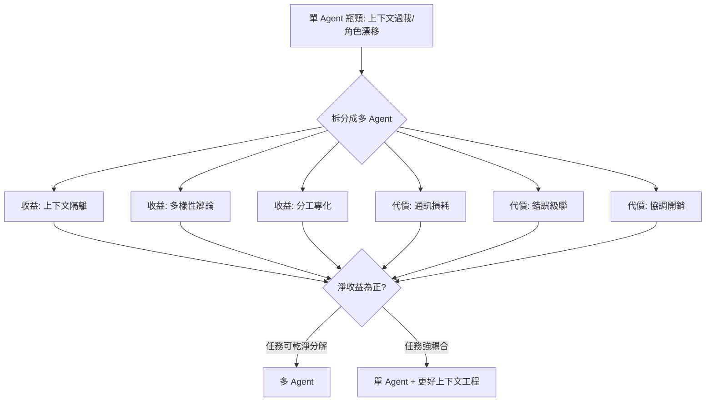

# 6.1 多 Agent 協作的理論基礎：從 MAS 到 Society of Mind（1980-2026）

## 一、歷史背景：為什麼「一個 Agent」不夠？

前面各章的主角都是「單一 Agent」。但 2023 年 AutoGPT 的教訓之一是：**單一 LLM 在長程任務中會「累昏」**——上下文越堆越長，注意力被稀釋，角色漂移（忘了自己該幹嘛），錯誤層層累積。工程師直覺地找到的解法是「拆」：把任務拆給多個各司其職的 Agent。但這個直覺背後有深厚的理論傳統——多 Agent 系統（MAS）在 1980 年代就是獨立的研究領域。

本節的目的，是把 2023-2026 年的多 Agent 工程實踐（第 6.2 節）放在四十年的理論地圖上：哪些老問題被 LLM 重新發明？哪些老教訓被重新踩坑？

## 二、理論源流一：分散式 AI 與理性協商（1980s）

### 2.1 從 DAI 到 MAS

1980 年，分布式人工智慧（DAI）在 MIT 的分布式感測器問題（Distributed Sensor Networks workshop）上首次被系統提出。其核心問題：**多個有限能力的節點如何透過通訊與協調，完成單點無法完成的任務**。

兩條分支隨即分化：

- **分散式問題求解（DPS）**：合作求解（如感測網路融合）；
- **多 Agent 系統（MAS）**：強調 Agent 的自主性（autonomy）——每個 Agent 有自己的目標，甚至互相競爭。

Rosenschein 與 Genesereth 的「理性協商」理論（1980s）把賽局理論引入 MAS：Agent 是自利的效用最大化者，協作必須透過**機制設計**（mechanism design）誘導。合同網協議（Contract Net Protocol, Smith 1980）是第一個著名成果：任務管理者廣播招標、承包者投標、管理者評標授予——**這是 2023 年多 Agent 框架中 orchestrator-worker 模式的直接祖先**。

### 2.2 FIPA 與標準化的早年教訓

1990 年代 MAS 學界大力推動標準：KQML（知識查詢與操作語言）、FIPA-ACL（Agent 通訊語言）、以及 BDI 平台（JADE、Jack）。這些標準學術上精美、工程上遇冷——因為當年根本沒有足夠聰明的 Agent 來「說這些語言」。**教訓：通訊協議的價值取決於節點的智慧水準**。有趣的是，2024 年 MCP 與 A2A 的成功恰好是這個教訓的反證——LLM 夠聰明了，協議才終於有了用武之地。

## 三、理論源流二：Society of Mind（1986）

Minsky 在《The Society of Mind》中提出一個影響深遠的認知模型：

> **心智不是一個單一系統，而是大量簡單「智能體（agents-of-mind）」的社會；每個 agent 只會做極簡單的事，智慧來自它們的互動組織。**

幾個關鍵概念：

- **Agent（心智內的）**：執行最基本功能的過程（識別邊緣、比較長度）；
- **K-line（K 線）**：記錄「上次成功解決此類問題時啟用了哪些 agent」的記憶結構——下次遇到類似問題按圖索驥激活同一組合；
- **Frame（框架）**：組織知識的預設結構。

對 LLM 時代的啟示驚人地精準：

1. **GPT 本身就是 Society of Mind 的實例**——內部是成千上萬的神經迴路（可解釋性研究稱之為 features），單個 feature 只做簡單模式識別，組合湧現出能力；
2. **多 Agent 系統是它在軟體層的複刻**——把「一個大模型什麼都管」拆成「多個專職 Agent 互相調用」，每個都是簡單的 K-line 式組合；
3. **上下文工程 = Frame 構造**——系統提示詞給模型搭好「預期結構」，正是 Minsky 所說的框架。

## 四、MAS 的理論工具箱

### 4.1 組織結構學

MAS 研究早就為「Agent 們如何組織」給出了類型學，2023-2026 年的框架全部落入這些模式：

| 結構 | 描述 | 2020s 對應 |
|------|------|-----------|
| 階層式 | 管理者分解任務、下屬執行 | orchestrator-worker（Claude Code 子 Agent、CrewAI hierarchical） |
| 平權式 | 對等協商、合議 | 辯論式（multi-agent debate）、群聊式（AutoGen group chat） |
| 市場式 | 招標-投標-授標 | Contract Net 的 LLM 版 |
| 流水線 | 固定順序傳遞產物 | 翻譯→審校→潤色的 pipeline |
| 競爭式 | 多方案互競、裁判擇優 | generator-critic、最佳-of-N |

### 4.2 為什麼多 Agent 有時更好：三個機理

1. **上下文隔離**：每個 Agent 只背負自己任務的上下文，避免「迷失在中間」與角色漂移——這是最重要的工程機理，本質上是用空間（多個窗口）換取注意力品質；
2. **多樣性與辯論**：獨立取樣的多個 Agent 意見不同，辯論能暴露單體的盲點——Du et al.（2023）證明多模型辯論可提升推理與事實性；Self-Consistency 的「互通版」；
3. **分工與專化**：為子任務配不同模型/提示詞/工具（便宜模型做初稿、強模型做審查），優化成本品質曲線。

### 4.3 為什麼多 Agent 常常更糟：三個陷阱

1. **通訊損耗**：Agent 間傳遞的是自然語言，每跳都有資訊損失與失真（ telephone game 效應）；
2. **錯誤級聯**：上游一個誤解被下游放大，且無人「看見全局」——全局視野分散在各 Agent 的局部上下文中；
3. **協調開銷**：token 成本數倍增長，延遲疊加；「沒人負責」的責任真空。研究普遍發現：**盲目堆 Agent 數量，效果常常不升反降**——多 Agent 是一項需要理由的設計決策，不是免費午餐。

### 4.4 賽局視角：Agent 社會的博弈

一旦 Agent 有獨立目標，賽局理論的全部難題復活：

- **囚徒困境**：兩個自利 Agent 協作還是背叛？（博弈論 LLM 實驗顯示 GPT 系模型能對情境做出近似理性反應）；
- **機制設計**：如何設計「獎勵/評分規則」使自利 Agent 的均衡就是集體最優——這正是 multi-agent RLHF 與辯論評分的理論基礎；
- **共識與投票**：多 Agent 意見不一致時的裁決機制（多數決、加權、裁判 Agent）。

## 五、形式化視角：MAS 作為分布式系統

從電腦科學看，MAS 就是一個分布式系統，經典難題全部適用：

$$
\text{系統輸出} = f(\text{各 Agent 輸出}, \text{通訊拓撲}, \text{合併機制})
$$

- **一致性問題**：多 Agent 對「事實」的共識（幻覺在多跳傳播中如何被放大或糾正）；
- **容錯**：一個 Agent 輸出垃圾，系統如何隔離（熔斷、重試、投票）；
- **死鎖與活鎖**：兩個 Agent 互相等對方、或互相改對方的產出無限循環——2023 年群聊式框架的常見事故。

## 六、本節重點

1. MAS 源於 1980 年代 DAI；Contract Net 的招標-投標-授標是今日 orchestrator-worker 模式的祖先；KQML/FIPA 的遇冷證明「協議價值取決於節點智慧」，而 MCP/A2A 的成功是此教訓的反證。
2. Minsky 的 Society of Mind 是理解 LLM 的雙重鑰匙：GPT 內部即簡單特徵的社會；軟體層的多 Agent 是其複刻；上下文工程對應 Frame 構造。
3. 多 Agent 的三收益（上下文隔離、多樣性辯論、分工專化）與三陷阱（通訊損耗、錯誤級聯、協調開銷）——多 Agent 是需要論證的設計決策，任務可乾淨分解才值得拆。
4. Agent 擁有獨立目標後，賽局理論難題（協作、機制設計、裁決）全部復活；分布式系統難題（一致性、容錯、死鎖）也全部適用。
5. 2023 年後的多 Agent 框架不是新發明，而是四十年理論在「節點終於夠聰明」之後的大規模兌現。

## 七、思考問題

1. 「上下文隔離」是多 Agent 最大的工程收益。請設計一個實驗比較「單 Agent 長上下文」與「多 Agent 各自短上下文」在同一複雜任務上的表現與成本。
2. Contract Net 的招標機制若套用到 Code Agent 團隊（架構師/實現者/審查者），招標「標書」裡應包含哪些資訊？評標標準是什麼？
3. Minsky 說智慧來自簡單 agent 的互動。可解釋性研究發現 LLM 內部特徵確實高度專化。這是否意味著「外部多 Agent」終究會被「內部湧現」取代？論證兩面。
4. 錯誤級聯在多跳通訊中放大。哪些機制（中間產物結構化、每跳驗證、全局監督 Agent）能阻斷級聯？各自的成本是什麼？
5. 群聊式多 Agent 容易死鎖（互相等、互相改）。請用分布式系統的術語（超時、仲裁、任期）為 AutoGen 式群聊設計一套防死鎖協議。
