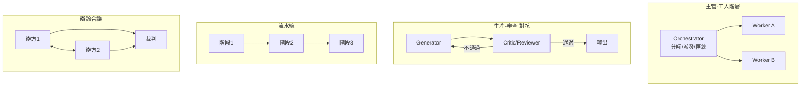

# 6.2 AutoGen、CrewAI 與 Agent 社會的分工模式（2023-2026）

## 一、歷史背景：從 AutoGPT 的混亂到「框架化協作」

2023 年 3 月 AutoGPT 爆紅後，開發者很快發現：單體自主 Agent 在長任務中失控率極高。2023 下半年，兩個方向的框架應運而生：

- **Microsoft AutoGen**（2023.10 論文，2025 年與 Semantic Kernel 整合為 **Microsoft Agent Framework**）：以「可對話的 Agent」為原語，Agent 之間靠消息傳遞協作，程式碼執行內建其中——學術味濃、控制精細；
- **CrewAI**（2023.11）：以「角色扮演的團隊」為隱喻（Agent/Task/Crew 三概念），上手快、適合業務流程——產品味濃。

加上 LangGraph（圖狀狀態機編排）、OpenAI Swarm→Agents SDK（輕量 handoff）、以及 Claude Code 的 subagent 機制，到 2026 年「多 Agent 編排」已沉澱為幾種標準模式。本節以這些框架為標本，講清多 Agent 的工程現實。

## 二、AutoGen：可對話的 Agent 作為原語

### 2.1 核心抽象

AutoGen 的哲學：**一切協作都是 Agent 間的對話**。每個 Agent 是一個能收發消息、可呼叫 LLM/工具的實體；編排就是安排「誰和誰對話、什麼順序、何時結束」。

```python
import autogen

config = [{"model": "gpt-4", "api_key": "..."}]

assistant = autogen.AssistantAgent(
    name="coder",
    llm_config={"config_list": config},
    system_message="你是資深工程師，寫出可執行的 Python。",
)

user_proxy = autogen.UserProxyAgent(
    name="reviewer",
    human_input_mode="NEVER",
    code_execution_config={"work_dir": "sandbox"},   # 可執行 code
)

user_proxy.initiate_chat(assistant, message="寫個函式計算斐波那契第 n 項，並用 n=10 驗證。")
```

`UserProxyAgent` 的設計是 AutoGen 的神來之筆：它代表「人類/環境」，可以**自動執行 Assistant 寫出的程式碼並把輸出（含錯誤）回灌**——這把第 3 章的測試驗證迴圈內建為框架原語，兩個 Agent 的「寫-跑-改」對話就是一個 Reflexion。

### 2.2 對話模式

| 模式 | 機制 | 適用 |
|------|------|------|
| 兩方對話 | A↔B 輪流直到終止條件 | 寫-跑-改迴圈 |
| 群聊（group chat） | 管理者 Agent 依對話狀態選下一位發言者 | 需要多角色動態介入（PM/工程/QA） |
| 順序/巢狀對話 | 固定 pipeline 或對話嵌套 | 確定性流程 |
| 有限狀態機（AutoGen 0.4+ / Agent Framework） | 顯式圖定義轉移 | 生產級可控編排 |

AutoGen 0.4 的重寫（事件驅動、型別化訊息）反映了行業共識：**原型期「自由對話」好用，生產期需要確定性編排**——這正是從「聊天」到「工作流」的成熟化。

## 三、CrewAI：角色扮演的團隊隱喻

### 3.1 三個概念與角色設計

CrewAI 把多 Agent 系統建模為「船員（Crew）」：Agent 有 **role（角色）/ goal（目標）/ backstory（背景）**，Task 有描述與期望輸出，Crew 定義流程（sequential / hierarchical）。

```python
from crewai import Agent, Task, Crew

researcher = Agent(
    role="市場研究員",
    goal="收集競品定價與功能差異",
    backstory="十年 SaaS 市場分析經驗，只報告有來源的事實。",
    tools=[search_tool],
)

writer = Agent(
    role="分析師",
    goal="把研究結果寫成一頁決策簡報",
    backstory="精煉寫作，重視數據與結論先行。",
)

t1 = Task(description="調查 A、B 兩家競品的定價", agent=researcher,
          expected_output="帶來源的定價對照表")
t2 = Task(description="依研究結果寫決策簡報", agent=writer,
          expected_output="500 字內簡報，含建議",
          context=[t1])                       # 依賴 t1 的產出

Crew(agents=[researcher, writer], tasks=[t1, t2],
     process="sequential").kickoff()
```

`backstory` 是角色工程的精髓：它不只是人格裝飾，而是**約束行為範圍的上下文**（「只報告有來源的事實」直接改變輸出的可靠性）。這印證了 2.1 節「提示即程式」：角色設定是一段可工程化調優的程式。

### 3.2 分工模式的樣板庫

CrewAI 與整個生態沉澱出幾種可複用的分工模式：



| 模式 | 理論淵源 | 何時用 |
|------|----------|--------|
| 主管-工人 | Contract Net、階層式 MAS | 任務可分解、worker 需上下文隔離 |
| 生產-審查 | generator-critic、Reflexion | 品質要求高、可機器驗證 |
| 流水線 | DPS 的任務分解 | 各階段轉換清晰（研究→寫作→校對） |
| 辯論合議 | Du et al. 2023、賽局 | 事實性、難題裁決 |

### 3.3 生產-審查模式的價值：批判者不需要更強

一個反直覺的實務發現：**審查 Agent 用同級甚至更弱的模型也有效**——因為「找錯」與「生成」的認知負荷不對稱，且審視者擺脫了生成者的上下文慣性（fresh eyes 效應）。在 Code 領域，「測試」就是最廉價的審查者，這解釋了為何 Code Agent 的多 Agent 化需求最低（單 Agent + 測試迴圈已足夠），而「開放式產出」（文案、研究）領域最需要 critic。

## 四、框架比較與選型

| 框架 | 原語 | 強項 | 弱項 |
|------|------|------|------|
| AutoGen / MS Agent Framework | 可對話 Agent、事件驅動圖 | 程式碼執行內建、控制精細 | 學習曲線較陡 |
| CrewAI | Agent/Task/Crew 角色模型 | 上手快、業務流程友好 | 彈性受限於隱喻 |
| LangGraph | 圖狀態機（節點=函式/Agent） | 確定性、可恢復、可觀測 | 需自己寫協作邏輯 |
| OpenAI Agents SDK | handoff（任務移交） | 極簡、官方整合 | 生態較新 |
| Claude Code subagent | 上下文隔離的子 Agent | 工程實戰驗證 | 綁定單一產品 |

選型的第一原則（呼應 6.1）：**先問「真的需要多個 Agent 嗎」**。需要隔離上下文、並行探索、或分工專化時才拆；否則單 Agent + 良好的上下文工程與測試迴圈，往往更便宜、更可控。

## 五、Agent 社會的運維：生產環境的現實問題

多 Agent 系統上生產後浮現的運維課題，正逐步形成新的工程學科（observability for agents）：

1. **追蹤（tracing）**：一次任務橫跨多個 Agent 的多次 LLM 呼叫與工具執行，需要 OpenTelemetry 式的全鏈路追蹤（LangSmith、Langfuse 等）；
2. **成本治理**：多 Agent 的 token 成本可達單體的 5-15 倍；需要預算控制與「哪個環節值得用強模型」的混合調度；
3. **確定性與可重放**：把每一步（含隨機性種子）記錄下來，才能重現事故——分布式系統的「事件溯源」思想移植；
4. **責任歸屬**：多 Agent 出錯時，「哪個 Agent 的哪一步錯了」需要自動歸因（error attribution），這仍是未完全解決的研究問題。

## 六、本節重點

1. AutoGen 把「可對話的 Agent」作為原語，UserProxyAgent 內建「寫-跑-改」迴圈（Reflexion 的框架化）；0.4 重寫為事件驅動狀態機，反映「原型自由對話、生產確定編排」的行業共識。
2. CrewAI 以角色隱喻（role/goal/backstory）降低門檻；backstory 是約束行為範圍的可工程化上下文，不是人格裝飾。
3. 四種分工模式（主管-工人、生產-審查、流水線、辯論合議）各有理論淵源與適用條件；「審查者不必更強」的反直覺發現與「fresh eyes」效應是生產-審查模式的價值根基。
4. Code Agent 對多 Agent 需求最低（測試即最廉價 critic），開放式產出領域需求最高——是否多 Agent 由「驗證訊號是否廉價」決定。
5. 多 Agent 生產化的四大運維課題：全鏈路追蹤、成本治理、可重放、錯誤歸因——分布式系統工程學正在 Agent 領域重演。

## 七、思考問題

1. AutoGen 的 UserProxyAgent「代執行程式碼」與 function calling 有何本質差異？哪個更安全？為什麼？
2. 設計一個三 Agent 的「內容工廠」（選題→撰稿→審稿）。你會用 CrewAI 的角色模型還是 LangGraph 的顯狀態機？請說明控制力與靈活性的取捨。
3. 「審查者不必更強」在什麼條件下失效？構造一個審查者總被生成者「說服」的場景，並提出對策。
4. 多 Agent 的 token 成本是單體的 5-15 倍。請給出一個「何時值得」的成本效益判斷公式，並代入一個具體任務估算。
5. 錯誤歸因（多 Agent 出錯時找出責任步驟）目前仍是開放問題。請設計一個基於「反事實重放」（回退到某步、換輸出、看結局是否改變）的歸因演算法草案，指出其計算成本。
