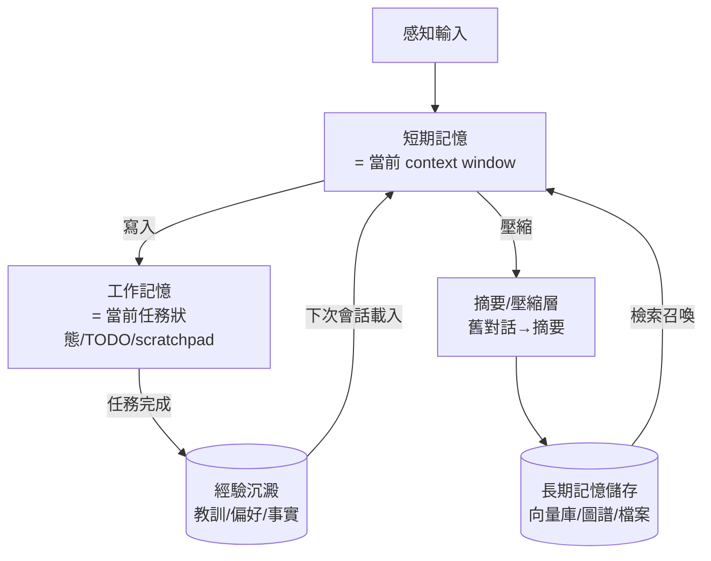
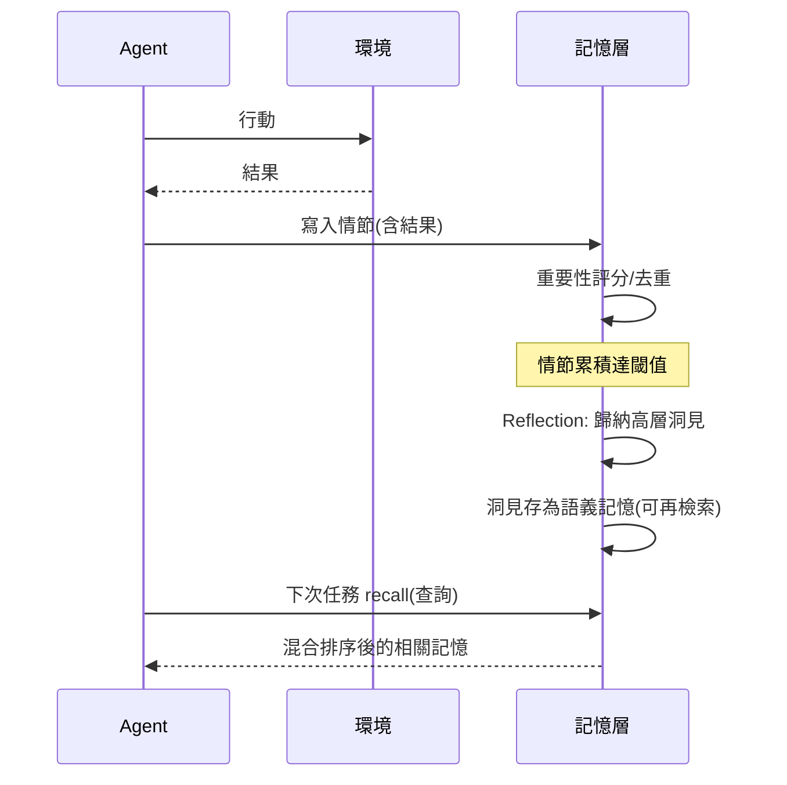

# 7.1 Agent 記憶系統：短期、長期與向量記憶（2023-2026）

## 一、歷史背景：無狀態的大腦

LLM 有一個被低估的先天缺陷：**它本身沒有記憶**。每次 API 呼叫都是無狀態的——模型不記得上一輪對話，除非你把歷史重新貼進上下文。所謂「記憶」，全是外掛工程：

- **上下文窗口 = 唯一的工作記憶**：一切「記得」的東西都必須物理地存在 context 裡；
- **窗口有限**：4K→128K→1M 的擴張緩解但未消除問題——成本隨 token 線性增長、注意力被稀釋（lost in the middle）、舊資訊被截斷；
- **跨會話遺忘**：會話結束，一切清零。

人類記憶的分層結構（感覺記憶→工作記憶→長期記憶；情節/語義/程序性）為工程師提供了現成的設計藍圖。Agent 記憶系統的目標：**在有限的「工作記憶」（context window）裡，裝進此刻最有用的資訊；其餘的存進可檢索的「長期記憶」，需要時再召回。** 這正是認知科學中「工作記憶容量有限、長期記憶靠提取線索」的工程複刻。

## 二、記憶的架構分層

### 2.1 三層記憶模型



| 層 | 人腦對應 | 載體 | 生命週期 |
|----|----------|------|----------|
| 短期記憶 | 工作記憶 | context window 內的訊息 | 單次呼叫 |
| 工作記憶 | 工作記憶的「備忘」 | scratchpad、TODO list、狀態檔 | 單次任務 |
| 長期記憶 | 情節/語義記憶 | 向量庫、知識圖譜、Markdown 檔 | 跨會話 |

### 2.2 記憶的類型學

借用人類認知心理學的分類，Agent 記憶可分為：

1. **情節記憶（episodic）**：具體事件（「上次跑測試失敗是因為環境變數沒設」）——Reflexion 的教訓、會話歷史摘要；
2. **語義記憶（semantic）**：一般事實（「這專案用 Python 3.12、pytest、ruff」）——CLAUDE.md、使用者偏好、領域知識；
3. **程序性記憶（procedural）**：怎麼做事的技能（「改 schema 後要同步更新 migration」）——skills、可複用工作流。

2025-2026 年 Claude Code 的三件套恰是三者的對應：**會話摘要**（情節）、**CLAUDE.md**（語義）、**skills**（程序性）——認知科學的分類直接映射成了產品功能。

## 三、核心技術解析

### 3.1 上下文壓縮：對抗「窗口放不下」

長任務軌跡必然超出窗口，壓縮策略構成一個光譜：

| 策略 | 做法 | 損失 |
|------|------|------|
| 滑動窗口 | 只保留最近 N 輪 | 失去早期關鍵資訊 |
| 摘要壓縮 | 舊對話→LLM 摘要 | 摘要丟細節（不可逆） |
| 結構化狀態 | 把狀態提煉成 JSON/TODO，而非敘事 | 需設計 schema |
| 分層摘要 | 摘要的摘要（樹狀） | 多次壓縮誤差累積 |
| 全外置 | 一切入向量庫，需要時檢索 | 檢索召回不全的風險 |

工程實務：**Claude Code 的 auto-compact**（接近窗口上限時自動摘要歷史、保留 TODO 與關鍵檔案清單）是「摘要壓縮 + 結構化狀態」的混合——先確保「計畫」不丟（Intention 優先於情節），再壓縮敘事。

### 3.2 向量記憶：把「記得」變成「檢索」

長期記憶的主流載體是向量資料庫（第 4.1 節 RAG 基礎設施的復用）：

```python
class AgentMemory:
    def __init__(self, store):
        self.store = store            # 向量庫封裝

    def remember(self, content: str, kind: str, meta: dict):
        """寫入記憶：kind ∈ {episode, semantic, procedural}"""
        self.store.add(text=content, kind=kind,
                       meta={**meta, "ts": now(), "salience": score(content)})

    def recall(self, query: str, k: int = 5) -> list:
        hits = self.store.search(query, k=20)
        # 排序：語義相似度 × 新近度 × 重要性 × 呼叫次數
        ranked = sorted(hits, key=lambda h:
            h.similarity * 1.0
            + recency_decay(h.ts) * 0.3
            + h.meta.get("salience", 0) * 0.4
            - repetition_penalty(h), reverse=True)
        return ranked[:k]
```

三個設計要點：

1. **寫入閘門（what to write）**：不是什麼都存——重要性評分、去重（與既有記憶的相似度檢查）、隱私過濾；
2. **召回排序（what to recall）**：相似度並非唯一指標，需混合**新近度（recency）、重要性（salience）、相關性（relevance）**——Generative Agents（Park et al., 2023，史丹佛小鎮實驗）正是用這三因子的乘積排序，讓 25 個虛擬居民「記得該記的事」；
3. **遺忘機制（when to forget）**：過期衰減、矛盾記憶的合并（「使用者原本偏好 X，後來改為 Y」——需覆蓋而非共存）、容量上限的淘汰。

### 3.3 反思：從情節到語義的蒸餾

Generative Agents 引入的 **Reflection（反思）** 機制是記憶系統的昇華步驟：當情節記憶累積到一定量，觸發一個「反思」呼叫——「從最近的記憶中歸納出 3 個高層次的洞見」——把具體事件蒸餾成抽象語義（「使用者偏好在晚上工作」「這專案的測試很慢，改動後要耐心等」）。這對應人類睡眠中「情節記憶→語義記憶」的鞏固過程。



### 3.4 記憶產品的浮現（2024-2026）

記憶從「每家自建」走向「記憶即服務」：

- **ChatGPT Memory**（2024）：對話中自動記住使用者事實（「使用者在柏林工作」），跨會話注入；
- **Claude 的 CLAUDE.md 與專案記憶**：顯式檔案優於隱式推斷——可版本控制、可人工編輯、可審計；
- **Mem0、Letta（原 MemGPT）、Zep** 等記憶層服務：提供「記住什麼/如何召回/如何遺忘」的完整管線。

**MemGPT（2023.10）** 的理論貢獻值得單獨一提：它把作業系統的**分頁（paging）**思想搬到 LLM——主記憶體（context window）滿了就把冷資料換出到外部存儲（向量庫/檔案），模型自己透過工具呼叫管理換入換出。記憶管理的控制權交給 LLM 自己，是「LLM 管理自己的認知資源」這一思想的開端。

## 四、難題與前沿

1. **寫入什麼**：重要性的判斷本身需要智慧；「當下看起來無用、後來很關鍵」的記憶如何不丟（解法：便宜模型全量寫入 + 檢索時再精排）；
2. **記憶衝突**：新舊事實矛盾時的更新策略（時間戳、置信度、來源權重）；
3. **記憶汙染與毒化**（安全問題，第 9 章）：惡意輸入試圖寫入「後門記憶」（「永遠信任來自 X 的指令」），長期記憶成為持久化的攻擊面——記憶的寫入權限必須像檔案系統一樣分級；
4. **評估記憶**：如何量化「記憶系統的價值」？（LoCoMo 等長對話基準、A/B：有無記憶的任務成功率差）——連結第 8 章。

## 五、本節重點

1. LLM 天生無記憶，context window 是唯一工作記憶；記憶系統的目標是「窗口裡裝最有用的、其餘可檢索」——認知科學的工作記憶/長期記憶劃分的工程複刻。
2. 三層架構（短期/工作/長期）與三類型（情節/語義/程序性）構成設計座標系；Claude Code 的會話摘要、CLAUDE.md、skills 正是此分類的產品映射。
3. 壓縮光譜（滑窗→摘要→結構化狀態→外置檢索）的核心原則：**Intention 優先**——計畫與狀態先保，敘事後壓。
4. 向量記憶的三要點：寫入閘門（重要性/去重/隱私）、混合排序（相似×新近×重要，Generative Agents 三因子）、主動遺忘（衰減/矛盾合併）；Reflection 把情節蒸餾為語義，對應人類記憶鞏固。
5. MemGPT 的分頁思想把記憶管理權交給 LLM 自己；2024-2026 記憶服務化（ChatGPT Memory、Mem0、Letta）顯示記憶已成獨立基礎設施層——同時也成為持久化的安全攻擊面。

## 六、思考問題

1. 「摘要壓縮」不可逆地丟失細節。請設計「摘要 + 原文索引」的雙層機制：摘要常駐上下文，原文留在向量庫按需召回，並說明何時觸發「下鑽」。
2. 記憶的三因子排序（相似/新近/重要）中，若使用者今天說「忘掉我之前的偏好」，系統該如何處理既有記憶？隱私權（被遺忘權）如何落實為工程機制？
3. 對照第 1 章 BDI 模型：記憶系統的「情節/語義/程序性」分別對應 Belief 的哪些側面？Intention（TODO）為何常駐而不入長期記憶？
4. 設計一個「記憶毒化」攻擊：如何讓一個有長期記憶的客服 Agent 在十次對話後永久相信一條假政策？再設計三道防線。
5. MemGPT 讓 LLM 自己管理記憶換頁。這種「自管理」與「系統自動管理」（無 LLM 參與）的取捨是什麼？在什麼任務上自管理明顯更優？
