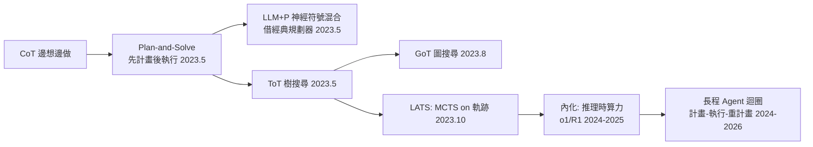
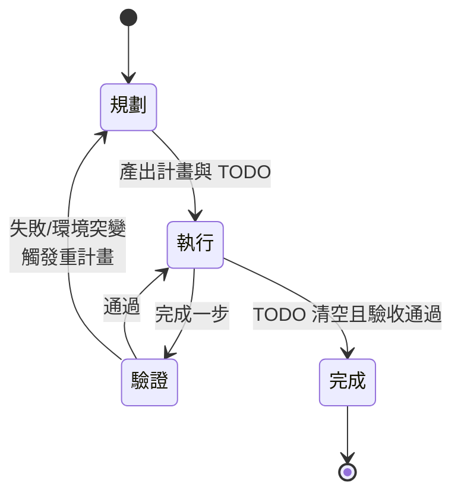

# 7.2 規劃與長程任務分解：Plan-and-Solve、自主執行的難題（2023-2026）

## 一、歷史背景：長程任務的「三次斷裂」

短任務（一問一答、單次修 bug）在 2023 年已基本解決，但**長程任務**——需要數十甚至數百步、跨多天、中途環境會變的任務——暴露了 LLM Agent 的三次斷裂：

1. **目標漂移**：走到第 20 步，模型忘了最初的目標，開始追求眼前的次要細節；
2. **雪崩式錯誤累積**：每步 95% 準確率，30 步之後 $0.95^{30} \approx 21\%$——長程成功率隨步數**指數衰減**；
3. **不會「回頭」**：ReAct 是貪婪單路徑，錯了不知道退回分岔點。

這正是 1980 年代 AI 規劃（planning）早已刻畫過的難題——HTN（層次化任務網路）規劃器用「任務分解」對抗組合爆炸，BDI 用「意圖承諾」對抗搖擺。2023 年後的 LLM 規劃研究，本質上是把這些經典思想用自然語言介面重新實現。

## 二、規劃技術的演化鏈

### 2.1 從 CoT 到 Plan-and-Solve：先計畫後執行

Plan-and-Solve Prompting（Wang et al., 2023.5）把 CoT 從「邊想邊做」改為「**先完整計畫，再逐步執行**」：

```
CoT 模式：   Q → 思考步1 → 做步1 → 思考步2 → 做步2 …（邊走邊想）
Plan-then-Exec：Q → 先列計畫 [1,2,3,4] → 嚴格按計畫執行
```

收益與代價分明：

- **收益**：計畫先行使全局結構穩定，對抗目標漂移；計畫可被審查（人類或另一 Agent 可在執行前否決壞計畫——廉價的提前糾錯）；
- **代價**：計畫僵化——執行中環境變了，舊計畫失效（經典的「計畫趕不上變化」）；計畫錯了會被一路執行到底。

### 2.2 LLM+P：與經典規劃器的混合（2023）

《LLM+P》論文指出分工：**LLM 擅長把自然語言翻譯成形式化問題，經典規劃器（PDDL solver）擅長找最優解**。流程：LLM 把任務翻成 PDDL → 經典規劃器求解 → LLM 把解翻回自然語言執行。這是「神經-符號混合」在規劃上的復興：LLM 付不出「最優性保證」的代價，就借五十年前的符號工具。

### 2.3 樹與圖上的規劃：ToT、GoT、MCTS

第 3 章的 ToT 已把思考變成樹搜尋；後續演化：

- **Graph of Thoughts（2023）**：允許思考節點合併與圖狀依賴（比樹更通用）；
- **LATS（Language Agent Tree Search, 2023.10）**：把 **MCTS（蒙地卡羅樹搜尋）** 套到 Agent 軌跡上——用 LLM 做策略（選動作）、自評做價值函數、環境回饋做獎勵，在「行動空間」上做 UCT 搜尋。AlphaGo 的骨架 + LLM 的直覺；
- **推理時算力範式（2024 o1 / 2025 DeepSeek-R1）**：把樹搜尋「內化」——訓練模型自己學會在鏈式思考中探索、回溯、驗證，外部工程不再需要顯式樹。



## 三、長程任務的工程解法：計畫-執行-重計畫迴圈

### 3.1 理論理想與工程現實

理想模式是經典的 **plan-execute-replan**：



工程上要處理四件事：

1. **計畫的持久化**：TODO list / 任務檔案常駐上下文（對抗目標漂移的錨）；
2. **重計畫的觸發條件**：步驟失敗 N 次、環境觀察與計畫假設不符、使用者介入；
3. **粒度控制**：計畫太粗（「實作功能 X」）無法指導執行；太細（每個按鍵）立刻過期。實務準則：**計畫到「可驗證的中間產物」層級**（如「跑通測試 A」）；
4. **進度感知**：Agent 需知道「現在做到哪」——TODO 勾選狀態就是最小可行的進度模型。

### 3.2 一個帶重計畫的最小實作

```python
def long_horizon_agent(goal: str, llm, tools, max_cycles: int = 20):
    todo = llm(f"把目標分解為可驗證的步驟清單（每步有完成判準）：\n{goal}")
    for cycle in range(max_cycles):
        done, failed = [], []
        for step in parse_todo(todo):
            result = execute(step, llm, tools)          # ReAct 子迴圈
            if verified(result):                        # 驗證完成判準
                done.append(step)
            else:
                failed.append((step, result.error))
                break                                    # 失敗即停，出去重計畫
        if all_done(todo, done) and final_check(goal, llm, tools):
            return report(done)
        # --- 重計畫：帶著失敗教訓修改計畫 ---
        todo = llm(
            f"原計畫：\n{todo}\n已完成：{done}\n失敗：{failed}\n"
            "請修改計畫：繞過或替代失敗步驟，保留已完成成果。")
    raise RuntimeError("重計畫次數耗盡")
```

注意兩個設計：**已完成成果不推倒重來**（計畫可變、成果累積——增量式穩定性）；**失敗教訓進入重計畫上下文**（Reflexion 思想的迴圈級應用）。

### 3.3 自主執行的難題：為什麼指數衰減難以根除

$$
P_{\text{成功}}(n) = \prod_{i=1}^{n} p_i \quad \Rightarrow \quad \ln P = \sum_i \ln p_i \approx -\epsilon n \; (p_i = 1-\epsilon)
$$

只要每步錯誤率 $\epsilon > 0$ 且步驟間**無獨立驗證**，長程成功率必然指數衰減。所有解法本質上都在改變這個公式：

| 解法 | 對公式的干預 | 成本 |
|------|--------------|------|
| 提高單步品質（更強模型） | 降低 $\epsilon$ | 貴，且 $\epsilon\to 0$ 無法保證 |
| 每步驗證 + 即時回滾 | 失敗步不累積（容錯而非防錯） | 驗證成本 + 需可驗證判準 |
| 分段提交（checkpoint） | 把長鏈切成短鏈，段間人審 | 人類負擔 |
| 冗餘與多樣性（多軌跡投票） | 對失敗模式去相關 | 算力數倍 |
| 減少步數（工具更強大、任務預編譯） | 降低 $n$ | 工程投入 |

2024-2026 年 Code Agent 的成功，正是同時用上了後四條：測試即驗證、git 即 checkpoint、多候選並行、以及把「環境準備」等重複步驟固化為工具。

## 四、開放難題：規劃的理論邊界

1. **幻覺式規劃**：計畫中引用不存在的檔案/API——規劃的品質依賴世界模型，而 LLM 的世界模型有洞（解法：計畫先行驗證，把「計畫中的每個假設」變成可查證斷言）；
2. **不可驗證的中間步驟**：寫程式有測試，「策略分析」如何驗證？（→ 開放式領域的長程 Agent 仍不成熟的原因）；
3. **探索-利用**：重計畫太頻繁＝原地打轉（BDI 警告過的）；太罕見＝死磕壞計畫。自適應的堅持閾值仍是研究問題；
4. **價值對齊的長程漂移**：步數越長，「完成任務」與「以正當方式完成」的偏差越難由人類監督（→ 第 9 章）。

## 五、本節重點

1. 長程任務的三次斷裂（目標漂移、錯誤指數累積 $0.95^{30}\approx 21\%$、不會回溯）是 LLM Agent 規劃研究的問題原點。
2. 演化鏈：CoT（邊想邊做）→ Plan-and-Solve（先計畫後執行，計畫可提前審查）→ LLM+P（神經翻譯 + 符號求解的混合）→ ToT/GoT/LATS（顯式樹圖搜尋）→ o1/R1（把搜尋內化為推理時算力）。
3. 工程解法是 plan-execute-replan 迴圈：計畫持久化（TODO 錨定目標）、明確的重計畫觸發、「可驗證中間產物」的粒度、成果增量累積。
4. 指數衰減公式 $P=\prod p_i$ 是統一視角：所有解法都在干預 $\epsilon$（模型）、容錯（驗證回滾）、$n$（步數）與去相關（冗餘）四個槓桿；Code Agent 的成功是四槓桿齊發。
5. 規劃的開放難題（幻覺式規劃、不可驗證步驟、探索-利用平衡、長程價值漂移）界定了 2026 年自主性的邊界——「可靠自主」的前提是「可驗證」。

## 六、思考問題

1. Plan-and-Solve 的計畫「可提前審查」是廉價糾錯。請設計一個「計畫審查 Agent」的提示詞要點：它該查什麼（可行性、假設、風險、與目標的偏移）？
2. 用 $P=\prod p_i$ 估算：每步 97% 準確率，50 步任務的成功率是多少？若引入「每 10 步一次 checkpoint 驗證（99% 可靠）且失敗可回滾重試 2 次（每次成功率 90%）」，新成功率是多少？
3. LLM+P 把翻譯交給 LLM、求解交給 PDDL。在什麼任務上這種分工失效（提示：狀態空間無法形式化、環境隨機）？
4. BDI 的「意圖承諾」警告重計畫太頻繁會原地打轉。請設計一個自適應「堅持閾值」：什麼訊號該觸發重計畫、什麼訊號該繼續死磕？
5. 「可靠自主的前提是可驗證」——以此推論：哪些領域的長程 Agent 會最先成熟、哪些最後？你的排序與第 5 章 Code Agent 先成功的史實一致嗎？
