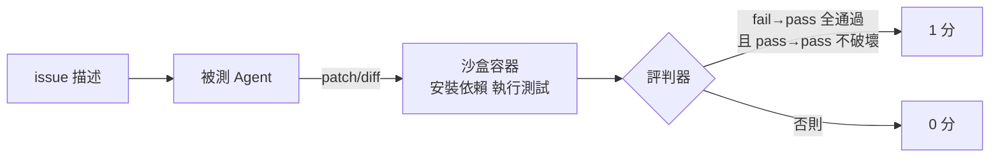
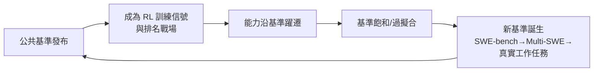

# 8.1 SWE-bench、WebArena 與 AgentBench：如何量測 Agent 能力（2023-2024）

## 一、歷史背景：為什麼舊基準失效了？

GPT-3 時代的 LLM 評估（MMLU、HellaSwag）測的是「靜態知識問答」：單輪、無工具、無環境。Agent 時代這套失效了，因為 Agent 的能力是**動態的**：

1. **多步性**：錯一步可以補救，也可以雪崩——單輪指標測不出「過程品質」；
2. **環境互動**：會用工具與不會用工具是兩個物種——需要「有狀態的環境」作為考場；
3. **任務真實性**：合成題（如 GSM8K 數學題）與真實工作（修一個真實 repo 的 issue）之間有巨大鴻溝。

2023-2024 年因此誕生了一批「環境型基準」：SWE-bench（真實軟體工程）、WebArena（真實網站操作）、AgentBench（多環境綜合）。它們共同的評估哲學：**給 Agent 一個真實環境與一個可機器驗證的成功判準，讓它自己跑，看終局**。這一年代也被稱為 Agent 評估的「奠基期」——基準成為了能力的公共裁判，驅動了整個賽道的軍備競賽。

## 二、SWE-bench：真實軟體工程基準（2023.10）

### 2.1 構造：從 GitHub 真實歷史中出題

SWE-bench（普林斯頓）的出題方式是革命性的：

- 從 12 個熱門開源 repo（Django、scikit-learn、sympy…）的**真實 GitHub issue + 對應修復 PR** 中抽取任務；
- 給 Agent：issue 描述 + repo 在 PR 之前的快照；
- 成功判準：**通過該 PR 附帶的測試**（fail-to-pass 測試從失敗轉為通過，且不破壞既有 pass-to-pass 測試）。

2,294 題全量（SWE-bench Full），後推出人工篩除題目缺陷的 **SWE-bench Verified**（500 題，OpenAI 2024.8 協作篩選），成為行業公認金標準。

### 2.2 分數史：能力躍遷的時間軸

| 時點 | 代表系統 | SWE-bench Verified |
|------|----------|---------------------|
| 2024 初 | 基線（直問 LLM） | ~3-4% |
| 2024.6 | Agentless（非 Agent 的簡單流程） | ~27%（打臉「必須複雜 Agent」） |
| 2024.10 | SWE-agent + Claude 3.5 Sonnet | ~49% |
| 2025 | Claude 3.7 + 迴圈工程 | ~62-70% |
| 2026 | 前沿模型 + Agent 工程 | 70%+ |

兩個重要教訓藏在這張表裡：**Agentless 事件**（2024.6）證明「簡單管線 + 強模型」有時勝過複雜 Agent 框架——評估逼出了「複雜性必須被證明值得」的紀律；而分數從 3% 到 70% 的五年飛躍，則展示了「可驗證基準 → RL 訓練信號 → 能力躍遷」的反身性迴路（基準本身塑造了被訓練的能力）。

### 2.3 評測架構



評判是「二值、行為級、機器自動」的——不評分程式碼風格、不看中間過程。這種嚴格性是它的公信力來源，也埋著它的盲點（見第 8.2 節）。

## 三、WebArena：環境保真度的里程碑（2023.7）

### 3.1 為什麼需要自建「考場網站」

在真實網站上測 Agent 有三個不可行：不可重複（頁面天天變）、不可復現（他人無法驗證）、有倫理風險（對真實服務產生副作用）。CMU 的 WebArena 的解法是**克隆三個真實網站**（GitLab 實例、電商 Magento、Reddit-like 論壇 + Wiki），構建 812 個「可自足驗證」的長程任務：

- 任務例：「把所有標著 dev 的 issue 重新指派給我，並在 wiki 記錄」——需多步跨站操作；
- 驗證方式：**檢查環境終態**（資料庫狀態、頁面內容），而非比對 Agent 的軌跡文字。

WebArena 建立了三個至今通行的設計原則：**環境可重置、任務可自足驗證（self-verifiable）、終態判分（state-based evaluation）**。其後的 WorkArena、WebVoyager、OSWorld（桌面環境）都是這條譜系。

### 3.2 數字背後的訊號

2023 年發布時，最強模型在 WebArena 上成功率僅 ~14%（人類 ~78%）。巨大的人機差距本身成為研究路標：它指向了三個具體短板——**導航失敗**（找不到入口）、**長程規劃失敗**（多步任務中後段崩潰）、**觀察資訊過載**（DOM 太長塞不下）。每一個短板都對應前文一章的技術（檢索、規劃、上下文管理）——**好基準是「能力的 X 光片」：不只給總分，還暴露斷在哪裡。**

## 四、AgentBench：多環境綜合測試台（2023.8）

清華的 AgentBench 走的是廣度路線：8 個異質環境（作業系統、資料庫 SQL、知識圖譜、網購網站、數位卡牌遊戲、思維迷宮等），統一協議、統一指標。它的貢獻在於**系統性揭示了「Agent 能力的遷移性很差」**：同一模型在 SQL 環境 70 分、在作業系統環境可能 30 分——**Agent 能力不是單一維度的「g 因子」，而是高度依賴環境與工具介面的複合能力**。這一發現直接影響了後來的評估觀：不能靠單一基準排名，要看能力剖面（capability profile）。

### 4.1 三大基準的方法論對照

| | SWE-bench | WebArena | AgentBench |
|---|-----------|----------|------------|
| 領域深度 | 軟體工程極深 | 網頁操作 | 多環境廣度 |
| 環境 | repo + 測試 | 克隆網站 | 8 個異質環境 |
| 判分 | 測試通過 | 終態比對 | 各環境自定義 |
| 難點 | 長程檢索+修改 | 部分可觀測導航 | 遷移性 |
| 教訓 | 可驗證性=訓練信號 | 環境保真度 | 能力剖面思維 |

## 五、程式碼範例：自製一個「終態判分」的迷你基準

理解基準的最佳方式是自己造一個。以下是一個帶沙盒執行與終態驗證的迷你 SWE-bench：

```python
import subprocess, tempfile, json, os

MINI_BENCH = [
    {
        "id": "fix-add",
        "issue": "utils.py 的 add 函式對負數回傳錯誤值，請修復。",
        "setup_files": {
            "utils.py": "def add(a, b):\n    return max(a, b)  # bug\n",
            "test_utils.py": ("from utils import add\n"
                              "def test_add():\n"
                              "    assert add(2, 3) == 5\n"
                              "    assert add(-1, 1) == 0\n"),
        },
        "judge": "pytest",               # 終態判準：測試通過
    },
]

def run_case(case: str, agent_patch_fn) -> dict:
    with tempfile.TemporaryDirectory() as d:
        for name, content in case["setup_files"].items():
            with open(os.path.join(d, name), "w") as f:
                f.write(content)
        agent_patch_fn(d, case["issue"])           # 讓 Agent 在沙盒內修改
        r = subprocess.run(["python", "-m", "pytest", "-q"],
                           cwd=d, capture_output=True, text=True, timeout=60)
        passed = r.returncode == 0
        return {"id": case["id"], "pass": passed, "tail": r.stdout[-300:]}

def my_agent(workdir: str, issue: str):
    # 被測 Agent：讀檔→改檔（此處假裝為簡單修復以示範評測器）
    p = os.path.join(workdir, "utils.py")
    src = open(p).read().replace("max(a, b)", "a + b")
    open(p, "w").write(src)

print(json.dumps([run_case(c, my_agent) for c in MINI_BENCH], ensure_ascii=False))
```

這 40 行包含了 Agent 基準的全部要素：**任務定義（issue）、初始環境（setup_files）、沙盒（tempdir+timeout）、行為判分（pytest 退出碼）**。SWE-bench 只是把每個要素做到了真實世界的規模與嚴謹。

## 六、基準的「反身性」：評估塑造能力

2024-2026 年出現了一個深刻的循環：



SWE-bench 的題目來自公開 repo——模型預訓練可能見過修復 commit（資料汙染）；一旦成為 RL 訓練場，分數的公信力開始與「訓練分布的重疊」糾纏。這驅動了 2025-2026 年的基準更新潮（私有 held-out 任務、SWE-bench Pro、真實企業工作抽樣）——**基準與能力是共生演化的，任何分數都必須放在「基準版本 + 訓練時代」的座標裡解讀**。

## 七、本節重點

1. 舊基準（單輪問答）測不出 Agent 的多步性、環境互動與任務真實性；2023-2024 的環境型基準確立了新評估哲學：真實環境 + 可機器驗證的終局判準。
2. SWE-bench 以「真實 issue + repo 快照 + 測試判分」把軟體工程變成可量化賽道；Verified 版成為金標準；Agentless 事件教訓是「複雜性必須被證明值得」。
3. WebArena 的三原則（環境可重置、任務自足驗證、終態判分）成為環境型基準的範式；其人機差距是「能力的 X 光片」，精準暴露導航、長程規劃、觀察過載三大短板。
4. AgentBench 揭示 Agent 能力遷移性差——評估應看「能力剖面」而非單一分數。
5. 基準具有反身性：它同時是量尺與訓練信號，分數必須與「資料汙染、訓練時代」一起解讀；基準與能力共生演化。

## 八、思考問題

1. SWE-bench 只判「測試通過」。請構造一個「通過測試但程式碼是災難」的解法（如硬編碼測試值），並提出評判器的補丁（連結第 8.2 節的獎勵駭客）。
2. WebArena 用「克隆網站」換取可重複性，但克隆環境與真實網站的差異（防爬蟲、驗證碼、彈窗）會高估 Agent。如何設計「半真實」環境平衡保真與可控？
3. AgentBench 的「能力剖面」發現對模型選型有何實務意義？你會為一個「資料庫運維 Agent」看哪幾個剖面？
4. 自製基準（第六節）中，timeout、沙盒逃逸、隨機性（時間/亂數）會如何破壞判分公平性？逐一提出防護。
5. 基準的反身性意味著「榜單第一名」可能是「最適應榜單者」。作為採購方，你會如何組合多個證據源（基準分、真試用、第三方審計）做決策？
