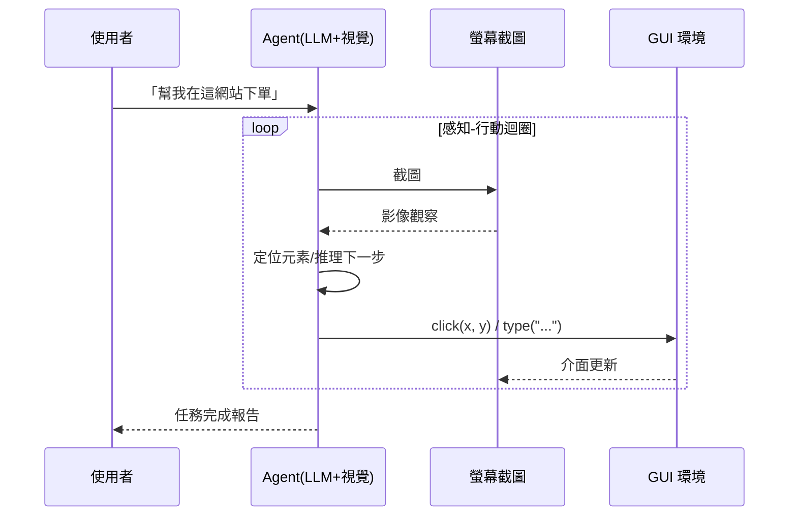
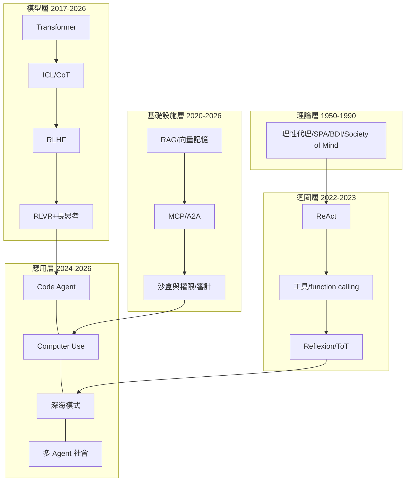

# 9.2 Computer Use、深海模式與 Agent 的終局：通往 AGI 之路？（2025-2026）

## 一、歷史背景：最後的介面

ReAct 時代的 Agent 透過「API 與工具」行動——乾淨、可控，但**只覆蓋有 API 的世界**。現實中大量工作發生在圖形介面上：老舊企業系統（無 API）、跨應用的桌面操作、以及「任何軟體都能做」的通用性。2024 年 10 月，Anthropic 發布 **Computer Use（電腦使用）**：讓模型看截圖、移動滑鼠、點擊、打字——像人一樣操作電腦。OpenAI（Operator，2025.1）與各家隨後跟進。

這一步的理論意義重大：**GUI 是人類的通用介面，能操作 GUI 的 Agent 理論上能做任何人能用電腦做的事**——這是「通用 Agent」假設的工程兌現。但它的代價同樣深刻：截圖是高維觀察、點擊是高風險行動、環境是最惡劣的（部分可觀測 + 隨機 + 動態），安全面（第 9.1 節）全面升級。

「深海模式」（deep research / 長時程自主模式，2025 起各家的說法，如 OpenAI Deep Research、Claude 的長時程任務）則是另一個方向的推進：**讓 Agent 連續自主工作數小時**——大量檢索、交叉驗證、產出報告。兩者合起來代表 2025-2026 年的邊界擴張：橫向（能操作的介面）與縱深（能連續自主的時長）。

## 二、Computer Use：架構與難點

### 2.1 迴圈結構

### 2.2 三大工程難點

1. **定位精度**：座標點擊依賴視覺理解的像素級準確；小按鈕、下拉選單、彈窗遮擋是失敗重災區。緩解：輔助 DOM/accessibility tree（瀏覽器可給語義樹，桌面難）、縮放重截、高亮疊加標註；
2. **錯誤的代價不對稱**：點錯「清空購物車」vs 點錯「加入購物車」風險天差地別。緩解：操作前視覺確認（高亮目標元素再點）、破壞性操作二次確認、會話回放；
3. **狀態追蹤**：GUI 狀態隱藏在像素裡，「剛才點的彈窗還開著嗎」需要從截圖重建——長任務中尤其脆弱。緩解：任務清單（TODO）外置、關鍵狀態文字化記錄。

**與 API Agent 的對照**揭示了介面選擇的第一原理：**有 API 用 API，API 不可得才降級到 GUI**——GUI 是通用性最後的兜底，而非首選。2026 年的成熟實踐是「分層行動」：應用有 MCP/API 走結構化、網頁走 DOM、實在不行才走截圖像素。

## 三、深海模式：長時程自主的工程與風險

### 3.1 Deep Research 的工作流解剖

以 2025 年的 Deep Research 類產品為標本，一次「深海模式」任務的典型結構：

1. **澄清階段**：先反問使用者（範圍、格式、立場）——把歧義消滅在起跑線（對抗第 7 章的需求歧義難題）；
2. **計畫階段**：產出研究大綱與搜尋策略（可審查）；
3. **執行階段**：數十至上百輪「搜尋→閱讀→記筆記→調整方向」，中間結果寫入結構化筆記（記憶系統，第 7 章）；
4. **綜合階段**：交叉驗證多來源、標註引文、產出報告；
5. **自我審查階段**：以評審者視角檢查覆蓋度與事實性（生產-審查模式，第 6 章）。

一次任務可消耗數十分鐘到一小時的推理算力——這是「推理時算力 scaling」在 Agent 任務上的直接應用：**用一小時的「深思」換取過去需人類一天的研究產出**，在資訊綜合類任務上首次達到或超過領域專家的初稿水準（2025 年多項評測結論）。

### 3.2 長時程自主的風險曲線

自主時長 $T$ 越長，三個風險同步上升：

$$
\text{風險} \propto \underbrace{(1-p)^n(T)}_{\text{累積錯誤}} + \underbrace{P_{\text{注入}}(T)}_{\text{遭遇攻擊面}} + \underbrace{P_{\text{漂移}}(T)}_{\text{偏離原始意圖}}
$$

工程對策：**檢查點制度**（每 30-60 分鐘產出進度報告供人類掃視）、**可中斷性**（任何時刻可安全暫停與回滾）、**行動預算**（花費/外呼次數上限）。深海模式因此不是「放養」，而是**人類以低頻率、高槓桿的方式持續在環**（human-on-the-loop，相對於每步審批的 human-in-the-loop）。

## 四、匯流：2026 年的 Agent 技術全景

把全書的技術線收攏到一張圖：

## 五、通往 AGI 之路：三種立場的嚴肅比較

### 5.1 立場一：Agent 即 AGI 的縮影（樂觀）

論證：Agent 已具備智能體的核心要素——感知（多模態）、規劃（長思考+樹搜尋）、行動（工具+GUI+程式碼）、記憶（分層記憶系統）、社會性（多 Agent）。經濟學人式的觀察：如果「能完成大部分知識工作的數位勞工」就是 AGI 的操作型定義，那麼 2026 年的 Agent 已在其最強領域（軟體工程、研究綜合）達到初級專業者的持續產出。進一步的 scaling（模型 × 迴圈 × 並行 Agent）可能指數級放大。

### 5.2 立場二：缺的是「世界模型與持續學習」（審慎）

論證：當前 Agent 有三個結構性缺陷，不是 scaling 能自動補上的：

1. **無真正的持續學習**：每個會話從零開始，經驗無法寫入權重（只能外掛記憶）——人類專家的成長機制不存在；
2. **世界模型有洞**：幻覺式規劃、對物理與因果的粗糙理解——在開放物理世界中（機器人、實驗科學）快速失效；
3. **價值與常識的長尾**：越界判斷（「這個要求雖然字面合理但不該做」）依賴深厚的情境常識，恰是 LLM 最弱處。

因此「Agent 是通向 AGI 的橋，但橋本身還不是彼岸」。

### 5.3 立場三：定義與測量的循環（哲學式審慎）

論證：AGI 的定義不斷被能力追平後重新挪移（西洋棋→圍棋→程式→研究）；而所有測量（第 8 章）都有 Goodhart 陷阱。「是否 AGI」可能不是一個科學問題，而是**經濟與社會採納的過程問題**——當 Agent 系統性承擔過半數知識工作且社會治理跟上時，問題自然失去重要性。

### 5.4 本書的立場：能力曲線與治理曲線的賽跑

綜合三種立場，本書以一個判準收尾：

> **Agent 史的最後一課：技術能力曲線持續陡升，而人類的驗證、對齊與制度能力曲線必須跟得上。AGI 之問的實質，不是「機器何時像人」，而是「人類能否在自己的迴圈被稀釋之前，建立足夠好的觀察、驗證與糾偏機制」。**

這正是全書的暗線：從 SPA 的「感知-行動」閉環，到 MCP 的協議、eval 的嚴格、權限的鐵律——**每一項技術進步，都是對「如何讓不完美智能體安全地嵌入人類系統」的回答**。

## 六、本節重點

1. Computer Use（2024.10）把行動介面推到「人機通用介面」的極限，證明了通用 Agent 的理論可能性；但工程第一原理是「分層行動」：API/MCP 優先，DOM 次之，像素兜底。
2. GUI Agent 的三大難點（定位精度、錯誤代價不對稱、像素狀態追蹤）對應視覺確認、二次防誤與狀態外置三種工程對策。
3. 深海模式（Deep Research/長時程自主）以「澄清→計畫→執行→綜合→自審」的工作流實現數小時自主，其安全性建立在檢查點、可中斷性、行動預算與 human-on-the-loop 上。
4. AGI 之問的三種立場（縮影論、缺陷論、定義循環論）各有堅實論證；共同承認的結構性缺口是持續學習、世界模型與長尾常識。
5. 全書收束於一個判準：真正的賽跑在能力曲線與治理曲線之間——Agent 技術史的每一步，都是「讓不完美智能體安全嵌入人類系統」的回答。

## 七、思考問題

1. 「分層行動」原則（API>DOM>像素）中，什麼情況下你會**故意**選擇更脆弱的像素層？（提示：第三方封鎖 API、條款限制、跨應用編排。）
2. Deep Research 的報告可能「看似嚴謹、實則查無實據」（幻覺引用）。請設計三道驗證機制（來源可回溯、斷言分級、對立觀點強制檢索），並說明各自的成本。
3. 三種 AGI 立場中，「持續學習的缺失」被普遍視為最深的缺口。請設計一個實驗框架，測量一個 Agent 系統「跨月任務的成長率」，與人類新手對比。
4. human-in-the-loop（每步審批）與 human-on-the-loop（低頻監督）之間，監督密度應如何隨任務風險與 Agent 可信度動態調整？請給出一個調度公式草案。
5. 2030 年回望 2026，你預測本書哪一章的內容會顯得最「過時」、哪一章最「超前」？用本書「前因後果」的推理方式論證你的預測。
