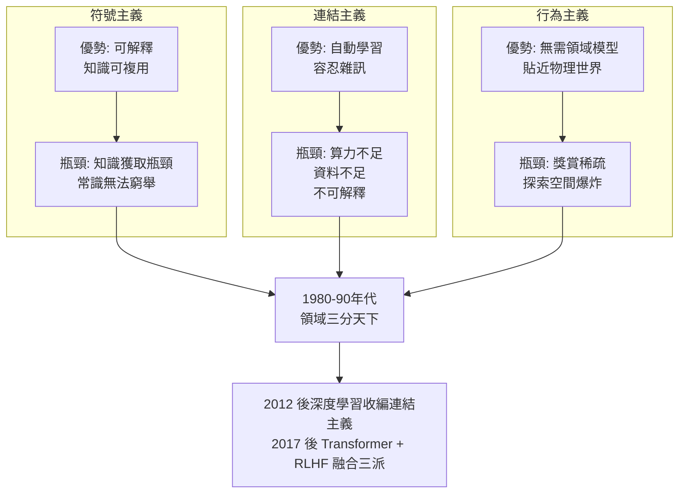
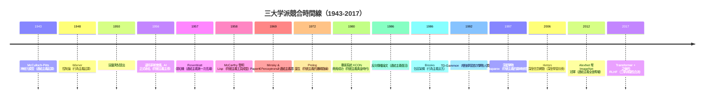

# 1.1 符號主義、連結主義與行為主義：三大学派之爭（1950-1990）

## 歷史背景

1950 年，Alan Turing 發表〈Computing Machinery and Intelligence〉，提出「機器能思考嗎？」的追問與著名的**圖靈測試**（Turing Test）。這篇論文把「智慧」從哲學思辨拉進了可操作的工程問題。1956 年夏天的**達特茅斯會議**（Dartmouth Conference）由 John McCarthy、Marvin Minsky、Claude Shannon、Nathaniel Rochester 共同發起，首次使用了「人工智慧」一詞，一般被視為 AI 作為獨立學科的誕生。

然而從一開始，「如何讓機器有智慧」就存在著多種互不相容的哲學立場。這些立場不只是學術品味差異，它們決定了研究者的工具選擇、資金流向，甚至造成了此後數十年 AI 領域的分裂與興衰。理解三大學派的爭論，是理解本書所有傳統 AI 技術的鑰匙——因為每一項技術幾乎都能歸屬於其中一個學派的血統。

> **為什麼 1950 年代會出現 AI？** 前提有三：(1) 電子數位計算機在 1940 年代成熟（ENIAC, 1945）；(2) Turing 與 von Neumann 建立了「計算」的數學理論；(3) McCulloch–Pitts（1943）證明了神經元的邏輯演算模型，使人們相信「思考可以形式化」。當時的氣氛是樂觀的：「教機器下棋，或許比教人類兒童還容易。」

## 三大学派的核心主張

| 學派 | 核心信念 | 代表人物 | 代表技術 | 隱喻 |
|------|----------|----------|----------|------|
| **符號主義**（Symbolicism） | 智慧 = 符號操作；思維是對符號的合法變換 | Newell、Simon、Minsky、McCarthy | 邏輯推理、專家系統、Lisp、搜尋演算法 | 心智是「實體符號系統」（Physical Symbol System） |
| **連結主義**（Connectionism） | 智慧從大量簡單單元的連結中湧現 | Rosenblatt、Rumelhart、Hinton、LeCun | 感知機、反向傳播、神經網路 | 心智是大腦；智慧在權重之中 |
| **行為主義**（Actionism / Cybernetics） | 智慧 = 感知—行動迴路；不需要內部表徵 | Wiener、Brooks、Sutton | 控制論、包容架構、增強學習 | 心智是身體；智慧在與環境的互動中 |

### 符號主義：實體符號系統假說

1976 年，Newell 與 Simon 正式提出**實體符號系統假說**（Physical Symbol System Hypothesis）：

> 「實體符號系統具有智慧行動的必要且充分手段。」

「必要」意味著：任何有智慧的系統（人類也好、機器也好）必然是符號系統；「充分」意味著：任何設計良好的符號系統終將展現智慧。這是一個極強的可證偽主張，也成為此後五十年 AI 哲學論戰的中心。

符號主義在 1950-1980 年代主導整個 AI 領域，因為它與當時的計算機硬體天然契合：數位計算機本來就是離散符號的處理器。程式語言 Lisp（1958，McCarthy）、搜尋演算法、定理證明、專家系統，全部是這條血統的產物。本書第 2、3、4 章的內容，正是符號主義的技術核心。

### 連結主義：從感知機到反向傳播

連結主義的血統更早：McCulloch 與 Pitts 在 1943 年就提出神經元的形式化模型。1949 年 Hebb 提出學習法則「同時激發的神經元連結會增強」（Hebbian learning）。1957 年 Rosenblatt 發明**感知機**（Perceptron），證明了一個單層網路可以透過資料自動學習分類規則——這在當年是革命性的：符號主義者需要人類工程師手工編碼知識，而感知機「自己學」。

但 1969 年，Minsky 與 Papert 出版《Perceptrons》，嚴格證明了單層感知機連 XOR 這種簡單函數都無法表示（線性不可分問題）。這本書被普遍認為澆熄了連結主義的資金與熱情，是**第一次 AI 寒冬**的推手之一。諷刺的是，多層網路的解法（隱藏層 + 反向傳播）在書中其實已被討論，只是當年缺乏高效演算法與算力。

1986 年，Rumelhart、Hinton、Williams 發表反向傳播演算法的系統性論文，連結主義復活。然而在傳統 AI 時代（本書的敘事範圍，約至 2012 年），連結主義始終是「在野黨」——它在語音辨識、手寫辨識等利基領域有成果，但要等到 2012 年 AlexNet 之後才真正奪權。

### 行為主義：控制論與「不需要表徵的智慧」

行為主義的前身是 1940-50 年代的**控制論**（Cybernetics，Wiener, 1948）：回饋迴路、目標追蹤、自我調節。英國神經生理學家 Grey Walter 在 1950 年代建造了會自動趨光充電的機器龜 Elmer 與 Elsie，只用兩個神經元等價的電路就展現出看似「有目的」的行為，震撼了當時的觀察者。

1986 年，Rodney Brooks 發表著名的〈Elephants Don't Play Chess〉與包容架構（Subsumption Architecture），主張：**智慧不需要中央符號表徵**。他建造的機器人 Genghis 沒有任何世界模型，只有分層的「感知—行動」模組，卻能在崎嶇地形上行走。Brooks 的口號是：

> 「世界就是它自己最好的模型。」

行為主義後來演化為**增強學習**（Reinforcement Learning）——Sutton 與 Barto 從 1980 年代起將動態規劃、試誤學習（Thorndike 的效果律，1911）與時序差分學習（TD-learning）系統化。1992 年 Tesauro 的 TD-Gammon 用增強學習達到西洋雙陸棋人類頂尖水準，是行為主義血統在傳統 AI 時代最耀眼的勝利。

## 三學派的比較分析

### 對「知識」的不同態度

三個學派對「知識從哪裡來」有根本分歧：

1. **符號主義**：知識是人類專家的顯性知識，應被**手工編碼**為規則或邏輯。學習是次要的、可有可無的。
2. **連結主義**：知識藏在**資料**裡，應由學習演算法自動提取為權重。表徵是分散式（distributed）的，無法直接閱讀。
3. **行為主義**：知識是**與環境互動的經驗**，透過獎賞訊號塑造行為策略，內部表徵可有可無。

這個分歧在 2010 年代之後有了戲劇性的答案：LLM 用連結主義的骨架（Transformer），行為主義的訓練迴路（RLHF，Reinforcement Learning from Human Feedback），吃下了符號主義者從未想像過規模的符號資料（整個網際網路的文字）。三學派在大模型中被無聲地統合了——這正是本書第 9 章的主題。

### 各自解決了什麼、又卡在哪裡



## 演算法說明：感知機學習法則

為了讓讀者體感連結主義與符號主義的差異，這裡給出 Rosenblatt 感知機的完整數學。

給定資料集 $\{(\mathbf{x}_i, y_i)\}_{i=1}^n$，其中 $\mathbf{x}_i \in \mathbb{R}^d$、$y_i \in \{-1, +1\}$。感知機定義決策函數：

$$\hat{y} = \operatorname{sign}(\mathbf{w}^\top \mathbf{x} + b)$$

其中 $\mathbf{w}$ 是權重向量，$b$ 是偏置。學習法則為：對每個被分錯的樣本，

$$\mathbf{w} \leftarrow \mathbf{w} + \eta \, y_i \, \mathbf{x}_i, \qquad b \leftarrow b + \eta \, y_i$$

**感知機收斂定理**（Novikoff, 1962）：若資料線性可分，則該演算法在有限次更新後必收斂，且更新次數 $k$ 滿足

$$k \le \frac{R^2}{\gamma^2}$$

其中 $R = \max_i \|\mathbf{x}_i\|$，$\gamma$ 是最佳分離超平面到最近樣點的間距（margin）。

這個定理的意義深遠：它證明了「從資料中學出規則」在數學上是可行的——但只在**線性可分**的前提下。XOR 問題的輸入點 $(0,0),(1,1)$ 為一類、$(0,1),(1,0)$ 為另一類，不存在任何直線可以分開它們，因此單層感知機必然失敗。要突破線性限制，需要非線性的隱藏層——而訓練多層網路需要解決 credit assignment 問題，這就是 1986 年反向傳播登場的歷史動機（本書在 9.1 節會再回顧）。

## Python 程式碼範例：用感知機學 XOR——以及它的失敗

```python
import numpy as np

class Perceptron:
    """Rosenblatt 感知機 (1957)"""
    def __init__(self, n_features, lr=0.1, epochs=50):
        self.w = np.zeros(n_features)
        self.b = 0.0
        self.lr = lr
        self.epochs = epochs

    def predict(self, X):
        return np.where(X @ self.w + self.b >= 0, 1, -1)

    def fit(self, X, y):
        for epoch in range(self.epochs):
            errors = 0
            for xi, yi in zip(X, y):
                pred = 1 if xi @ self.w + self.b >= 0 else -1
                if pred != yi:                       # 分錯才更新
                    self.w += self.lr * yi * xi
                    self.b += self.lr * yi
                    errors += 1
            if errors == 0:
                print(f"收斂於 epoch {epoch}")
                return
        print("50 個 epoch 仍未收斂（很可能線性不可分）")

# --- XOR 問題 ---
X = np.array([[0,0],[0,1],[1,0],[1,1]], dtype=float)
y_xor = np.array([-1, 1, 1, -1])
y_and = np.array([-1, -1, -1, 1])

p1 = Perceptron(2); p1.fit(X, y_and)   # AND: 線性可分 → 成功
p2 = Perceptron(2); p2.fit(X, y_xor)   # XOR: 線性不可分 → 失敗
print("AND 預測:", p1.predict(X))
print("XOR 預測:", p2.predict(X))     # 永遠分不對

# --- 符號主義的答案：一條規則就解決 XOR ---
def xor_rule(a, b):
    return 1 if (a != b) else -1       # 「不同為正」——人類寫死，零學習
print("符號規則 XOR:", [xor_rule(a, b) for a, b in X])
```

執行後你會看到：感知機在 AND 上快速收斂，在 XOR 上震盪不收斂；而符號主義者用兩行規則就「解決」了 XOR。這正是 1969 年《Perceptrons》對連結主義的致命一擊，也是兩學派方法論差異的縮影：**符號主義犧牲了學習，換取表達的精確；連結主義犧牲了精確與可解釋，換取學習的能力**。

## Mermaid 時間線：三學派的興衰



## 本節重點

1. **三大學派**對「智慧的本質」給出不同答案：符號操作、連結湧現、感知—行動迴路；每個學派衍生出完全不同的技術路線與本書不同的章節。
2. **實體符號系統假說**是符號主義的哲學基石，也是本書主角技術（專家系統、搜尋、邏輯推理）的共同前提。
3. 感知機的興衰說明了一個反覆出現的模式：**表達能力的理論限制**（XOR 線性不可分）比工程困難更具殺傷力；而解決一個學派的限制，往往靠的是另一學派或數十年後的新數學。
4. 三學派的根本分歧在於「知識從哪裡來」：手寫規則、資料學習、環境互動。這三種知識來源在 LLM 時代以預訓練（資料）、RLHF（互動）、提示工程（符號）的形式再度交會。

## 思考問題

1. 圖靈測試以「語言行為」判定智慧。請用三大學派各自的立場，各寫一段對圖靈測試的批評。
2. 感知機收斂定理給出的更新次數上限 $R^2/\gamma^2$，在資料接近線性可分但 margin 很小時會發生什麼？這與後來 SVM（第 6 章）「最大化 margin」的思想有什麼呼應？
3. 如果 1969 年《Perceptrons》沒有出版，AI 歷史會改寫嗎？連結主義的延遲，主要是理論被駁倒、算力不足，還是資料不足？
4. Brooks 說「世界就是它自己最好的模型」。請以自動駕駛為例，討論這句話的合理之處與危險之處。
5. 你認為實體符號系統假說今天被證偽了嗎？LLM 的向量表徵算是「符號」嗎？
