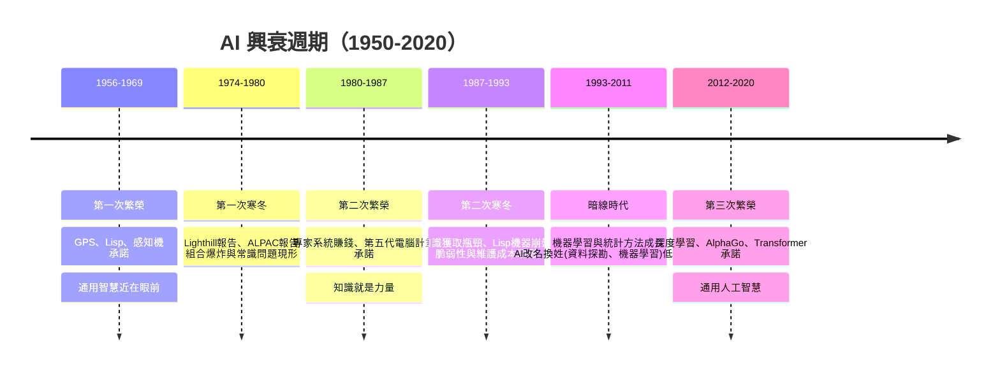

# 1.2 傳統 AI 的問題地圖與兩次寒冬的興衰週期（1950-2020）

## 歷史背景

如果把 1950-2020 年的 AI 歷史壓縮成一張圖，你會看到兩座高峰與兩個深谷：**兩次繁榮、兩次寒冬**（AI Winter）。這不是簡單的「時運不濟」，而是一個結構性的循環：每個時代，研究者用當時可用的數學與硬體去攻擊一個「看起來可解」的問題 → 早期成果驚豔、資金湧入、承諾過度膨脹 → 撞上理論或工程的硬牆 → 承諾跳票、資金撤出、領域寒冬 → 寒冬中孕育的基礎研究（往往無聲無息）成為下一次繁榮的火種。

理解這個循環，是本書的敘事主軸：本書每一章的技術，幾乎都是「某次繁榮期的王牌技術」或「某個寒冬期悶頭積累的暗線技術」。而 2012 年之後的深度學習繁榮之所以沒有立刻迎來第三次寒冬，正是因為它在「資料、算力、演算法」三個環節同時突破了過去每次引爆崩盤的結構性缺陷。

## 兩次寒冬的精確斷代

### 第一次寒冬（約 1974-1980）

**繁榮期（1956-1969）的承諾**：
- 達特茅斯會議提議書豪言「機器將能使用語言、形成抽象概念、解決目前只有人類才能解決的問題」。
- 1958 年 Simon 預言「十年內，數位計算機將成為世界西洋棋冠軍」與「十年內，數位計算機將發現並證明一個重要的新數學定理」。
- 早期成果確實驚人：Logic Theorist（1956）證明了《數學原理》中 38 條定理；General Problem Solver（GPS, 1957）宣稱是通用問題求解器；ELIZA（1966）讓人們相信對話機器近在眼前。

**撞上的硬牆**：
1. **組合爆炸**（Combinatorial Explosion）：棋類與定理證明的搜尋空間隨深度指數增長。西洋棋分支因子約 35，深 4 層就要搜尋 $35^4 \approx 150$ 萬個節點，深 40 層則是天文數字。早期 AI 的「通用解題」方案在玩具問題上漂亮，一到真實規模就崩潰。
2. **機器翻譯的失敗**：1966 年 ALPAC 報告指出機器翻譯又慢又差又貴，美國資助全面中止——NLP 因此沉寂近二十年。
3. **常識問題浮現**：研究者發現讓機器「看懂」一則簡單故事，需要海量的背景知識，而沒有人知道知識應該如何組織（引出第 2 章的知識表示研究）。
4. **Lighthill 報告（1973）**：英國科學研究委員會的這份報告嚴厲批評 AI「未能實現宏偉目標」，導致英國幾乎全面停止 AI 資助。

### 第二次寒冬（約 1987-1993）

**繁榮期（1980-1987）的承諾**：
- 專家系統（Expert System）成為第一個「真的賺到錢」的 AI：DEC 的 XCON 每年省下數千萬美元；幾乎所有大公司都成立 AI 部門；1985 年企業在 AI 上的年支出超過十億美元。
- 日本通產省 1982 年啟動**第五代電腦計畫**（Fifth Generation Computer Project），預算 8.5 億美元，宣稱以 Prolog 為核心建造「推理機」，引發美英的恐慌性投入。

**撞上的硬牆**：
1. **知識獲取瓶頸**（Knowledge Acquisition Bottleneck）：建造一個專家系統需要知識工程師花費數年訪談專家、手寫數千條規則，成本遠超收益，且規則之間互相衝突。
2. **脆弱性**（Brittleness）：專家系統在訓練分布內表現完美，遇到邊界情況就給出荒謬答案，且**不知道自己不知道**（引出第 5 章貝葉斯網路對不確定性的處理）。
3. **Lisp 機器市場崩盤**（1987）：通用 PC 與工作站效能追上昂貴的 Lisp 專用機，Sun、Apple 等公司以通用硬體加軟體模擬擊垮了 Symbolics、Lisp Machines Inc.，AI 硬體產業一年內蒸發約五億美元市值。
4. 第五代電腦計畫 1992 年宣告失敗：平行 Prolog 機器的架構選錯了賽道，同期通用平行計算與工作站才是正解。

## 問題地圖：傳統 AI 面對的五大根本難題

所有寒冬的深層原因，可以歸結為五個根本難題。本書後續章節，其實就是歷代研究者對這五個難題的攻堅史：

```mermaid
flowchart TD
    P[傳統AI的五大根本難題]
    P --> P1[難題1: 知識表示<br>知識怎麼寫進機器?]
    P --> P2[難題2: 組合爆炸<br>搜尋空間指數增長]
    P --> P3[難題3: 常識與默會知識<br>人視為理所當然的機器不懂]
    P --> P4[難題4: 不確定性<br>真實世界沒有確定規則]
    P --> P5[難題5: 特徵與表徵<br>感知資訊如何變成可推理的形態]

    P1 --> S1[第2章 知識表示與專家系統<br>第4章 邏輯與自動推理]
    P2 --> S2[第3章 搜尋演算法<br>第8章 演化計算]
    P3 --> S3[知識圖譜(第4.2節)<br>語料統計(第7.2節)<br>最終: LLM]
    P4 --> S4[第5章 貝葉斯網路與HMM]
    P5 --> S5[第6章 統計機器學習<br>第7章 手工特徵工程]

    S3 --> F1[2000s 統計方法吃掉符號方法]
    S5 --> F2[2012 表示學習吃掉特徵工程]
    F1 --> G[2012-2026 深度學習+LLM<br>第9章]
    F2 --> G
```

### 難題 1：知識表示——「寫下」智慧有多難？

符號主義假設智慧可以被寫成規則。但真實知識是黏稠的：一條規則總有未言明的例外（「鳥會飛——除了企鵝、駝鳥、被困在籠裡的鳥、死鳥……」）。McCarthy 稱之為**資格問題**（Qualification Problem）。Dreyfus 更從哲學上指出：人類專家的默會知識（tacit knowledge）本質上無法被完整外顯化。第 2 章的框架與語意網路、第 4 章的描述邏輯、以及最終的知識圖譜，都是對這個難題的接續嘗試。

### 難題 2：組合爆炸

第 3 章將完整展示：從盲目搜尋（BFS/DFS）到啟發式搜尋（A*），再到博弈搜尋的 Alpha-Beta 剪枝，每一代演算法都是在與指數爆炸賽跑。傳統 AI 的極限也在此：**沒有好啟發式的領域，符號搜尋就無能為力**。而「好啟發式」本身往往又是人類專家手工給出的——這又回到難題 1。

### 難題 3：常識問題

Winograd Schema 挑戰（1972）給出了精準的例子：句子「把獎盃從盒子裡拿出來，因為**它**太小了」與「……因為**它**太大了」，代詞「它」指涉完全不同——需要真實世界的常識。符號方法編不完常識（Cyc 專案 1984 年起手寫了數百萬條常識規則仍未成功），直到 LLM 從語料中「泡」出常識分佈。

### 難題 4：不確定性

早期專家系統用 MYCIN 的**確定因子**（Certainty Factor）這類 ad hoc 數值湊合不確定性，結果在規則鏈中傳播錯誤。1985 年 Pearl 的貝葉斯網路（第 5 章）第一次給出有嚴格機率語意的框架，是傳統 AI 內部「數學化修正」的典範。

### 難題 5：特徵與表徵

視覺與語音的原始訊號（像素、聲波）與符號世界（物件、音素）之間隔著巨大鴻溝。傳統 AI 的答案是**手工特徵工程**（第 7 章：SIFT、HOG、MFCC），把領域知識寫進特徵抽取器。深度學習的革命（第 9 章）正是用「表示學習」取代了它。

## 興衰週期的結構分析



### 為什麼會出現「承諾過度膨脹」？

興衰週期並非偶然，而是由三個正回饋迴路驅動：

1. **資金—媒體迴路**：早期成功 → 媒體報導 → 官方與企業加碼 → 研究者被期待給出更大承諾。達特茅斯會議的提議書本身就是最好的公關文件。
2. **玩具問題迴路**：在 8 皇后、積木世界等玩具問題上的成功，讓人誤以為放大即可解決真實問題；但真實問題有玩具問題沒有的「長尾」。
3. **單一技術押注迴路**：繁榮期資源集中押注單一範式（1970s 的通用解題、1980s 的專家系統、1980s 的第五代機），一旦該範式撞牆，整個領域跟著陪葬。

### 寒冬期教會了 AI 什麼？

第二次寒冬之後，AI 社群內部形成了深刻的經驗教訓，這些教訓直接塑造了 1990-2012 年（本書第 5、6、7 章）的「統計轉向」：

1. **從「承諾」轉向「基準」**：改用可量化的任務（Text REtrieval Conference、CoNLL、ImageNet）評估，取代宣言式的承諾。
2. **從「知識手工編碼」轉向「從資料學習」**：既然寫不完規則，就讓統計模型從語料與資料集中挖規律。
3. **從「通用智慧」轉向「窄域解題」**：先在單一任務上達到可用精度，再談推廣。

1990 年代 AI 一詞甚至一度是研究者的避諱——機器學習、資料探勘、模式辨識成為更「安全」的標籤。這種低調反而讓技術扎實成長，為 2012 年的爆發積蓄了能量。

## Python 程式碼範例：組合爆炸的實證

與其抽象地說「指數增長」，不如親手跑一次。下面用三種搜尋策略解 8-皇后與更高維的 N-皇后，觀察搜尋節點數的增長差異：

```python
import itertools, math, random

def conflicts(state):
    """state[i] = 第 i 行皇后所在的欄。回傳衝突對數。"""
    n = len(state); c = 0
    for i in range(n):
        for j in range(i+1, n):
            if state[i] == state[j] or abs(state[i]-state[j]) == j-i:
                c += 1
    return c

def brute_force(n):
    """盲目搜尋: 檢查所有排列 O(n!)"""
    count = 0
    for perm in itertools.permutations(range(n)):
        count += 1
        if conflicts(perm) == 0:
            return perm, count
    return None, count

def random_restart_hill_climbing(n, restarts=100):
    """啟發式局部搜尋(符號AI的另一支): 只看衝突數"""
    best, evals = None, 0
    for _ in range(restarts):
        state = list(range(n)); random.shuffle(state)
        while True:
            neighbors = []
            for i in range(n):
                for j in range(i+1, n):
                    s = state[:]; s[i], s[j] = s[j], s[i]
                    neighbors.append((conflicts(s), s)); evals += 1
            c, s = min(neighbors)
            if c >= conflicts(state): break
            state = s
            if conflicts(state) == 0: return state, evals
        best = state
    return None, evals

for n in [6, 8, 10]:
    sol, nodes = brute_force(n)
    print(f"N={n} 盲目搜尋列舉了 {nodes:,} 個排列 ({math.log10(max(nodes,1)):.1f} 位數量級)")

for n in [8, 30, 100]:
    sol, evals = random_restart_hill_climbing(n)
    ok = "解" if sol else "未解"
    print(f"N={n} 局部搜尋約 {evals:,} 次評估 → {ok}")
```

典型輸出（數值因隨機而異）：

```
N=6 盲目搜尋列舉了 720 個排列 (2.9 位數量級)
N=8 盲目搜尋列舉了 40320 個排列 (4.6 位數量級)
N=10 盲目搜尋列舉了 3628800 個排列 (6.6 位數量級)
N=8 局部搜尋約 3,000 次評估 → 解
N=30 局部搜尋約 20,000 次評估 → 解
N=100 局部搜尋約 90,000 次評估 → 解
```

對 N=100，排列總數 $100! \approx 9.3 \times 10^{157}$ ——比可觀測宇宙的原子數還多，盲目搜尋毫無希望；而一個簡單的啟發式（只維持「衝突數下降」的局部性）用不到十萬次評估就找到解。這就是第 3 章全部內容的種子：**智慧 = 選對「往哪裡看」**。

## 本節重點

1. 兩次寒冬的表面原因不同（第一次：組合爆炸與機翻失敗；第二次：知識獲取瓶頸與專家系統脆弱性），深層原因相同：**單一範式被過度承諾後撞上根本難題**。
2. 傳統 AI 的五大根本難題——知識表示、組合爆炸、常識、不確定性、特徵表徵——構成整本書的問題地圖；每一章的技術都是對其中一個（或多個）難題的攻堅。
3. 興衰週期由「資金—媒體」「玩具問題」「單一押注」三個正回饋迴路驅動；寒冬期的教訓（基準評估、從資料學習、窄域解題）直接催生了 1990 年代的統計轉向。
4. 2012 年後的繁榮未立即崩盤，是因為資料（網際網路）、算力（GPU）、演算法（深度學習）三個環節同時打破了過去的結構性缺陷——但它是否引入了新的迴路與新難題，是本書第 9 章與讀者要共同回答的問題。

## 思考問題

1. 用本節的三個正回饋迴路分析 2023 年至今的 LLM 熱潮：哪些迴路在運作？有沒有出現「玩具問題迴路」的現代版本？
2. Lighthill 報告批評 AI「組合爆炸」與「只解玩具問題」。請檢視這兩項批評在今天的神經網路上是否仍然成立。
3. 常識問題：Cyc 專案手寫了數百萬條常識規則仍失敗，LLM 卻似乎「免費」獲得常識。請推測兩者本質差異（顯性規則 vs 分佈統計）各自的方式論上意味著什麼。
4. 若你是 1985 年的 AI 研究者，眼見專家系統熱潮，你會押注哪個方向避開第二次寒冬？你的判斷依據是本節五難題中的哪一個？
5. 五大難題中，你認為哪一個到今天（LLM 時代）仍完全未解？為什麼？
