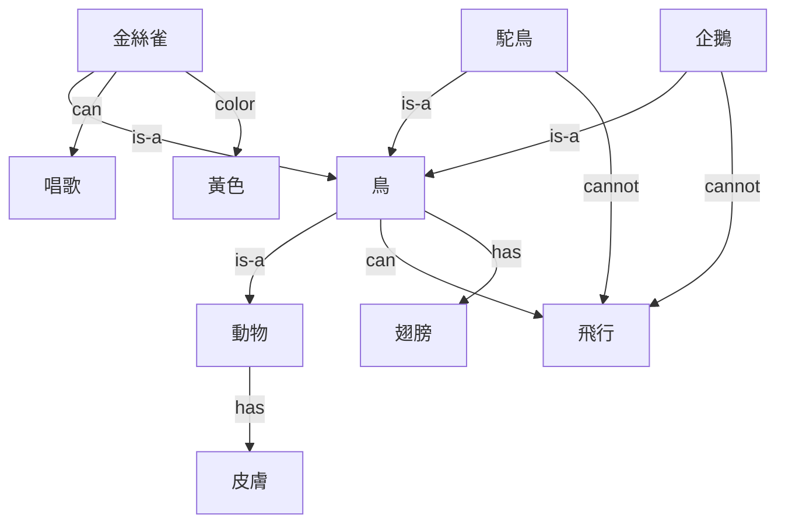
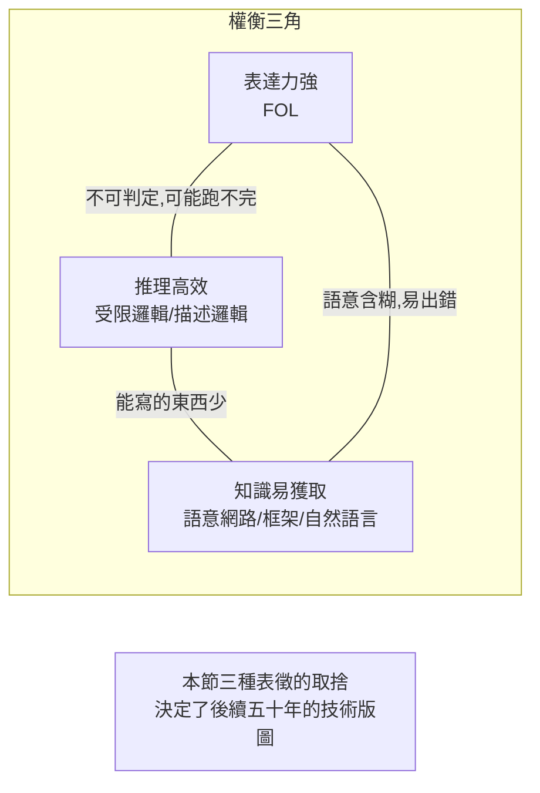

# 2.1 邏輯、語意網路與框架：知識如何被編碼（1958-1980）

## 歷史背景

第一次寒冬的教訓之一是：**搜尋不是萬能的**。Newell 與 Simon 的 General Problem Solver 證明了「手段—目的分析」在玩具問題上可行，但真實問題需要的不只是推理程序，而是**內容**——領域知識。1970 年代 AI 社群的口號從「通用解題」轉為「**知識就是力量**」（Knowledge is Power），這句話成為費根鮑姆（Edward Feigenbaum）知識工程運動的旗幟。

於是核心問題浮現：**知識應該以什麼形式寫進機器？** 三種主要表徵形式在 1960-70 年代相繼誕生：

- **邏輯**（Logic）：以形式語言（命題邏輯、一階邏輯）精確刻畫事實與規則，源於 Frege（1879）與 Russell 的數理邏輯傳統，由 McCarthy（1958）引入 AI。
- **語意網路**（Semantic Network）：以節點與邊的圖結構表示概念與關係，源自 Quillian（1966）對人類語意記憶的心理學建模，以及 Richens（1956）早期的機器翻譯互聯結構。
- **框架**（Frame）：Minsky（1974）提出的結構化表徵，一個框架是一個「刻板情境」的資料結構，含槽（slot）與填槽值（filler），源自視覺感知研究中的「圖式」（schema）概念。

這三種形式並非平等競爭，而是各有語意承諾：邏輯追求**精確可推理**，語意網路追求**符合人類聯想記憶**，框架追求**結構化的預設與預期**。它們之後在 1970-80 年代逐步融合：語意網路 + 邏輯 → 描述邏輯（第 4.2 節）；框架 + 規則 → 專家系統的知識庫（第 2.2 節）；框架的槽值繼承 → 物件導向程式設計（Smalltalk、C++ 的類別與繼承明顯承襲框架）。

## 命題邏輯與一階邏輯的快速回顧

### 命題邏輯

命題邏輯的原子是整個命題 $P, Q, \ldots$ ，連接詞為 $\neg, \land, \lor, \rightarrow, \leftrightarrow$ 。語意由真值表給定。它精確但表達力太弱：無法表達「所有人都會死」這種泛化句子。

### 一階邏輯（First-Order Logic, FOL）

一階邏輯加入**物件、關係、量詞**：

$$\forall x \, (\text{Human}(x) \rightarrow \text{Mortal}(x))$$
$$\text{Human}(\text{Socrates})$$
$$\therefore \; \text{Mortal}(\text{Socrates})$$

這三行構成一個經典的三段論演繹。一階邏輯的關鍵性質：

- **語意**（Semantics）：模型是論域 $D$ 加上對謂詞、函數、常數的解釋 $I$ 。公式在模型中為真或假。
- **蘊含**（Entailment）： $KB \models \alpha$ 表示所有使 $KB$ 為真的模型都使 $\alpha$ 為真。
- **完備性**：Gödel（1930）證明一階邏輯存在完備的證明系統——凡是邏輯上必然的結論，都可被機械地證出。這是 AI 敢於做「自動推理」的數學靠山（第 4 章主題）。
- **不可判定性**：Church（1936）與 Turing（1936）證明一階邏輯的有效性問題（所有模型下為真）不可判定——沒有演算法能對任意公式判定是否邏輯有效。自動推理注定要在完備性與實用性之間折衷。

一階邏輯表達力強，但 AI 研究者很快發現三個實務困難：(1) 寫一個真實領域的完整 FOL 知識庫極其費力（難題 1：知識獲取）；(2) 演繹太「保守」——邏輯上推不出的知識就無法使用，人類卻大量依賴預設與捷徑；(3) 沒有處理不確定性與預設推翻的機制（難題 4）。這些困難直接催生了語意網路與框架。

## 語意網路：概念之間的圖

Quillian 的洞見：人類記憶中，「金絲雀會唱歌」「金絲雀是鳥」「鳥有翅膀」這些知識不是一堆獨立語句，而是**以概念為節點、以關係為邊**的網路，且普遍屬性存在上位概念上，由**繼承**（inheritance）取得。查詢「金絲雀有翅膀嗎」不必直答，而可沿 `is-a` 邊上行至「鳥」取得屬性。



### 邊的語意問題

語意網路的致命弱點是**邊的語意含糊**：`is-a` 有時指「子類別」（金絲雀 is-a 鳥），有時指「實例」（Tweety is-a 金絲雀），有時指「屬性謂詞」；`can` 是能力、允許還是傾向？沒有形式語意的網路，無法保證推理結果正確。後來的**描述邏輯**（第 4.2 節）正是為了給語意網路一個精確的邏輯語意而生——這是「心理學啟發的表徵」被「邏輯馴化」的歷史過程。

另一個弱點是**預設例外**：鳥會飛，但企鵝不會。語意網路用「例外邊」打補丁，卻無法回答「企鵝會飛嗎」到底該走哪條邊。這引出了 **非單調推理**（Non-monotonic Reasoning）的 1980 年代研究熱潮（預設邏輯、封閉世界假設），也是知識表徵最深的傷口之一。

## 框架：結構化的刻板情境

Minsky 在〈A Framework for Representing Knowledge〉（1974）中批判了「將知識拆成獨立原子語句」的路線。他主張：人遇到一個情境（走進旅館房間、參加生日派對）時，是從記憶中**取出整個結構化框架**，框架預先填好了預期——牆在哪裡、床在哪裡、哪些細節可以忽略。遇到新事實就填入槽位；槽位未填時用預設值（default）補上。

框架的形式要素：

- **槽**（slot）：框架的屬性欄位（如「旅館房間」框架的 `床數`、`價格`）。
- **填槽值**（filler）：槽的值，可以是常數、另一個框架、或**程序附件**（procedural attachment，如 `if-needed`、`if-added` 這樣的觸發程序）。
- **預設值**（default）：槽的預期值，可被具體事實推翻。
- **父子繼承**：子框架自動繼承父框架的槽與預設值，除非覆寫（override）。

框架的**程序附件**是一個影響深遠的妥協：它承認「純宣告式知識不夠」，在資料結構裡嵌入了程式碼。這個想法直接影響了物件導向程式設計——框架 ≈ 類別、實例框架 ≈ 物件、槽 ≈ 屬性、程序附件 ≈ 方法、預設值與覆寫 ≈ 繼承與多型。Alan Kay 明言 Smalltalk 受 Minsky 框架理論影響。

### 框架與腳本

Schank 與 Abelson（1977）將框架動態化為**腳本**（Script）：一個刻板的**事件序列**（餐廳腳本：入座 → 看菜單 → 點餐 → 用餐 → 付帳）。用腳本回答「John 進了餐廳，點了漢堡，付了帳。他給小費了嗎？」這類問題時，系統可以用腳本補出未言明的中間事件。這是 AI 最早對「常識推理依賴刻板情境」的系統性建模——而它與 LLM 的相似性值得注意：兩者都依賴「從大量經驗中沉澱出來的典型模式」，只是 LLM 的模式是從語料統計學到的，腳本是人工寫的。

## Python 程式碼範例：實作一個小型框架系統

```python
class Frame:
    def __init__(self, name, parent=None, **slots):
        self.name = name
        self.parent = parent          # 繼承鏈
        self.slots = dict(slots)      # 槽名 → (值, 類型, 預設)
        self.demons = {}              # 程序附件: 槽名 → 函數

    def get(self, slot):
        """沿繼承鏈查詢槽值; 未提供時呼叫 if-needed demon; 再不行用預設"""
        f = self
        while f is not None:
            if slot in f.slots and f.slots[slot] is not None:
                return f.slots[slot]
            if slot in f.demons:                      # procedural attachment
                return f.demons[slot](self)
            f = f.parent
        return None

    def set(self, slot, value):
        self.slots[slot] = value
        if slot in self.demons:                       # if-added demon
            self.demons[slot](self, value)

    def __repr__(self):
        return f"<Frame {self.name} {self.slots}>"

# ---- 建構框架層級 ----
thing = Frame("thing", 預設重量="未知")
animal = Frame("animal", parent=thing, 有皮膚=True, 會移動=True)
bird = Frame("bird", parent=animal, 有翅膀=True, 會飛=True)   # 預設: 鳥會飛
penguin = Frame("penguin", parent=bird, 會飛=False)          # 例外覆寫
tweety = Frame("tweety", parent=bird, 顏色="黃")

# ---- if-needed demon: 需要時才計算 ----
tweety.demons["鳴叫聲"] = lambda f: "啾啾" if f.get("會飛") else "咕咕"

print(tweety.get("有翅膀"))   # True  ← 沿 is-a 繼承自 bird
print(tweety.get("會飛"))     # True  ← 繼承預設值
print(penguin.get("會飛"))    # False ← 子框架覆寫預設
print(tweety.get("鳴叫聲"))   # 啾啾 ← 程序附件按需觸發
```

這個 30 行的迷你系統涵蓋了框架的三個關鍵機制：**繼承查詢、預設值覆寫、程序附件**。讀者可以發現它的感受性很強（幾乎是 Python 物件導向的鏡像），但也暴露了弱點：`會飛` 的繼承是「第一個找到的值取勝」，多父框架（多重繼承）時衝突如何解？語意上 `False` 是「確定不會」還是「暫時不會」？框架系統從不回答這些問題——它們被推給了邏輯（第 4 章）與機率（第 5 章）。

## 知識表徵的權衡三角

三種表徵形式各自在「表達力—推理效率—知識獲取成本」三角中取不同位置：



這個三角是傳統 AI 的宿命：**你只能同時擁有兩個**。專家系統（2.2 節）選了「易獲取 + 高效」而放棄嚴格語意（用 ad hoc 的確定因子）；描述邏輯選了「表達力 + 語意精確」而受控於複雜度；而 LLM 最終選了「易獲取 + 表達力」（自然語言直接輸入）而犧牲了可驗證的精確性。

## 本節重點

1. 1970 年代 AI 的重心從「通用解題」轉向「知識表示」；三種形式——邏輯（精確）、語意網路（心理學直覺）、框架（結構化預期）——各有語意承諾與弱點。
2. 一階邏輯有完備證明系統但不可判定；表達力與可計算性的衝突貫穿了整個自動推理史。
3. 語意網路的 `is-a` 語意含糊與預設例外問題，直接催生了描述邏輯與非單調推理兩條研究線。
4. 框架的槽、預設值、程序附件深刻影響了物件導向程式設計；腳本則是 AI 對「刻板情境中的常識」的最早建模。
5. 「表達力—推理效率—知識獲取」的權衡三角是傳統 AI 的宿命；LLM 以可驗證性為代價同時取得了三者中的兩個。

## 思考問題

1. 用本節的框架系統表示「餐廳腳本」，並嘗試回答 Schank 的「他給小費了嗎」問題。缺了什麼？
2. 預設值覆寫（企鵝不會飛）在多重繼承下會產生「Yale Shooting Problem」式的詭論。請查閱並討論非單調推理為何在 1980 年代熱鬧十年後又沉寂。
3. 若語意網路的每條邊都給出精確的邏輯語意，它會變成什麼？（提示：描述邏輯。）這種「馴化」損失了什麼？
4. LLM 的 Transformer 權重可以被視為一種「隱式知識表徵」。比較它與框架/語意網路在「可編輯性」與「可組合性」上的差異。
5. 知識獲取瓶頸若如此致命，為何 1970 年代的研究者仍堅持手工編碼路線二十年？從社群與資助結構的角度分析。
