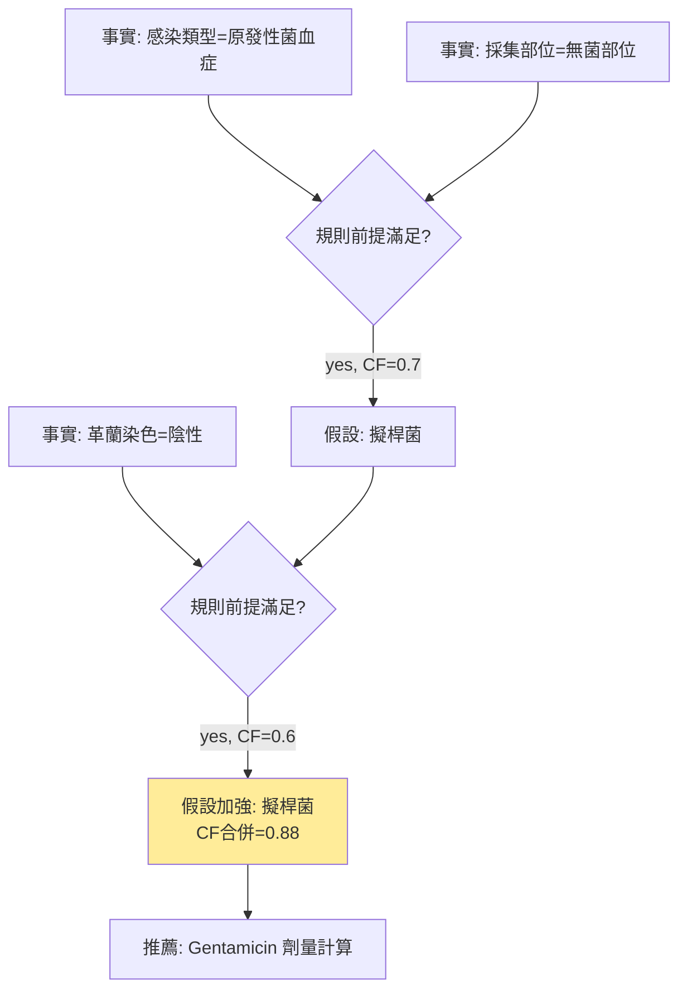
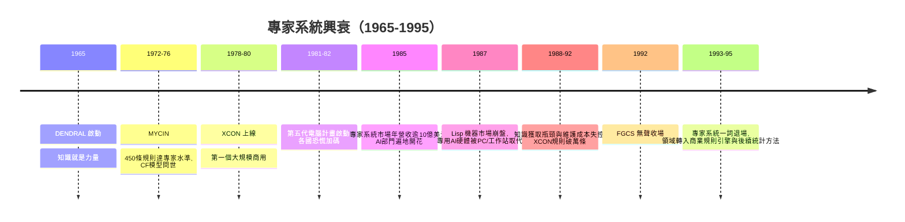

# 2.2 專家系統黃金時代與第二次寒冬：MYCIN 到 Japanese Fifth Generation（1980-1990）

## 歷史背景

1970 年代中期，史丹佛的 Edward Feigenbaum 團隊做出一個關鍵的策略決定：**放棄通用智慧，專攻單一狹窄領域的專家級表現**。這個「性能重於通用性」的路線催生了專家系統（Expert System）——傳統 AI 唯一一次大規模商業化，也是第二次寒冬的直接引爆點。

黃金時代的技術心臟是**知識庫 + 推理引擎**的分離架構：領域知識寫成 if-then 規則，與使用規則的通用推論機制分開。這個架構的商業承諾是：換個領域，只需重寫知識庫。這個承諾後來被證明嚴重高估——但它的失敗方式，精確地暴露了符號 AI 的結構極限。

## 標誌性系統

| 系統 | 年代 | 領域 | 規則數 | 歷史意義 |
|------|------|------|--------|----------|
| DENDRAL | 1965-69 | 質譜推斷分子結構 | ~數百 | 第一個專家系統；「知識就是力量」的起源 |
| MYCIN | 1972-76 | 細菌感染診斷與用藥 | ~450 | 確定因子；醫學 AI 範本；從未臨床使用 |
| XCON/R1 | 1978-80 | DEC 電腦配置 | ~10,000+ | 第一個大規模商用成功，年省數千萬美元 |
| PROSPECTOR | 1978-83 | 礦藏探勘 | ~1,100 | 機率推理；曾「找到」價值上億美元的鉬礦 |
| CADUCEUS/INTERNIST-I | 1970s-80s | 內科診斷 | ~500,000 | 嘗試覆蓋全內科，暴露規則爆炸 |

### MYCIN 的設計

MYCIN（Shortliffe, 1976）診斷血液細菌感染並推薦抗生素劑量。它的規則形式如：

> IF 感染是原發性菌血症 AND 採集部位是無菌部位 AND 疑似入口是胃腸道  
> THEN 證據顯示感染原為擬桿菌（確定因子 0.7）

MYCIN 的特色與命門都在**不確定性的 ad hoc 處理**。它使用**確定因子**（Certainty Factor, CF）：

$$CF(H, E) \in [-1, 1]$$

正值表示證據 $E$ 支持假設 $H$ 的程度，負值反對。兩條規則支持同一假設時合併：

$$CF_{combine}(c_1, c_2) = \begin{cases} c_1 + c_2(1 - c_1) & \text{if } c_1, c_2 \ge 0 \\ \frac{c_1 + c_2}{1 - \min(|c_1|, |c_2|)} & \text{if } c_1, c_2 < 0 \\ \frac{c_1 + c_2}{1 - \min(|c_1|,|c_2|)} & \text{otherwise} \end{cases}$$

CF 模型的問題（Adams, 1976 的批評）：它不是機率論——合併公式在規則鏈中傳播時會產生數學上不自洽的結果，例如證據重複計入時 CF 會被重複累加。MYCIN 之父之一後來承認：CF 是為了讓系統「看起來合理」而湊出來的。**正因如此，它直接觸發了 Pearl 在 1980 年代以機率論重整 AI 的革命**（第 5 章開場）。

MYCIN 的評估是黃金時代的驕傲：盲測中 MYCIN 的處方建議被專家評為優於 Stanford 醫學院教師的平均水準。但它從未上線看診——原因包括法律責任（誰為錯誤處方負責）、醫界文化，以及系統在 450 條規則之外的脆弱性。**「技術上達專家水準」與「實際可用」之間的鴻溝**，是本節最重要的教訓。

### XCON 的成功與崩壞

DEC 的 XCON 為每台 VAX 電腦產生客製化配置單，是唯一公認商業成功的專家系統：1980 年上線，處理率 95% 以上，每年為 DEC 省下 2,500 萬美元。但它的衰亡更具教育意義：DEC 產品線不斷變動，規則庫以每年 8,000 條的速度增長（最終逾萬條），規則間的隱性交互作用使維護成本失控——改一條規則可能在別處引爆衝突。XCON 證明了：**沒有全域一致性的知識庫，會隨規模腐化**。

## 推理引擎：前向鏈與後向鏈

### 前向鏈（Forward Chaining，資料驅動）

從已知事實出發，反覆找到「前提滿足」的規則觸發之，把結論加入事實集，直到無規則可觸發或得出目標。這是 Rete 演算法（Forgy, 1979）優化的對象：Rete 將規則條件建成共用網路，增量更新匹配集，使數千條規則的系統能即時反應。CLIPS、Jess、Drools 等規則引擎至今仍用 Rete。

### 後向鏈（Backward Chaining，目標驅動）

從目標（假設）出發，找「結論匹配目標」的規則，將其前提變成子目標遞迴求解。Prolog 即後向鏈的語言（第 4.1 節）。診斷類系統（MYCIN）偏好後向鏈：只問與當前假設相關的問題，如同醫師問診。



## 知識獲取瓶頸：黃金時代的阿基里斯腱

建造專家系統的流程是**知識工程**（Knowledge Engineering）：知識工程師訪談領域專家，把專家的「我知道怎麼做但說不清楚」的直覺，轉寫成形式化規則。Feigenbaum 稱之為知識瓶頸，並估計知識工程的成本約為「每條規則數百美元」。這個過程有三層困難：

1. **專家的知識是默會的**（Polanyi: "we know more than we can tell"）：專家看一張 X 光片「直接」看到病灶，但說不出中間的特徵判斷步驟。規則是專家**事後合理化**的產物，未必是實際決策依據。
2. **規則庫沒有全域一致性**：數千條規則由不同時期的訪談累積，交互作用無人能全盤掌握（XCON 的腐化即其果）。
3. **領域邊界外全是斷崖**：MYCIN 知道細菌，不知道病人可能根本不是細菌感染。系統缺乏「知道自己不知道」的能力——這是符號系統的結構性缺陷，因為每條知識都要被顯式寫下，而「我不知道什麼」無法窮舉。

這三層困難合起來，構成第二次寒冬的技術面主因：**系統越大越脆弱，維護成本指數上升**。商業界發現專家系統是「買得起、養不起」的資產。

## 日本第五代電腦計畫

1982 年，日本通產省（MITI）啟動**第五代電腦系統**（Fifth Generation Computer Systems, FGCS）十年計畫，預算 8.5 億美元（當時約合 4 億美元實際撥款），目標是以**平行邏輯程式設計**（並列 Prolog）建造「推理機」，宣稱可支撐自然語言對話、機器翻譯與知識處理。FGCS 的歷史意義有三：

1. **地緣政治效應**：日本宣言引發美英恐慌性回應。美國成立 MCC 聯盟、英國推出 Alvey 計畫（4.7 億英鎊）——各國政府以「國家隊」規模押注一條特定技術路線，正是第 1.2 節所述「單一押注迴路」的最大規模上演。
2. **技術判斷的時代錯誤**：FGCS 押注邏輯程式語言＋專用平行硬體。但同期 RISC 工作站、通用平行計算與 C 語言生態快速發展；FGCS 的專用機器在 1992 年計畫結束時已被通用硬體超越。其產出（如五世機 PIM）在學術上有價值（平行推理、約束求解），商業上全軍覆沒。
3. **失敗的公共性**：FGCS 是政府主導、全球矚目的巨型計畫，其 1992 年的無聲收場等於向全世界宣告「符號 AI 路線的國家級實驗失敗」，加速了第二次寒冬的降溫與「AI」一詞的污名化。

## 專家系統的衰亡與遺產



衰亡的原因不是「規則推理沒用」，而是五個結構性問題疊加：

1. **知識獲取瓶頸**：人工編碼速度跟不上知識增長。
2. **脆弱性**：分布外全線崩潰，且無自我覺察。
3. **維護腐化**：無全域一致性，規模越大越難改。
4. **不確定性處理失當**：CF 類 ad hoc 數值在鏈式推理中放大錯誤（促成貝葉斯革命）。
5. **經濟結構**：專用硬體（Lisp 機器）被通用硬體碾壓，軟體遷移成本高。

但專家系統留下的遺產真實存在：(1) **知識庫/推理引擎分離**成為此後所有系統的架構範式；(2) 規則引擎（Rete）至今活在金融風控、合規系統中；(3) 醫學決策支持的知識本體傳統演化為 SNOMED CT、知識圖譜；(4) 「領域知識重要」的教訓以不同形態回歸——今天的 retrieval-augmented generation（RAG）中，向量庫扮演了當年知識庫的角色。

## Python 程式碼範例：一個迷你專家系統（後向鏈 + 確定因子）

```python
RULES = [
    # (結論, 前提串列, CF)
    ("fungal_infection", ["gram_negative", "culture_anaerobic"], 0.6),
    ("fungal_infection", ["fever_high", "wbc_low"],              0.4),
    ("bacterial_infection", ["fever_high", "wbc_high"],          0.7),
    ("bacterial_infection", ["gram_positive"],                   0.5),
    ("prescribe_antibiotic", ["bacterial_infection"],            0.9),
    ("prescribe_antifungal", ["fungal_infection"],               0.9),
]

def ask(symptom, known):
    if symptom not in known:
        known[symptom] = float(input(f"病人有「{symptom}」嗎? (0~1, 0=無): "))
    return known[symptom]

def backward_chain(goal, known):
    """後向鏈: 取所有支持 goal 的規則, 合併其確定因子"""
    cf_total, evidence_count = 0.0, 0
    for conclusion, premises, cf_rule in RULES:
        if conclusion != goal:
            continue
        cf_min = 1.0                              # 前提取最小 CF(AND 語意)
        for p in premises:
            cf_p = ask(p, known)                  # 缺的事實向使用者提問
            cf_min = min(cf_min, cf_p)
        if cf_min > 0:
            cf_total += cf_rule * cf_min
            evidence_count += 1
    if evidence_count == 0:
        return 0.0
    return cf_total                               # 極簡化的 CF 合併(非嚴格MYCIN公式)

def cf_combine(c1, c2):
    """MYCIN 的合併公式"""
    if c1 >= 0 and c2 >= 0:
        return c1 + c2 * (1 - c1)
    if c1 < 0 and c2 < 0:
        return c1 + c2 * (1 + c1)
    return (c1 + c2) / (1 - min(abs(c1), abs(c2)))

if __name__ == "__main__":
    known = {"fever_high": 0.9, "wbc_high": 0.8, "gram_positive": 0.6, "wbc_low": 0.0}
    for h in ["bacterial_infection", "fungal_infection"]:
        print(f"{h}: CF = {backward_chain(h, known):.2f}")
```

執行後系統像醫師問診般聚焦提問（後向鏈只問與假設相關的事實），給出帶 CF 的診斷。請注意兩個伏筆：(1) `cf_total += ...` 這種合併在證據相關時會重複計分——這正是 Adams 批評 CF 的要害，也是 Pearl 用貝葉斯網路取代 CF 的動機；(2) 系統對「已知之外」的可能病因完全沉默——脆弱性的具體呈現。

## 本節重點

1. 專家系統以「性能重於通用性」取得傳統 AI 唯一的大規模商業成功（XCON 年省千萬美元），MYCIN 達到專家級診斷水準。
2. 知識庫/推理引擎分離、前向/後向鏈、Rete 演算法是本節的技術核心；後向鏈的「聚焦提問」能力使其適合診斷任務。
3. 確定因子是有用的工程湊合、卻是糟糕的數學：證據相關時重複計分，直接催生 Pearl 的貝葉斯網路革命。
4. 知識獲取瓶頸的根源是專家默會知識的外顯化困難；規則庫隨規模腐化（XCON）證明符號知識庫沒有自然的全域一致性。
5. 第五代電腦計畫是國家級「單一押注」的教訓；其失敗與 Lisp 機器崩盤共同構成第二次寒冬，並造成「AI」一詞十年污名化。

## 思考問題

1. MYCIN 達到專家水準卻從未上線。請列出你認為今日醫療 AI（如輔助診斷模型）仍面對的相同障礙，與已被克服的障礙。
2. 用 cf_combine 公式驗證：同一證據經兩條路徑到達同一假設時，CF 會被重複計分。請設計一個數值例子，並說明貝葉斯網路如何用條件獨立性避免此問題（預習第 5 章）。
3. XCON 的規則庫腐化與今天的「大規模 LLM 提示工程腐化」有何相似之處？向量資料庫（RAG）是解藥還是新問題？
4. 若你是 1983 年的日本通產省官員，你會如何設計 FGCS 的審查機制，使「押注錯誤路線」能在中途被偵測與修正？
5. 知識工程師訪談專家的過程，與今天從人類回饋中訓練模型（RLHF）有什麼結構上的相似與相異？
