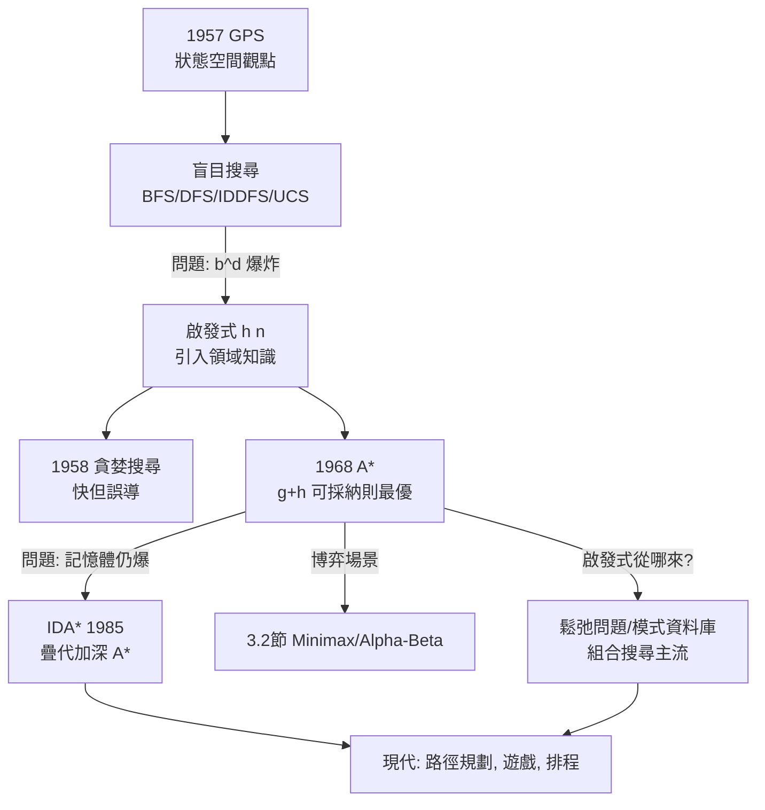

# 3.1 盲目搜尋與啟發式搜尋：從 BFS 到 A*（1950-1968）

## 歷史背景

搜尋是 AI 最古老的統一視角：Newell、Shaw 與 Simon 在 1957 年的 General Problem Solver 中主張，問題求解 = 在**狀態空間**（state space）中從初始狀態找到通往目標狀態的路徑。這個觀點把下棋、路徑規劃、定理證明、排程全部統一為「搜尋」，是符號 AI 最大的理論野心。

但它立刻撞上**組合爆炸**：狀態空間往往是指數甚至階乘大小（第 1.2 節的 $100! \approx 9.3\times10^{157}$ ）。1950-60 年代 AI 的十年，本質上是一部「與指數爆炸賽跑」的歷史：先建立盲目搜尋的基礎理論（BFS、DFS、一致性代價搜尋），再發明利用**領域知識**的啟發式搜尋，最後在 1968 年由 Hart、Nilsson 與 Raphael 在 SRI 研究機器人導航時，綜合出 A* 演算法——將「已走代價」與「估計剩餘代價」以可證明最優的方式結合。A* 至今仍是遊戲 AI、路徑規劃、機器人學的骨幹，是傳統 AI 少數「理論與實用雙豐收」的技術。

## 狀態空間的形式化

一個搜尋問題由五元組 $(S, s_0, A, T, G)$ 構成：

- $S$ ：狀態集合（可能無限）
- $s_0 \in S$ ：初始狀態
- $A(s)$ ：在狀態 $s$ 可用的動作集合
- $T(s, a)$ ：轉移函數， $s \xrightarrow{a} s'$
- $G \subseteq S$ ：目標狀態集合；若有代價，另有步進代價 $c(s, a, s') > 0$

解 = 動作序列 $a_1, \ldots, a_k$ 使 $s_0 \to \cdots \to s_k \in G$ 。**最優解** = 代價最小的解。搜尋演算法的評比只在兩個軸上：**完備性**（有解必找到）、**最優性**（找到的是最優解），加上資源軸：時間與空間複雜度。

## 盲目搜尋（Uninformed Search）

盲目搜尋不使用任何領域知識，只依狀態生成的順序系統性探索。

### 廣度優先搜尋（BFS）

逐層擴展：先訪問深度 1 的所有節點，再深度 2……保證在**單位步長代價**下找到最淺解（最優）。時間與空間複雜度 $O(b^d)$ ，其中 $b$ 是分支因子、 $d$ 是解的深度。**瓶頸是記憶體**： $b=10, d=10$ 就要存下 $10^{10}$ 量級的節點集，遠超任何記憶體。

### 深度優先搜尋（DFS）

沿一條路走到底再回溯。空間只要 $O(bm)$ （ $m$ 為最大深度）——這是它在窮盡搜尋（如定理證明）中被愛用的原因。但不完備（無限分支會迷路）、不最優。

### 疊代加深 DFS（IDDFS）

反覆以深度限制 $0, 1, 2, \ldots$ 跑 DFS。看似浪費（上層被重複擴展），實則重複代價可忽略：以 $b=10$ 為例，最深一層的節點占總量的 90%，前面各層重複的總量是小頭。IDDFS 兼得 **BFS 的最優性與 DFS 的線性記憶體**，是「組合爆炸下工程折衷」的典範。

### 一致性代價搜尋（UCS, Dijkstra 1959）

當步長代價不等時，BFS 的「最淺=最便宜」假設失效。UCS（即 Dijkstra 演算法在單源多目標時的形態）以**累計代價** $g(n)$ 排序擴展，保證最優，代價是可能深入「便宜但無用」的區域。

## 啟發式搜尋（Informed Search）

啟發式（heuristic）的核心想法：**用領域知識給每個節點一個「看起來離目標多遠」的估計值** $h(n)$ ，讓搜尋優先往有希望的方向走。這是把「人類專家的直覺」形式化進演算法的第一步——也是傳統 AI「知識就是力量」信條在搜尋中的化身。

### 貪婪最佳優先搜尋

以 $f(n) = h(n)$ 擴展，快但不最優，可能被啟發式誤導進死胡同。

### A* 演算法（Hart, Nilsson, Raphael, 1968）

A* 結合兩個資訊源：

$$f(n) = g(n) + h(n)$$

- $g(n)$ ：從起點到 $n$ 的已知實際代價（過去）
- $h(n)$ ：從 $n$ 到目標的估計代價（未來）

**可採納性**（admissibility）：若 $h(n) \le h^*(n)$ （永不高估， $h^*$ 為真實剩餘代價），則 A* 是**最優的**——它保證找到代價最小的解。直覺證明：A* 按 $f$ 值擴展，當它取出目標節點時， $f(\text{goal}) = g(\text{goal})$ 是目前最小 $f$ ；而任何未擴展路徑的 $f = g + h \le g + h^* =$ 該路徑的真實總代價，故沒有更便宜的路徑還沒被考慮。

**一致性**（consistency）：若對所有邊 $h(n) \le c(n, n') + h(n')$ （三角不等式），則 A* 第一次到達某節點時即以最優代價到達，可用封閉集避免重複擴展，且 $h$ 自動可採納。

### 啟發式的品質與「有效分支因子」

A* 擴展的節點數可用**有效分支因子** $b^*$ 描述： $N = 1 + b^* + (b^*)^2 + \cdots + (b^*)^d$ 。好的啟發式把 $b^*$ 從真實的 $b$ 壓到接近 1。例如八數碼問題中，曼哈頓距離啟發式使 $b^* \approx 1.35$ ，而錯位牌數啟發式只有 $b^* \approx 1.65$ ——啟發式越「知情」，爆炸被抑制得越狠。

**鬆弛問題**（relaxed problem）是產生可採納啟發式的系統方法：把原問題的約束刪掉幾條，鬆弛問題的最優解代價必然 $\le$ 原問題（原問題是鬆弛問題的特例），故可作為 $h$ 。八數碼的「曼哈頓距離」正是「允許牌子穿牆直行」這個鬆弛問題的解。這一思想在 2000 年代演化為模式資料庫（Pattern Database）啟發式，至今仍是組合搜尋最優解的主流。

## Python 程式碼範例：八數碼問題的四種搜尋對比

```python
import heapq
from collections import deque

GOAL = (1,2,3,4,5,6,7,8,0)     # 0 代表空格

def neighbors(state):
    """生成後繼狀態"""
    i = state.index(0)
    r, c = divmod(i, 3)
    for dr, dc in ((-1,0),(1,0),(0,-1),(0,1)):
        nr, nc = r+dr, c+dc
        if 0 <= nr < 3 and 0 <= nc < 3:
            s = list(state); j = nr*3+nc
            s[i], s[j] = s[j], s[i]
            yield tuple(s)

def h_misplaced(s):
    return sum(1 for i, v in enumerate(s) if v != 0 and v != GOAL[i])

def h_manhattan(s):
    d = 0
    for i, v in enumerate(s):
        if v:
            gi = GOAL.index(v)
            d += abs(divmod(i,3)[0]-divmod(gi,3)[0]) + abs(divmod(i,3)[1]-divmod(gi,3)[1])
    return d

def bfs(start):
    q, seen, expanded = deque([(start, 0)]), {start}, 0
    while q:
        state, depth = q.popleft()
        if state == GOAL: return depth, expanded
        for nxt in neighbors(state):
            if nxt not in seen:
                seen.add(nxt); q.append((nxt, depth+1)); expanded += 1
    return None, expanded

def astar(start, h):
    openq, g, expanded = [(h(start), 0, start)], {start: 0}, 0
    while openq:
        f, cost, state = heapq.heappop(openq)
        if state == GOAL: return cost, expanded
        if cost > g.get(state, float('inf')): continue
        for nxt in neighbors(state):
            ng = cost + 1
            if ng < g.get(nxt, float('inf')):
                g[nxt] = ng
                heapq.heappush(openq, (ng + h(nxt), ng, nxt))
                expanded += 1
    return None, expanded

start = (2,8,3,1,6,4,7,0,5)
d1, e1 = bfs(start)
d2, e2 = astar(start, h_misplaced)
d3, e3 = astar(start, h_manhattan)
print(f"BFS            : 解深度 {d1}, 擴展 {e1:,} 節點")
print(f"A* (錯位牌數)  : 解深度 {d2}, 擴展 {e2:,} 節點")
print(f"A* (曼哈頓距離): 解深度 {d3}, 擴展 {e3:,} 節點")
```

典型輸出：

```
BFS            : 解深度 14, 擴展 181,440 節點
A* (錯位牌數)  : 解深度 14, 擴展 2,191 節點
A* (曼哈頓距離): 解深度 14, 擴展 547 節點
```

三者找到的都是最優解（深度 14），但擴展節點數相差兩到三個數量級。這張對比表就是「啟發式的價值」的實證：**同樣的最優性保證，知識越多搜得越省**。而啟發式本身的設計（錯位牌數 vs 曼哈頓距離）同樣來自對問題結構的理解——傳統 AI 中「知識」的兩個載體由此可見：搜尋策略（通用）與啟發式函數（領域特定）。

## 搜尋譜系與相互驅動



這條譜系有一個貫穿的張力：**通用性與知識的互斥**。越通用的搜尋器越不依賴領域知識，也越受爆炸之苦；注入知識（啟發式）能壓制爆炸，但每個領域要重新設計 $h$ 。這正是「知識獲取瓶頸」在搜尋領域的化身，也預示了第 6 章機器學習的路線轉換：能不能**從資料中學出 $h$ **？（答案在神經網路與後來的價值函數學習——AlphaGo 正是 A* 思想與學習式價值函數的合流。）

## 本節重點

1. 狀態空間觀點把多樣問題統一為搜尋，是符號 AI 的核心抽象；代價是問題規模的組合爆炸。
2. 盲目搜尋的取捨軸是完備性/最優性 vs 時間/空間：BFS 最優但 $O(b^d)$ 記憶體；DFS 省記憶體但不完備；IDDFS 是優雅的工程折衷；UCS 處理不等代價。
3. A* 以 $f = g + h$ 融合「過去實際代價」與「未來估計代價」，在 $h$ 可採納時保證最優——是傳統 AI 理論最漂亮的成果之一。
4. 可採納啟發式的系統來源是鬆弛問題：刪約束後的問題最優解即為合法 $h$ 。
5. 搜尋的知識載體二分（通用策略 vs 領域啟發式）預示了後續所有路線之爭：手工知識（本書主線）最終在 2010 年代被學習到的知識（第 9 章）大面積取代。

## 思考問題

1. 證明：若 $h$ 一致（滿足三角不等式），則 A* 對同一節點不會重複擴展。若 $h$ 僅可採納而不一致，會發生什麼？
2. IDDFS 重複擴展上層節點，為何總時間仍可接受？請以 $b=10$ 精確計算重複擴展的開銷比例。
3. 為八數碼再設計一個可採納的啟發式（提示：線性衝突），並用本節程式碼驗證它比曼哈頓距離擴展更少節點。
4. A* 的記憶體瓶頸催生了 IDA*。請分析 IDA* 在什麼情況下會比 A* 慢得不可接受（提示： $f$ 值分布稀疏時）。
5. 「啟發式 = 領域知識的形式化」。比較手工設計 $h$ （本節）與用神經網路學習價值函數（AlphaGo）的取捨：什麼情況下手工仍勝出？
