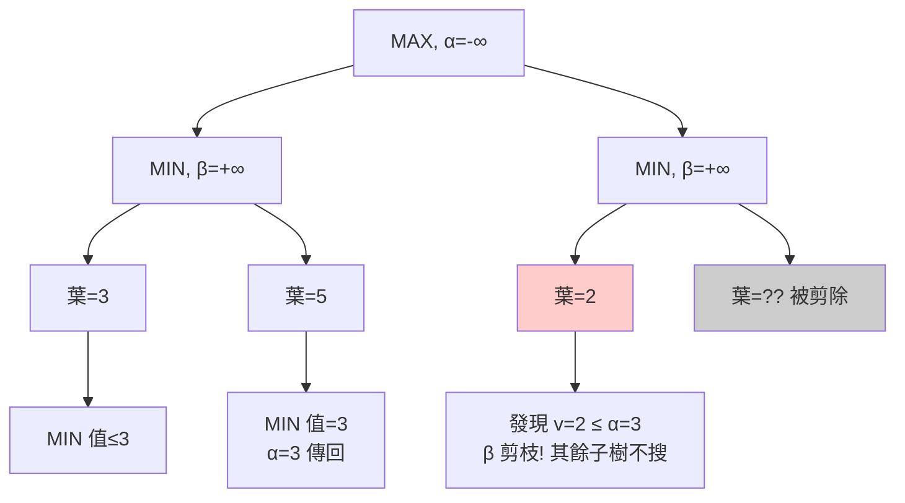
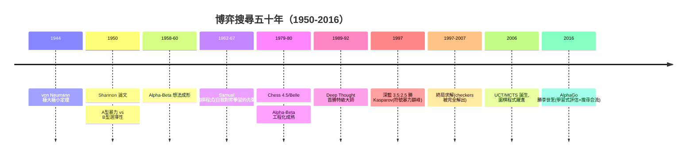

# 3.2 博弈搜尋：Minimax、Alpha-Beta 剪枝與深藍（1950-1997）

## 歷史背景

棋類遊戲是 AI 最早被選中的試金石，原因有三：(1) 規則完全形式化，狀態可精確表示；(2) 「下棋」在當時是智慧的象徵，擊敗人類冠軍的公關與科學價值巨大；(3) 對抗性質使「搜尋」必須處理**對手的最優反應**，這催生了不同於單體搜尋的新數學。

Von Neumann 與 Morgenstern 的《賽局理論與經濟行為》（1944）為零和完美資訊博弈給出了**極大極小定理**：此類博弈存在確定的最優策略與遊戲價值。Shannon 在 1950 年的〈Programming a Computer for Playing Chess〉提出程式化下棋的兩條路線——A 型（暴力搜尋）與 B 型（選擇性搜尋＋評估函數），這篇論文是整個電腦下棋的奠基文獻。1951 年 Turing 親手為 Turochamp 程式紙上模擬下棋；1950 年代中期 McCarthy 在達特茅斯會議前後提出 **Alpha-Beta 剪枝**的原始想法（1958-1960，由 Slate 與 Atkin 的 Chess 4.5 等程式工程化成熟）。

1997 年 5 月，IBM 的**深藍**（Deep Blue）以 3.5:2.5 擊敗世界冠軍 Garry Kasparov。這是傳統 AI 巔峰的標誌性事件——純粹的符號式暴力搜尋（每秒 2 億局面）＋手工評估函數，沒有任何學習成分。諷刺的是，這一勝也宣告了此路線在完美資訊棋類的天花板：AlphaGo（2016）在圍棋上取代深藍的位置時，核心已換成神經網路與增強學習——**學習取代了手工知識**，本節結尾會詳述這條接軌線。

## Minimax：對抗搜尋的基礎

### 形式化

兩人零和完美資訊博弈的賽局樹上，雙方交替行動。MAX 玩家最大化效用，MIN 玩家最小化它。定義節點價值：

$$\text{MAX 節點}: \; V(n) = \max_{c \in \text{children}(n)} V(c)$$
$$\text{MIN 節點}: \; V(n) = \min_{c \in \text{children}(n)} V(c)$$

葉節點價值由終局效用或**評估函數** $Eval(s)$ 給出。Minimax 演算法由底向上遞迴計算根節點價值，MAX 取價值最大的著法。

### 關鍵事實：搜尋深度即棋力

真實棋局無法搜到底（西洋棋分支因子 ~35，圍棋 ~250；完整賽局樹分別約 $10^{120}$ 與 $10^{170}$ 個狀態，遠超宇宙原子數 $10^{80}$ ）。實務上只能搜到深度 $d$ ，用評估函數截斷。因此：

**電腦棋力 ≈ 搜尋深度 × 評估函數品質 × 硬體速度**

Shannon 的 A 型/B 型之分正是這個權衡：A 型全寬搜尋（保證不漏，但爆炸）、B 型選擇性搜尋（只搜有希望的著法，省深度但有「水平線效應」horizon effect——被剪掉的分支裡可能藏著對手的好棋）。歷史證明 A 型＋Alpha-Beta＋快硬體勝出：B 型的選擇性判斷太容易犯人類式偏誤。

## Alpha-Beta 剪枝

### 演算法

Alpha-Beta 在 Minimax 的遞迴中傳遞兩個界限： $\alpha$ （MAX 已保證的下界）與 $\beta$ （MIN 已保證的上界）。當某子樹**不可能影響最終決策**時立即放棄：

- 在 MAX 節點：若某子節點價值 $v \ge \beta$ ，其餘子節點不必再看（ $\beta$ 剪枝，cut-off）。
- 在 MIN 節點：若 $v \le \alpha$ ，同理剪掉（ $\alpha$ 剪枝）。



圖中 MIN 節點 $C$ 看到第一個孩子值為 2，因為 MAX 父親已從 $B$ 拿到 3， $C$ 的值至多是 2，MAX 永遠不會選 $C$ ——右邊剩餘子樹整個剪掉。剪枝不改變根節點決策（仍最優），只是省去無關計算。

### 效率

**最優排列**（每次先看最好的著法）下，Alpha-Beta 搜尋深度 $d$ 的有效分支因子從 $b$ 降到 $\sqrt{b}$ ，時間複雜度從 $O(b^d)$ 降為：

$$O(b^{\lceil d/2 \rceil}) = O(b^{d/2})$$

$b=35$ 時， $b^{d/2} \approx 5.9^d$ ——**同樣時間可多看一倍深度**，這在棋類中是決定性的棋力差距。因此著法排序（move ordering，先用快啟發式把強著法排前面）成為實作勝敗的關鍵工程：歷史啟發式、killer moves、靜態搜尋（quiescence search，在評估前把戰術變化解完避免水平線效應）都是服務於排序的技術。

### 進一步的變體

- **轉置表**（Transposition Table）：不同著法順序常到達同一局面，以雜湊表快取已搜結果。深藍的關鍵組件之一。
- **疊代加深**（Iterative Deepening）：不斷加深搜尋，兼得時間控制與著法排序的免費加成（用上層結果排序下層）。
- **Null-window / NegaScout / PVS**：用零寬窗探測加速確認。
- **MTD(f)**：2000 年代的最優化版本，實際西洋棋引擎（Stockfish 前身）長期採用。

## 深藍：暴力符號 AI 的巔峰

深藍並非單一演算法，而是一個**符號暴力工程的系統集成**：

1. **專用硬體**：480 枚客製化 VLSI 棋局搜尋晶片，每秒檢查 2 億個局面（Kasparov 每秒約 3 個）。
2. **評估函數**：8,000+ 個手工調校的特徵（物質、王安全、控制中心、棋子機動性……），係數由西洋棋大師與工程師反覆校準。
3. **開局庫與殘局庫**：專家知識直接注入。
4. **單步延展**（singular extension）：對關鍵著法突破深度限制繼續搜——對抗水平線效應。

1996 年首戰深藍以 2:4 敗北；1997 年升級版險勝。深藍證明了：**在規則完全形式化、評估可手工編碼的領域，暴力搜尋＋精細領域知識可以登頂**。Kasparov 事後抱怨機器「太像人類」，某些著法充滿創造性——而這些「創造性」其實來自 2 億局面/秒的深度計算中湧現的長程戰術。

## Python 程式碼範例：Minimax 與 Alpha-Beta（井字遊戲）

```python
import math

WINS = [(0,1,2),(3,4,5),(6,7,8),(0,3,6),(1,4,7),(2,5,8),(0,4,8),(2,4,6)]

def winner(s):
    for a, b, c in WINS:
        if s[a] != ' ' and s[a] == s[b] == s[c]:
            return s[a]
    return None

def minimax(s, is_max, nodes):
    nodes[0] += 1
    w = winner(s)
    if w == 'O': return 1          # O(電腦) 勝
    if w == 'X': return -1
    if ' ' not in s: return 0
    vals = []
    for i, v in enumerate(s):
        if v == ' ':
            ns = s[:i] + ('O' if is_max else 'X') + s[i+1:]
            vals.append(minimax(ns, not is_max, nodes))
    return max(vals) if is_max else min(vals)

def alphabeta(s, is_max, alpha, beta, nodes):
    nodes[0] += 1
    w = winner(s)
    if w == 'O': return 1
    if w == 'X': return -1
    if ' ' not in s: return 0
    if is_max:
        best = -math.inf
        for i, v in enumerate(s):
            if v == ' ':
                ns = s[:i] + 'O' + s[i+1:]
                best = max(best, alphabeta(ns, False, alpha, beta, nodes))
                alpha = max(alpha, best)
                if beta <= alpha: break        # β 剪枝
        return best
    else:
        best = math.inf
        for i, v in enumerate(s):
            if v == ' ':
                ns = s[:i] + 'X' + s[i+1:]
                best = min(best, alphabeta(ns, True, alpha, beta, nodes))
                beta = min(beta, best)
                if beta <= alpha: break        # α 剪枝
        return best

def best_move(s, use_ab):
    nodes = [0]
    best, move = -math.inf, None
    for i, v in enumerate(s):
        if v == ' ':
            ns = s[:i] + 'O' + s[i+1:]
            val = (alphabeta(ns, False, -math.inf, math.inf, nodes)
                   if use_ab else minimax(ns, False, nodes))
            if val > best:
                best, move = val, i
    return move, nodes[0]

empty = (' ',) * 9
for label, use_ab in [("純 Minimax", False), ("Alpha-Beta", True)]:
    m, n = best_move(empty, use_ab)
    print(f"{label:12s}: 最佳首著 = 位置 {m}, 搜尋節點數 = {n:,}")
```

典型輸出：

```
純 Minimax  : 最佳首著 = 位置 0, 搜尋節點數 = 549,945
Alpha-Beta  : 最佳首著 = 位置 0, 搜尋節點數 = 25,647
```

決策完全相同，節點數差 20 倍以上（井字太淺，實際西洋棋引擎中差距是指數級的兩倍深度）。

## 深藍之後：為何圍棋需要新方法？

深藍之後，問題自然地指向圍棋：分支因子 ~250、局面評估**極難手工編碼**（西洋棋的物質比在圍棋幾乎無用，「棋形厚薄」是人類大師的直覺）。1990-2000 年代圍棋程式（GNUGo 等）只達業餘初段，證明了 B 型路線的極限：**當評估函數無法手工寫出時，Alpha-Beta 失去作用對象**。

這正是連結主義的回馬槍：2016 年 AlphaGo 用兩個深度神經網路取代手工評估——**策略網路**（學人類高手棋譜的先驗，等價於著法排序）與**價值網路**（學習局面勝率，等價於 $Eval(s)$ ），再以 Monte Carlo Tree Search（MCTS）與自我對弈的增強學習合成。MCTS 可以看作「放棄了 minimax 的完備性、以隨機取樣逼近」的新一代博弈搜尋；而它需要的兩個核心組件（先驗、價值）恰恰都是**學出來的**，不是寫出來的。深藍的框架（搜尋＋評估）被完整保留，知識的來源從「手工」換成「資料」——這就是 9.1 節「表示學習取代特徵工程」在博弈領域的具體劇本。



## 本節重點

1. Minimax 把對抗性搜尋形式化；零和完美資訊博弈有確定最優策略（von Neumann 定理），這給了符號 AI 一個可窮盡的目標。
2. Alpha-Beta 剪枝在最優排列下把複雜度從 $O(b^d)$ 降到 $O(b^{d/2})$ ，等價於免費翻倍搜尋深度；工程關鍵（著法排序、轉置表、疊代加深）共同構成深藍棋力。
3. 深藍的勝利證明「暴力搜尋＋手工評估＋專用硬體」在可形式化領域登頂，是傳統 AI 的絕唱式巔峰。
4. 同一套方法在圍棋失效，暴露了此路線的結構依賴：**評估函數必須能被手工編碼**。
5. AlphaGo 保留了深藍的「搜尋＋評估」框架，卻把評估與先驗換成學習——傳統博弈搜尋的骨架以神經化形態存活至今（MCTS 至今仍是所有棋類 AI 的核心）。

## 思考問題

1. 證明 Alpha-Beta 在最優排列下的節點數量級為 $b^{d/2}$ ，並解釋為何「次優排列」下效率會顯著退化。
2. 水平線效應是 B 型與截斷搜尋的共同弱點。比較靜態搜尋、單步延展與學習式價值網路三種對策的本質差異。
3. 井字遊戲可被完全解出（平局必達）。請討論：可解的博弈上搜尋還有存在意義嗎？西洋棋是否也終將被完全解出？
4. 深藍的評估函數有 8,000 個手工特徵。將此與第 7 章的 SIFT/HOG 特徵工程對照：兩者失敗與存活的模式有何相似？
5. MCTS 相對 Minimax 的哲學差異是「取樣 vs 窮舉」。這與第 8 章演化計算「取樣 vs 窮舉」的思想有何呼應？
