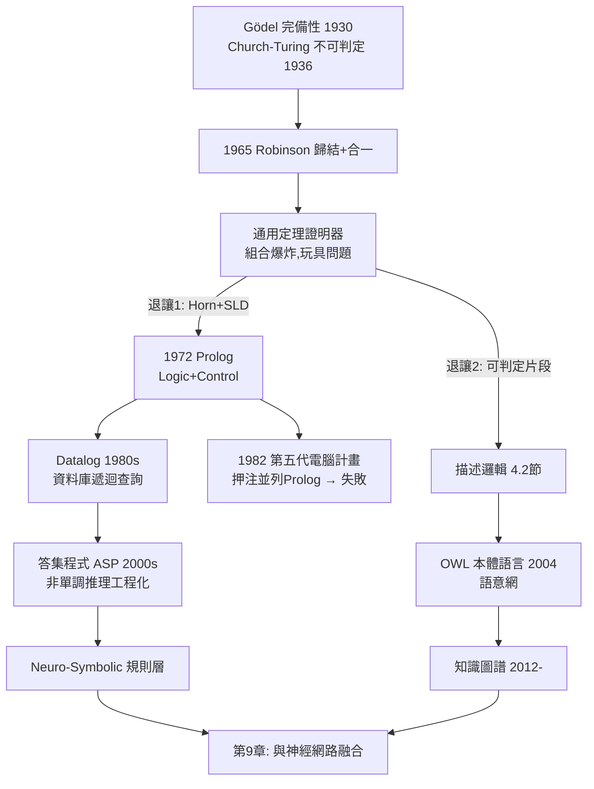

# 4.1 一階邏輯、歸結原理與 Prolog（1965-1972）

## 歷史背景

第 2 章說過：知識要被寫成某種形式。但寫下來只是第一步——**機器必須能自動推理**。1950 年代末的 AI 先驅相信，數理邏輯就是思考的形式語言，只要造出通用的「定理證明機」，智慧問題就解決了。這條路線的數學基礎由兩位邏輯學家在 1930 年代鋪好：

- **Gödel 完備性定理**（1930）：一階邏輯中，凡語意上有效的公式，都存在形式證明。這意味著「推理」機械化在原理上可行。
- **Church–Turing 不可判定性**（1936）：不存在演算法判定任意一階公式是否有效。這意味著任何證明器都會在某些輸入上跑不完。

夾在這兩個定理之間，AI 的自動推理註定是「完備但可能極慢」的工程賽跑。1965 年，J. Alan Robinson 發表**歸結原理**（Resolution Principle），提供了第一個既有完備性、又簡單到可以程式化的一階邏輯證明程序。七年後的 1972 年，Alain Colmerauer 與 Philippe Roussel 在馬賽、Robert Kowalski 在愛丁堡，把歸結的受限版本（SLD 歸結）包裝成程式語言 **Prolog**（Programming in Logic）——邏輯第一次成為可用的程式設計範式，也成為日本第五代電腦計畫（第 2.2 節）押注的核心。

## 一階邏輯的自動推理準備

### 子句形（Clause Form）

歸結不直接在原始公式上操作，而是先把知識庫轉為**子句形**：一組析取式的全稱閉包，每個子句形如

$$\neg P_1 \lor \neg P_2 \lor \cdots \lor \neg P_m \lor Q_1 \lor \cdots \lor Q_n$$

等價地寫作蘊含式 $P_1 \land \cdots \land P_m \rightarrow Q_1 \lor \cdots \lor Q_n$（Horn 子句是 $n \le 1$ 的特例）。標準轉換流程：消蘊含 → 內移否定 → 變數標準化 → Skolem 化（存在量詞改為 Skolem 函數）→ 前束化 → 分配律展開成子句集。Skolem 化的代價：轉換後的子句集與原公式**可滿足性等價**但非邏輯等價——這在歸結的「反證」用法中恰好夠用。

### 歸結原理

核心規則只有一條：從兩個子句中找出**互補文字**（一個 $P$、一個 $\neg P$，經過**合一** unification 替換變數後相同），消去之，合併其餘文字：

$$\frac{A \lor C \qquad \neg B \lor D \qquad \sigma = \text{mgu}(A, B)}{(C \lor D)\sigma}$$

其中 mgu（most general unifier）是 Robinson 的第二個貢獻：**合一演算法**（1965）在幾乎線性時間（Martelli–Montanari 演算法）內找出兩個表達式的最一般變數代換。合一 + 歸結 = 邊推理邊做「模式匹配」，這兩個操作後來直接成為 Prolog 的執行引擎。

### 反證法與完備性

歸結是**反證式**的：要證 $KB \models \alpha$，等價於證 $KB \cup \{\neg \alpha\}$ **不可滿足**。Robinson 證明：歸結對不可滿足的子句集是**反駁完備的**（refutation-complete）——只要不可滿足，反覆歸結終將導出空子句 $\square$（矛盾）。因此演算法是：

1. 把 $KB$ 與 $\neg\alpha$ 全部化成子句；
2. 歸結直到導出 $\square$（證明成功）或無新子句可生（證明失敗，若 $KB$ 有限則完備）。

問題在第 2 步的搜尋：每步可選的子句對是 $O(n^2)$ 級，歸結深度一深就是組合爆炸——**這是第 1.2 節「難題 2」在邏輯領域的化身**。1960 年代末的通用定理證明器（如 Green 的 QA3）在玩具問題之外全面熄火，直接促成兩種退讓：

- **受限於 Horn 子句 + SLD 策略** → Prolog（實用路線）
- **受限於可判定片段** → 描述邏輯（4.2 節，理論路線）

## SLD 歸結與 Prolog

### Horn 子句的幸運性質

Horn 子句（至多一個正文字）有一個關鍵好處：對確定子句 $H \leftarrow B_1 \land \cdots \land B_n$（事實是 $n=0$ 的特例），歸結可以**目標導向**地進行——把目標與子句頭合一，用子句體替換目標。這就是 **SLD 歸結**（Selected Literal Definite clause），配合「左到右選字面、深度優先搜尋子句」的固定策略，執行過程變成簡單的遞迴降級：

```
?- ancestor(tom, X).      % 目標
   用 ancestor(X,Y) :- parent(X,Y).
   用 ancestor(X,Y) :- parent(X,Z), ancestor(Z,Y).
```

Kowalski 的名言總結了這個範式：**演算法 = 邏輯 + 控制**（Algorithm = Logic + Control）。程式設計師只寫「什麼為真」（邏輯），語言負責「怎麼找出來」（控制，即 SLD 搜尋）。這是宣告式程式設計的極致主張。

### 回溯與非邏輯擴充

SLD 的深度優先搜尋需要**回溯**（backtracking）：一條路走不通就換下一條子句。Prolog 的執行模型是「深度優先 + 按子句順序嘗試 + 回溯」，這帶來兩個實用功能與兩個理論污點：

- **功能 1：非確定性免費獲得**——枚舉所有解只需重複呼叫即可。
- **功能 2：cut（`!`）**——手動剪掉回溯點，控制搜尋。
- **污點 1：不完備**——深度優先在遞迴規則下可能無限下鑽（左遞迴死循環），明明有解卻找不到。完備的寬度優先策略（如 Prolog 的表展開修正）太慢，實務永遠犧牲完備性換效率——Church–Turing 幽靈的重演。
- **污點 2：非邏輯操作**——`assert/retract`（動態改知識庫）、`var/!`、否定即失敗（negation as failure, `not(G)` 意為「G 推不出」而非「¬G 可證」）都不是純邏輯。否定即失敗後來被理論化為**封閉世界假設**，成為非單調推理與邏輯程式設計（答集程式 ASP）的重要源頭。

### Datalog 與遺產

Prolog 的確定子句子集去掉函數項後即為 **Datalog**（1980s）：保證終止、適合資料庫遞迴查詢（如傳遞閉包）。Datalog 在 2010 年代以「大型公司內部資料處理神器」的身分復活（Datomic、LogicBlox、Neuro-Symbolic 系統中的規則層），這是第 9 章融合敘事的重要一環。

## Python 程式碼範例：實作一個迷你 Prolog（合一 + SLD 深度優先回溯）

```python
def unify(x, y, subst=None):
    """Robinson 合一演算法的簡化版; subst: {變數: 項}"""
    subst = dict(subst or {})
    def walk(t):
        while isinstance(t, str) and t.startswith("?") and t in subst:
            t = subst[t]
        return t
    x, y = walk(x), walk(y)
    if x == y:                        return subst
    if isinstance(x, str) and x.startswith("?"):
        subst[x] = y;                 return subst
    if isinstance(y, str) and y.startswith("?"):
        subst[y] = x;                 return subst
    if isinstance(x, tuple) and isinstance(y, tuple) and len(x) == len(y):
        for xi, yi in zip(x, y):
            subst = unify(xi, yi, subst)
            if subst is None: return None
        return subst
    return None

def substitute(term, subst):
    if isinstance(term, str) and term in subst:
        return substitute(subst[term], subst)
    if isinstance(term, tuple):
        return tuple(substitute(t, subst) for t in term)
    return term

class Prolog:
    def __init__(self):
        self.clauses = []             # (head, [body...])

    def rule(self, head, *body):  self.clauses.append((head, list(body)))
    def fact(self, f):            self.clauses.append((f, []))

    def query(self, goals, subst=None, depth=0):
        """SLD 深度優先 + 回溯; 產生所有解的替換"""
        subst = subst or {}
        if not goals:
            yield subst; return
        if depth > 50:                # 防左遞迴無限下鑽(Prolog同樣會卡)
            return
        g, rest = substitute(goals[0], subst), goals[1:]
        for head, body in self.clauses:
            s = unify(g, head, subst)
            if s is not None:
                yield from self.query(body + rest, s, depth + 1)

# ---- 家族知識庫 ----
P = Prolog()
for f in [("parent", "tom", "bob"), ("parent", "bob", "ann"),
          ("parent", "bob", "pat"), ("parent", "pat", "jim"),
          ("male", "tom"), ("female", "ann"), ("female", "pat")]:
    P.fact(f)
P.rule(("ancestor", "?X", "?Y"), ("parent", "?X", "?Y"))
P.rule(("ancestor", "?X", "?Y"), ("parent", "?X", "?Z"),
                                  ("ancestor", "?Z", "?Y"))
P.rule(("sibling", "?X", "?Y"),  ("parent", "?P", "?X"),
                                 ("parent", "?P", "?Y"), ("\\=", "?X", "?Y"))

for s in P.query([("ancestor", "tom", "?Who")]):
    print("ancestor(tom,", s.get("?Who"), ")")
for s in P.query([("ancestor", "?A", "jim")]):
    print("jim 的祖先:", s.get("?A"))
```

輸出：

```
ancestor(tom, bob )
ancestor(tom, ann )
ancestor(tom, pat )
ancestor(tom, jim )
jim 的祖先: pat
jim 的祖先: bob
jim 的祖先: tom
```

約 50 行 Python 實作了合一、替換與 SLD 回溯——Prolog 的全部本質。注意 `ancestor` 的第二條規則是右遞迴（`ancestor` 在體的最後），若寫成左遞迴（`ancestor` 在最前），本實作與真 Prolog 一樣會在 depth 上限死掉：**宣告式的外表下，控制仍無所不在**——Kowalski 的公式從未真正兌現。

## 自動推理的路線圖



## 本節重點

1. Gödel 完備性與 Church–Turing 不可判定性夾出了自動推理的命運：原理可行、實務必須妥協。
2. Robinson 歸結 + 合一是第一個完備且可程式化的證明程序；反證式證明（$KB \cup \{\neg\alpha\}$ 不可滿足）是其操作框架。
3. 通用定理證明器被組合爆炸擊敗後，兩大退讓路線：Horn 子句 + SLD → Prolog；可判定片段 → 描述邏輯。兩條線都活到今天。
4. Prolog 實現了「演算法 = 邏輯 + 控制」的宣告式理想，但深度優先搜尋的不完備性與 cut/否定即失敗等非邏輯操作，暴露了理想與實務的鴻溝。
5. 否定即失敗 → 封閉世界假設 → 非單調推理 → ASP/Datalog，構成一條貫穿至今的暗線；Datalog 在知識圖譜與 Neuro-Symbolic 系統中復活。

## 思考問題

1. 實作中若把 `ancestor` 規則改寫成左遞迴，程式行為如何？請解釋深度優先 SLD 為何不完備，並查閱「表展開」如何修復左遞迴。
2. Skolem 化保持可滿足性但不保持邏輯等價。請構造一個例子說明為何歸結的反證用法不受影響。
3. 否定即失敗在「封閉世界」假設下合理，在開放世界（如醫療：未知 ≠ 不存在）下危險。請各舉一個領域例子，並連結到 4.2 節描述邏輯的開放世界選擇。
4. 第五代電腦計畫押注並列 Prolog。以今天的角度，哪些並列化難題（如回溯的並列、搜尋削減）註定了它難以成功？
5. Kowalski 的「邏輯 + 控制」分離，在今天的 LLM 中有對應物嗎？（提示：把「控制」外包給提示與 agent 迴圈、把「邏輯」外包給模型權重或外部工具，各自是什麼取捨？）
