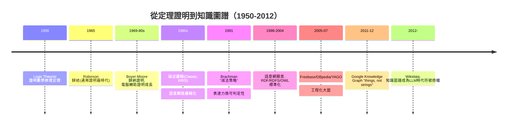

# 4.2 定理證明、描述邏輯與知識圖譜的先聲（1950-2012）

## 歷史背景

4.1 節的結尾是：通用定理證明在組合爆炸前退讓。但「讓機器進行嚴格推理」的夢想沒有死，而是學會了**縮小野心**。本節敘述三個世代接力的故事：

1. **數學定理證明**（1950s-）：從 Logic Theorist 到機器發現定理，目標是數學本身。
2. **描述邏輯**（1980s-2000s）：把一階邏輯裁剪到**可判定**的片段，用來給語意網路（2.1 節）精確語意，最後成為語意網（Semantic Web）的邏輯底座。
3. **知識圖譜**（2012-）：放棄嚴格邏輯、改用工程化的圖資料庫＋輕量約束，由 Google 以 Knowledge Graph 之名引爆，成為今天 LLM 最重要的符號搭檔。

這條線的共同主題是**表達力與可計算性的反覆交易**（1.2 節權衡三角的邏輯版本），以及一個深刻問題：機器需要的到底是「證明」還是「查詢」？

## 數學定理證明的譜系

### Logic Theorist 與 General Problem Solver

Newell、Simon 與 Shaw 的 Logic Theorist（1956）模仿人類數學家的啟發式（手段—目的分析、向前鏈結），證明了《數學原理》（Whitehead & Russell, 1910）中 38 條定理，其中一條（定理 2.85）它找到了比原書更優雅的證明——期刊《Journal of Symbolic Logic》甚至（以 Newell 與 Simon 名義）發表了這個機器證明。這是 AI 歷史上第一次「機器做出被同行接受的數學工作」。

1976 年，Appel 與 Haken 用電腦輔助完成**四色定理**的證明（1,200 小時機器時間、檢查 1,936 個組態），引發「什麼是證明」的哲學爭論——電腦在這裡的角色不是發現證明，而是**驗證不可窮舉的案例**。此後電腦輔助證明（CAP）與互動式定理證明（ITP，如 Coq、Isabelle）發展成獨立學科：2005 年 Gonthier 用 Coq 完全形式化四色定理；2000 年代 Kepler 猜想的 Hales 実驗同樣走這條路。這一脈的立場是「機器 = 邏輯的精確執行者」，與 AI 的「機器 = 啟發式搜尋者」漸行漸遠。

### 程式綜合與歸納

1969 年 Manna 與 Waldinger 開始的程式綜合（從規格自動推導程式）、Boyer–Moore 的歸納證明器（Nqthm, 1971-）是一個重要支線：試圖讓機器**從例子與規格歸納**。這條線在 2010 年代以 program synthesis 之名復活，並在 LLM 時代與程式碼生成合流。

## 描述邏輯：把語意網路邏輯化

### 動機

2.1 節指出語意網路的兩個傷口：`is-a` 語意含糊、繼承衝突無解。1980 年代，Brachman、Schmolze 等人提出**結構繼承網路**的形式化，發展為**描述邏輯**（Description Logic, DL）。核心思想：把知識分兩層——

- **TBox**（Terminology，術語層）：定義概念與其階層，如「父親 = 人 ∧ 有孩子」。
- **ABox**（Assertions，斷言層）：具體個體的事實，如 `Father(Tom)`、`hasChild(Tom, Ann)`。

### 語法與語意

基本構造子（以 $\mathcal{ALC}$ 為例）：

| 構造 | 語法 | 語意 |
|------|------|------|
| 交集 | $C \sqcap D$ | $C^I \cap D^I$ |
| 聯集 | $C \sqcup D$ | $C^I \cup D^I$ |
| 補集 | $\neg C$ | $\Delta^I \setminus C^I$ |
| 存在限制 | $\exists r.C$ | 有 $r$ 關係到某 $C$ 個體的個體集 |
| 全稱限制 | $\forall r.C$ | 所有 $r$ 關係對象都在 $C$ 中 |

例：「有一個孩子是醫生的人」：

$$\text{Person} \sqcap \exists \text{hasChild}.(\text{Doctor})$$

推理服務包括：**概念可滿足性**（ $C$ 的語意非空？）、**次概念關係**（ $C \sqsubseteq D$ ？）、**實例檢查**（ $a$ 是 $C$ 的實例？）、**知識庫一致性**。DL 的關鍵賣點是：這些推理在設計得當的語言片段中是**可判定的**（PSPACE 甚至多項式時間），且許多推理可被「展開成語意網路式的結構比對」高效實作。

### 表格演算法（Tableau Algorithm）

實用的 DL 推理器（FaCT、RACER、Pellet、HermiT）使用**表格演算法**：把可滿足性檢查轉成「嘗試建構一個模型」的約束傳播——展開存在限制生成新個體、分裂補集生成分支、衝突即封閉分支。它是回溯搜尋（第 3 章）在邏輯上的精緻化，實務上能處理數十萬概念的醫學本體。

### 語意網與 OWL

1990 年代末 Berners-Lee 提出語意網：讓網頁帶上機器可讀的語意。其標準堆疊——RDF（資料模型：主詞-述詞-受詞三元組）、RDFS（類別與屬性階層）、**OWL**（2004，其語意核心正是描述邏輯，不同子語言對應不同表達力/複雜度權衡：OWL-Lite、OWL-DL、OWL-Full）。語意網的宏大願景（機器自動理解整個網路）沒有實現——知識編碼成本太高（又是知識獲取瓶頸），但它留下了 RDF/SPARQL 生態與「本體工程」的社群與方法論。

## 知識圖譜的先聲與誕生

### 從邏輯到圖的降維

2000 年代中期，工業界發現了一個務實的公式：**不要嚴格推理，要大規模資料**。Freebase（2007）、DBpedia（2007，從維基百科 infobox 抽取）、YAGO（2007，WordNet + Wikipedia）把知識做成「實體—關係—實體」的三元組大圖，推理只保留最輕量的形式：屬性繼承、類型檢查、少量規則（Datalog 風格）。

2012 年 Google 宣布 **Knowledge Graph**，口號「things, not strings」：搜尋從字串匹配升級為實體理解。這宣告知識圖譜成為大型工業系統的正式元件。



### 知識圖譜的技術內容

現代知識圖譜系統的四大件：

1. **表示**：三元組 $(h, r, t)$ （head, relation, tail）或屬性圖；儲存用三元組庫（RDF store）或屬性圖資料庫（Neo4j）。
2. **建構**：從非結構文字抽取（實體辨識、關係抽取——第 7 章 NLP 技術的應用）、從結構資料對齊融合、本體對齊（schema matching）。
3. **補全與推理**：連結預測（head/tail 缺失時猜）、規則學習（AMIE、AnyBURL 學出「 $\text{bornIn}(x,y) \wedge \text{cityIn}(y,z) \Rightarrow \text{bornInCountry}(x,z)$ 」類規則）、嵌入模型（TransE: $\mathbf{h} + \mathbf{r} \approx \mathbf{t}$ ，把三元組放進向量空間——**這已經是神經/幾何方法**）。
4. **服務**：問答（SPARQL 或嵌入檢索）、推薦、資料治理。

注意第 3 件的弔詭：知識圖譜的「推理」早已不是 1960 年代的符號演繹，而是向量嵌入與統計規則——**符號技術被統計技術內部殖民**，這是第 9 章融合主題的預演。

## Python 程式碼範例：迷你知識圖譜——查詢、繼承推理與 TransE 嵌入

```python
import numpy as np
from collections import defaultdict

# ---- 1. 三元組知識庫 ----
triples = [
    (" Tweety",  "is_a", "金絲雀"), ("金絲雀", "is_a", "鳥"),
    ("企鵝", "is_a", "鳥"),        ("鳥", "is_a", "動物"),
    ("金絲雀", "can", "飛"),       ("企鵝", "cannot", "飛"),
    ("Bob", "bornIn", "劍橋"),     ("劍橋", "cityIn", "麻州"),
]
entities = sorted({t[i] for t in triples for i in (0, 2)})
relations = sorted({t[1] for t in triples})

# ---- 2. 符號推理: 沿 is_a 的傳遞閉包(輕量 Datalog) ----
parents = defaultdict(set)
for h, r, t in triples:
    if r == "is_a": parents[h].add(t)

def ancestors(e, acc=None):
    acc = acc or set()
    for p in parents.get(e, ()):
        if p not in acc:
            acc.add(p); ancestors(p, acc)
    return acc

print("Tweety 的所有上位類:", ancestors("Tweety"))

# ---- 3. 連結預測: TransE 嵌入 h + r ≈ t ----
rng = np.random.default_rng(0)
E = {e: rng.normal(size=16) for e in entities}
R = {r: rng.normal(size=16) for r in relations}

for epoch in range(2001):
    for h, r, t in triples:
        vh, vr, vt = E[h], R[r], E[t]
        loss = ((vh + vr - vt) ** 2).sum()          # margin-free 簡化版
        grad = 2 * (vh + vr - vt)
        E[h] -= 0.01 * grad; R[r] -= 0.01 * grad; E[t] += 0.01 * grad

def predict_tail(h, r):
    target = E[h] + R[r]
    return min(entities, key=lambda e: ((E[e] - target) ** 2).sum())

def predict_head(r, t):
    target = E[t] - R[r]
    return min(entities, key=lambda e: ((E[e] - target) ** 2).sum())

print("預測 (Bob, bornIn, ?):", predict_tail("Bob", "bornIn"))
print("預測 (?, cityIn, 麻州):", predict_head("cityIn", "麻州"))
```

典型輸出：

```
Tweety 的所有上位類: {'金絲雀', '鳥', '動物'}
預測 (Bob, bornIn, ?): 劍橋
預測 (?, cityIn, 麻州): 劍橋
```

這個例子刻意呈現兩種推理並存：上半部是**符號繼承**（精確、可解釋、零學習），下半部是**向量嵌入**（統計、可泛化到未見三元組、不可解釋）。真實知識圖譜系統正是這兩者的混合體——這個 20 行的 TransE 已經踩在神經方法的門檻上，是本節通往第 9 章的橋。

## 三代技術的比較

| 維度 | 定理證明 | 描述邏輯/OWL | 知識圖譜 |
|------|----------|--------------|----------|
| 知識形態 | 公式＋規則 | TBox+ABox | 三元組大圖 |
| 推理 | 歸結反證（完備、慢） | 表格演算法（可判定片段） | 繼承＋規則＋嵌入（不完備、快） |
| 知識來源 | 人類數學家 | 本體工程師 | 半自動抽取＋群眾（維基） |
| 規模 | 千級公式 | 十萬級概念 | 十億級三元組 |
| 失敗原因 | 組合爆炸 | 知識編碼成本 | （未失敗，但精度受限於抽取） |

規模的每一步擴大，都以**放棄嚴格性**為代價。這條「減法策略」（Brachman 語）是傳統 AI 邏輯路線的宿命曲線，而它的終點站在 LLM 旁邊：今天最先進的系統用 LLM 做知識抽取、用圖譜做可驗證的事實儲存、用嵌入做檢索——三代技術在同一個系統裡各司其職（9.2 節）。

## 本節重點

1. 數學定理證明從 Logic Theorist 到 Coq 分化為「自動發現」與「互動驗證」兩路；四色定理確立了電腦輔助證明的合法性。
2. 描述邏輯以「TBox+ABox、可判定片段、表格演算法」馴化了語意網路，成為 OWL 的語意核心——「減法策略」的典範。
3. 語意網的宏大願景敗於知識編碼成本，但留下了 RDF 生態與本體工程方法論。
4. 知識圖譜以「工程化大圖＋輕量推理」取代嚴格邏輯，Google 2012 宣告其工業地位；其內部推理已大量向量嵌入化。
5. 表達力、規模、嚴格性三者不可兼得是邏輯路線五十年的主旋律；最終形態是與神經方法的混合系統。

## 思考問題

1. Logic Theorist 找到了比《數學原理》更優雅的證明。請討論：這算是「機器的數學創造力」還是「啟發式搜尋的副產品」？
2. 描述邏輯把 $\mathcal{ALC}$ 的概念可滿足性做到 PSPACE 完備。請查閱加入逆角色、傳遞角色、基數限制後複雜度的變化，總結「減法策略」的操作空間。
3. 知識圖譜的三元組模型無法直接表達「Bob 曾在 2010-2015 之間住在劍橋」（n-ary relation）。請調查 RDF-star 或重新化（reification）的解法，並評論其代價。
4. TransE 要求 $\mathbf{h} + \mathbf{r} \approx \mathbf{t}$ 。這對哪類關係（1-N、N-1、對稱）會失效？後繼模型（RotatE、ComplEx）如何改善？
5. 若 LLM 是「隱式知識圖譜」（知識散布在權重中），顯式圖譜的不可替代價值是什麼？請從「更新、溯源、可驗證」三個面向回答。
