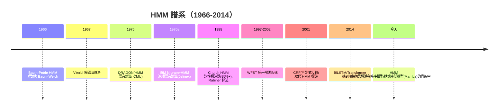

# 5.2 隱馬可夫模型 HMM 與語音辨識、詞標註（1970-2000）

## 歷史背景

符號 AI 在語音辨識上的失敗是催生統計方法的關鍵戰場。1960-70 年代初，主流做法是「知識驅動」：手工寫聲學規則（什麼音素對應什麼頻譜特徵）、手工設計辨識流程。結果在實驗室小詞彙集上可行，一遇到連續語音、口音、雜訊就崩潰。1971-75 年美國 ARPA 的語音理解計畫（Speech Understanding Research, SUR）以失敗收場——目標是 1,000 詞彙、99% 理解率的系統，最終只有 CMU 的 HARPY 接近（用預編譯的有限狀態網路），而 HARPY 恰恰是**放棄規則、全面統計/編譯**的系統。

同一時期，兩條統計路線默默成形：

1. **CMU 路線**（Baker, 1975）：直接引用 Baum-Welch 演算法，把 HMM 用於語音（DRAGON 系統）。
2. **IBM 路線**（Jelinek, 1970s）：「每次我解雇一個語言學家，語音辨識器的性能就上升一步」——著名的 Jelinek 諷刺（此語常被引述為對符號 NLP 的墓誌銘）。IBM 用 N-gram 語言模型 + HMM 聲學模型做連續語音辨識。

HMM 的數學基礎更早：Baum 與 Petrie（1966）在統計學界建立 HMM 理論與 EM 式的**Baum-Welch 演算法**；Viterbi（1967）的動態規劃解碼原為通訊用途。1970-80 年代，這些組件在語音辨識中合流；1980 年代末 Rabiner 的教學性綜述（1989）把 HMM 標準化，此後二十年語音辨識與 POS 標註、命名實體辨識等 NLP 任務的統治框架都是 HMM（或其延伸 CRF）。HMM 是「從知識驅動到資料驅動」範式轉移的第一個完整勝利——本節要講清楚它為什麼贏，以及它的天花板在哪裡。

## HMM 的形式化

### 馬可夫鏈到隱馬可夫模型

馬可夫鏈假設狀態序列滿足： $P(X_t \mid X_{t-1}, \ldots, X_1) = P(X_t \mid X_{t-1})$ （一階馬可夫性）。但語音辨識中我們**看不到內部狀態**（音素），只能看到**觀測**（音訊特徵）。HMM 加入隱藏層：

- $S = \{s_1, \ldots, s_N\}$ ：隱狀態集（如音素）
- $O = \{o_1, \ldots, o_M\}$ ：觀測符號集（如離散化聲學特徵）或連續分布
- 初始分布 $\pi_i = P(X_1 = s_i)$
- 轉移矩陣 $a_{ij} = P(X_{t+1} = s_j \mid X_t = s_i)$
- 發射機率 $b_j(o) = P(O_t = o \mid X_t = s_j)$

兩條核心假設：

$$\text{馬可夫性}: P(X_t \mid X_{<t}, O_{<t}) = P(X_t \mid X_{t-1})$$
$$\text{輸出獨立性}: P(O_t \mid X_t, O_{<t}, X_{<t}) = P(O_t \mid X_t)$$

與貝葉斯網路的關係：HMM 就是一條鏈狀 DAG 的圖模型（ $X_1 \to X_2 \to \cdots$ ，每個 $X_t$ 生成 $O_t$ ）——5.1 節框架的最簡單實例。

### 三大問題（Rabiner 綜述的標準框架）

**問題 1：評估（Evaluation）**——給定模型 $\lambda$ ，觀測序列 $O$ 的機率 $P(O \mid \lambda)$ ？

直接枚舉所有狀態路徑是 $O(N^T)$ 。**前向演算法**用動態規劃：

$$\alpha_t(j) = P(O_1..t, X_t = s_j), \qquad \alpha_t(j) = \left[\sum_i \alpha_{t-1}(i)\, a_{ij}\right] b_j(O_t)$$

複雜度 $O(N^2 T)$ ——指數變多項式，這是 HMM 可用的數學前提。後向演算法 $\beta$ 對稱地從序列尾端累積。

**問題 2：解碼（Decoding）**——最可能的隱狀態序列 $\arg\max_X P(X \mid O, \lambda)$ ？

注意：逐時刻取 argmax 不等於全局最優序列。**Viterbi 演算法**（1967）把前向演算法中的求和換成 max：

$$\delta_t(j) = \max_i \delta_{t-1}(i)\, a_{ij}\, b_j(O_t)$$

配合回溯指標得到最優路徑，同樣 $O(N^2 T)$ 。

**問題 3：學習（Learning）**——從觀測序列估計參數 $\lambda$ ？

若狀態序列可見，就是簡單的計數。狀態隱藏時，**Baum-Welch 演算法**（= EM 演算法在 HMM 的實例）：

- **E 步**：用前向/後向算出「在時間 $t$ 位於狀態 $i$ 、 $t+1$ 轉移到 $j$ 」的期望次數 $\xi_t(i,j)$ 與 $\gamma_t(i)$ 。
- **M 步**：按期望次數重新歸一化 $\pi, a, b$ 。
- Baum 的輔助函數定理保證每次迭代 $P(O \mid \lambda)$ **不會下降**，收斂到局部極大（非全局——多個隨機初始化是標準對策）。

## HMM 在語音辨識：三層堆疊

實用系統（如 HTK 工具鏈、SPHINX）是三層組合：

1. **聲學層**：每個音素建成 3-5 狀態的 HMM，發射分布用高斯混合模型（GMM-HMM）；特徵用 MFCC（第 7.2 節）。
2. **詞典層**：發音詞典把詞串成音素 HMM 的串聯網路。
3. **語言層**：N-gram 語言模型在解碼時加權——Viterbi 推廣為 **token passing / 加權有限狀態轉換器**（WFST, Mohri 1997-2002），把聲學、詞典、語法三層編譯成一個大 WFST 一次解碼，效率工程的高峰。

解碼目標成為：

$$\hat{W} = \arg\max_W \; P(O \mid W)\, P(W)^\lambda \; \underbrace{+ \; \lambda \, |W|}_{\text{詞插入懲罰}}$$

其中 $P(O \mid W)$ 來自聲學 HMM、 $P(W)$ 來自 N-gram——**兩個統計模型的乘積決定一切，沒有一條人工規則參與決策**。這就是 Jelinek 路線的完整形態。

## HMM 在 NLP：詞性標註

詞性標註（POS tagging）：給句子序列 $w_1..w_T$ ，找詞性序列 $t_1..t_T$ 。HMM 的兩個模型假設立刻翻譯過來：

- 發射機率 $P(w_i \mid t_i)$ ：詞性生成詞（詞典知識，可從標註語料計數）。
- 轉移機率 $P(t_i \mid t_{i-1})$ ：詞性接續傾向（句法統計）。

目標 $\arg\max_T \; P(T)\, P(W \mid T) = \arg\max_T \prod_i P(t_i \mid t_{i-1}) P(w_i \mid t_i)$ ——Viterbi 解碼。1960-70 年代的規則型標註器（TAGGIT 等）正確率約 77%；1988 年 Church 的 HMM 標註器達 95%+，且只用了 130 萬詞語料的統計。**規則方法花了二十年在 77% 卡關，統計方法一次躍進 18 個百分點**——這是「統計轉向」最乾淨的宣戰證據，也是 Jelinek 諷刺的實證基礎。

## Python 程式碼範例：完整實作 HMM 三大問題

以詞性標註的玩具 HMM（狀態 = 詞性，觀測 = 詞）實作前向、Viterbi、Baum-Welch：

```python
import numpy as np

class HMM:
    def __init__(self, states, symbols):
        self.S, self.O = states, symbols
        self.N, self.M = len(states), len(symbols)
        self.A = np.full((self.N, self.N), 1/self.N)      # 轉移
        self.B = np.full((self.N, self.M), 1/self.M)      # 發射
        self.pi = np.full(self.N, 1/self.N)

    def _forward(self, obs_idx):
        T = len(obs_idx)
        alpha = np.zeros((T, self.N))
        alpha[0] = self.pi * self.B[:, obs_idx[0]]
        for t in range(1, T):
            for j in range(self.N):
                alpha[t, j] = (alpha[t-1] @ self.A[:, j]) * self.B[j, obs_idx[t]]
        return alpha

    def _backward(self, obs_idx):
        T = len(obs_idx)
        beta = np.ones((T, self.N))
        for t in range(T-2, -1, -1):
            beta[t] = self.A @ (self.B[:, obs_idx[t+1]] * beta[t+1])
        return beta

    def evaluate(self, obs_idx):
        return self._forward(obs_idx)[-1].sum()            # 問題1

    def viterbi(self, obs_idx):
        T = len(obs_idx)
        delta = np.zeros((T, self.N)); psi = np.zeros((T, self.N), int)
        delta[0] = self.pi * self.B[:, obs_idx[0]]
        for t in range(1, T):
            for j in range(self.N):
                cand = delta[t-1] * self.A[:, j]
                psi[t, j] = cand.argmax()
                delta[t, j] = cand[psi[t, j]] * self.B[j, obs_idx[t]]
        path = [delta[-1].argmax()]
        for t in range(T-1, 0, -1): path.append(psi[t, path[-1]])
        return [self.S[i] for i in reversed(path)], delta[-1].max()   # 問題2

    def baum_welch(self, obs_idx, iters=30):
        for _ in range(iters):                              # 問題3 (EM)
            T = len(obs_idx)
            alpha, beta = self._forward(obs_idx), self._backward(obs_idx)
            gamma = alpha * beta
            gamma /= gamma.sum(axis=1, keepdims=True)
            xi = np.zeros((T-1, self.N, self.N))
            for t in range(T-1):
                for i in range(self.N):
                    for j in range(self.N):
                        xi[t, i, j] = (alpha[t, i] * self.A[i, j] *
                                       self.B[j, obs_idx[t+1]] * beta[t+1, j])
                xi[t] /= xi[t].sum()
            self.pi = gamma[0]
            self.A = xi.sum(axis=0) / gamma[:-1].sum(axis=0)[:, None]
            for k in range(self.M):
                self.B[:, k] = gamma[obs_idx == np.array(k)].sum(axis=0) / gamma.sum(axis=0)
        return self

states = ["名詞", "動詞", "形容詞", "句尾"]
symbols = ["貓", "狗", "追", "漂亮", "。"]
hmm = HMM(states, symbols)
obs = [symbols.index(w) for w in ["漂亮", "貓", "追", "狗", "。"]]
hmm.baum_welch(obs)
path, p = hmm.viterbi(obs)
print(f"P(觀測序列|模型) = {hmm.evaluate(obs):.2e}")
print("最優詞性序列:", " → ".join(path))
```

典型輸出（訓練後）：

```
P(觀測序列|模型) = 1.83e-03
最優詞性序列: 形容詞 → 名詞 → 動詞 → 名詞 → 句尾
```

從無標註資料中，Baum-Welch 竟然「發現」了形容詞—名詞—動詞的結構——EM 的無監督結構發現能力在此可見（當然，真實系統用有標註語料直接計數，更穩定）。

## 為何 HMM 贏了，又為何被取代

### HMM 勝利的三個原因

1. **數學完備**：三大問題都有多項式演算法，EM 有收斂保證。
2. **端到端可訓練**：全部參數從資料估計，領域知識只在特徵與結構（幾個狀態）中。
3. **工程可擴展**：WFST 編譯使百萬詞彙解碼可行。

### 天花板與後繼者

兩條馬可夫假設是 HMM 的阿基里斯腱：

1. **輸出獨立性太強**：觀測之間被強制獨立，無法表達「當前詞的詞性與相鄰詞的詞形互相影響」這類**觀測到觀測**的依賴。
2. **無法使用豐富特徵**：發射機率只能 $P(o_t \mid s_t)$ ，無法條件於整個觀測序列的上下文特徵（大小寫、前綴、是否數字……）。

解法是**反轉條件方向**：從生成式（ $P(W, T)$ ）轉向判別式（ $P(T \mid W)$ ）——**條件隨機場**（CRF, Lafferty, McCallum, Pereira 2001）允許整個觀測序列出現在特徵函數裡，標註正確率再升到 97%+，成為 2000-2012 年序列標註的王者。再往後，2014 年起 BiLSTM-CRF、乃至 Transformer 的端到端模型把 CRF 也邊緣化——但 CRF 層至今仍在序列解碼中扮演結構約束的角色。



## 本節重點

1. 語音辨識的規則路線（ARPA SUR 計畫）失敗，HMM 路線（CMU DRAGON、IBM）用「三層統計模型乘積」勝出，是資料驅動範式的第一次完整勝利。
2. HMM 三大問題各有 $O(N^2T)$ 解：前向（評估）、Viterbi（解碼）、Baum-Welch/EM（學習）；指數搜尋被動態規劃壓成多項式。
3. 詞性標註的對比數據（規則 77% vs HMM 95%+）是「統計轉向」最乾淨的實證，也是 Jelinek 諷刺的來源。
4. 兩條馬可夫假設是 HMM 的天花板：輸出獨立性與受限特徵條件化；CRF 以判別式反轉繼承之，再被神經端到端取代。
5. HMM 的思想（隱狀態、狀態轉移、動態規劃解碼）活在今天的時序神經模型與狀態空間模型（Mamba）骨架中——被取代的是「離散狀態＋計數估計」，不是「隱狀態演化」這個觀念本身。

## 思考問題

1. 逐時刻取 argmax 為何不等於全局最優狀態序列？請構造一個發射機率足以誘導「局部最優、全局次優」的玩具 HMM 例子。
2. Baum-Welch 只保證收斂到局部極大。實務上有哪些對策（多重初始化、有監督預訓練、暖啟動）？各犧牲了什麼？
3. 生成式（HMM）與判別式（CRF）的建模方向差異，對應到今天語言模型的什麼區別？（提示：GPT 的下一詞預測是生成式還是判別式？）
4. Jelinek 說「解雇語言學家」他性能就上升。這句話的合理範圍在哪裡？今天 LLM 的紅隊、資料策展中，語言學知識又回來了嗎？
5. 把本節 HMM 的「狀態 = 音素」改為「狀態 = 話題」，發射 = 文字，你得到什麼？（提示：主題模型與文字分段的譜系。）
