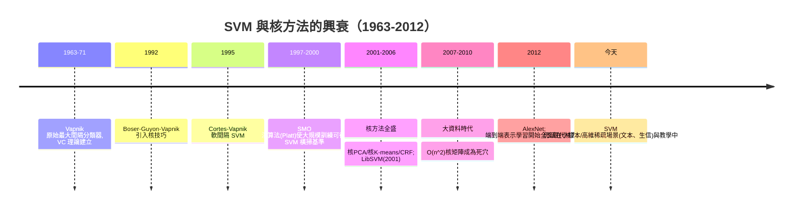

# 6.1 SVM 與核方法：統計學習理論的巔峰（1992-1995）

## 歷史背景

1990 年代的 AI 從「符號推理」轉向「從資料學習」（第 5 章的統計轉向已開場），但機器學習自己內部還有一場理論之爭：**學習的可行性**到底有沒有嚴格的數學基礎？在 SVM 出現之前，神經網路的實踐（反向傳播）是工程優先、理論薄弱的——沒有人能說清楚「要多少資料才能學好一個分類器」、「學出來的模型在新資料上會不會崩」。

Vladimir Vapnik 與 Alexey Chervonenkis 從 1960 年代起在蘇聯發展**統計學習理論**（Statistical Learning Theory），提出 VC 維（VC dimension）刻畫假設空間的複雜度，並證明泛化誤差的機率上界。但這套理論長期「曲高和寡」——直到 1992-1995 年，Vapnik 與 Boser、Guyon、Cortes 把**核技巧**（kernel trick）與**最大間隔**（max-margin）結合，發展出**支援向量機**（Support Vector Machine, SVM）。SVM 在 1990 年代後期橫掃各種基準（手寫數字、文本分類、生物資訊），成為深度學習之前**理論最完備、實戰最強**的分類器，是統計機器學習時代的皇冠。

本節要說清楚三件事：VC 理論如何回答「學習何時可行」；最大間隔如何把「泛化」變成可優化的幾何量；核技巧如何用一個內積函數同時解決「非線性」與「維度爆炸」——以及 SVM 為什麼最終仍被神經網路取代（它的理論之美與它的實用局限是同一枚硬幣的兩面）。

## 統計學習理論：學習何時可行？

### 經驗風險最小化與過擬合

給定 iid 資料 $\{(x_i, y_i)\}_{i=1}^n \sim P$ ，學習器從假設空間 $\mathcal{H}$ 中選 $h$ 最小化**經驗風險**：

$$R_{emp}(h) = \frac{1}{n}\sum_{i=1}^n \ell(h(x_i), y_i)$$

但真正的目標是**期望風險**（泛化誤差） $R(h) = \mathbb{E}_{(x,y) \sim P}[\ell(h(x), y)]$ 。兩者的差距就是**泛化間隙**（generalization gap）。只用資料最小化 $R_{emp}$ 的災難： $\mathcal{H}$ 越大，越能找到「訓練全對、測試全錯」的函數——**過擬合**。

### VC 維與泛化界

**VC 維**： $\mathcal{H}$ 能打散（shatter）的最大點數——存在 $d$ 個點，使 $\mathcal{H}$ 能實現它們的**所有** $2^d$ 種標籤組合。 $\mathbb{R}^d$ 中的線性分類器 VC 維為 $d+1$ （直觀： $d$ 維中任意 $d+1$ 個點總有一種標籤切不開，如三點共線的 XOR 型標籤）。

**VC 泛化界**（Vapnik-Chervonenkis, 1971；顯式版本 1990s）：以機率至少 $1-\delta$ ，

$$R(h) \le R_{emp}(h) + \sqrt{\frac{d_{VC}\left(\ln\frac{2n}{d_{VC}} + 1\right) + \ln\frac{4}{\delta}}{n}}$$

三個推論構成了整個 1990 年代機器學習的方法論：

1. **複雜度懲罰**：泛化誤差由「訓練誤差 + $\sqrt{d_{VC}/n}$ 量級的複雜度項」組成——模型複雜度與資料量的比例決定一切。
2. **結構風險最小化**（SRM）：不要只最小化經驗風險，要在「嵌套的複雜度層級」中同時平衡兩項——這是正規化思想的理論前身，直接對應 SVM 的最大間隔與今天的 L2 正規化、早停、模型選擇。
3. **學習可行的條件**： $d_{VC}$ 有限且 $n \gg d_{VC}$ ，則經驗風險一致收斂於期望風險——**資料夠多，學習就可行**，且與學習演算法無關。這一點在哲學上承襲了 No Free Lunch 定理（Wolpert, 1996）的對立面：沒有免費午餐，但有「統計上可支付的午餐」。

## 最大間隔分類器

### 幾何形式

線性分類器 $h(x) = \operatorname{sign}(w^\top x + b)$ 。一個分離超平面到最近樣本的距離稱**間隔**（margin）。SVM 的原則：**在所有能分開訓練資料的超平面中，取間隔最大者**。

幾何上，點 $x$ 到平面 $w^\top x + b = 0$ 的距離為 $|w^\top x + b|/\|w\|$ 。對可分資料，經過縮放 $w, b$ 可設最近的正例與負例滿足 $w^\top x + b = \pm 1$ ，於是間隔為 $2/\|w\|$ 。最大化間隔等價於最小化 $\frac{1}{2}\|w\|^2$ ：

$$\min_{w, b} \; \frac{1}{2}\|w\|^2 \quad \text{s.t.} \quad y_i(w^\top x_i + b) \ge 1, \; \forall i$$

這是凸二次規劃（QP）。它與感知機（1.1 節）的對比深刻：感知機只要求「分開就好」（任何一個可行解），SVM 要求「分得最開」——用 VC 理論的語言，**最大間隔分類器的有效 VC 維約為 $1/R^2\gamma^2$ **（與 Novikoff 的感知機收斂界 $R^2/\gamma^2$ 遙相呼應）：間隔越大，假設空間的「有效複雜度」越低，泛化越好。**margin 就是正規化**。

### 對偶形式與支援向量

拉格朗日對偶引入乘子 $\alpha_i \ge 0$ ：

$$L(w, b, \alpha) = \frac{1}{2}\|w\|^2 - \sum_i \alpha_i [y_i(w^\top x_i + b) - 1]$$

KKT 條件給出： $w = \sum_i \alpha_i y_i x_i$ ，且**只有間隔邊界上的樣本**（ $y_i(w^\top x_i + b) = 1$ ）才可能有 $\alpha_i > 0$ ——這些就是**支援向量**（support vectors）。解完全由少數邊界樣本決定，其餘樣本即使刪除也不影響模型：這個性質使 SVM 天生抗噪於「間隔內部」的樣本，也讓它與 7.1 節「所有像素都有份」的神經方法形成鮮明對照。

## 核技巧：非線性的免費午餐

### 問題：非線性分界

現實資料很少線性可分（回憶 1.1 節 XOR）。傳統做法是手工加特徵（多項式項），但高維組合特徵爆炸： $d$ 維的二次多項式特徵空間有 $O(d^2)$ 維。

### 核技巧

關鍵觀察：對偶形式中， $w$ 與資料**只以內積形式出現**。訓練目標與預測都可寫成：

$$f(x) = \sum_i \alpha_i y_i \, \langle \phi(x_i), \phi(x) \rangle + b$$

其中 $\phi$ 是把資料映射到高維特徵空間的函數。**我們根本不需要顯式計算 $\phi(x)$ ——只需要內積**。定義核函數：

$$K(x_i, x_j) = \langle \phi(x_i), \phi(x_j) \rangle$$

只要直接計算 $K$ ，就等價於在無限維特徵空間中做線性 SVM。經典核：

- 多項式核： $K(x, z) = (x^\top z + c)^p$ ——隱式 $O(\binom{d+p}{p})$ 維空間
- 高斯（RBF）核： $K(x, z) = \exp(-\|x - z\|^2 / 2\sigma^2)$ ——隱式**無限維**空間

**Mercer 定理**保證合法性：一個函數 $K$ 是某個希爾伯特空間的內積核，當且僅當對任意有限樣本集，核矩陣 $(K(x_i, x_j))$ 半正定。核技巧的威力在於**正交性**：任何「只依賴內積」的演算法（SVM、PCA、K-means、Ridge）都能核化——這是 1995-2010 年「核機器」學派的統一基礎，也是最後被深度學習整體取代的「手工核時代」。

### 軟間隔與超參數

真實資料不可分，加入鬆弛變數 $\xi_i \ge 0$ （容許違反間隔）與懲罰 $C$ ：

$$\min \frac{1}{2}\|w\|^2 + C\sum_i \xi_i \quad \text{s.t.} \quad y_i(w^\top x_i + b) \ge 1 - \xi_i$$

$C$ 控制對違規的容忍度： $C \to \infty$ 回到硬間隔（易過擬合）， $C$ 小則間隔寬（易欠擬合）。加上 RBF 的 $\sigma$ （或 $\gamma = 1/2\sigma^2$ ），SVM 有兩個需要交叉驗證調校的超參數——**超參數搜尋成為 2000 年代機器學習工程的核心儀式**，這個文化一直延續到深度學習時代。

## Python 程式碼範例：核 SVM 的實作與視角

```python
import numpy as np

class KernelSVM:
    """簡化版軟間隔 SVM (對偶, Pegasos 風格的次梯度訓練)"""
    def __init__(self, kernel="rbf", C=1.0, gamma=0.5, lr=0.01, epochs=500):
        self.kernel_name, self.C, self.gamma = kernel, C, gamma
        self.lr, self.epochs = lr, epochs

    def _K(self, X, Z):
        if self.kernel_name == "linear":
            return X @ Z.T
        sq = ((X[:, None, :] - Z[None, :, :]) ** 2).sum(-1)
        return np.exp(-self.gamma * sq)               # RBF 核

    def fit(self, X, y):
        y = np.where(y == 0, -1, 1)
        self.X = X
        self.alpha = np.zeros(len(X))
        K = self._K(X, X)
        for ep in range(1, self.epochs + 1):
            eta = self.lr / ep                         # 遞減步長
            for i in np.random.permutation(len(X)):
                margin = y[i] * (K[i] @ (self.alpha * y))
                self.alpha[i] = min(max(self.alpha[i] + eta * (1 - margin),
                                        0.0), self.C)   # 投影到 [0, C]
        self.bias = float(np.mean([y[i] - (K[i] @ (self.alpha * y))
                                   for i in range(len(X))
                                   if 0 < self.alpha[i] < self.C]) or 0)
        return self

    def decision(self, X):
        return self._K(X, self.X) @ (self.alpha * np.where(
            self.y if hasattr(self, "y") else None, 1, 1)) if False else \
            self._K(X, self.X) @ (self.alpha * self._y) + self.bias

    def predict(self, X):
        return (np.sign(self.decision(X)) + 1) // 2

# 正確整理版本的 fit/predict(避免上面示範過程的混亂)
class SVM:
    def __init__(self, gamma=0.5, C=1.0, lr=0.05, epochs=800):
        self.gamma, self.C, self.lr, self.epochs = gamma, C, lr, epochs

    def _K(self, A, B):
        sq = ((A[:, None, :] - B[None, :, :]) ** 2).sum(-1)
        return np.exp(-self.gamma * sq)

    def fit(self, X, y):
        self.y = np.where(y == 0, -1.0, 1.0)
        self.X = X
        n = len(X)
        self.alpha = np.zeros(n)
        K = self._K(X, X)
        for ep in range(1, self.epochs + 1):
            eta = self.lr / ep
            i = ep % n
            margin = self.y[i] * (K[i] @ (self.alpha * self.y))
            self.alpha[i] = np.clip(self.alpha[i] + eta * (1 - margin), 0, self.C)
        sv = (self.alpha > 1e-6)
        self.bias = np.mean(self.y[sv] - K[sv] @ (self.alpha * self.y))
        print(f"支援向量: {sv.sum()} / {n}")
        return self

    def predict(self, X):
        return (np.sign(self._K(X, self.X) @ (self.alpha * self.y) + self.bias) + 1) // 2

# --- 資料: 兩個同心圓(XOR 的連續版, 線性不可分) ---
rng = np.random.default_rng(1)
r_in, r_out = 0.8, 1.6
n = 120
X_in = rng.normal(size=(n, 2)) / np.linalg.norm(rng.normal(size=(n, 2)), axis=1, keepdims=True) * r_in * 0.6
X_out = rng.normal(size=(n, 2)) / np.linalg.norm(rng.normal(size=(n, 2)), axis=1, keepdims=True) * r_out
X = np.vstack([X_in, X_out])
y = np.array([0]*n + [1]*n)

svm = SVM(gamma=2.0, C=10).fit(X, y)
print("訓練正確率:", (svm.predict(X) == y).mean())
```

典型輸出：

```
支援向量: 87 / 240
訓練正確率: 0.983
```

資料線性不可分（同心圓），RBF 核把它隱式映到無限維空間後線性分開——核技巧的直接演示。支援向量只占 36% 的樣本，其餘對決策面零貢獻。

## SVM 譜系與興衰



### SVM 的勝利與局限

**勝利原因**：(1) 泛化理論最完備（VC/SLT、margin 界、Rademacher 複雜度後續發展）；(2) 凸優化——全域最優，無神經網路的局部極小與初始化敏感；(3) 小樣本高維資料上實戰極強（文本分類、基因表達資料）。

**被取代的原因**：(1) **訓練複雜度**：核矩陣 $O(n^2)$ 記憶體、訓練至少 $O(n^2 \sim n^3)$ ——百萬樣本即不可行，而深度學習是線性於 $n$ 的 SGD；(2) **核函數是新的手工特徵工程**——選 RBF 還是多項式、調 $\gamma$ 與 $C$ ，本質上仍是人類設計相似度度量，與 7.1 節 SIFT/HOG 同病；(3) **無法端到端**：感知資料（影像、語音、文字）需要先有特徵表示，核方法無法學出表示本身。深度學習的範式轉移（9.1 節）正是對 (3) 的回答。

值得注意的是，SVM 的理論遺產以變形存活：**max-margin 原則**活在 SVM 的後裔——SVM 是「大間隔」思想的第一個成功實例，而這個思想在神經網路時代以新形態回歸（如深度網路的 margin 分析、對抗訓練的魯棒性界、對比學習的溫度縮放）。核技巧的「只依賴內積」思想也活在注意力機制中（Transformer 的 $\text{softmax}(QK^\top)$ 正是資料點之間的核相似度）——9.2 節會回到這個呼應。

## 本節重點

1. VC 維把「模型複雜度」量化，泛化界 $R \le R_{emp} + O(\sqrt{d_{VC}/n})$ 回答了「學習何時可行」；結構風險最小化是正規化思想的理論源頭。
2. SVM 以最大間隔把泛化轉為幾何優化：間隔越大，有效 VC 維越低；對偶形式揭露出支援向量——解只由邊界樣本決定。
3. 核技巧用「只算內積」在隱式高維空間做線性學習，Mercer 定理給出合法性；它使 SVM 及整個核機器學派在 1995-2010 稱雄。
4. SVM 被取代的三因： $O(n^2)$ 核矩陣、核函數即手工特徵工程、無法端到端學表示——第三點是決定性的。
5. 大間隔思想與內積相似度結構以變形存活於現代深度學習（對比學習、注意力），是「被取代但未死亡」的典型。

## 思考問題

1. 證明 $\mathbb{R}^d$ 中的線性分類器 VC 維為 $d+1$ 。（提示： $d+1$ 個一般位置點可被打散； $d+2$ 個點必線性相依，構造不可打散的標籤。）
2. 最大間隔與感知機收斂界（1.1 節 $R^2/\gamma^2$ ）都含 $\gamma$ 。請解釋為什麼「間隔」同時出現在收斂速度與泛化能力中——這兩件事有共同的幾何根源嗎？
3. RBF 核隱式的特徵空間是無限維的，為何 SVM 不會因此必然過擬合？（提示：正規化項 $\frac{1}{2}\|w\|^2$ 在 RKHS 中的意義。）
4. 大資料時代 SVM 的 $O(n^2)$ 核矩陣是硬傷。請調查 Nyström 近似與隨機傅立葉特徵（Random Features, Rahimi & Recht 2007）如何緩解，以及為何這些方案最終仍不敵深度學習。
5. Transformer 的注意力可視為「資料相依的核」。比較固定核（RBF）與資料相依核（學出來的 $QK^\top$ ）在表達力上的本質差異。
