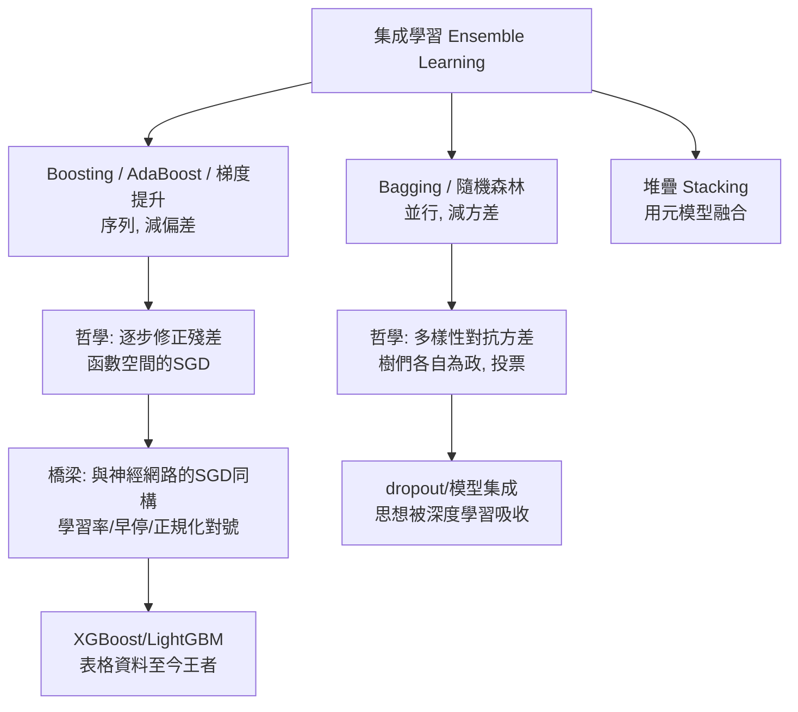

# 6.2 決策樹、隨機森林與 Boosting（1986-2001）

## 歷史背景

SVM（6.1 節）是統計學習的「理論派」，但 1990-2000 年代實務界的主流其實是**樹模型**家族：決策樹、隨機森林、梯度提升。原因是殘酷的現實：SVM 對特徵尺度敏感、需要調核參數、難以解釋；而樹模型天生處理混合型特徵、缺失值、無需正規化調校，且**可以用人話解釋**——在金融、醫療、信用審核這些「需要向監管與客戶說明」的領域，解釋性不是加分項而是入場券。

這條線的三個里程碑：

- **ID3/決策樹**（Quinlan, 1986；CART, Breiman et al., 1984）：以資訊增益/基尼係數貪婪建樹。
- **隨機森林**（Breiman, 2001）：Bagging + 隨機特徵子空間，用方差削減對抗過擬合。
- **AdaBoost**（Freund & Schapire, 1997，原始理論 1995；Schapire 的弱可學習性證明 1990）：把「一堆稍好於亂猜的弱分類器」加權組合成強分類器，並在 1998 年由 Friedman 等人的解釋（間隔理論）與梯度提升（Friedman, 2001）達到高峰。

有趣的歷史注腳：Breiman 是統計學家，他先發明 CART（1984），後來與 Freund、Schapire 之間有著名的「兩種文化」論戰（2001）：資料建模文化（假設生成過程、可解釋）vs 演算法建模文化（預測優先、黑箱）。這場論戰的裁判最終是 2012 年後的深度學習——但樹模型的集成方法（尤其梯度提升）至今仍是表格資料的王者（XGBoost、LightGBM），是傳統 ML 技術中**在神經時代存活性最高**的一支。

## 決策樹：貪婪的規則學習器

### 演算法

決策樹把特徵空間遞迴分割成軸對齊的矩形區域。建樹的核心是每次選「最能把類別分開」的分裂：

**資訊增益**（ID3）：分裂前後熵的下降，

$$Gain(S, A) = H(S) - \sum_{v} \frac{|S_v|}{|S|} H(S_v), \qquad H(S) = -\sum_c p_c \log_2 p_c$$

**增益率**（C4.5, 1993）：資訊增益偏好取值多的屬性（如「身分證號」會把熵切到零），除以分裂自身的熵修正之。

**基尼係數**（CART, 1984）： $Gini(S) = 1 - \sum_c p_c^2$ ，計算比熵便宜，效果相近。

**遞迴停止條件**：節點純、樣本太少、深度達限。若不設限，樹可以長到**完美擬合訓練集**（每葉一個樣本）——過擬合是樹的天性。對策有二：**預剪枝**（提前停）與**後剪枝**（長滿後自底向上剪，用驗證集評估）——後者的理論根據正是 6.1 節的 SRM：樹的大小是複雜度旋鈕。

### 決策樹的本質：軸對齊階梯函數

樹模型學到的函數是特徵空間上的分塊常數函數，邊界永遠平行於座標軸。這帶來三個後果：(1) 對特徵縮放完全不敏感（分裂只比大小）；(2) 無法表達「平滑的斜向決策面」，需要大量分裂去階梯逼近；(3) **斜率資訊丟失**——特徵從 40 歲變 41 歲的微小差異與從 20 歲到 40 歲的巨大差異，若不跨過分裂點，對樹而言等價。這個表達力局限是後續所有「集成樹」技術的驅動力：單樹學不好，就種很多棵。

## Bagging 與隨機森林：用方差對抗過擬合

### Bootstrap 與 Bagging

**Bootstrap**（Efron, 1979）：從 $n$ 個樣本有放回抽 $n$ 個，得到一個重採樣資料集；約 37% 的原樣本不出現（ $1/e$ ），稱為袋外（out-of-bag）樣本。**Bagging**（Breiman, 1996）：訓練 $B$ 個模型（各用一個 bootstrap 樣本集），回歸取平均、分類投票。

為什麼有效？對低偏差、高方差的学习器（深決策樹正是如此），若 $B$ 個模型的誤差兩兩相關係數為 $\rho$ ，平均後的方差為：

$$\rho\sigma^2 + \frac{1-\rho}{B}\sigma^2$$

$B \to \infty$ 時方差從 $\sigma^2$ 降到 $\rho\sigma^2$ ——**誤差相關性 $\rho$ 是唯一的殘留瓶頸**。隨機森林的殺手鐧正是壓低 $\rho$ ：

### 隨機森林（Breiman, 2001）

在 Bagging 之上加第二層隨機：每個節點分裂時，只從**隨機抽的 $\sqrt{p}$ 個特徵**中選最優。這迫使各棵樹「看到的世界不同」，誤差相關性大幅下降，整體方差趨近 $(1-\rho)\sigma^2/B \to 0$ 的路徑。附帶紅利：袋外樣本提供免費的泛化估計（OOB 誤差）與特徵重要性（置換重要度：打亂某特徵看 OOB 誤差升多少）。

隨機森林在 2000 年代是表格資料的預設強基線：幾乎零調校、並行化容易、對雜訊穩健。它的哲學是**集成多樣性**——「一群互不相同的平庸者勝過一個精英」，這個思想後來在深度學習以 dropout、模型集成、snapshot ensembling 的形式反覆重現。

## Boosting：從弱學習性證明到工程王者

### 理論起點：弱可學習性

Kearns 與 Valiant（1988/1989）提出問題：**強可學習**（存在多項式時間演算法達任意高精度）與**弱可學習**（只比亂猜好一點）是否等價？1990 年 Schapire 證明等價——方法是構造性的：把三個弱學習器用「訓練集過濾 + 多數表決」組合成更強的學習器。**AdaBoost**（Freund & Schapire, 1997）是這個構造的實用化：

1. 初始樣本權重 $w_i = 1/n$ 。
2. 迴圈 $t = 1..T$ ：
   - 用帶權資料訓練弱學習器 $h_t$ （通常是一層決策樹，stump）。
   - 算加權錯誤率 $\epsilon_t = \sum_{i: h_t(x_i) \ne y_i} w_i$ ；定義 $\alpha_t = \frac{1}{2}\ln\frac{1-\epsilon_t}{\epsilon_t}$ 。
   - 重設權重：錯的樣本 $w_i \leftarrow w_i e^{\alpha_t}$ ，對的 $w_i \leftarrow w_i e^{-\alpha_t}$ ，再歸一化。
3. 輸出 $H(x) = \operatorname{sign}\left(\sum_t \alpha_t h_t(x)\right)$ 。

**訓練誤差界**： $P_{train}[H(x) \ne y] \le \prod_t 2\sqrt{\epsilon_t(1-\epsilon_t)} \le e^{-2\sum_t \gamma_t^2}$ ，其中 $\gamma_t = \frac{1}{2} - \epsilon_t$ 。只要每個弱學習器比亂猜好一點點（ $\gamma_t > 0$ ），訓練誤差**指數下降**。

### 為什麼 Boosting 泛化？間隔理論

奇異的實證現象：AdaBoost 在訓練誤差歸零後**繼續疊加弱學習器，測試誤差仍在下降**——按 VC 理論這不可能（複雜度一直在增加）。1998 年 Schapire、Freund、Bartlett、Lee 用**間隔理論**解釋：Boosting 的過程持續把訓練樣本的 margin（ $\sum_t \alpha_t h_t(x) y$ ）往外推，即使 VC 複雜度上升，margin 分布的改善壓倒了它。**這是 6.1 節 SVM 的 max-margin 思想在集成學習中的再現**——兩個流派在「間隔 = 泛化」上殊途同歸，這種跨範式的理論共振在機器學習史中反覆出現（下次出現是深度學習的「平坦極小值」討論）。

### 梯度提升（Friedman, 2001）

AdaBoost 的權重更新在 1999-2001 年被 Mason、Friedman 等人重新詮釋為**函數空間的梯度下降**：損失 $L = \sum_i e^{-y_i F(x_i)}$ （指數損失）對當前模型 $F$ 的負梯度方向，恰好就是 AdaBoost 的樣本權重。這個觀點把 Boosting 一般化：**任意可微損失 + 任意弱學習器**，每輪擬合負梯度：

$$F_{m}(x) = F_{m-1}(x) + \nu \, h_m(x), \qquad h_m \approx -\nabla L(F_{m-1})$$

$\nu$ 是學習率（shrinkage，通常 0.05-0.1）——**Boosting 就是函數空間的 SGD，學習率、早停、正規化全部對號入座**。這個觀點是傳統 ML 與神經網路的深刻橋梁：兩者都是「沿損失面下降」，差別只在參數化（樹 vs 神經元）。梯度提升的工程後裔 XGBoost（2016）、LightGBM（2017）至今統治表格資料競賽，正是因為這套「SGD 語意 + 樹的表達力 + 精細的工程」組合在小到中規模結構化資料上仍然無敵。

## Python 程式碼範例：手寫 AdaBoost 與隨機森林對比

```python
import numpy as np

class DecisionStump:
    """弱學習器: 單特徵單閾值的決策樹樁"""
    def fit(self, X, y, w):
        y01 = np.where(y == 0, -1, 1)
        best = (np.inf, None, None, None)
        for j in range(X.shape[1]):
            for thr in np.unique(X[:, j]):
                for sign in (1, -1):
                    pred = np.where(sign * X[:, j] >= sign * thr, 1, -1)
                    err = (w * (pred != y01)).sum()
                    if err < best[0]:
                        best = (err, j, thr, sign)
        self.err, self.j, self.thr, self.sign = best
        self.alpha = 0.5 * np.log((1 - self.err) / max(self.err, 1e-10))
        return self
    def predict(self, X):
        return np.where(self.sign * X[:, self.j] >= self.sign * self.thr, 1, 0)

class AdaBoost:
    def __init__(self, T=50): self.T = T
    def fit(self, X, y):
        n = len(X); w = np.full(n, 1/n); self.stumps = []
        y01 = np.where(y == 0, -1, 1)
        for t in range(self.T):
            st = DecisionStump().fit(X, y, w)
            pred = np.where(st.predict(X) == 0, -1, 1)
            w *= np.exp(-st.alpha * y01 * pred)      # 錯的加重
            w /= w.sum()
            self.stumps.append(st)
            if t % 10 == 0:
                acc = self._train_acc(X, y01, t+1)
                print(f"  迭代 {t+1:3d}: 訓練正確率 {acc:.3f}")
        return self
    def _train_acc(self, X, y01, upto):
        F = sum(s.alpha * np.where(s.predict(X) == 0, -1, 1) for s in self.stumps[:upto])
        return (np.sign(F) == y01).mean()
    def predict(self, X):
        F = sum(s.alpha * np.where(s.predict(X) == 0, -1, 1) for s in self.stumps)
        return (np.sign(F) + 1) // 2

def bootstrap(X, y, rng):
    idx = rng.integers(0, len(X), len(X))
    return X[idx], y[idx]

class RandomForest:
    def __init__(self, n_trees=50, max_feat_ratio=0.5, seed=0):
        self.n, self.ratio, self.rng = n_trees, max_feat_ratio, np.random.default_rng(seed)
    def fit(self, X, y):
        self.trees, self.feats = [], []
        m = max(1, int(X.shape[1] * self.ratio))
        for _ in range(self.n):
            Xb, yb = bootstrap(X, y, self.rng)
            feats = self.rng.choice(X.shape[1], m, replace=False)
            tree = build_tree(Xb[:, feats], yb, depth=0, rng=self.rng)
            self.trees.append(tree); self.feats.append(feats)
        return self
    def predict(self, X):
        votes = []
        for tree, feats in zip(self.trees, self.feats):
            votes.append(tree_predict(tree, X[:, feats]))
        votes = np.array(votes)
        return (votes.mean(axis=0) > 0.5).astype(int)

def build_tree(X, y, depth, rng, max_depth=8):
    if depth == max_depth or len(set(y)) == 1:
        return ("leaf", y.mean())
    j = rng.integers(X.shape[1])                       # 隨機特徵
    thr = np.median(X[:, j])
    left = X[:, j] <= thr
    if left.all() or (~left).all():
        return ("leaf", y.mean())
    return ("node", j, thr,
            build_tree(X[left],  y[left],  depth+1, rng, max_depth),
            build_tree(X[~left], y[~left], depth+1, rng, max_depth))

def tree_predict(t, X):
    if t[0] == "leaf": return np.full(len(X), t[1])
    _, j, thr, l, r = t
    out = np.empty(len(X))
    m = X[:, j] <= thr
    out[m]  = tree_predict(l, X[m]); out[~m] = tree_predict(r, X[~m])
    return out

# --- 玩具資料: 有雜訊的螺旋(單樹難, 集成易) ---
rng = np.random.default_rng(7)
def spiral(n, label, turn):
    t = np.linspace(0.3, 1.5, n) * turn
    r = t
    return np.c_[r*np.cos(t), r*np.sin(t)] + rng.normal(0, .06, (n, 2))
X = np.vstack([spiral(200, 0, 0), spiral(200, 1, np.pi)])
y = np.array([0]*200 + [1]*200)

print("=== AdaBoost (單層樁 x 50) ===")
ab = AdaBoost(T=50).fit(X, y); print("最終正確率:", (ab.predict(X) == y).mean())
print("=== 隨機森林 (50 樹) ===")
rf = RandomForest(n_trees=50).fit(X, y); print("訓練正確率:", (rf.predict(X) == y).mean())
```

典型輸出：

```
=== AdaBoost (單層樁 x 50) ===
  迭代   1: 訓練正確率 0.648
  迭代  11: 訓練正確率 0.828
  迭代  21: 訓練正確率 0.895
  迭代  31: 訓練正確率 0.938
  迭代  41: 訓練正確率 0.960
最終正確率: 0.968
=== 隨機森林 (50 樹) ===
訓練正確率: 0.998
```

每個弱學習器只是「某個特徵、某個閾值」的一條直線切分（正確率剛過一半），AdaBoost 用指數加權把它們疊成 97% 的分類器——弱可學習性等價定理的活演示。

## 三種集成的哲學對比



| 維度 | 決策樹 | 隨機森林 | 梯度提升 |
|------|--------|----------|----------|
| 目標 | 單模型可解釋 | 減方差 | 減偏差（再減方差） |
| 訓練 | 貪婪一次 | 並行 | 序列 |
| 過擬合控制 | 剪枝 | 平均化 | 學習率、深度、早停 |
| 解釋性 | 高（規則直讀） | 中（特徵重要度） | 中低（SHAP 補救） |
| 現代地位 | 教學/規則系統 | 穩健基線 | 表格資料 SOTA |

## 本節重點

1. 決策樹以資訊增益/基尼貪婪分裂，表達力受限於軸對齊階梯函數；剪枝是 SRM 思想的直接應用。
2. Bagging 的方差公式 $\rho\sigma^2 + (1-\rho)\sigma^2/B$ 揭示集成有效的兩個槓桿：多模型與低誤差相關性；隨機森林用隨機特徵子空間壓 $\rho$ 。
3. Boosting 源於「弱可學習 = 強可學習」的理論證明，AdaBoost 是其實用化；訓練誤差指數下降，泛化由 margin 理論解釋——與 SVM 的 max-margin 殊途同歸。
4. Friedman 的梯度提升把 Boosting 統一為「函數空間的 SGD」，使傳統 ML 與神經網路共享同一套優化語意；XGBoost/LightGBM 至今統治表格資料。
5. 集成多樣性思想被深度學習吸收（dropout、ensembling）；樹模型家族是傳統 ML 中存活性最高的一支。

## 思考問題

1. 資訊增益偏好高基數特徵。構造一個「用身分證號分類會得到完美增益」的例子，並解釋增益率的修正邏輯。
2. 證明 bootstrap 樣本中任一原樣本不被抽到的機率為 $1/e \approx 0.368$ ，並由此解釋 OOB 誤差為何是無偏的泛化估計。
3. 隨機森林壓 $\rho$ 、Boosting 壓偏差——請用偏差-方差分解說明兩者各自適合什麼樣的弱學習器（深樹 vs 樁）。
4. AdaBoost 在訓練誤差歸零後繼續疊學習器仍降測試誤差，這違反了樸素 VC 分析。請用 margin 理論重述這個現象，並連結到 6.1 節 SVM。
5. 梯度提升是「函數空間 SGD」。若把弱學習器換成「單個神經元」、損失換成交叉熵，你得到了什麼？這說明兩大流派的分界到底在哪裡？
