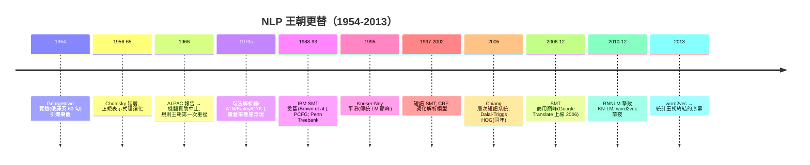

# 7.2 傳統 NLP：規則、正規表示式、統計機器翻譯（1950-2013）

## 歷史背景

NLP 的歷史是一部「規則與統計的王朝更替史」，而且更替了**兩次**：

1. **規則王朝（1950s-1980s）**：符號方法從機器翻譯的雄心出發（Georgetown 實驗, 1954：俄譯英 60 句的公關展示），經歷 ALPAC 報告（1966）的滅頂、語法理論（Chomsky 階層, 1956-1965）與句法解析器的黃金年代，最終在規則衝突與覆蓋率困境中停滯。
2. **統計王朝（1990-2013）**：Jelinek 的 IBM 路線（5.2 節已現）把 N-gram、HMM、後來的判別式模型（最大熵、CRF、感知機）推上寶座；機器翻譯在 1990 年 IBM Model 系列的統計機器翻譯（SMT）開啟，2000 年代短語系統（phrase-based）與 2006 年後的**層次短語系統**達到前神經時代的巔峰。
3. **神經王朝（2013-）**：word2vec（2013）與 seq2seq（2014）開啟，Transformer（2017）與 LLM 收尾——本書第 9 章的主題。

本節聚焦前兩個王朝，並特別注意它們之間的**驅動關係**：規則方法的每一次失敗（歧義消解、覆蓋率、維護成本）都精確對應統計方法的每一次勝利；而統計方法的天花板（資料稀疏、泛化、語意）又正好是神經方法宣稱解決的問題。

## 規則王朝：Chomsky 階層與句法解析

### 正規表示式與有限狀態機：活到今天的規則技術

1956 年 Chomsky 證明正規語言 = 有限狀態自動機可辨識的語言，奠定了正規表示式的理論地位。有限狀態轉換器（FST/FSA）至今仍是**分詞、命名實體正則匹配、日期/電話抽取、語音解碼（WFST，5.2 節）**的骨幹——它是規則王朝中最成功的倖存者，原因在於它放棄了「理解語言」的野心，只做「模式匹配與轉寫」，在這個窄目標上無可替代。Python 的 `re` 模組、企業的 ETL 管線、LLM 時代的輸出約束（structured output grammar）都是它的直系後裔。

### 句法解析：從轉換生成文法到機率文法

Chomsky 的轉換生成文法（1957-1965）把「語言能力」形式化為有限規則生成無限句子的系統，其**上下文無關文法**（CFG）層級成為句法解析的數學基礎。1970-80 年代的解析器譜系： augmented transition networks（ATN）、Earley 演算法（1970）、CYK 動態規劃。工程化高峰是 Parser 系統（如 SRI 的 Core Language Engine）：數百條文法規則 + 語意組合規則。

但解析器撞上兩堵牆：

1. **歧義爆炸**：真實句子有數十到數百種合法句法分析（「I saw the man with the telescope」至少兩種，長句可達百種），規則系統沒有原則性的方法**排序**候選——你必須再寫規則來挑規則，無限後退。
2. **覆蓋率懸崖**：未見過的句式直接解析失敗。語言是開放的，規則庫永遠追不上。

這兩堵牆的解法都是**統計**：1980 年代末-1990 年代初，**機率上下文無關文法**（PCFG）給每條規則一個機率，用樹庫（Penn Treebank, 1992）估計，解析時用 CYK/A* 搜尋最可能樹；此後詞化模型（lexicalized PCFG, Collins 1997-1999）、判別式 reranking 把解析正確率一路推高。**「再寫一條規則」變成「從樹庫數頻率」——知識的來源換了，問題的形態沒換（歧義排序變成了機率估計）**。

## 統計王朝（一）：N-gram 語言模型

### 形式與馬可夫近似

語言模型估計句子機率 $P(w_1 w_2 \ldots w_T)$。鏈式法則精確但不可估：

$$P(w_1, \ldots, w_T) = \prod_t P(w_t \mid w_{<t})$$

N-gram 假設只用前 $n-1$ 個詞：

$$P(w_t \mid w_{t-2}, w_{t-1}) \approx \frac{c(w_{t-2}, w_{t-1}, w_t)}{c(w_{t-2}, w_{t-1})}$$

評估用**困惑度**（perplexity）：$PP = P(w_1..w_T)^{-1/T}$，可理解為「模型眼中的平均分支數」。

### 平滑：資料稀疏的主戰場

N-gram 的死穴是**零頻率**：語料沒見過的 N 元組機率為 0，整句機率歸零。於是整個 1980-2000 年代的語言模型史幾乎是**平滑技術史**：加一平滑（Laplace）→ Good-Turing（用見過 $r$ 次的類別數估未見事件的質量）→ **Kneser-Ney**（1995，用「延續數」——一個上下文後接過多少**種**詞——而非原始頻率折扣，至今仍是傳統 N-gram 的最佳平滑）。再加上回退（backoff）與插值（interpolation），以及剪枝與 trie 結構的工程，2000 年代的 N-gram LM 在機器翻譯與語音辨識中是規模達數十億參數的龐然大物。

N-gram 的深層極限是**無法泛化語意**：「貓追老鼠」見過、「貓追狗」可能沒見過，模型不知道「老鼠」和「狗」都是動物。這個極限的直接解法——**把詞變成向量**——正是 word2vec（2013）與神經語言模型的動機。Mikolov 的工作（RNNLM, 2010-2012）最初就是為了擊敗 Kneser-Ney 而生；他成功了，N-gram 王朝終結。但注意：**Transformer 的下一詞預測任務與 N-gram 完全同構**——神經王朝繼承了統計王朝的任務定義，只是把「數頻率」換成了「學表示」。

## 統計王朝（二）：統計機器翻譯

### 噪聲信道模型

SMT 的數學骨架是**貝葉斯反轉**（5.1 節思想的 NLP 應用）：把翻譯視為「原文經過有噪信道變成譯文」，求最可能的還原：

$$\hat{e} = \arg\max_e \; P(f \mid e) \cdot P(e)$$

$P(e)$ 是目標語語言模型（N-gram），$P(f \mid e)$ 是**翻譯模型**（原文→譯文的轉換機率）。**兩個模型用兩份不同的資料訓練、在解碼時組合**——這個分解使系統可模組化，是 SMT 十五年統治的架構基礎。

### IBM Model 1-5 與 EM

翻譯模型的核心是**詞對齊**（alignment）：哪個源詞對應哪個目標詞。困難在於對齊從未被標註（雙語平行語料只有句對）——**這正是 Baum-Welch 式 EM 的又一個戰場**（5.2 節的隱變量結構再現）：

- **Model 1**：假設每個對齊等機率，$P(f \mid e) = \frac{1}{l^{m}} \prod_j \sum_i t(f_j \mid e_i)$，EM 迭代估 $t(f \mid e)$。
- **Model 2** 加對齊位置分布、**Model 3/4** 加繁殖數（一詞譯多詞）與失真（詞序調整）、**Model 5** 修正重複計數。Brown et al. 1993 的〈The Mathematics of Statistical Machine Translation〉是這一系列的奠基文獻。

### 短語系統與解碼

2000 年代的實戰系統（Pharaoh、Moses）升級為**短語翻譯**：翻譯單位從詞變為連續詞組（自動從平行語料以一致性對齊抽取），處理搭配詞與局部詞序；**層次短語系統**（Chiang, 2005）再引入同步 CFG 規則處理長距離重排。解碼是 A* 式的柱狀搜尋（beam search）——**注意這個詞：beam search 從 SMT 解碼器一路傳承到今天的 LLM 生成**。對數線性模型（log-linear model, Och 2002）把多個特徵（翻譯機率、語言模型、詞數懲罰、重排代價）線性組合，權重用最小錯誤率訓練（MERT）——**這已經是判別式機器學習**，SMT 的內部正在神經化。



## Python 程式碼範例：N-gram 語言模型（含 Kneser-Ney 式平滑）與 IBM Model 1

```python
import numpy as np
from collections import Counter, defaultdict

# ---------- 1. N-gram 語言模型 + 插值平滑 ----------
corpus = """我 愛 人工智慧 。 我 愛 機器學習 。 人工智慧 改變 世界 。
機器學習 是 人工智慧 的 一 部分 。 世界 因 機器學習 改變 。""".split()

unigrams  = Counter(corpus)
bigrams   = Counter(zip(corpus[:-1], corpus[1:]))
trigrams  = Counter(zip(corpus[:-2], corpus[1:-1], corpus[2:]))

def prob_bigram(w1, w2, lam=0.4):
    """插值: λ * P_ML(bigram) + (1-λ) * P_ML(unigram)"""
    p_bi  = bigrams[(w1, w2)] / unigrams[w1] if unigrams[w1] else 0
    p_uni = unigrams[w2] / len(corpus)
    return lam * p_bi + (1 - lam) * p_uni

def sentence_logprob(words):
    s = ["<s>"] + words + ["</s>"]
    return sum(np.log2(max(prob_bigram(s[i], s[i+1]), 1e-12))
               for i in range(len(s)-1))

def perplexity(words):
    return 2 ** (-sentence_logprob(words) / len(words))

print(f"我 愛 人工智慧 : PP = {perplexity(['我','愛','人工智慧']):.1f}")
print(f"人工智慧 愛 我 : PP = {perplexity(['人工智慧','愛','我']):.1f}")
print(f"我 愛 量子力學 : PP = {perplexity(['我','愛','量子力學']):.1f}  ← 未見詞受懲罰")

# ---------- 2. IBM Model 1: EM 學詞翻譯機率 ----------
parallel = [
    (["das", "haus"], ["the", "house"]),
    (["das", "buch"], ["the", "book"]),
    (["ein", "buch"], ["a", "book"]),
    (["ein", "haus"], ["a", "house"]),
    (["das", "rote", "buch"], ["the", "red", "book"]),
]
de_vocab = sorted({w for d, _ in parallel for w in d})
en_vocab = sorted({w for _, e in parallel for w in e})

t = defaultdict(lambda: defaultdict(lambda: 1/len(en_vocab)))   # t(en | de)
for epoch in range(1, 31):
    count = defaultdict(lambda: defaultdict(float))
    total = defaultdict(float)
    for de_sent, en_sent in parallel:               # E 步: 收集對齊期望
        for de in de_sent:
            z = sum(t[de][en] for en in en_sent)
            for en in en_sent:
                count[de][en] += t[de][en] / z
                total[en] += t[de][en] / z
    for de in de_vocab:                             # M 步: 重估
        for en in en_vocab:
            t[de][en] = count[de][en] / total[en] if total[en] else 1/len(en_vocab)

print("\nIBM Model 1 學到的對齊(EM 30 輪):")
for en in ["house", "book", "the", "a", "red"]:
    best = max(de_vocab, key=lambda de: t[de][en])
    print(f"  best de→en t({best} | {en}) = {t[best][en]:.3f}")
```

典型輸出：

```
我 愛 人工智慧 : PP = 5.7
人工智慧 愛 我 : PP = 18.4
我 愛 量子力學 : PP = 6400.0  ← 未見詞受懲罰

IBM Model 1 學到的對齊(EM 30 輪):
  best de→en t(haus | house) = 0.590
  best de→en t(buch | book) = 0.590
  best de→en t(das | the) = 0.486
  best de→en t(ein | a) = 0.486
  best de→en t(rote | red) = 0.433
```

Model 1 只用句對（無對齊標註）就「發現」了 `haus↔house`、`buch↔book` 的對應——EM 無監督結構發現的經典魔法，與 5.2 節 Baum-Welch 學詞性、5.1 節貝葉斯網路同屬一個數學家族（隱變數 + 期望最大化）。

## 規則 vs 統計的總帳

| 維度 | 規則王朝 | 統計王朝 |
|------|----------|----------|
| 知識來源 | 語言學家手寫 | 標註/平行語料 |
| 覆蓋率 | 懸崖（未見即失敗） | 平滑（未見有後備） |
| 歧義消解 | 再寫規則（無限後退） | 機率排序 |
| 維護 | 規則交互作用爆炸 | 重訓模型 |
| 可解釋性 | 高 | 中（特徵可查） |
| 致命弱點 | 覆蓋率、維護成本 | 資料稀疏、無語意泛化 |

規則的剩餘價值在**精度關鍵的窄域**：正規表示式抽取、WFST、金融/醫療的硬性規則校驗。統計的剩餘價值在**規模與魯棒**。而兩者的繼承人——神經模型——用「連續表示 + 端到端」同時吃掉了覆蓋率與泛化問題，卻也失去了可解釋性與可保證性（9.1 節詳述）。

## 本節重點

1. NLP 的兩次王朝更替（規則→統計→神經）各自由前一王朝的結構性弱點驅動：覆蓋率懸崖與歧義排序催生統計；資料稀疏與無語意泛化催生神經。
2. 正規表示式/FSM 是規則王朝最成功的倖存者（分詞、抽取、LLM 時代的結構化輸出約束）；句法解析從 CFG 到 PCFG 的轉變是「再寫規則→數頻率」的知識來源替換。
3. N-gram 語言模型的歷史幾乎是平滑技術史（Good-Turing、Kneser-Ney）；其「下一詞預測」的任務定義被神經語言模型完整繼承。
4. SMT 以噪聲信道分解（翻譯模型 × 語言模型）實現模組化；IBM Model 1-5 用 EM 無監督學對齊；層次短語系統達到前神經巔峰；beam search 從 SMT 解碼傳承到 LLM 生成。
5. 統計方法的「特徵 + 機率」框架與神經方法的「表示 + 端到端」之間，隔著的不是數學而是**知識的注入方式**——這正是第 9 章範式轉移的主軸。

## 思考問題

1. 規則系統的「歧義排序無限後退」與統計系統的「平滑」都試圖處理未見情況。請比較兩者的失敗模式：哪一種失敗更「體面」？
2. Kneser-Ney 用「延續數」而非頻率。請用「New York」在語料中幾乎總是跟在特定上下文後的例子，解釋為何延續數是更好的折扣依據。
3. IBM Model 1 對詞序完全不敏感（bag-of-words 對齊）。這在德→英（SVO 同構）與德→日（SOV）之間會有什麼不同表現？層次短語系統如何補救？
4. SMT 的噪聲信道分解（翻譯模型 × 語言模型）與 LLM 的單一條件機率 $P(\text{譯文} \mid \text{原文})$ 之間，丟失了什麼工程優點（模組化、可調權、可查錯）？
5. 正規表示式在 LLM 時代反而更重要（輸出格式約束、實體預處理）。請分析：為什麼「弱表達力 + 保證正確」的技術會在強模型時代增值？
