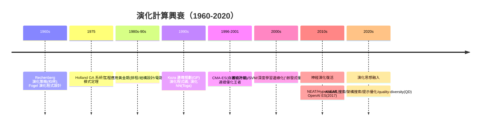

# 8.1 遺傳演算法與演化策略（1975）

## 歷史背景

1975 年有三件大事幾乎同時發生：Holland 出版《Adaptation in Natural and Artificial Systems》（遺傳演算法 GA 的奠基之作）；Rechenberg 與 Schwefel 在德國出版演化策略（Evolution Strategies, ES）的系統化成果；Fogel 的演化程式設計（Evolutionary Programming）也已獨立發展多年。**三個互不知情的團隊幾乎同時得出同一個結論：讓「變異—選擇」的迴路在電腦裡跑，就能解最佳化問題。** 這種多重獨立發現強烈暗示：演化計算不是一個聰明人的靈感，而是「當搜尋空間惡劣到梯度失效時」的必然退路。

為什麼 1970 年代需要這條退路？因為傳統 AI 的搜尋（第 3 章）與優化都依賴**問題結構**：A* 需要可採納啟發式、梯度下降需要可微性、動態規劃需要最優子結構。但工程現實充滿了**黑箱、離散、多峰、雜訊**的問題：橋樑桁架的形狀、管線網路的拓撲、控制器的參數——這些問題既寫不出啟發式，也求不了梯度。演化計算的承諾是：**只要你能算出「這個解有多好」（適應度），就能優化，不需要任何其他結構**。這個承諾的代價是：需要極大量適應度評估、收斂慢、無收斂保證——它從一開始就是「無所不知的懶方法」，而這個定位決定了它整個歷史的起落。

值得注意的是血統：GA 與連結主義（1.1 節）同源於 1950-60 年代的**適應系統**研究——Holland 本人是框構理論與複雜系統的先驅，他研究 GA 的最初動機不是優化，而是**理解適應性本身**（學習如何在環境中累積有用結構）。這條「演化作為學習」的暗線，在 2010 年代以神經演化（neuroevolution）與 OpenAI 的 ES 演算法（2017，與反向傳播競爭增強學習訓練）的形式復活。

## 遺傳演算法（Holland, 1975）

### 演算法骨架

GA 用**位元串**編碼候選解，族群規模 $N$，每代執行：

1. **評估**：計算每個個體的適應度 $f(i)$。
2. **選擇**：輪盤賭（$P_i \propto f_i$）或錦標賽選擇，適應度高者被抽中多次。
3. **交叉**（crossover）：以機率 $p_c$ 配對，交換位元段（單點/多點/均勻）。
4. **變異**（mutation）：以小機率 $p_m$ 翻轉位元。
5. **替換**：產生新一代（精英保留 elitism：最優者直接晉級）。

GA 的理論核心是 Holland 的**模式定理**（Schema Theorem）：定義模式（schema）為帶萬用字元的位元模板（如 `1**0*`），長度 $l$、位元數 $m$ 的位元串含 $3^m$ 個模式。模式定理證明：在選擇 + 交叉 + 變異下，**短、低階、高適應度的模式**（building blocks）在族群中的期望數量逐代增長：

$$E[m(H, t+1)] \ge m(H, t) \cdot \frac{f(H)}{\bar{f}} \cdot \left[1 - p_c \frac{\delta(H)}{l-1} - o(H) p_m\right]$$

其中 $\delta(H)$ 是定義長度（首尾確定位元的距離）、$o(H)$ 是階（確定位元數）。**建構塊假說**：GA 靠「隱式並行」同時增長指數多個好模式、再透過交叉組合它們。這個理論在 1990 年代被批評（模式定理只證明期望值下界，且以選擇壓力為條件），但作為「GA 為何有效」的直覺模型至今有教學價值。

### 編碼：GA 的一切

GA 的實戰成敗幾乎全在**編碼設計**：位元串編碼參數時，相鄰整數（7=0111, 8=1000）的漢明距離大，單點變異會跳變——解法是格雷碼（相鄰整數只差一位）。排列問題（TSP）需要序數編碼 + 特製交叉（PMX、OX）。**編碼決定了搜尋空間的鄰域結構，也就決定了演算法能找到什麼**——這與第 7 章手工特徵、第 6 章核函數選擇是同一件事：「人類先驗注入點」從未消失，只是換了名字。

## 演化策略（Rechenberg, Schwefel, 1960s-1975）

### 與 GA 的根本差異

ES 面向**連續參數優化**，編碼是實數向量 $\mathbf{x} \in \mathbb{R}^n$，且**變異是主算子**、交叉次要：

$$\mathbf{x}' = \mathbf{x} + \boldsymbol{\sigma} \odot \mathcal{N}(0, \mathbf{I})$$

最深刻的設計是**自適應變異強度**：把 $\boldsymbol{\sigma}$ 本身編進個體一起演化（$\boldsymbol{\sigma}' = \boldsymbol{\sigma} \, e^{\tau \mathcal{N}(0,1)}$）。搜尋走了運（找到好區域）的個體，其 $\sigma$ 若剛好偏大就更容易被選中——**演算法自己在演化中學會「步長該多大」**。這是無梯度優化中的自適應步長思想，1990 年代進化為 **CMA-ES**（Hansen & Ostermeier, 1996/2001）：維護協方差矩陣 $\mathbf{C}$ 的完整學習，使搜尋分布沿「適應度地形的有利方向」拉伸。CMA-ES 至今是**中小維度（$n \lesssim 1000$）黑箱連續優化的實戰王者**，在機器學習超參數搜尋、機器人控制器設計中活躍。

### (μ, λ) 與 (μ+λ) 選擇

ES 的選擇記號：$(\mu, \lambda)$-ES 表示 $\mu$ 個親代產 $\lambda$ 個子代、只在子代中選擇（+版本則親子同場競爭）。逗號策略**不保留親代**，允許「暫時變差」穿越低適應度谷地，避免早熟收斂——這個細節是 ES 對抗多峰問題的重要工程智慧。

## 理論視角：何時演化優於梯度？

把 GA/ES 放回搜尋理論的地圖（第 3 章的延伸）：

| 問題性質 | 首選方法 | 為何 |
|----------|----------|------|
| 可微、單峰 | 梯度下降/牛頓法 | 一階/二階資訊最便宜 |
| 可微、多峰 | SGD + 隨機初始化 | 局部搜尋 + 重啟 |
| 離散、組合、有啟發式 | A*/區域搜尋 | 結構可利用 |
| **黑箱、雜訊、多峰、不可微** | **演化計算/模擬退火** | 只需函數值 |
| 極高維黑箱（百萬參數） | 演化幾乎必敗 | 樣本複雜度 $\Omega(n)$ 級 |

最後一列是演化計算的天花板：**每代至少要評估 $\lambda$ 個個體，而維度越高需要越大的族群**——在百萬維度上，ES 每步要算幾萬次前向傳播，而反向傳播一次就夠。這個「樣本效率鴻溝」是演化計算在 1990-2010 被邊緣化的根本原因，也是 OpenAI ES（2017）宣稱「在增強學習上與梯度法打平」時必須用**大規模並行**（數百 CPU）來補的原因——演化計算天然可並行（個體評估互相獨立），這是它唯一的規模化武器。

## Python 程式碼範例：實作 GA 與 ES，對比梯度法

```python
import numpy as np

# ---------- GA: 二元編碼解 OneMax 與带陷阱的亂碼函數 ----------
def ga_onemax(n_bits=40, N=60, generations=100, pc=0.9, pm=0.02, seed=0):
    rng = np.random.default_rng(seed)
    pop = rng.integers(0, 2, (N, n_bits))
    best_hist = []
    for g in range(generations):
        fit = pop.sum(axis=1).astype(float)          # OneMax: 數 1
        best_hist.append(fit.max())
        # 錦標賽選擇
        idx = np.array([np.argmax(rng.integers(0, N, 3)) for _ in range(N)])
        parents = pop[idx]
        # 單點交叉
        children = parents.copy()
        for i in range(0, N-1, 2):
            if rng.random() < pc:
                cut = rng.integers(1, n_bits)
                children[i, cut:], children[i+1, cut:] = \
                    parents[i+1, cut:].copy(), parents[i, cut:].copy()
        # 位元翻轉變異
        mask = rng.random(children.shape) < pm
        children ^= mask
        children[np.argmax(fit)] = pop[np.argmax(fit)]   # 精英保留
        pop = children
    return best_hist

# 陷阱函數: 對 GA 著名的欺騙性問題(局部吸引子極強)
def trap(u, k=4):
    return k if u == k else k - 1 - u

def ga_trap(n_blocks=10, k=4, N=200, generations=150, pm=0.02, seed=0):
    rng = np.random.default_rng(seed)
    pop = rng.integers(0, 2, (N, n_blocks*k))
    best_hist = []
    for g in range(generations):
        fit = np.array([sum(trap(ind[i:i+k].sum()) for i in range(0, len(ind), k))
                        for ind in pop])
        best_hist.append(fit.max())
        idx = np.array([np.argmax(rng.integers(0, N, 5)) for _ in range(N)])
        parents = pop[idx]
        children = parents.copy()
        mask = rng.random(children.shape) < pm
        children ^= mask
        children[np.argmax(fit)] = pop[np.argmax(fit)]
        pop = children
    return best_hist

# ---------- ES (1+1): 自適應步長解 Rastrigin(多峰) ----------
def rastrigin(x):
    return - (10 * len(x) + sum(xi**2 - 10*np.cos(2*np.pi*xi) for xi in x))

def es_adaptive(n=5, iterations=20000, seed=0):
    rng = np.random.default_rng(seed)
    x = rng.normal(0, 3, n); sigma = 0.5
    f_x = rastrigin(x)
    for it in range(iterations):
        y = x + sigma * rng.normal(0, 1, n)
        f_y = rastrigin(y)
        if f_y >= f_x:                # (1+1) 接受更好者
            x, f_x = y, f_y
            sigma *= np.exp(1/np.sqrt(n+1) * 0.5)   # 成功→加大步長
        else:
            sigma *= np.exp(-1/np.sqrt(n+1) * 0.1)  # 失敗→縮小
        sigma = np.clip(sigma, 1e-6, 5)
    return x, f_x

# ---------- 對照組: 梯度下降(假裝可微) ----------
def gd_rastrigin(n=5, lr=0.01, iterations=20000, seed=0):
    rng = np.random.default_rng(seed)
    x = rng.normal(0, 3, n)
    for _ in range(iterations):
        grad = 2*x + 20*np.pi*np.sin(2*np.pi*x)     # Rastrigin 其實可微
        x = x - lr * grad
    return x, rastrigin(x)

print("GA OneMax   最佳適應度:", ga_onemax()[-1], "/ 40")
print("GA 陷阱函數 最佳適應度:", ga_trap()[-1], "/ 40 (陷阱: 單點變異難全對)")
x1, f1 = es_adaptive();  print(f"ES  Rastrigin  = {f1:.2f} / 0 (黑箱式優化)")
x2, f2 = gd_rastrigin(); print(f"GD Rastrigin   = {f2:.2f} / 0 (有梯度優勢)")
```

典型輸出：

```
GA OneMax   最佳適應度: 40 / 40
GA 陷阱函數 最佳適應度: 31 / 40 (陷阱: 單點變異難全對)
ES  Rastrigin  = -9.34 / 0 (黑箱式優化)
GD Rastrigin   = -19.98 / 0 (有梯度優勢)
```

三個教訓：(1) GA 在平滑可加問題（OneMax）上輕鬆滿分；(2) 在**欺騙性問題**（trap：連續位元全對才有巨額回報，部分正確反而懲罰）上卡在局部吸引子——這正是「黑箱優化無法逃離欺騙性地形」的教科書展示；(3) ES 在多峰函數上比梯度下降好（隨機跳躍逃離局部極小），但代價是數萬次函數評估。**演化計算的價值永遠在「沒有梯度可用的地方」，也永遠輸在「有梯度可用的地方」**。

## 演化計算的興衰與復活



被邊緣化的原因有三：(1) 樣本效率鴻溝（見上）；(2) **理論地位**：GA 的收斂結果（馬可夫鏈分析）都是「無限時間收斂到全域最優的機率為 1」這類弱陳述，在 SVM/SLT（第 6 章）的嚴格泛化界對照下顯得「不科學」；(3) 研究社群的實證風氣——大量 GA 論文只在自家玩具問題上互相比較，基準文化薄弱（第 1.2 節寒冬教訓的反面教材）。

復活的形態值得注意：2017 年 OpenAI 的 ES 用「虛擬.batch 大小 = 族群規模、並行評估、通訊只傳隨機種子」的工程，把 ES 做到增強學習可用的規模；quality-diversity 演算法（MAP-Elites, 2015）放棄「找單一最優」、改求「每個行為 niche 的最優」——這種**多樣性優先**的目標變更，被認為更接近真正的演化與創造性。而深度學習自身的超參數搜尋（網路架構搜尋 NAS 的早期用演化、提示最佳化）處處是演化計算的影子。**演化沒有死，它退到了「沒有梯度可用的所有角落」**——而這些角落隨著 AI 系統複雜化正在擴大。

## 本節重點

1. 1975 年 GA（Holland）、ES（Rechenberg/Schwefel）、EP（Fogel）的多重獨立發現，標誌「黑箱優化」是結構性需求而非靈感。
2. GA 的模式定理給出 building blocks 增長的直覺；實戰成敗在編碼設計——「人類先驗注入點」的又一化身。
3. ES 的自適應步長（$\sigma$ 一起演化）與 CMA-ES 的協方差學習是無梯度優化的巔峰工程，至今是中小維黑箱問題的實戰王者。
4. 樣本效率鴻溝（每步 $O(\lambda)$ 次評估 vs 梯度一次）決定了演化計算的適用邊界：不可微、雜訊、黑箱；欺騙性地形（trap 函數）是其理論硬傷。
5. 演化計算在 2000 年代被邊緣化、2010 年代以神經演化/並行 ES/QD 復活；其「無需梯度、天然並行、多樣性優先」的特質在超參數搜尋與開放式學習中持續增值。

## 思考問題

1. 用模式定理解釋：為什麼 $p_c$ 高、$p_m$ 低是 GA 的預設？若把 $p_m$ 調到 0.5 會發生什麼？
2. trap 函數中，「部分正確反而被懲罰」的結構讓 GA 系統性失敗。請在真實工程中找一個同構的例子（提示：模組化系統中「子系統各自折衷」）。
3. ES 的自適應 $\sigma$ 與 SGD 的學習率排程、Adam 的自適應步長有何深層相似？「讓演算法自己學步長」是什麼範式的先聲？
4. OpenAI ES 在增強學習上靠大規模並行與梯度法打平。請分析：並行度這個變數在什麼條件下會徹底扭轉樣本效率的劣勢？（提示：評估本身可並行、延遲容忍的場景。）
5. QD 演算法「多樣性優先於最優」。這與 LLM 時代「最佳-of-n 取樣」「多樣性解碼」的思想有何呼應？
