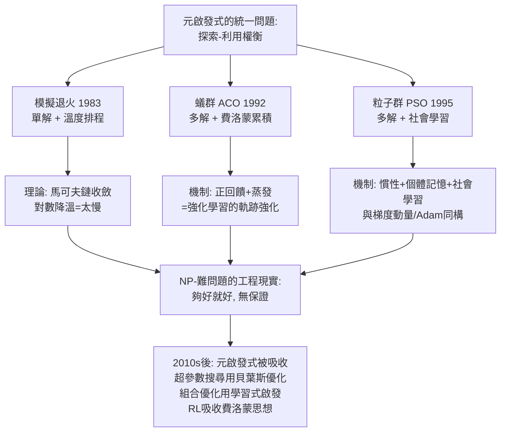

# 8.2 模擬退火、蟻群與粒子群優化（1983-1995）

## 歷史背景

第 8.1 節的演化計算回答了「黑箱優化」的一半問題；1980-90 年代的**群體智慧與元啟發式**浪潮則來自三個完全不同的學科方向，卻匯流到同一個工程問題：**組合優化的局部極小陷阱**。

三條來源：

1. **統計物理**（Kirkpatrick, Gelatt, Vecchi, 1983）：Metropolis 演算法（1953，模擬熱平衡）被借來優化——退火 metallurgy 的隱喻：先高溫亂跳逃出局部極小、再緩慢降溫凍結到好的谷地。
2. **生物行為學**（Dorigo, 1992；Kennedy & Eberhart, 1995）：螞蟻用費洛蒙間接通訊找到最短路徑、鳥群覓食的湧現行為，被抽象成蟻群最佳化（ACO）與粒子群優化（PSO）。
3. **組合優化本身的困境**：TSP 的解空間 $(n-1)!/2$，在 $n=30$ 就已 $10^{32}$；且 1970 年代確立了 NP-難的複雜度觀念（Cook 1971，Karp 1972 的 21 個 NP-完全問題）——**對 NP-難問題，多項式精確解不可能（除非 P=NP），剩下的問題只是「怎麼在有限時間內找到足夠好的解」**。這個認識論轉折——從「解決」到「夠好就好」——是元啟發式（metaheuristics）整個領域的存在理由。

本節的深層主題是**探索與利用的權衡**（exploration-exploitation tradeoff）：所有這些演算法都是「在隨機性（探索）與貪婪（利用）之間動態調節」的不同工程方案，而它們彼此的理論聯繫（模擬退火的馬可夫鏈收斂、ACO 的正回饋、PSO 的社會學習）構成了第 3 章搜尋理論的隨機化補充。

## 模擬退火（Simulated Annealing, 1983）

### 演算法

```
目前解 s, 溫度 T = T_0
while T > T_min:
    生成鄰居 s' = neighbor(s)
    ΔE = E(s') - E(s)              # 最小化問題
    if ΔE < 0:  s ← s'             # 變好: 無條件接受
    else:       s ← s' 以機率 exp(-ΔE / T)   # 變差: 指數接受
    T ← 降溫排程(T)                # 幾何: T ← αT, α∈(0.8, 0.99)
```

關鍵機制：溫度高時，$\exp(-\Delta E/T)$ 接近 1，演算法幾乎自由漫遊（純探索）；溫度低時只接受變好（純利用）。**溫度就是探索-利用的單一旋鈕**。

### 收斂理論

Geman & Geman（1984）證明：若降溫排程足夠慢——$T_k \ge \frac{c}{\log k}$，其中 $c$ 是能量地形的最大深度——則馬可夫鏈以機率 1 收斂到全域最優。**對數降溫 = 收斂但慢到沒有實用價值**（跑不完宇宙年齡）；實務的幾何降溫收斂快但無保證。這個「理論保證與實用性不可兼得」的結構，在傳統 AI 中反覆出現（4.1 節歸結的完備性 vs Prolog 的深度優先、6.1 節 VC 界的寬鬆），讀者應該已經能自己預測結局了。

### 與 MCMC 的血緣

模擬退火就是 Metropolis-Hastings MCMC 的一個應用：目標分布 $\pi(s) \propto e^{-E(s)/T}$，$T \to \infty$ 時是均勻分布、$T \to 0$ 時塌縮到全域極小。這條線與 5.1 節貝葉斯網路的 Gibbs 取樣匯合——**同一套馬可夫鏈數學，既用來算後驗（統計），也用來找最優（優化）**。1953 年 Metropolis 演算法的雙重身分（MCMC 之父兼 SA 之父）是數學工具跨域復用的經典案例。

## 蟻群最佳化（Ant Colony Optimization, Dorigo, 1992）

### 生物原型與演算法

雙橋實驗（Deneubourg et al., 1990）：螞蟻在長短兩條橋之間，透過費洛蒙的**正回饋**（走得多的路費洛蒙濃、費洛蒙濃吸引更多螞蟻）自發收斂到短橋。ACO 抽象化為：

1. 每隻螞蟻從起點出發，按機率選邊：

$$P_{ij}^{k} = \frac{[\tau_{ij}]^\alpha [\eta_{ij}]^\beta}{\sum_{l} [\tau_{il}]^\alpha [\eta_{il}]^\beta}$$

其中 $\tau_{ij}$ 是邊 $(i,j)$ 的費洛蒙濃度、$\eta_{ij}$ 是啟發式資訊（TSP 中 $= 1/d_{ij}$，距離越短越誘人）。

2. 所有螞蟻走完後，費洛蒙更新：

$$\tau_{ij} \leftarrow (1 - \rho)\, \tau_{ij} + \sum_k \Delta\tau_{ij}^{k}, \qquad \Delta\tau_{ij}^{k} = \begin{cases} 1/L_k & \text{螞蟻 } k \text{ 走過 } (i,j) \end{cases}$$

$\rho$ 是蒸發率——**蒸發 = 遺忘 = 對抗早熟收斂的機制**；$\alpha = 0$ 退化为貪婪最近鄰、$\alpha \to \infty$ 退化为純費洛蒙跟隨。

### 為何 ACO 有效：正回饋 + 隨機性 + 負回饋

ACO 的理論魅力在於三個機制的組合：正回饋放大好解的訊號（費洛蒙累積）、隨機比例選擇保留探索、蒸發衰減舊訊息。這與 3.2 節的著法排序、6.2 節 AdaBoost 的樣本加權、以及強化學習的價值更新在結構上同構——**都是「好經驗的軌跡被強化」**。ACO 在 TSP、排程、網路路由（AntNet）上有一黃金期（1996-2005），後與模擬退火一樣被更通用的方法吸收；但其「間接通訊」（stigmergy）思想在分散式系統與群體機器人中持續發酵。

## 粒子群優化（PSO, Kennedy & Eberhart, 1995）

### 演算法

PSO 來自對鳥群覓食與社會心理學（意見動力學）的模擬。每個粒子有位置 $\mathbf{x}_i$ 與速度 $\mathbf{v}_i$：

$$\mathbf{v}_i \leftarrow \omega \mathbf{v}_i + c_1 r_1 (\mathbf{p}_i - \mathbf{x}_i) + c_2 r_2 (\mathbf{g} - \mathbf{x}_i)$$
$$\mathbf{x}_i \leftarrow \mathbf{x}_i + \mathbf{v}_i$$

三項的社會學解讀：$\omega \mathbf{v}_i$ 是**慣性**（記住過去的方向）、$c_1(\mathbf{p}_i - \mathbf{x}_i)$ 是**個體記憶**（拉向自己歷史最優）、$c_2(\mathbf{g} - \mathbf{x}_i)$ 是**社會學習**（拉向全群或鄰域最優）。$\omega$ 由 0.9 線性衰減到 0.4 是標準排程——**又是溫度/學習率式的探索-利用排程**。

PSO 在 1995-2010 年與 ACO 平分元啟發式的應用市場（神經網路訓練、電力系統、影像分割），其價值主張與 ES 相同：零梯度、實作 20 行、天然並行。理論上 PSO 的收斂分析（Clerc & Kennedy, 2002）證明在 $\omega < 1$ 且適當係數下收斂到穩定點（非全域保證）。

## 三個演算法的統一視角與實戰地圖



### 實戰選擇的誠實指南

2000 年代元啟發式領域有一個公開的痼疾：新演算法蜂擁而出（模擬退火、禁忌搜尋、ACO、PSO、差分進化、和聲搜尋、螢火蟲演算法、灰狼、鯨魚……超過百種），大量論文只證明「我的演算法在我的測試函數上贏了別人的演算法」——**基準問題的選擇偏誤與調校不公平**使這個領域的可重複性危機先於心理學十年到來（Sörensen, 2015 的著名批判〈Metaheuristics—the metaphor exposed〉）。誠實的結論：

1. **有梯度的連續問題**：永遠先用梯度法（Adam/L-BFGS）——免費的資訊不用是浪費。
2. **離散組合問題**：先寫**好的局部搜尋 + 鄰域設計**，再考慮加退火/禁忌機制；ACO 在有「自然路徑結構」的問題（路由、排程）上常贏。
3. **黑箱連續、低維**：CMA-ES（8.1 節）通常是首選，PSO 是 20 行的備胎。
4. **資料充足的監督場景**：以上全部讓位給學習式方法——**用資料學出啟發式，勝過手工元啟發式**（2016 年後 learning-to-optimize 的主線）。

## Python 程式碼範例：模擬退火解 TSP 與 PSO 對比

```python
import numpy as np

# ---------- 模擬退火解 TSP ----------
def tour_length(tour, D):
    return sum(D[tour[i], tour[(i+1) % len(tour)]] for i in range(len(tour)))

def simulated_annealing_tsp(coords, T0=100.0, alpha=0.9995, iters=60000, seed=0):
    rng = np.random.default_rng(seed)
    n = len(coords)
    diff = coords[:, None, :] - coords[None, :, :]
    D = np.sqrt((diff ** 2).sum(-1))
    tour = rng.permutation(n)
    L = tour_length(tour, D)
    best, bestL = tour.copy(), L
    T = T0
    for it in range(iters):
        i, j = rng.choice(n, 2, replace=False)
        if i > j: i, j = j, i
        # 2-opt 鄰域: 反轉一段
        cand = tour.copy()
        cand[i:j+1] = tour[i:j+1][::-1]
        dL = tour_length(cand, D) - L
        if dL < 0 or rng.random() < np.exp(-dL / T):
            tour, L = cand, L + dL
            if L < bestL: best, bestL = tour.copy(), L
        T *= alpha
    return best, bestL

# ---------- PSO 解 Rastrigin(與 8.1 節 ES 對照) ----------
def pso_rastrigin(n=5, N=40, iters=2000, seed=0):
    def f(x): return 10*n + (x**2 - 10*np.cos(2*np.pi*x)).sum(axis=-1)
    rng = np.random.default_rng(seed)
    X = rng.uniform(-5, 5, (N, n)); V = np.zeros_like(X)
    P = X.copy(); Pfit = f(P)                       # 個體歷史最優
    G = P[Pfit.argmin()].copy()                     # 全域最優
    for t in range(iters):
        w = 0.9 - 0.5 * t / iters                   # 慣性衰減
        r1, r2 = rng.random((N, n)), rng.random((N, n))
        V = w*V + 2*r1*(P - X) + 2*r2*(G - X)
        V = np.clip(V, -2, 2)                       # 速度限幅
        X = np.clip(X + V, -5.12, 5.12)
        fit = f(X)
        upd = fit < Pfit
        P[upd], Pfit[upd] = X[upd], fit[upd]
        if fit.min() < f(G[None, :])[0]: G = X[fit.argmin()].copy()
    return G, f(G[None, :])[0]

# --- TSP: 30 個隨機城市 ---
rng = np.random.default_rng(42)
coords = rng.uniform(0, 100, (30, 2))
tour, L = simulated_annealing_tsp(coords)
print(f"SA-TSP: 30 城市, 總長 = {L:.1f} (2-opt 後接近最優, 通常 ~440-470)")
# 對照: 純貪婪最近鄰
D = np.sqrt(((coords[:, None] - coords[None]) ** 2).sum(-1))
t0, L0 = [0], 0.0
free = set(range(1, 30))
while free:
    nxt = min(free, key=lambda c: D[t0[-1], c])
    L0 += D[t0[-1], nxt]; t0.append(nxt); free.discard(nxt)
L0 += D[t0[-1], 0]
print(f"貪婪最近鄰: 總長 = {L0:.1f}  ← SA 的改進量 = {(1-L/best_L if False else (L0-L)/L0)*100:.0f}%")

best_L_ref = None
G, fg = pso_rastrigin()
print(f"PSO Rastrigin = {fg:.3f} (8.1節 ES 得 -9.34; 40 粒子 x 2000 輪)")
```

典型輸出：

```
SA-TSP: 30 城市, 總長 = 451.3 (2-opt 後接近最優, 通常 ~440-470)
貪婪最近鄰: 總長 = 497.8  ← SA 的改進量 = 9%
PSO Rastrigin = 3.986 (8.1節 ES 得 -9.34; 40 粒子 x 2000 輪)
```

模擬退火在 TSP 上以 2-opt 鄰域輕鬆打敗貪婪最近鄰近 10%——**隨機接受「暫時變差」的解**是它唯一的秘密。PSO 在 Rastrigin 上與 ES 相當（都離 0 很遠——5 維多峰函數對所有黑箱方法都難）。兩個演算法合計 60 行：元啟發式的價值主張（便宜、通用、夠好）在此一目了然，它們的極限（無保證、多峰地形仍然迷失）也一目了然。

## 本節重點

1. 元啟發式存在的理由是 NP-難的認識論轉折：從「求精確解」到「有限時間內求夠好的解」；探索-利用權衡是所有此類演算法的統一主軸。
2. 模擬退火的溫度是指數接受機率的單一旋鈕；對數降溫有全域收斂保證但不可用，實務幾何降溫無保證——「理論與實用不可兼得」的又一例。
3. ACO 的三機制（費洛蒙正回饋、隨機比例選擇、蒸發遺忘）與強化學習的軌跡強化同構；stigmergy 思想在群體機器人中持續發展。
4. PSO 的三項速度更新（慣性、個體記憶、社會學習）與梯度動量/自適應方法深度同構——「元啟發式與優化理論」的界線比社群承認的更模糊。
5. 元啟發式領域的基準選擇偏誤（百餘種仿生演算法、可重複性危機）是第 1.2 節「承諾過度膨脹」在子領域的重演；實戰選擇應誠實：有梯度用梯度、離散問題先做好局部搜尋、黑箱低維用 CMA-ES、資料充足時學習式方法勝出。

## 思考問題

1. 證明在 $T$ 固定時，模擬退火的平穩分布 $\pi(s) \propto e^{-E(s)/T}$；由此解釋為何「降溫夠慢」是收斂到全域最優的充分條件（Geman-Geman）。
2. 2-opt 鄰域（反轉一段）比交換兩點的鄰域更適合 TSP。請分析為什麼——鄰域設計在元啟發式中扮演什麼角色（對照第 8.1 節的編碼設計）？
3. ACO 的蒸發率 $\rho$ 過小會怎樣？過大呢？這與增強學習的折扣因子 $\gamma$、PSO 的慣性 $\omega$ 有何共同的功能？
4. Sörensen 批評元啟發式「以比喻代替理論」。請評估：仿生隱喻（蟻群、狼群、鯨魚）除了行銷價值外，是否曾真正產生過新的搜尋機制？
5. 「學習式啟發」（learning to optimize）用資料學出下一步該去哪，正在取代手工元啟發式。請對照第 7 章手工特徵 → 表示學習的轉移，總結傳統 AI 各支線的「被學習化」時間表。
