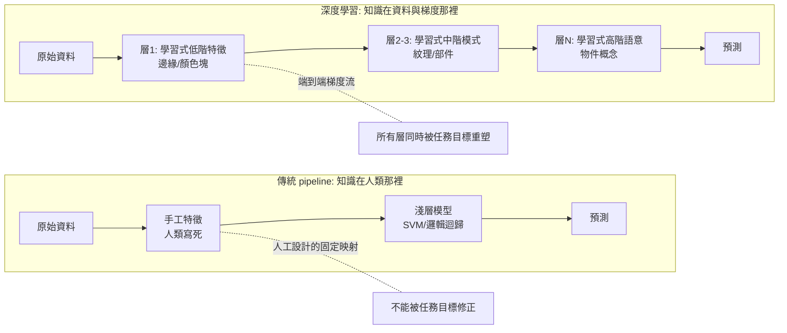
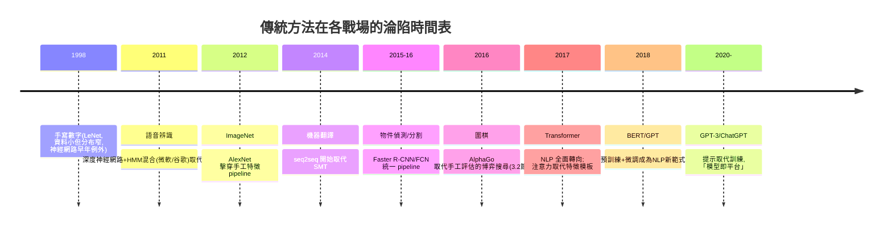

# 9.1 為何深度學習取代了傳統方法：特徵工程→表示學習的範式轉移（2012-2016）

## 歷史背景

2012 年 10 月，AlexNet 在 ImageNet 大規模視覺辨識挑戰賽（ILSVRC）把 top-5 錯誤率從上一年亞軍的 25.8% 壓到 15.3%，第二名（也是傳統 pipeline 的最後輝煌）是 26.2%。十個百分點的斷崖式領先，此前任何一年的進步幅度都在 2 個百分點以內。這不是一次普通的基準刷新，而是**範式更替的裁定日**：此後五年，電腦視覺、語音辨識、NLP 的主流方法全面換血，手工特徵、圖模型、核方法的論文比例斷崖下跌。

但把 2012 年讀成「神經網路突然變聰明」是錯的。反向傳播 1986 年就有了，CNN 的 LeNet 1998 年就贏了手寫數字，LSTM 1997 年就發明了。**深度學習的勝利需要三個外部條件在同一時刻成熟**：大規模標註資料（ImageNet, 2009）、GPU 並行計算（CUDA, 2007；AlexNet 用兩張 GTX 580）、以及累積二十年的演算法改良（ReLU、Dropout、更好的初始化）。本節的任務是把「為什麼是 2012 年、為什麼是表示學習贏了」講成一個有前因後果的結構性故事，而不是英雄敘事。

## 範式轉移的定義：從「人類寫特徵」到「機器學表示」

傳統 pipeline 與深度學習的根本差別不在「模型大小」，而在**知識的注入位置**：

**表示學習**（representation learning）的核心主張：分類的難度取決於表徵的好壞，而表徵應該是**任務驅動、可微、端到端**地被學出來的。深度網路的層次結構對應特徵的層次組合（Zeiler & Fergus, 2014 的反捲積可視化：第 1 層學 Gabor/顏色、第 3 層學紋理、第 5 層學物件部件）——這個層次性不是人教的，是**組合性資料的統計結構**與「逐層組合 + 權重共享」歸納偏置的自然產物。

## 為什麼深度學習等了二十六年？

### 三個條件的匯聚

1. **資料**：手工特徵是「先驗的濃縮」，在資料稀缺時是理性的；ImageNet（2009，1400 萬張、2.2 萬類）第一次提供了**足以支撐表示學習的監督訊號量**。Hinton 的名言點破時序：「（在 AlexNet 之前）我們（神經網路社群）的表演一直被資料量耽誤。」
2. **算力**：CNN 的核心運算是卷積 = 大量矩陣乘法，GPU 的並行吞吐恰好對口。AlexNet 訓練用了兩張消費級 GPU 六天——1986 年的同樣訓練需要（按算力外推）數十年。
3. **演算法**：ReLU（2010-2011）緩解梯度消失、Dropout（2012）抗過擬合、更好的初始化與批量歸一化（2015）穩定深層訓練。這些改良單獨看都是小技巧，合起來把「能訓練的深度」從 5 層推到 100+ 層（ResNet, 2015）。

### 理論視角：歸納偏置的重新分配

用 6.1 節的語言說，深度學習與傳統方法的差別是**歸納偏置的放置位置**：

| | 傳統方法 | 深度學習 |
|---|---|---|
| 偏置放在哪 | 特徵設計（人類寫） | 架構設計（卷積、注意力、層次） |
| 偏置的性質 | 任務特異、固定 | 任務通用、可組合 |
| 適配成本 | 每個新任務重新設計 | 遷移學習/微調 |
| 樣本效率 | 高（先驗強） | 低（需要大資料） |
| 可解釋/可保證 | 高 | 低 |

**傳統方法用強先驗換樣本效率；深度學習用資料換先驗的免費性。** 當資料與算力廉價化，天平傾斜；當資料稀缺（罕見病、工業缺陷樣本），傳統方法至今仍常勝出——「為什麼被取代」的正確答案是「**在資料充裕的任務上被取代**」，這個限定語在 9.2 節的融合討論中至關重要。

## 各戰場的淪陷時間表

不同領域被深度學習攻陷的時間差，本身就是很好的證據——**資料密度越高的戰場，淪陷越早**：

### 案例解剖一：語音辨識（2011，第一塊骨牌）

GMM-HMM（5.2 節）的體系在 2010 年已是成熟工業。擊敗它的不是拋棄 HMM，而是**替換發射模型**：把 GMM 換成深度神經網路（DNN-HMM 混合系統），詞錯率相對下降 30%。注意這個**漸進的攻城方式**：神經網路先作為「更好的發射機率估計器」嵌入舊架構，站穩後才逐步接管解碼（CTC, 2014）與整個端到端（RNN-T、Whisper, 2022）。**新範式取代舊範式通常不是一次決戰，而是先寄生、再蠶食、最後拆掉宿主**——這個模式在機器翻譯（先神經化翻譯模型、再端到端）與檢測（先替換分類頭、再端到端）中重複。

### 案例解剖二：機器翻譯（2014-2016）

SMT（7.2 節）的解體極具教育意義。SMT 的短語表、對齊、重排模型都是**人類可檢查的中間產物**——工程師可以 debug 為什麼某句翻錯。seq2seq（Sutskever et al., 2014）把整個 pipeline 壓縮成一個編碼器-解碼器，翻譯品質兩年內全面超越、中間表示完全黑箱化。業界的遷移不是因為模型更漂亮，而是因為**SMT 的維護成本結構崩了**：SMT 的每個模組（對齊工具、短語抽取、調權）都需要專家維護，端到端系統只需要資料。**「可解釋性」在傳統時代是資產，在規模時代成了負債**——這個反轉是理解 9.2 節融合爭論的鑰匙。

## 被取代者的臨床診斷：五種死法

把本書各章技術的退場方式分類，可以發現五種死法（對應 1.2 節五難題的解決）：

1. **特徵工程之死**（7.1 節 SIFT/HOG）：表示學習直接取代。死因：人工不變性無法覆蓋資料中的長尾變化。
2. **知識編碼之死**（2 章專家系統、4 章 OWL 大規模本體）：知識獲取瓶頸被「從語料統計中蒸餾知識」取代。死因：寫不完、養不起。
3. **手工概率模型之死**（5.2 節 GMM-HMM、CRF 大部分應用）：被神經化替換（發射模型→神經、特徵模板→表示）。死因：特徵容量上限。
4. **手工核之死**（6.1 節）：$O(n^2)$ 的規模上限 + 核選擇又是手工特徵工程。死因：無法端到端、無法規模。
5. **規則王朝之死**（7.2 節句法解析器）：歧義排序被機率、覆蓋率被規模碾過。死因：語言的長尾。

注意**沒有死透的**：決策樹集成（6.2）在表格資料上活得好好的；FSM/正則（7.2）在結構化約束中增值；A*/博弈搜尋骨架（3 章）活在 MCTS 與路徑規劃中；因果推理（5.1）在 LLM 時代反而更重要；CMA-ES（8 章）活在黑箱優化角落。**死與活的分界線是：該技術解決的問題，是「表示」問題還是「結構」問題。** 表示問題（把原始訊號變成好的特徵空間）被神經網路全面接管；結構問題（搜尋的正確性、優化的約束、因果的方向）依然需要非神經的技術。

## 反面證據與範式轉移的未竟之處

誠實的歷史書必須記錄深度學習沒有解決的問題，因為它們正是傳統 AI 的遺產清單：

1. **樣本效率**：人類看幾張猩猩照片就認得猩猩；AlexNet 需要百萬張。小樣本學習、元學習試圖補洞，而補洞的思路（強先驗、結構先驗、因果模型）**恰恰是傳統方法的核心資產**。
2. **可保證性**：神經網路沒有 VC 式的可用泛化界（6.1 節的理論優雅性在深網上失效）、沒有形式化驗證的通用工具。安全關鍵場景（醫療、自動駕駛、航空）中，可驗證性是監管硬要求。
3. **因果與反事實**（5.1 節 Pearl 的階梯）：LLM 只學關聯，干預與反事實推理能力存疑——假相關的陷阱在分佈漂移時爆發。
4. **長尾與分佈外**：手工系統「知道自己不知道什麼」（規則沒覆蓋就拒答）；神經系統在分佈外自信地胡說——**脆弱性沒有消失，只是從「規則沒覆蓋」變成了「資料沒覆蓋」**（2.2 節 MYCIN 的病灶在 AlexNet 身上完整重現）。
5. **知識的更新與溯源**：改一條專家系統規則 vs 重訓一個模型；引用來源 vs 權重蒸餾。9.2 節的知識圖譜+LLM 融合正是對此的回應。

## 本節重點

1. 2012 年的範式轉移 = 資料（ImageNet）+ 算力（GPU）+ 演算法（ReLU/Dropout）三條件同時成熟；本質是**知識注入位置**的轉移：人類寫特徵 → 資料與梯度學表示。
2. 歸納偏置的重新分配是理論主軸：傳統方法偏置在特徵（任務特異、樣本高效），深度學習偏置在架構（任務通用、需要大資料）——天平隨資料成本傾斜。
3. 各戰場淪陷時間與資料密度正相關；新範式取代舊範式的模式是「先寄生（替換一個模組）→ 再蠶食 → 最後端到端拆掉宿主」。
4. 五種死法（特徵工程、知識編碼、手工機率、手工核、規則王朝）都死於「表示問題被神經化」；倖存者的共同點是解決**結構問題**（搜尋正確性、優化約束、因果方向、表格資料）。
5. 深度學習未解的問題——樣本效率、可保證性、因果、長尾、知識更新——正是傳統 AI 的遺產清單，也是 9.2 節融合運動的驅動力。

## 思考問題

1. AlexNet 的十個百分點斷崖，若沒有 ImageNet 會發生嗎？請用「歸納偏置 vs 樣本量」的框架論證，並推測在 2005 年訓練 AlexNet 會發生什麼。
2. 語音辨識的 DNN-HMM「先寄生後接管」模式，在今天的 LLM 對傳統系統的替代中重演了嗎？請舉一個正在發生的例子（提示：RAG 對知識庫、Tool-use 對規則引擎）。
3. SMT 的可解釋性從資產變負債。請討論：在 2026 年的醫療 AI 監管環境下，這個價值判斷會不會再反轉一次？
4. 五種死法中，哪一種的「遺體」今天被重新利用得最多？請用 9.2 節的融合例子佐證。
5. 「脆弱性從規則沒覆蓋變成資料沒覆蓋」。MYCIN 的確定因子試圖量化「不確定」，LLM 的幻覺是「過度自信」。兩種系統該如何借鑑對方？
