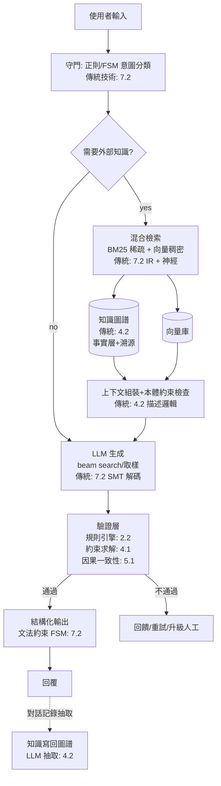

# 9.2 存活與融合：知識圖譜、Neuro-Symbolic、LLM 時代的傳統技術（2012-2026）

## 歷史背景

9.1 節的結論是：表示問題被神經方法全面接管，結構問題的技術存活。本節敘述 2012-2026 年間，這些倖存技術如何與深度學習**重組**成新形態的系統，以及這個「融合時代」的驅動邏輯。

融合不是情懷，而是被 LLM 的四個結構性缺陷倒逼出來的工程需求：

1. **幻覺**（hallucination）：下一詞預測的目標函數獎勵「像真的話」，不獎勵「是真的話」。
2. **知識滯後與更新成本**：知識凍結在訓練快照裡，更新需重訓或微調，成本高且無版本控制。
3. **無溯源**：無法回答「你這個結論來自哪份文件第幾段」——醫療、法律、金融場景的入場障礙。
4. **計算與邏輯的不可靠性**：精確算術、多步符號推理、複雜約束滿足，權重蒸餾的統計逼近在這些任務上不可保證。

而傳統 AI 剛好有一整櫃針對這四個缺陷的技術：知識圖譜（4.2）管事實與溯源、檢索系統管更新、FSM/正則/文法（7.2）管輸出格式、規則引擎與約束求解（2.2/4.1）管硬約束、SMT 式解碼的 beam search（7.2）管生成、搜尋演算法（3 章）管規劃。**2020 年代的 LLM 應用工程，本質上是「神經大腦 + 符號骨架」的系統整合**——傳統 AI 沒有被丟進博物館，而是從「主角」轉型為「骨架與免疫系統」。

## 知識圖譜的復興：與 LLM 的雙向奔赴

### 為什麼 LLM 需要圖譜

4.2 節的知識圖譜在 2012-2018 年（語意網退潮期）一度被認為是「太工程化、抽取出錯率高」的遺產。LLM 時代它的四個不可替代價值重新被定價：

1. **可更新的事實層**：公司產品知識、法律條文、醫療指引的變更寫進圖譜是即時的（CRUD），寫進權重是重訓。
2. **溯源**：每個三元組有來源，回答可附引用——監管合規的剛需。
3. **多跳一致性**：「A 的供應商的 CEO 的母校」這類查詢，圖上三跳精確可達；LLM 的隱式知識在多跳組合時錯誤率相乘。
4. **領域本體的約束**：OWL/SHACL 約束能**證明**回答不違反 schema（藥物交互作用的硬禁區），這是機率模型做不到的保證。

### 雙向融合的兩個方向

- **LLM → 圖**：用 LLM 做資訊抽取（實體辨識、關係抽取、事件抽取），把非結構文字批量變成三元組——4.2 節「知識獲取瓶頸」的最大死結，被 LLM 的語言能力直接鬆開。GraphRAG（2024，微軟）是這個方向的系統化：先用 LLM 抽取實體與關係建圖，查詢時在圖上做多跳檢索 + 摘要，在「全域性問題」（整份文件的主題關係）上大幅超越樸素 RAG。
- **圖 → LLM**：圖譜作為檢索源（KAPING、KG-RAG），把精確三元組注入上下文；或用 GNN 編碼子圖作為表示輸入。事實性錯誤率的實證改善顯著。

這個雙向結構值得停在歷史視角上：**1960 年代的符號主義者想要「人類寫知識、機器推理」；2020 年代的系統是「神經網路寫知識、圖譜保證推理、人類審核」**——知識工程的分工徹底反轉了，但「顯式知識層」這個 2.1 節的核心主張以新形態復活。

## Neuro-Symbolic：三十年暗線的總爆發

### 定義與譜系

Neuro-Symbolic AI 指一切「神經網路（學習、感知）與符號系統（推理、約束）混合」的方法。它不是 2020 年的新發明，而是一條從 1980 年代就存在的暗線（Hinton 本人在 1990 年也寫過連結主義者如何借鑑符號 AI），2018 年後因 LLM 缺陷而總爆發。Marcus 與 Davis 的《Rebooting AI》（2019）是哲學面的旗幟，IBM 的神經符號計畫與 MIT-IBM Watson AI Lab 是機構面主力。

```mermaid
flowchart TD
    A[Neuro-Symbolic 譜系] --> B[類型1: 符號包裹神經<br>Neuro | Symbolic 並聯]
    A --> C[類型2: 符號監督神經<br>語意損失/邏輯正規化]
    A --> D[類型3: 神經學規則<br>Datalog學習/歸納邏輯程式+梯度]
    A --> E[類型4: 神經解碼約束<br>文法約束生成/結構化輸出]
    A --> F[類型5: 神經當工具<br>Tool-use/Agent+符號後端]
    B --> G[視覺問答: 神經感知+符號推理<br>NMN 2018, VQA 2.0]
    D --> H[不同情境學習: NeuralLP, 規則從資料學]
    E --> I[JSON Schema約束/文法受限解碼<br>2023-26 LLM工程標配]
    F --> J[Code Interpreter/計算器/SQL<br>2023-26 事實上的主力形態]
```

### 幾個標誌性系統

- **神經模組網路**（Neural Module Networks, Andreas et al., 2016-2018）：先解析問題為符式的程式（find → filter → count），再由神經模組執行——「解析器（符號）+ 模組（神經）」的分工，是 3.1 節「搜尋策略 vs 啟發式」二分的神經版。
- **DeepProbLog**（Manhaeve et al., 2018）：在 Prolog（4.1 節）中允許某些謂詞由神經網路給機率，整個系統用機率邏輯程式的語意端到端訓練——**SLD 歸結與反向傳播在同一條計算圖上**，是兩大血統形式上最深的合流。
- **AlphaGeometry**（DeepMind, 2024）：神經語言模型生成輔助線的建議（探索），符號演繹引擎（DD+AR）做嚴格證明（驗證），在 IMO 幾何題上逼近金牌水準。**「神經提假設、符號做證明」**——這正是 3.2 節 AlphaGo「神經評估 + MCTS 搜尋」的數學版，傳統 AI 的搜尋骨架與神經的直覺在三十年後完成了對位。

### 為什麼融合終於可行：三個歷史條件

1. **介面標準化**：LLM 的自然語言介面使符號系統（SQL、Prolog、求解器）可以被「呼叫」而非「嵌入」——Tool-use 協議把系統整合成本從 1980 年代的博士論文題目降級為 API 呼叫。
2. **可微化工具鏈成熟**：不同情境學習、機率程式語言（Pyro、Pyro 的 Symbolic 後裔）使「符號結構上的學習」有工程棧。
3. **缺陷互補的實證壓力**：2022-2024 年大量實證（GSM8K 的算術錯誤、幻覺率的測量）使「純神經」路線的工程界信譽受損，混合方案成為理性選擇。

## LLM 時代的傳統技術生存地圖

把本書 18 節的技術逐一對帳，2026 年的生存狀態分為四類：

| 生存狀態 | 技術 | 在 LLM 時代的角色 |
|----------|------|------------------|
| **復興** | 知識圖譜/RDF（4.2） | 事實層、溯源、GraphRAG |
| | 貝葉斯/因果推理（5.1） | 不確定性量化、因果評估、對齊研究 |
| | 資訊檢索/BoW 思想（7.2） | RAG 的向量檢索、BM25 仍是最強稀疏基線 |
| **變形存活** | A*/搜尋理論（3.1） | Tree-of-Thought、規劃模組、MCTS* |
| | Minimax/MCTS（3.2） | 決策模型、博弈測試、自我對弈對齊 |
| | FSM/正則（7.2） | 分詞器、結構化輸出約束、文法受限解碼 |
| | 決策樹集成（6.2） | 表格資料 SOTA（XGBoost/LightGBM） |
| | CMA-ES/演化（8） | 超參數搜尋、提示最佳化、開放式學習 |
| | HMM 狀態思想（5.2） | 狀態空間模型（Mamba）的理論骨架 |
| **倖存於利基** | 專家規則引擎（2.2） | 金融合規、醫療硬約束、SLA 判定 |
| | 描述邏輯/OWL（4.2） | 藥物本體、航空本體等強 schema 領域 |
| | 元啟發式（8.2） | 組合優化後端（排程、路由） |
| **被取代（但思想被繼承）** | 手工特徵 SIFT/HOG（7.1） | CNN 的架構原型 |
| | SMT（7.2） | beam search、對齊思想 |
| | CRF/GMM（5.2） | 序列約束層、混合聲學前端 |
| | 手工核 SVM（6.1） | margin 思想、注意力內積結構 |
| | 純規則解析器（7.2） | 句法先驗進入 LLM 的隱式表示 |

這張表是全書的總帳，核心規律值得重述：**倖存的技術都在做「神經網路做不了的保證」**——精確性（圖譜查詢、FSM）、可證明性（規則引擎、約束求解）、可更新性（外部知識庫）、可解釋性（決策樹）、或無梯度的結構優化（搜尋、演化）。

## 系統案例：2026 年的標準 LLM 應用架構



數一下這張圖：**六個節點是傳統技術，兩個是神經的**。LLM 是大腦，但它泡在一缸傳統 AI 建的骨架裡——守門、檢索、約束、驗證、溯源。這是本書最後的歷史判決：**傳統 AI 輸掉了「表示」的戰爭，贏下了「系統」的戰爭**。

## 開放問題與本書的結尾

融合時代並非終局，三個問題仍在演化：

1. **LLM 的隱式符號能力邊界**：GPT-4 級模型在 CoT、自洽性取樣下展現出可觀的推理能力，Neuro-Symbolic 的「必須顯式符號」主張是否會被規模化的隱式推理稀釋？（2024-2026 的實證仍在激烈擺盪。）
2. **神經系統的形式化驗證**：安全關鍵場景需要「證明 LLM 的輸出滿足性質」——可滿足性求解與神經網路驗證（貝葉斯符號方法的交叉）是活躍前線。
3. **誰來寫規則**：融合系統的規則層（本體、約束）仍需人類維護——知識工程的幽靈（2.2 節）在 LLM 時代以「治理」之名回歸。

最後，把全書的興衰主題收束成一句話：AI 的歷史不是「錯的理論被對的理論取代」，而是**「每一代的正確答案，在下一代變成了新的問題」**。符號主義解決了知識表示的形式化，卻製造了知識獲取瓶頸；統計方法解決了知識獲取，卻製造了不可解釋與幻覺；LLM 解決了語言的通用性，卻把保證、溯源、治理重新變成燃眉問題。本書記錄的每一項「傳統」技術，都是這個循環中的某個正確答案——而 2026 年的讀者，正站在下一個循環的入口。

## Python 程式碼範例：一個神經-符號混合的迷你系統

```python
import numpy as np
import re

# ---------- 符號層: 迷你規則引擎(2.2節) + 圖譜(4.2節) ----------
KG = [
    ("阿斯匹靈", "屬於", "NSAID"),
    ("華法林", "屬於", "抗凝血劑"),
    ("NSAID", "禁忌併用", "抗凝血劑"),
    ("胃潰瘍", "禁忌藥物", "NSAID"),
    ("布洛芬", "屬於", "NSAID"),
]
def q(h, r):
    return {t for (hh, rr, t) in KG if hh == h and rr == r}
def rq(h, r, depth=3):
    """多跳查詢: 沿邊展開"""
    seen, frontier = {h}, {h}
    for _ in range(depth):
        nxt = {t for e in frontier for (hh, rr, t) in KG
               if hh == e and rr == r} - seen
        seen |= nxt; frontier = nxt
    return seen - {h}

RULES = [
    # IF 病人用 X 且 X 禁忌併用 Y 且 病人用 Y → 攔截
    lambda ctx: ("併用禁忌", q(ctx.get("藥", ""), "禁忌併用") & rq(ctx.get("藥", ""), "禁忌併用"))
                 if ctx.get("藥") else None,
    lambda ctx: ("疾病禁忌", q(ctx.get("藥", ""), "禁忌併用") & q(ctx.get("診斷", ""), "禁忌藥物"))
                 if ctx.get("藥") and ctx.get("診斷") else None,
]

def rule_engine(ctx):
    hits = [name for f in RULES if (name := f(ctx))]
    return hits

# ---------- 神經層: 模擬 LLM 的實體抽取與嵌入檢索 ----------
def extract_entities(text):
    """真 LLM 的任務; 此處用規則模擬其輸出"""
    drugs = {"阿斯匹靈", "華法林", "布洛芬"}
    diseases = {"胃潰瘍"}
    return {"藥": next((d for d in drugs if d in text), None),
            "診斷": next((d for d in diseases if d in text), None)}

class Retriever:
    """BM25 風格的稀疏檢索(7.2節)——RAG 的傳統骨幹"""
    def __init__(self, docs):
        self.docs = docs
        self.df = {}
        for d in docs:
            for w in set(d.lower().split()):
                self.df[w] = self.df.get(w, 0) + 1
    def score(self, query, doc):
        q, k1, b = query.lower().split(), 1.5, 0.75
        s, dl = 0.0, len(doc.split())
        for w in q:
            tf = doc.lower().split().count(w)
            if tf:
                s += np.log((len(self.docs) - self.df[w] + 0.5) /
                            (self.df[w] + 0.5)) * \
                     (tf * (k1 + 1)) / (tf + k1 * (1 - b + b * dl / 12))
        return s
    def search(self, query, k=1):
        return sorted(self.docs, key=lambda d: -self.score(query, d))[:k]

docs = ["華法林與 NSAID 併用增加出血風險，應避免或監測 INR。",
        "阿斯匹靈具抗血小板作用，胃潰瘍患者慎用。",
        "布洛芬為 NSAID，常見副作用為腸胃不適。"]
ret = Retriever(docs)

# ---------- 混合主流程: 神經感知 → 符號驗證 → 檢索增強 ----------
def pipeline(user_text):
    print(f"輸入: {user_text}")
    # 1. 神經層: 實體抽取(LLM 的職責)
    ctx = extract_entities(user_text)
    print(f"  [神經抽取] {ctx}")
    # 2. 符號層: 規則引擎硬約束(不可被統計說服)
    hits = rule_engine(ctx)
    for h in hits:
        print(f"  [規則引擎] ⛔ 攔截: {h} (圖譜多跳驗證)")
        return {"status": "blocked", "reason": h}
    # 3. 檢索層: BM25 找依據
    ref = ret.search(user_text)[0]
    print(f"  [BM25 檢索] 依據: {ref}")
    # 4. 生成(此處以擷取代替 LLM 輸出)
    return {"status": "ok", "answer": ref}

print(pipeline("我在吃華法林，可以吃阿斯匹靈嗎？"))
print(pipeline("頭痛可以吃布洛芬嗎？"))
```

典型輸出：

```
輸入: 我在吃華法林，可以吃阿斯匹靈嗎？
  [神經抽取] {'藥': '阿斯匹靈', '診斷': None}
  [規則引擎] ⛔ 攔截: 併用禁忌 (圖譜多跳驗證)
{'status': 'blocked', 'reason': '併用禁忌'}
輸入: 頭痛可以吃布洛芬嗎？
  [神經抽取] {'藥': '布洛芬', '診斷': None}
  [BM25 檢索] 依據: 布洛芬為 NSAID，常見副作用為腸胃不適。
{'status': 'ok', 'answer': '布洛芬為 NSAID，常見副作用為腸胃不適。'}
```

第一個查詢被符號層攔截（華法林與阿斯匹靈在圖譜中沿「禁忌併用」一跳相連——若只寫具體藥物對，規則會爆炸；多跳查詢是圖譜的價值），第二個放行並附檢索依據。這 60 行就是 2026 年醫療 LLM 應用的縮影：**神經管理解、符號管保證、檢索管依據**。

## 本節重點

1. LLM 的四缺陷（幻覺、滯後、無溯源、不可保證）為傳統技術重新定價；融合不是情懷而是工程需求倒逼。
2. 知識圖譜與 LLM 雙向融合：LLM 鬆開了知識獲取瓶頸（抽取建圖），圖譜提供可更新、可溯源、多跳一致的事實層（GraphRAG）。
3. Neuro-Symbolic 是三十年暗線的總爆發；DeepProbLog（歸結+梯度同圖）、AlphaGeometry（神經提假設、符號做證明）是形式與系統的兩個標杆。
4. 2026 年 LLM 應用的標準架構中，守門、檢索、約束、驗證、溯源六個環節全是傳統技術——**傳統 AI 輸了表示戰爭，贏了系統戰爭**。
5. 倖存技術的共同點是提供神經網路給不了的保證（精確、可證明、可更新、可解釋）；歷史的韻律是「每一代的正確答案成為下一代的問題」。

## 思考問題

1. 圖譜多跳查詢（$A$ 的供應商的 CEO 的母校）對 LLM 為何是組合災難？請用「單跳錯誤率 $p$、$k$ 跳後 $1-(1-p)^k$」的估算，說明何時必須顯式圖譜。
2. AlphaGeometry 的「神經提假設、符號驗證」與 AlphaGo 的「神經評估、MCTS 搜尋」結構同構。請比較兩者中「探索」與「保證」的分工，並推測該模式還能套用到哪些領域。
3. 2.2 節的知識工程師在 2026 年以什麼職位復活？他的技能清單（本體設計、規則治理、溯源審計）與 1985 年有何異同？
4. 若下一代 LLM 的推理能力大幅提升，Neuro-Symbolic 的「必須顯式符號」主張會被稀釋嗎？請從「保證 vs 便利」的取捨給出你的判斷標準。
5. 全書的興衰循環說「每一代的正確答案成為下一代的問題」。請預測：2026 年的 LLM 融合系統中，哪個環節最可能成為 2030 年代被取代的「本代的正確答案」？
