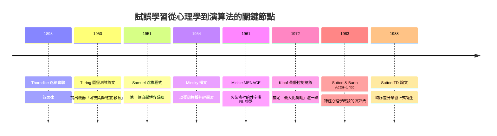
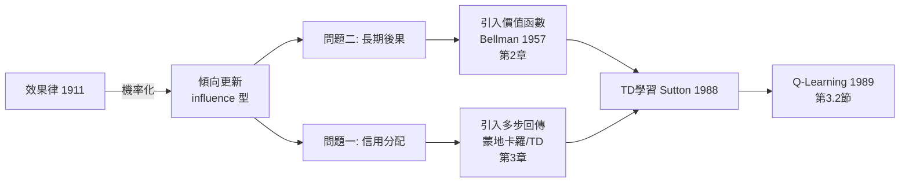

# 1.1 試誤學習、Thorndike 效果律與 Sutton 的起點（1950-1988）

## 前言：為什麼要從一百多年前的一隻貓說起？

在本書展開所有數學與程式碼之前，我們必須先回答一個根本問題：**「從經驗中學習」到底是什麼意思？** 強化學習（Reinforcement Learning, RL）並不是 2013 年 DeepMind 打 Atari 遊戲時才發明的技術，它背後是一條橫跨心理學、控制理論與電腦科學超過一百年的思想長河。這一節我們要沿著這條河往上走，看看 1950 到 1988 年間，試誤學習（trial-and-error learning）如何從動物心理學實驗，一步步變成可以寫進電腦的演算法，最後在 Richard Sutton 1988 年的論文中凝聚成「時序差分學習」的雛形——那是整本書的種子。

理解這段歷史不只是懷舊。事實上，後面每一章的技術突破（Q-Learning、DQN、AlphaGo、RLHF、o1），都可以追溯到本章提到的核心張力：**獎勵是稀疏的、延遲的，而學習者必須在不知道「正確答案」的情況下，自己摸索出好行為。** 這個張力在 1898 年就已被清楚描述，而我們花了超過一個世紀才讓機器真正做到。

## 歷史背景：Thorndike 的效果律（1898）

### 迷箱實驗

哥倫比亞大學的心理學家 Edward Thorndike 把飢餓的貓放進一個「迷箱」（puzzle box）：貓必須踩到某個機關才能打開門逃出去吃到外面的魚。Thorndike 記錄每次實驗貓逃脫所需的時間，發現了一個關鍵現象：

1. 最初幾次，貓的行為幾乎是隨機的——抓、咬、亂撞，偶爾碰到機關逃出。
2. 隨著重複次數增加，無效動作逐漸減少，有效動作（踩機關）出現得越來越快。
3. 重要的是，貓並沒有「突然想通」——逃脫時間是**漸進地**改善的曲線，而不是階梯式的頓悟。

Thorndike 據此提出心理學史上影響最深遠的學習原理之一——**效果律（Law of Effect, 1911）**：

> 在特定情境中，伴隨滿足結果的反應，會更可能在相似情境中重複出現；伴隨不適結果的反應，則更可能被消去。

用現代語言翻譯：**一個動作若帶來正向回饋，其被選擇的機率會上升；若帶來負向回饋，機率會下降。** 這句話幾乎就是策略梯度定理（第 5 章）的直覺版本。 注意效果律的兩個要件：

- **選擇性（selectional）**：學習不是「灌輸新知識」，而是在既有的行為庫中**調整各行為被選中的傾向**。
- **關聯性（associative）**：調整的依據是行為與結果之間的**關聯**，而非邏輯推理。

這兩點至今仍是強化學習的定義性特徵。 supervised learning 是「老師告訴你正確答案」，而效果律是「沒有人告訴你答案，只有結果的好壞」。這個差異將在第 1.2 節正式展開。

### 從心理學到機器的三次轉譯



**圖靈（1950）**：在〈Computing Machinery and Intelligence〉中，Turing 不只提出圖靈測試，還提出「child machine」的教育構想，並明確討論了以**獎勵與懲罰**訓練機器的兩種方式（類似進化搜索與類似學習的懲罰訊號），甚至預言這種方法的計算成本可能過高——這正是日後「樣本效率」問題的先聲。

**Samuel（1951-1959）**：Arthur Samuel 的西洋跳棋（checkers）程式是公認最早的自我學習程式之一。它透過與自己對弈、調整棋盤評估函數的線性權重，棋力超越了 Samuel 本人。Samuel 使用了一個影響深遠的技巧：**讓當前局面評估值去逼近對手走完後的局面評估值**——這在數學結構上就是後來的 bootstrapping（自舉）與 TD 學習的前身。Samuel 之後的三十多年，這條線卻沒有被持續推進，原因之一是當時學界被神經網路與感知機的熱潮占據，而「以最優控制的角度看待學習」的框架尚未成形。

**Michie（1961-1963）**：Donald Michie 用火柴盒和豆子建造了 MENACE（Machine Educable Noughts And Crosses Engine）：每個井字棋盤面狀態對應一個盒子，盒中豆子代表各個走法的「權重」。贏棋就往用過的盒子加豆子，輸棋就拿走豆子。這是一個**物理實作的表格型強化學習機器**，比數位電腦更直觀地展示了「狀態-動作-計數」的核心結構。

## 數學側寫：效果律的機率化

把 Thorndike 的敘述寫成最簡單的數學形式，是理解後續所有章節的起點。假設在情境 $s$ 下有動作集合 $\mathcal{A}$，學習者對動作 $a$ 的選擇傾向（preference）為 $p_t(s,a)$。效果律對應的更新規則是：

$$
p_{t+1}(s,a) = p_t(s,a) + \alpha \, r_t \, \mathbb{1}[A_t = a]
$$

其中 $\alpha > 0$ 是學習率，$r_t$ 是執行動作 $A_t$ 後收到的獎勵（可正可負）。展開來看：

- 若 $r_t > 0$（滿足結果），$p_t(s, A_t)$ 上升 → 該動作更可能被重複。
- 若 $r_t < 0$（不適結果），$p_t(s, A_t)$ 下降 → 該動作傾向被消去。
- 未被執行的動作不受影響 → 這是 **influence 型更新**，與稍後的 Bellman 型更新（對所有動作或價值做運算）形成對照。

這個更新式有兩個立即的問題，而這兩個問題將驅動後面七十年的研究：

**問題一：信用分配（credit assignment）。** 獎勵 $r_t$ 常常不是當下動作造成的，而是很多步之前一連串決策的總和（下棋贏了，功勞屬於哪一步？）。只看即時獎勵，無法把功勞/過失分配到正確的動作上。

**問題二：長期後果（delayed consequence）。** 一個動作的價值不只看即時獎勵，還看它把你帶到什麼樣的**未來**。例如「棄子」即時獎勵為負，卻可能帶來勝局。要處理這件事，我們需要「未來的價值」這個概念——這就是價值函數與 Bellman 方程（第 2 章）登場的理由。



## Samuel 的自舉：TD 的史前史

值得再深挖 Samuel，因為他埋下的種子要到 1988 年才發芽。Samuel 的評估函數是線性的：

$$
\hat{v}(s) = w_1 f_1(s) + w_2 f_2(s) + \cdots + w_n f_n(s)
$$

其中 $f_i(s)$ 是手工設計的特徵（例如棋子數差、控制中心數等）。學習的目標是調整權重 $w_i$。他的做法是：每當輪到對手走棋，就把**我方上一步做決策時的預測** $\hat{v}(s_t)$，拿去逼近**我方下一步決策時的預測** $\hat{v}(s_{t+2})$：

$$
w \leftarrow w + \alpha \left( \hat{v}(s_{t+2}) - \hat{v}(s_t) \right) \nabla_w \hat{v}(s_t)
$$

請注意這個式子的革命性：**學習目標不是棋局的真實勝負（那要等很多局才知道），而是自己稍後、更接近終局的預測。** 用自己的預測去修正自己稍早的預測——這就是 bootstrapping。它的好處是回饋極快（不用等到局終）、壞處是如果自己預測有偏見，會把偏見自我強化。這組好處/壞處將貫穿全書：第 3 章比較蒙地卡羅與 TD 時會正式量化它；第 4 章 DQN 的目標網路正是為了控制 bootstrapping 的不穩定性；第 6 章 AlphaGo 用「樹搜尋修正後的價值」來當 TD 的目標，同樣是在對抗自我偏見。

## Sutton 的起點：Actor-Critic 與 TD（1983-1988）

### 為什麼 1970-1980 年代的 AI 沒有 RL？

在 Sutton 之前，AI 主流是搜尋與知識表示（專家系統），機器學習主流是監督式神經網路。「以獎懲學習」的想法散落在控制理論（最優控制、動態規劃，見第 2 章）與心理學模型中，兩邊互不往來。Harry Klopf 在 1970 年代指出：行為主義的學習觀被淡化成「只求系統穩定、消除誤差」，丟失了動物行為中最關鍵的**趨利性（hedonism）**——動物是為了「獲得更多好處」而行動，不只是為了「減少誤差」。Klopf 呼籲把**最大化獎勵**重新放回學習理論的中心，這正是 Sutton 與 Barto 進入這個領域的入口。

### Sutton & Barto (1983)：第一個現代 Actor-Critic

Sutton 在碩士時期與導師 Andy Barto 開發了「自我調整時變突觸」的類神經網路，套用到模擬的「平衡桿（cart-pole）」控制問題上——這正是今日 RL 教材中 cart-pole 環境的起源（本書第 4 章會在 Gym 中直接使用它）。其架構：

- **Actor（行動器）**：根據每個動作的「傾向」以機率選擇動作（效果律的機率化）。
- **Critic（評論家）**：估計長期價值，計算**強化訊號**告訴 Actor 哪些傾向該加強或削弱。

Critic 的核心問題是：只憑即時獎勵，無法區分「這一步好」與「這是長期好局的一環」。Sutton 的解法是讓 Critic 做預測——預測「從現在起到終局的總獎勵」，並用**預測誤差的變化**當作強化訊號。於是問題又回到：如何學會預測長期累積獎勵？

### Sutton (1988)：TD 學習——解決信用分配的鑰匙

考慮一個純預測問題：觀察序列 $s_0, s_1, s_2, \ldots$，每步有獎勵 $r_t$，要預測**折扣總和**：

$$
G_t = r_{t+1} + \gamma r_{t+2} + \gamma^2 r_{t+3} + \cdots, \quad \gamma \in [0,1)
$$

傳統上有兩種監督學習式做法：

1. **監督學習法**：等整個回合結束，用真實觀測值 $G_t$ 當標籤，每步做一次迴歸。問題：必須等很久、且每個回合的資訊只被使用一次、無法線上即時更新。
2. **適應預測**（Widrow-Hoff / LMS 式）：同樣需要目標值，本質上仍是「等答案」。

Sutton 的洞察是：$G_t$ 本身有**遞迴結構** $G_t = r_{t+1} + \gamma G_{t+1}$。那麼學習目標可以是「下一刻的估計」而非「局終的真值」：

$$
V(s_t) \leftarrow V(s_t) + \alpha \left[ \underbrace{r_{t+1} + \gamma V(s_{t+1})}_{\text{TD 目標}} - V(s_t) \right]
$$

括號內的量稱為 **TD 誤差（temporal-difference error）**：

$$
\delta_t = r_{t+1} + \gamma V(s_{t+1}) - V(s_t)
$$

這一行的意義值得停下來咀嚼：

- 它**完全不需要等到局終**——每走一步就能更新一次，天然支援線上學習。
- 它是**自我引用**的：$V(s_{t+1})$ 是自己的估計。這既是效率的來源，也是不穩定的來源（第 3、4 章的主線）。
- $\delta_t > 0$ 意味著「下一步的處境比預期好」，於是調高 $V(s_t)$；反之調低。**預測的更新由「驚訝程度」驅動**——這與心理學中的獎勵預測誤差（dopamine 神經元，Schultz 1997 年的實驗後來證實）完全同構，是 RL 理論最深刻的一次跨領域呼應。

Sutton 在 1988 年的論文中證明了：在表格型、固定的策略下，TD(0) 會**機率收斂**到正確的價值估計；並用隨機走（random walk）實驗展示 TD 在收斂速度上大幅領先監督學習法。

### 數學：為何 TD 收斂？一個直觀論證

設馬可夫鏈的轉移機率為 $P(s'|s)$、獎勵函數 $R$，真實價值 $v^\pi$ 滿足不動點方程 $v^\pi = R + \gamma P v^\pi$。TD(0) 的更新在期望上等價於：

$$
\mathbb{E}[\Delta V] = \alpha \left( R + \gamma P V - V \right)
$$

當 $V \neq v^\pi$ 時，$R + \gamma P V - V = (R + \gamma P v^\pi - v^\pi) + \gamma P (V - v^\pi) - (V - v^\pi) = (\gamma P - I)(V - v^\pi)$，指向把 $V$ 拉回 $v^\pi$ 的方向（在合適的學習率條件 $\sum \alpha_t = \infty,\ \sum \alpha_t^2 < \infty$ 下，加上隨機逼近的標準假設，可證 $V \to v^\pi$）。完整證明在第 3.1 節與參考書中給出；此處要記住的是**結構性的原因：TD 目標的期望值是不動點方程的殘差，殘差為零即真值。**

### TD(λ)：把蒙地卡羅與 TD 放在同一把尺上

Sutton 1988 論文的另一個大貢獻是 TD(λ) 家族，用一個參數 $\lambda \in [0,1]$ 在「一步自舉（TD(0)）」與「整回合回傳（蒙地卡羅，等價 TD(1)）」之間連續插值：

$$
V(s_t) \leftarrow V(s_t) + \alpha\, \delta_t\, \Big( \sum_{k=0}^{\infty} (\lambda \gamma)^k \,\mathbb{1}[s_{t+k} = s] \Big)
$$

其含義是「**資格跡（eligibility trace）**」：每個近期拜訪過的狀態保有一條會衰減的「跡」，TD 誤差出現時，所有有跡的狀態一起被更新——最近的狀態更新多、久遠的狀態更新少。這在工程上等於「把功勞沿著時間軸向過去分配」，正是對**信用分配問題**的正面回答。TD(λ) 的完整推導與 $\lambda$ 的取捨留待第 3.1 節；這裡只需記住：**1988 年，信用分配問題有了第一個統一的數學框架。**

```mermaid
flowchart TD
    A[監督學習: 等真實答案 G_t] -->|慢, 無法線上| C[問題]
    B[純即時獎勵] -->|無法看長期| C
    C --> D[Sutton TD: 用自身預測當目標]
    D --> E[δ_t = r + γV_s' - V_s]
    E --> F[λ=0: TD(0) 自舉快但有偏]
    E --> G[λ=1: 蒙地卡羅 無偏但慢]
    F & G --> H[TD λ 資格跡: 統一插值]
    H --> I[1989 Q-Learning: 從預測到控制]
```

## 程式碼：一個 30 行的 TD 學習者

以下用現代 Python 重現 Sutton 1988 隨機走實驗的精神：一條 5 個狀態的鏈，從任一狀態隨機左/右走，走到最右端得獎勵 1，否則為 0，折扣 $\gamma = 0.9$。真實價值可由線性代數直接算出，我們觀察 TD(0) 是否收斂到它。

```python
import numpy as np

rng = np.random.default_rng(0)

# 環境: 0 -- 1 -- 2 -- 3 -- 4 -- 5(終點)
#   s=0 與 s=5 是終點。到達 s=5 得 r=1, 到達 s=0 得 r=0。
N = 5
GAMMA = 0.9

# 真實價值 v(s) = E[總折扣獎勵 | 從 s 出發]
P = np.zeros((N + 2, N + 2))          # 轉移矩陣 (含兩個終點)
for s in range(1, N + 1):
    P[s, s - 1] += 0.5
    P[s, s + 1] += 0.5
R = np.zeros(N + 2)
R[N + 1] = 1.0                         # 進入 s=5 時的獎勵
# v = (I - γP)^{-1} R   (吸收鏈的解析解)
V_true = np.linalg.solve(np.eye(N + 2) - GAMMA * P, R)

V = np.full(N + 2, 0.5)                # 初始估計
V[0] = V[N + 1] = 0.0                  # 終點價值為 0

def td_episode(V, alpha):
    s = 3                              # 從中央出發
    trajectory = []
    while s not in (0, N + 1):
        s_next = s - 1 if rng.random() < 0.5 else s + 1
        r = 1.0 if s_next == N + 1 else 0.0
        td_error = r + GAMMA * V[s_next] - V[s]
        V[s] += alpha * td_error       # TD(0) 更新
        trajectory.append((s, td_error))
        s = s_next
    return trajectory

print(f"真實價值:      {np.round(V_true[1:N+1], 4)}")
for episode in range(1, 201):
    alpha = 0.05 if episode < 100 else 0.01
    td_episode(V, alpha)
    if episode in (1, 10, 100, 200):
        err = np.abs(V[1:N+1] - V_true[1:N+1]).max()
        print(f"episode {episode:3d}: 估計 {np.round(V[1:N+1], 4)}  |最大誤差|={err:.4f}")
```

預期輸出顯示估計值逐步逼近解析解——你剛剛重現了 1988 年 Sutton 論文的核心實驗。值得注意的是：**這段程式裡沒有任何標籤、沒有任何資料集**；學習訊號完全來自環境回饋與自身的預測差。這就是「無監督的決策學習」與監督學習的本質分界，下一節將正式比較。

## 歷史因果鏈的收束

到 1988 年，拼圖已經齊了：

- Thorndike 給了**學習原理**（效果律）。
- Samuel 給了**自舉的實作直覺**（用未來預測教過去預測）。
- Bellman（1957）給了**長期價值的數學**（動態規劃，第 2 章）。
- Klopf 與 Minsky 給了**「最大化獎勵」的問題意識**。
- Sutton 給了**在不知道世界模型時、線上估計長期價值的演算法**（TD）。

1989 年 Watkins 在 Sutton 的研討會上把 TD 從「預測」推進到「控制」（Q-Learning，第 3.2 節）；1992 年 Tesauro 用 TD-Gammon 震驚西洋雙陸棋界（第 6 章）；2013 年 DQN 把 TD 接上深度網路（第 4 章）；2017 年 PPO 把策略直接參數化（第 5 章）；2022 年 RLHF 把「獎勵」換成「人類偏好」（第 8 章）；2024 年 o1/R1 把「獎勵」換成「答案正確性」來鍛鍊推理（第 9 章）。**每一站都是同一個效果的律動：給機器一個回饋訊號，讓它自己找到最大化長期回饋的行為。**

## 本節重點

1. **效果律（Thorndike, 1911）**是強化學習的心理學源頭：伴隨滿足的反應更可能重複，伴隨不適的反應被消去；其機率化形式 $p \leftarrow p + \alpha r \mathbb{1}[A_t=a]$ 即一切 RL 更新規則的原型。
2. **兩大根本難題**自始存在：信用分配（獎勵歸屬於哪一步）與長期後果（動作的價值在於它通向的未來）。全書所有方法都是對這兩題的回應。
3. **Samuel（1959）的自舉**——用自身稍後的預測去教稍早的預測——是 TD 學習的史前史，也預埋了「自舉快但可能自我強化偏見」的主線。
4. **Sutton（1988）TD(0)**：以 $\delta_t = r_{t+1} + \gamma V(s_{t+1}) - V(s_t)$ 驅動更新，不需等局終、可線上學習，且與神經科學的獎勵預測誤差同構。
5. **TD(λ) 與資格跡**把「一步自舉」與「整回合回傳」統一成一個連續家族，是對信用分配的第一個數學完備回答。

## 思考問題

1. Thorndike 觀察到貓的逃脫時間是**漸進**改善而非頓悟式跳躍。這個觀察如何區分「效果律學習」與「洞察學習」？對應到機器學習中，哪類演算法會產生頓悟式的跳躍？（提示：對照第 9 章的 emergent ability 現象。）
2. TD 更新中的 $\delta_t$ 為什麼被稱為「驚訝」？若你把 $\gamma$ 設為 0，$\delta_t$ 會變成什麼？這還算是「強化學習」嗎？
3. Samuel 用自己的預測教自己的預測。請想出一個「自我強化偏見」的具體情境：什麼情況下這種學習會越學越錯？（提示：對手若改變策略，舊預測的偏見會如何被放大？）
4. 圖靈在 1950 年就預言獎懲式學習「計算成本可能過高」。請估計：本章的隨機走實驗收斂需要多少次更新？若狀態空間放大一百萬倍，這個方法的樣本需求如何成長？這個估計如何預言了第 4 章 DQN 出現前三十年的停滯？
5. MENACE 用豆子的**數量**表示傾向。這其實是隱式地假設了「數量 ∝ 選擇機率」。請問這與本章的傾向更新式 $p \leftarrow p + \alpha r$ 在數學上有何差異？哪一種更容易飽和或卡死？
