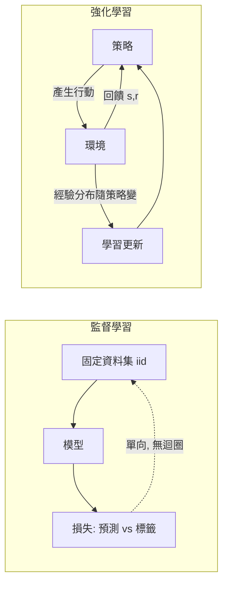
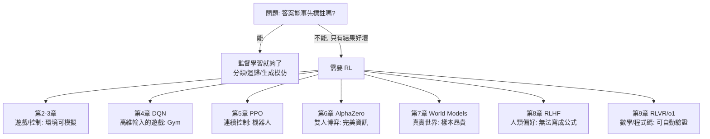

# 1.2 強化學習與監督學習的本質差異及應用地圖

## 前言：同一個「學習」，兩種截然不同的處境

上一節我們看到，強化學習的思想源頭是 Thorndike 的效果律：沒有老師給答案，只有結果的好壞。這一節要把這個差異說清楚、說嚴謹。為什麼不能把 RL 當成「監督學習 + 一點雜訊」？為什麼 AlphaGo 不能直接用 ImageNet 式的做法訓練？為什麼 LLM 時代大家還是繞回 RLHF？答案都在本章：**監督學習解決的是「模仿已知答案」，強化學習解決的是「在沒有答案的世界裡自己找答案」。** 兩者的困難點完全不同，工具箱也完全不同。本節最後給出一張「應用地圖」，列出 RL 真正不可取代的戰場，作為後續八章的路標。

## 歷史背景：兩條研究路線的分岔與交會

1950-1980 年代，機器學習的兩個社群各自發展：

- **模式識別/神經網路社群**（Rosenblatt 感知機 1958、Widrow-Hoff LMS 1960、反向傳播 1986）：處理「有標籤的資料」，目標是擬合映射 $\mathcal{X} \to \mathcal{Y}$ 。優化對象是**損失函數對參數的梯度**，一個純數學優化問題。
- **最優控制/試誤學習社群**（Bellman 動態規劃 1957、Samuel 跳棋、Sutton TD 1988）：處理「決策序列」，目標是最大化**長期累積獎勵**。難點不在擬合，而在**信用分配與探索**。

1990 年代這兩條線開始交會：TD-Gammon（1992）把神經網路當作價值函數近似器；2013 年 DQN 把兩者正式焊接起來（深度網路 + Q-Learning）；2017 年起，RL 更成為監督學習模型的「後訓練」工具（RLHF）。理解「差異」才能理解「為何交會」以及「交會後各自的貢獻是什麼」。

## 五大本質差異：逐一拆解

### 差異一：資料的來源——環境生成 vs. 事先給定

監督學習的資料集 $\{(x_i, y_i)\}_{i=1}^N$ 在訓練前就固定了，假設 iid（獨立同分布）抽樣自某個固定分布。強化學習的資料由**學習者自己的行為生成**：

$$
\text{資料}_{RL} = \{(s_t, a_t, r_{t+1}, s_{t+1})\} \sim \text{由策略 } \pi \text{ 誘導的分布}
$$

這帶來一個監督學習完全沒有的迴圈：**你學到什麼，決定你看到什麼。** 若策略學壞了，環境回饋的資料分布也變差（只體驗爛局面），學習可能停在一個平庸的局部。這就是「分布偏移由自己造成」的問題，導出第 5 章 PPO 的存在理由（限制策略更新幅度）、以及第 8 章 RLHF 中「off-policy 資料越用越偏」的實務難題。



### 差異二：回饋的訊號——標籤 vs. 稀疏標量

監督學習的標籤 $y_i$ 是**完整答案**：告訴你「正確的輸出長什麼樣」。RL 的回饋只是一個標量 $r_t$ ，而且：

- **稀疏**：下圍棋只在局終有勝負，很多步的 $r_t = 0$ 。
- **延遲**：勝負的功勞屬於開局棄子，而非終局收官。
- **評價性而非指示性**： $r_t$ 只說「這樣好不好」，不說「該怎樣才對」。一個做了 10000 個動作的回合，得到的資訊只有 1 個 bit（贏/輸）。

用資訊量來說：標籤 $y \in \mathcal{Y}$ 的位元數是 $\log|\mathcal{Y}|$ ，而獎勵可能只有 $\log 2$ 。這解釋了為何第 2 章要引入價值函數（把稀疏回饋「攤平」到每個狀態）、第 6 章 AlphaGo 要引入 MCTS（用搜尋把稀疏回饋放大）、以及第 9 章 RLVR 用可驗證獎勵時為何仍需大量採樣。

### 差異三：探索的必要性——沒有免費的資料

監督學習不存在「探索」：資料已經給了。RL 中，若策略永遠選當前最優動作（純貪婪），你可能永遠不知道還有更好的選擇——**未試過的動作，其價值估計永遠不會更新**。這是著名的探索/利用（exploration/exploitation）兩難，形式化如下：

$$
a_t = \begin{cases} \text{隨機動作} & \text{以機率 } \varepsilon \\ \arg\max_a Q(s_t, a) & \text{以機率 } 1-\varepsilon \end{cases}
$$

（ε-greedy，第 3.2 節正式登場。）更精確的說法是 regret 分析：多臂老虎機理論證明 $\varepsilon$ -greedy 的遺憾（regret）隨時間線性成長，而 UCB 類方法可達對數成長——這條線後來成為 AlphaGo 樹搜尋 PUCT 公式的理論基礎（第 6 章）。

### 差異四：優化的目標——點估計 vs. 長期回報

監督學習最小化 $L(\theta) = \frac{1}{N}\sum_i \ell(f_\theta(x_i), y_i)$ 。RL 最大化：

$$
J(\theta) = \mathbb{E}_{\tau \sim p_\theta}\left[ \sum_t \gamma^t r_t \right], \quad \tau = (s_0, a_0, r_1, s_1, \ldots)
$$

注意 $J(\theta)$ 的期望是**對策略自己產生的軌跡分布**取的——目標函數依賴於它自己的輸出分布。這導致兩個監督學習沒有的現象：

1. **非凸且不可微（若獎勵不可微）**： $J$ 對 $\theta$ 的梯度無法直接用反向傳播算（動作是離散取樣，梯度被截斷）。第 5 章的策略梯度定理就是繞道解決這件事： $\nabla J = \mathbb{E}[\sum_t \nabla_\theta \log \pi_\theta(a_t|s_t) \cdot G_t]$ 。
2. **改善是局部的**： $J$ 的景觀由「你目前站的位置」決定，走太遠會摔（策略效能斷崖式崩壞），這是 PPO 的 clip 機制要處理的問題。

### 差異五：對「分布」的依賴——covariate shift 的自製版本

監督學習的泛化誤差分析假設訓練/測試同分布。RL 中，學到 $Q$ 之後真正使用時走到的狀態分布，與訓練時的分布**不同且由自己造成**。經驗回放（DQN，第 4 章）用「混合歷史資料」緩解；第 8 章 RLHF 中獎勵模型在「人類偏好分布」上訓練、卻在「策略新產生的分布」上被消費，正是 reward hacking（第 8.2 節）的結構性根源之一。

## 一張總對照表

| 面向 | 監督學習 | 強化學習 |
|---|---|---|
| 資料 | 固定資料集, iid | 環境即時生成, 分布隨策略變 |
| 回饋 | 完整標籤 | 稀疏、延遲的標量獎勵 |
| 難點 | 擬合與泛化 | 信用分配 + 探索 + 長期回報 |
| 探索 | 不需要 | 必要, 有 regret 保證的設計 |
| 目標 | 最小化固定損失 | 最大化自身軌跡的期望回報 |
| 梯度 | 直接反向傳播 | 需策略梯度/自舉繞道 |
| 評估 | 測試集一次評估 | 環境採樣, 高變異 |
| 典型失敗 | 過擬合 | 樣本效率低、不穩定、reward hacking |

## 程式碼：同一個問題，兩種學法的對照

用最簡單的情境直接感受差異：一個賭場有兩台老虎機，回饋是「拉桿後的獎勵」，沒有人告訴你哪台好。

```python
import numpy as np

rng = np.random.default_rng(7)
TRUE_MEANS = [0.3, 0.7]          # 兩台老虎機的真實期望獎勵(隱藏)
K = 2

# ---------- 情境A: 監督學習式的幻覺 ----------
# 假如有人給你 50 筆 (機器編號, 獎勵) 的標籤資料, 你可以直接算平均:
labels = [(0, rng.normal(TRUE_MEANS[0])) for _ in range(25)] + \
         [(1, rng.normal(TRUE_MEANS[1])) for _ in range(25)]
best = max(K, key=lambda k: np.mean([r for j, r in labels if j == k]))
print(f"監督學習(有標籤): 直接選機器 {best}, 無需探索")

# ---------- 情境B: RL 現實——只有互動, 沒有標籤 ----------
def pull(k):
    return rng.normal(TRUE_MEANS[k])   # 環境只回饋一個數

est = np.zeros(K)        # 每台機器的價值估計 Q
cnt = np.zeros(K)        # 嘗試次數
epsilon = 0.1            # 探索率
total = 0.0
for t in range(200):
    if rng.random() < epsilon:                 # 探索: 隨機試
        a = rng.integers(K)
    else:                                      # 利用: 選當前估計最好
        a = int(np.argmax(est))
    r = pull(a)
    cnt[a] += 1
    est[a] += (r - est[a]) / cnt[a]            # 增量平均 = TD(0) 的特例
    total += r

print(f"RL(無標籤):    估計 {np.round(est,3)}, 最終選機器 {int(np.argmax(est))}")
print(f"平均每次獎勵: {total/200:.3f}  (理論最優 {max(TRUE_MEANS)})")
```

執行後會發現：情境 A 一次到位但**需要 50 個標籤**（現實中往往不存在）；情境 B 前幾十次還在亂試，但逐漸鎖定正確的機器。把 `epsilon` 改成 0 或 0.5 跑跑看，你會直接體驗探索不足（鎖死在錯的機器）與探索過度（平均回報被拉低）的兩難。

## 應用地圖：RL 真正不可取代的戰場

不是所有問題都需要 RL。判斷準則只有一條：**當「正確答案無法事先列舉、只能由結果評價」時，才需要 RL。** 據此畫出本書的旅程：



逐項補充判準與代表：

- **遊戲與模擬控制**（第 2-5 章）：環境可廉價重置、可重複採樣 → RL 的樣本低效可以容忍。Gym 的意義就是把「環境」標準化，讓整個領域可以複現、比較。
- **雙人博弈**（第 6 章）：沒有標籤（歷史上棋譜數量有限），但**自我對弈可以無限生成對局** → RL 把「資料瓶頸」轉化為「計算瓶頸」，這是 AlphaZero 的核心洞見。
- **真實世界機器人**（第 7 章）：樣本昂貴（摔壞機器就是真錢）→ 必須學世界模型、在想像中訓練。
- **對齊 LLM**（第 8 章）：什麼是「好的回答」寫不成公式（無害、有幫助、符合風格），但**人類可以比較兩個回答** → RL 的獎勵訊號來自學到的偏好模型。
- **推理**（第 9 章）：數學題與程式碼**可自動驗證**（答案對/單元測試過）→ 獎勵雖稀疏但無詐欺，可以大規模 RL；這正是 2024-2025 推理模型爆發的條件。

反例（不該用 RL 的情境）同樣重要：能拿到標籤就別繞路（RL 樣本效率低、方差大）；獎勵無法正確測量就別硬上（會被 reward hacking 反噬，第 8.2 節）；環境無法重置採樣（如某些醫療場景）則 offline RL 與世界模型是前提。

## 本節重點

1. **監督學習模仿已知答案；強化學習在只有結果評價的世界裡自己找答案**——資料由自身策略生成，形成「學到什麼就看到什麼」的迴圈，這是 RL 一切工程難題（分布偏移、不穩定、hacking）的根源。
2. RL 回饋的三大特徵：**稀疏、延遲、評價性而非指示性**；資訊量可低至每回合 1 bit，故需要價值函數攤平回饋、需要搜尋放大回饋。
3. **探索/利用兩難**是監督學習不存在的問題； $\varepsilon$ -greedy 是最簡單的答案，其理論缺陷（線性 regret）催生了 UCB 並一路通往 AlphaGo 的 PUCT。
4. RL 目標 $J(\theta) = \mathbb{E}_{\tau\sim p_\theta}[\sum \gamma^t r_t]$ 對**自身輸出分布**取期望，導致不可微、非凸、且「走太遠會摔」——分別由策略梯度、 Actor-Critic、PPO 回應。
5. **應用判準**：答案可事先列舉 → 監督學習；答案只能由結果評價 → RL。遊戲、博弈、機器人、人類偏好對齊、可驗證推理，構成本書九章的應用地圖。

## 思考問題

1. 有人主張「RL 就是標籤極稀疏的監督學習」。請用本章哪一個差異反駁他？再用哪一個差異部分支持他？（提示：策略梯度其實把每條軌跡當成一組加權樣本。）
2. 在老虎機程式中，把 `epsilon` 設為 0.01 與 0.5，分別觀察最終選擇與平均回報。請解釋為何兩種設定都可能「失敗」，但失敗的方式不同。
3. 第 8 章將說明：RLHF 的獎勵模型是在「人類偏好分布」上訓練、在「策略輸出分布」上使用。請用本章差異五解釋：為何這個「訓練/使用分布不一致」會隨訓練進行而惡化？
4. 舉一個你生活或工作中的決策問題，套用「應用地圖」判準：它是監督學習問題還是 RL 問題？它的獎勵訊號是什麼？是否稀疏、延遲、可被駭？
5. 監督學習的過擬合有明確藥方（正則化、更多資料）。請推測：RL 對應的「過擬合」是什麼？（提示：對「採樣到的軌跡」過擬合 = 對什麼東西過擬合？）這個問題會在第 5.2 節 PPO 得到正式處理。
