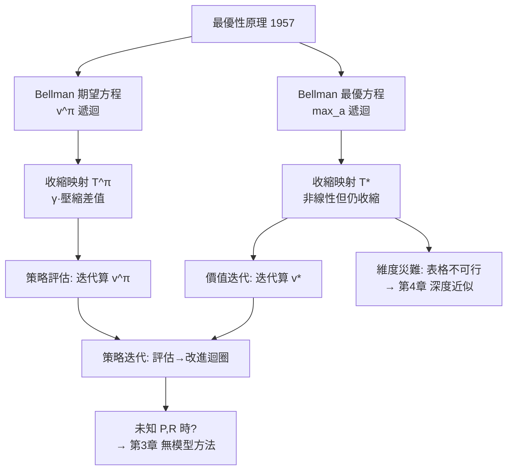
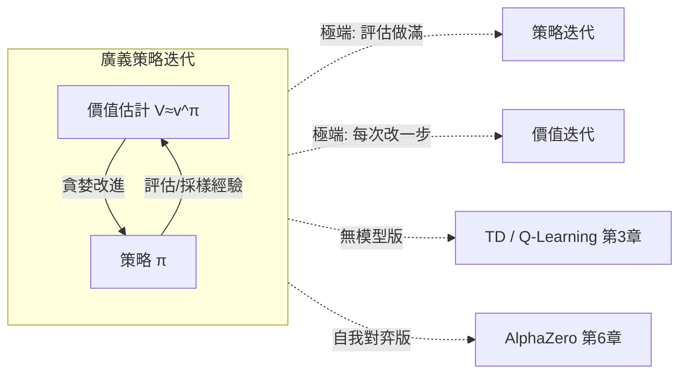

# 2.2 Bellman 方程與價值迭代、策略迭代（1957）

## 前言：從「評價」到「求解」的遞迴

上一節定義了 MDP 與價值函數，但它們只是「定義」——本節要給出**計算**它們的方法。關鍵工具是 **Bellman 方程**：把價值函數寫成一組自我引用的遞迴方程，其解就是真實價值；而「最優版」的 Bellman 方程（max 形式）則定義了最優策略。在此之上，1957-1960 年間發展出的**價值迭代**與**策略迭代**是第一批「解出 MDP」的演算法。它們要求完全已知 $P$ 與 $R$（「有模型」），樣本效率無限好但適用面窄——這個限制正是第 3 章無模型方法存在的全部理由。理解本節，你就理解了後面所有方法的「理想狀態基準線」：無模型方法做的一切，本質上是在不知道 $P,R$ 時，試圖免費或廉價地重現動態規劃的效果。

## 歷史背景：RAND 的多階段決策問題

Bellman 在 1950 年代 RAND 的任務是研究多階段決策（庫存、生產排程、飛彈攔截）。當時變分法只能處理連續、可微、低維的問題。Bellman 的突破是**最優性原理（Principle of Optimality, 1957）**：

> 無論初始狀態與初始決策為何，剩餘的決策序列相對於**第一個決策造成的狀態**而言，必須構成最優策略。

用白話說：一條最優路徑的任何「尾巴」本身也是一條最優路徑。這把「找最優軌跡」的全域指數問題，化約成「在每個狀態解一次最優一步」的遞迴——配合電腦迭代，問題變得可算。Bellman 隨後的 1957 年專著《Dynamic Programming》與 1962 年與 Dreyfus 合著的應用性著作，把這套方法推廣到工程各領域。值得注意的是，Bellman 本人因為眼疾半盲仍持續研究，他晚年感嘆動態規劃的「維度災難（curse of dimensionality）」是未解的詛咒——**狀態數隨維度指數成長**。這個詛咒要到 2013 年（用神經網路泛化代替表格）才有實質性的工程解，DQN 的標題「Human-level control through deep reinforcement learning」背後的第一句潛台詞就是「對抗維度災難」。

## Bellman 期望方程：價值函數的不動點

由回報的遞迴結構 $G_t = R_{t+1} + \gamma G_{t+1}$，對策略 $\pi$ 取期望，可得：

$$
v^\pi(s) = \sum_a \pi(a|s) \sum_{s'} P(s'|s,a)\left[ R(s,a,s') + \gamma\, v^\pi(s') \right]
$$

這是 **Bellman 期望方程**：狀態價值 = 「平均動作」的「平均轉移」的「即時獎勵 + 折扣的下一步價值」。它是一組線性方程（$|\mathcal{S}|$ 條、$|\mathcal{S}|$ 個未知數），理論上可直接解線性系統，但 $O(|\mathcal{S}|^3)$ 的複雜度不實際，實務用**迭代法**：

$$
V_{k+1}(s) = \sum_a \pi(a|s) \sum_{s'} P(s'|s,a)\left[ R(s,a,s') + \gamma V_k(s') \right]
$$

**收斂證明骨架（本節唯一的正式證明）**：定義 Bellman 期望算子 $T^\pi V(s) = \sum_a \pi(a|s)\sum_{s'}P(s'|s,a)[R + \gamma V(s')]$。對任意 $U, W$：

$$
|T^\pi U - T^\pi W|_s \le \gamma \max_{s'} |U(s') - W(s')|
$$

（因為 $\pi$、$P$ 是機率分布，加權和不放大差值；$\gamma$ 因子來自折扣。）所以 $T^\pi$ 是收縮映射（contraction），由 Banach 不動點定理，$T^\pi$ 有唯一不動點 $v^\pi$，且任意初值迭代都收斂到它。**記住這個證明模式：收縮映射 → 唯一不動點 → 迭代收斂。** 之後的 Q-Learning 收斂證明（第 3.2 節）用的是同一副骨架，只是加上了隨機逼近的技術細節。

## Bellman 最優方程：max 的登場

現在把「最優」放進來。定義最優價值：

$$
v^*(s) = \max_\pi v^\pi(s)
$$

最優性原理直接給出 **Bellman 最優方程**：

$$
v^*(s) = \max_a \sum_{s'} P(s'|s,a)\left[ R(s,a,s') + \gamma\, v^*(s') \right]
$$

以及 Q 版本（後續全書的主角）：

$$
q^*(s,a) = \sum_{s'} P(s'|s,a)\left[ R(s,a,s') + \gamma \max_{a'} q^*(s',a') \right]
$$

與期望方程的差異只有一處：$\sum_a \pi(a|s)\cdots$ 變成 $\max_a \cdots$。但這一處差異改變了數學性質：**max 不是線性運算**，$T^*$ 不再對應線性方程組——不過它**仍是收縮映射**（證明同上，max 只是選出加權和中最大的一項，仍不放大差值），所以 $v^*$ 存在、唯一、可迭代求得。達到 $v^*$ 的策略稱**最優策略** $\pi^*$，貪婪化即得：

$$
\pi^*(s) = \arg\max_a \sum_{s'} P(s'|s,a)\left[ R(s,a,s') + \gamma v^*(s') \right]
$$

理論上任何 MDP 都存在確定性的最優策略——這是一個深刻的結構保證（隨機性只可能在環境，不需要在最優行為裡）。



## 價值迭代與策略迭代

### 價值迭代（Value Iteration, Bellman 1957）

直接把最優方程當更新規則迭代：

```
V ← 任意初值
重複:
    V(s) ← max_a Σ_s' P(s'|s,a)[R(s,a,s') + γV(s')]   對所有 s 同步更新
直到 max_s |V_new(s) - V(s)| < ε
π(s) ← argmax_a Σ_s' P(s'|s,a)[R(s,a,s') + γV(s')]
```

每次掃描 $O(|\mathcal{S}||\mathcal{A}||\mathcal{S}|)$；收斂速率為 $\gamma^k$（收縮速率），達到 $\epsilon$ 精度需 $O(\log(1/\epsilon)/\log(1/\gamma))$ 次迭代。

### 策略迭代（Policy Iteration, Bellman/Howard 1960）

把「評估」與「改進」拆成兩個交替步驟：

```
π ← 任意策略
重複:
    (1) 策略評估: 精確解出 v^π (或迭代到收斂)
    (2) 策略改進: π'(s) ← argmax_a Σ_s' P(s'|s,a)[R + γv^π(s')]
    若 π' = π 則停止
```

**策略改進定理**：對任意 $\pi$，令 $\pi'$ 為對 $v^\pi$ 的貪婪策略，則 $v^{\pi'}(s) \ge v^\pi(s)$ 對所有 $s$ 成立。直觀：在每一步都選「就當前評估而言更好」的動作，不可能變差。由此每輪迭代策略嚴格改善（或已收斂），且 MDP 只有有限個確定性策略，故**有限步收斂**到 $\pi^*$——比價值迭代的漸近收斂更強。Howard（1960）的《Dynamic Programming and Markov Processes》把此方法系統化，並證明策略迭代通常收斂得比價值迭代快（每輪昂貴但輪數少）。

### 兩者比較與「廣義策略迭代」

| 方法 | 每輪成本 | 輪數 | 收斂保證 | 適用 |
|---|---|---|---|---|
| 價值迭代 | 一次掃描 | 多次（$\gamma$ 决定） | 漸近收縮 | 轉移簡單 |
| 策略迭代 | 精確解線性系統（貴） | 極少 | 有限步終止 | 小且精確的 MDP |

兩者其實是光譜的兩端：**廣義策略迭代（GPI）**框架指出——任何「（近似）評估某策略的價值」與「（近似）貪婪改進策略」兩個過程互相拉扯、最終同時到位的演算法都屬於 GPI。**這個框架是第 3 章的鑰匙**：TD 與 Q-Learning 只是「用採樣的經驗代替已知 $P,R$ 做評估/改進」，結構仍是 GPI。第 6 章 AlphaZero 的「自我對弈（產生資料）→ 訓練網路（評估）→ MCTS（改進）」也是一個 GPI 迴圈。



## 程式碼：解 FrozenLake 的最優策略

用第 2.1 節的 FrozenLake，比較價值迭代與策略迭代：

```python
import gymnasium as gym
import numpy as np

env = gym.make("FrozenLake-v1", is_slippery=True)
P = env.unwrapped.P
S, A, GAMMA = env.observation_space.n, env.action_space.n, 0.99

def q_from_v(V):
    """由 V 算每個 (s,a) 的動作價值 Q(s,a) = Σ P·(R + γV)"""
    Q = np.zeros((S, A))
    for s in range(S):
        for a in range(A):
            for prob, s_next, r, _ in P[s][a]:
                Q[s, a] += prob * (r + GAMMA * V[s_next])
    return Q

def value_iteration(theta=1e-8, verbose=True):
    V = np.zeros(S)
    for k in range(1, 10001):
        delta = 0.0
        for s in range(S):
            v_old = V[s]
            V[s] = np.max(q_from_v(V)[s])          # Bellman 最優算子
            delta = max(delta, abs(v_old - V[s]))
        if delta < theta:
            if verbose: print(f"價值迭代收斂: {k} 輪")
            break
    return np.argmax(q_from_v(V), axis=1), V

def policy_iteration(theta=1e-8):
    pi = np.zeros(S, dtype=int)                    # 任意初始策略
    for k in range(1, 101):
        # (1) 策略評估: 解線性系統 (I - γP^π) v = R^π
        V = np.zeros(S)
        while True:
            Q = q_from_v(V)
            V_new = Q[np.arange(S), pi]
            if np.max(np.abs(V_new - V)) < theta:
                V = V_new; break
            V = V_new
        # (2) 策略改進
        pi_new = np.argmax(q_from_v(V), axis=1)
        if np.array_equal(pi_new, pi):
            print(f"策略迭代收斂: {k} 輪"); break
        pi = pi_new
    return pi, V

pi_vi, V_vi = value_iteration()
pi_pi, V_pi = policy_iteration()
print("兩法得到的策略一致:", np.array_equal(pi_vi, pi_pi))

# 用學到的策略實際走幾回合檢驗
env2 = gym.make("FrozenLake-v1", is_slippery=True)
wins = 0
for ep in range(500):
    obs, _ = env2.reset(seed=ep)
    done = False
    while not done:
        obs, r, term, trunc, _ = env2.step(int(pi_vi[obs]))
        done = term or trunc
        if term: wins += (r == 1.0)
print(f"最優策略 500 回合勝率: {wins/500:.1%}  (隨機策略約 1~2%)")
```

執行重點：策略迭代輪數極少（通常 3-7 輪）但每輪要做完整評估；價值迭代每輪便宜但需要多輪；最終兩者給出**同一個** $\pi^*$（因為最優價值唯一）。勝率約 65-70% 而非 100%，因為 `is_slippery=True` 下冰面會滑——**即使策略最優，隨機轉移仍可能把你滑進洞**；MDP 的最優是「期望意義上的最優」。

## 本節重點

1. **Bellman 期望方程**把 $v^\pi$ 寫成自引用遞迴；**Bellman 最優方程**用 $\max_a$ 定義 $v^*, q^*$。兩者皆為收縮映射的不動點（Banach 定理），故存在唯一且可迭代求得。
2. 最優方程與期望方程只差 $\max_a$ vs $\sum_a \pi(a|s)$；max 使方程非線性但仍收縮——「每步選就當前而言最好的動作」這個決策形式貫穿全書（Q-Learning 的更新、DQN 的目標、AlphaZero 的備份）。
3. **價值迭代**直接迭代最優方程（收縮速率 $\gamma^k$）；**策略迭代**「精確評估 → 貪婪改進」交替，由策略改進定理保證有限步收斂且通常輪數極少。
4. 兩者是**廣義策略迭代（GPI）**光譜的兩端；GPI 是理解後續方法的統一框架——TD/Q-Learning 是無模型版 GPI，AlphaZero 是自我對弈版 GPI。
5. 動態規劃要求已知 $P, R$ 且表格可行；**維度災難**（Bellman 1957 年即已警告）與**模型未知**兩大限制，分別由第 4 章深度近似與第 3 章無模型學習解決。

## 思考問題

1. 證明策略改進定理：若 $\pi'(s) = \arg\max_a q^\pi(s,a)$，則 $v^{\pi'}(s) \ge v^\pi(s)$。（提示：從定義逐步展開，用 $q^\pi(s,\pi'(s)) \ge q^\pi(s,\pi(s)) = v^\pi(s)$ 與遞迴。）
2. 若 $\gamma = 1$ 且環境含正獎勵迴圈，Bellman 最優方程還有唯一解嗎？價值迭代會發生什麼？這說明 $\gamma < 1$ 承擔了什麼數學角色？
3. 在 FrozenLake 程式中把 GAMMA 改成 0.5，觀察策略如何改變（可能不再敢走靠近洞的短路徑）。用「決策視野」概念解釋這個現象。
4. 策略迭代的評估步驟解線性系統需 $O(|\mathcal{S}|^3)$。若 $|\mathcal{S}| = 10^6$，這意味著多少計算量？由此說明為何 Bellman 的「維度災難」使動態規劃在 Atari（狀態數 $10^{30}$ 量級的畫面空間）上完全不可行，從而需要第 4 章的函數近似。
5. GPI 說「評估」與「改進」不必各自做滿、可以互相拉扯。請推測：若兩個過程用**不同**的價值估計（例如改進用 $Q_{online}$、評估目標用 $Q_{target}$），會發生什麼？這個問題正是第 4.1 節 DQN 目標網路的結構。
