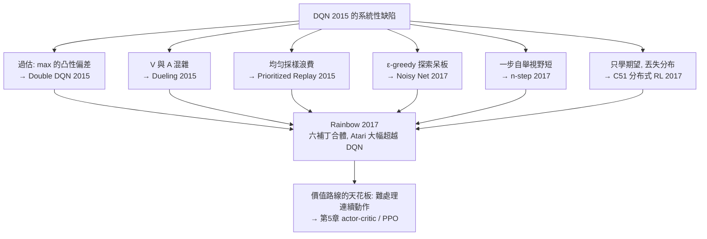

# 4.2 深度 RL 的不穩定性：Double DQN、Dueling、Rainbow（2015-2018）

## 前言：DQN 之後，大家發現「會玩」不等於「學得穩」

DQN 震驚世界之後，研究者立刻注意到它的系統性毛病：**Q 值嚴重過估（overestimation）**——Hasselt 2010 年在表格時代就證明了 max 算子的統計偏差，深度網路把它放大到荒謬的程度（Atari 訓練中真實值可能是 20，估計值卻飆到 100+）；**不同遊戲需要調超參數**（DQN 論文自己用了兩套超參數跑不同遊戲，違反「一套演算法通用」的承諾）；**訓練曲線劇烈震盪**（同一個 seed 重跑可能差好幾倍）。2015-2018 年間，社群以 DQN 為基準疊出了一連串改進：Double DQN 修過估、Prioritized Replay 修樣本浪費、Dueling 修價值分解、Noisy Net 修探索、Multi-step 修自舉視野、Distributional RL 修「只學期望」——六件套合體就是 2017 年的 **Rainbow**，在多數 Atari 遊戲上把 DQN 的樣本效率與最終性能大幅推高。本節的重點不只是清點技巧，而是看清一條規律：**每個改進都對應 DQN 中一個具體的數學缺陷**。這條「診斷缺陷 → 修補 → 暴露新缺陷」的鏈條，正是工程化 RL 的核心敘事，也為第 5 章 PPO 的「另起爐灶」鋪墊了背景。

## 歷史背景：從單點突破到系統工程

2015 年 Nature DQN 之後，深度 RL 進入「快速疊代、論文爆炸」的階段。當時的環境條件：Gym 尚未誕生（2016），但 ALE 已是共識基準；各家實驗室（DeepMind、Google Brain、後來的 OpenAI）開始發表可對比的 Atari 分數。這段時期一個關鍵的文化變化是**「消融實驗（ablation）」成為標準**：每篇論文必須證明「我的補丁單獨就有貢獻」。2017 年 Hessel 等人的 Rainbow 論文把這種文化推到頂點——它系統性地組合六項改進，並逐一消融，展示各補丁的**邊際貢獻**。這份「工程清單」式的方法論，直接影響了後來 AlphaZero（2017，見第 6 章）與 PPO 生態（第 5 章）的論文寫作方式。而 Rainbow 本身也標誌著 value-based 路線的成熟與極限——之後最強的通用方法轉向了 actor-critic（第 5 章），因為它能處理連續動作。

## 病灶一：max 算子的過估偏差（Double DQN, 2015）

### 數學診斷

考慮估計 $\max_{a'} Q(s',a')$。若真值 $q^*(s',a')$ 皆為 $v$，但估計帶零均值噪聲 $\epsilon_a$，則：

$$
\mathbb{E}\left[\max_{a'} (v + \epsilon_{a'})\right] \ge v + \max_{a'} \mathbb{E}[\epsilon_{a'}] = v
$$

因為 $\max$ 對噪聲是**凸的**（Jensen 不等式），期望被系統性推高。動作越多、噪聲越大，過估越嚴重。更糟的是**正回饋迴路**：過估的 Q → 貪婪策略偏好被過估的動作 → 回放池中該動作的樣本增多 → 進一步過估。DQN 在 Atari 上的 Q 值曲線（記錄於 van Hasselt et al. 2015 論文）經常單調飆升而實際性能不變甚至下降——網路在「自我催眠」。

### 藥方：把「選動作」與「評價動作」分家

Double Q-Learning（van Hasselt 2010）用兩套獨立估計 $Q_1, Q_2$：

$$
Q_1(s,a) \leftarrow Q_1(s,a) + \alpha\left[ r + \gamma\, Q_2\!\left(s', \arg\max_{a'} Q_1(s',a')\right) - Q_1(s,a) \right]
$$

**選動作用 $Q_1$，評價用 $Q_2$**——$Q_1$ 的過估偏差被 $Q_2$ 的（獨立的）噪聲洗掉一部分。原理上若兩者誤差獨立，期望過估歸零。Deep DQN 版本幾乎免費：主網路選動作、目標網路打分：

$$
\text{DDQN target} = r + \gamma\, Q(s', \arg\max_{a'} Q(s',a'); \theta^-;\, \theta^-)\quad\text{即}\quad r + \gamma\, Q_{\theta^-}\!\left(s', \arg\max_{a'} Q_{\theta}(s',a')\right)
$$

有趣的是：目標網路的存在（第 4.1 節的補丁二）本身已部分提供了「選評分家」的效果（$\theta$ 與 $\theta^-$ 錯開了 $C$ 步）——這解釋了為何 DQN 沒有立刻崩潰；DDQN 則把這個偶然的保護變成有意的設計。

## 病灶二：狀態價值與優勢的混雜（Dueling, 2015）

### 數學診斷

$Q(s,a) = V(s) + A(s,a)$，其中 $A(s,a) = Q(s,a) - V(s)$ 是**優勢函數**（這個分解也預告了第 5 章 actor-critic 的核心概念）。很多狀態的問題是「**這個狀態值多少錢**」（例如賽車遊戲大部分時刻，任何動作結果差別不大），而非「**該選哪個動作**」。DQN 把兩者混在一張輸出裡，等於強迫網路在「值不值得來」與「來了該怎麼做」之間搶參數容量。

### 藥方：顯式分解的網路結構

Dueling 網路把骨幹特徵分兩路輸出 $V(s;\theta)$ 與 $A(s,a;\theta)$，再合成：

$$
Q(s,a;\theta) = V(s;\theta) + A(s,a;\theta) - \frac{1}{|\mathcal{A}|}\sum_{a'} A(s,a';\theta)
$$

減均值（而非直接相加）是為了**可辨識性**：若直接 $V + A$，則 $(V+c, A-c)$ 產生同樣的 $Q$，梯度訓練時 $V$ 與 $A$ 可互相漂移；減去均值迫使 $A$ 的均值為 0，讓 $V(s)$ 與 $A(s,a)$ 各自穩定地對應真實分解。效果：狀態價值的估計可以跨動作共享梯度訊號（同狀態下所有動作共享 $V$ 的更新），在「動作差異小」的狀態學得快得多。



## 病灶三至六：其餘四件套速覽

- **Prioritized Replay（2015）**：均匀採樣讓「高資訊量經驗」（TD 誤差大的樣本）被平均對待。改為按 $p_i \propto |\delta_i|^\omega$ 優先採樣，並用**重要性採樣權重** $w_i = (N p_i)^{-\beta}$ 校正偏差。這是把第 3.2 節「所有樣本等權」的隱含假設顯式打破。
- **Noisy Net（2017）**：把 ε-greedy 的全域隨機換成**參數化噪聲**——在網路權重上加可學習的噪聲層，讓「探索」變成狀態依賴的（某些狀態多試、某些狀態少試），並提供穩定的隱式探索保證。第 1.2 節的探索兩難在此獲得深度學習式的答案。
- **n-step 回傳（2017）**：把 TD 目標從一步改成 $n$ 步截斷回傳，直接調用第 3.1 節的 λ/n 步光譜——老理論的新應用。
- **C51 分布式價值學習（2017）**：不學 $\mathbb{E}[G]$ 而學 $G$ 的**完整分布**（51 個离散支撐點）。數學動機：期望損失對 outlier 極敏感，學分布更穩；且分布中隱含了「風險」資訊。它與 DDQN 的理論關係微妙（兩者對「該學什麼」有不同意見），但實務上相容。

## Rainbow：組合的威力與教訓

Hessel et al. (2017) 把六項合併，在 Atari 57 遊戲上以相同預算大幅超越 DQN，且消融顯示各補丁大多有正貢獻、但**貢獻不獨立**（如 Prioritized 與 Distributional 有交互作用）。Rainbow 的教訓有二：（1）深度 RL 的性能是「補丁堆疊」的乘積，單一理論視角難以解釋全部；（2）價值路線至此接近天花板——所有補丁都在優化「離散動作 + argmax」框架，而機器人與後來的 LLM 需要的是**連續動作或超大動作空間**，argmax 根本算不動。第 5 章的策略梯度路線正是為此登場。

## 程式碼：親眼看到過估，並用 Double 修掉它

用一個極小的實驗直接量化 max 過估：一個狀態、$K$ 個動作、真值皆為 0，估計值帶隨機噪聲，比較 DQN 目標與 DDQN 目標的期望：

```python
import numpy as np

rng = np.random.default_rng(0)
K = 10; TRIALS = 200_000; TRUE_V = 0.0

# 情境: 下一狀態的所有動作真實價值都是 0, 但估計值帶噪聲 σ
for sigma in [0.1, 0.5, 1.0]:
    est = rng.normal(TRUE_V, sigma, size=(TRIALS, K))   # 網路估計 Q1(=Qθ)
    est2 = rng.normal(TRUE_V, sigma, size=(TRIALS, K))  # 目標網路估計 Q2(=Qθ⁻)

    dqn_target = est.max(axis=1).mean()          # DQN: max 用同一份估計
    a_pick = est.argmax(axis=1)                  # DDQN: 用 est 選動作
    ddqn_target = est2[np.arange(TRIALS), a_pick].mean()  # 用 est2 打分

    print(f"σ={sigma:.1f}: DQN 目標均值={dqn_target:+.4f}  "
          f"DDQN 目標均值={ddqn_target:+.4f}  (真值 0)")
```

輸出顯示 DQN 目標均值隨 $K$（與 $\sigma$）增長而系統性為正（過估），DDQN 顯著更接近 0。把 $K$ 從 10 改成 100，過估差距繼續擴大——這正是 LLM 場景（動作=詞表數萬）中 max 類方法的結構性危險，第 8 章會再回來。

## 本節重點

1. **max 的凸性**使 DQN 系統性過估 Q 值，且形成「過估 → 偏好被過估動作 → 更多樣本 → 更過估」的正回饋。**Double DQN** 以「選動作用 A 網路、打分用 B 網路」的解耦，讓獨立噪聲互相抵消。
2. **Dueling** 把 $Q = V + A$ 顯式寫進網路結構（減均值保證可辨識），讓「狀態值多少」與「動作差多少」分開學習——優勢函數的直覺直接孕育了第 5 章 actor-critic。
3. Rainbow（2017）= Double + Prioritized + Dueling + Noisy Net + n-step + Distributional 六件套，以消融實驗確立各補丁的邊際貢獻，代表 value-based 路線的成熟與極限。
4. 每個補丁都是對一個**具體數學缺陷**的回應；「診斷 → 修補 → 暴露新缺陷」是深度 RL 工程史的基本節奏。
5. 價值路線的天花板在「argmax 需要可枚舉動作」；連續控制與超大動作空間（LLM 詞表）要求策略直接參數化——第 5 章策略梯度的登場理由。

## 思考問題

1. 用 Jensen 不等式完整寫出 $\mathbb{E}[\max_a (v + \epsilon_a)] \ge \max_a v$ 的證明。為什麼「動作數越多、噪聲越大，過估越重」？
2. Double DQN 只是用「另一份估計」打分，那份估計自己也帶噪聲。請推理：它為何能減輕而非消除過估？什麼條件下兩份估計的噪聲不再獨立（提示：它們共享回放池與大部分訓練資料）？
3. Dueling 的減均值技巧是為了可辨識性。請證明：若不加減均值，$(V(s)+c,\ A(s,a)-c)$ 對任意常數 $c$ 產生相同 $Q$；加了之後為何不行？
4. Prioritized Replay 用 TD 誤差決定採樣優先級。請討論它可能引入的循環偏見：高誤差樣本被頻繁採樣 → 更新更頻繁 → 這是否會「過度關注難樣本」而遺忘簡單但必要的樣本？
5. C51 主張「學分布比學期望好」。請舉出一個「兩個動作期望相同但分布不同」的例子，並討論在什麼偏好下（風險趨避 vs. 風險喜好）最優動作會不同——這與第 9 章推理模型「在多條思路中如何取捨」有何呼應？
