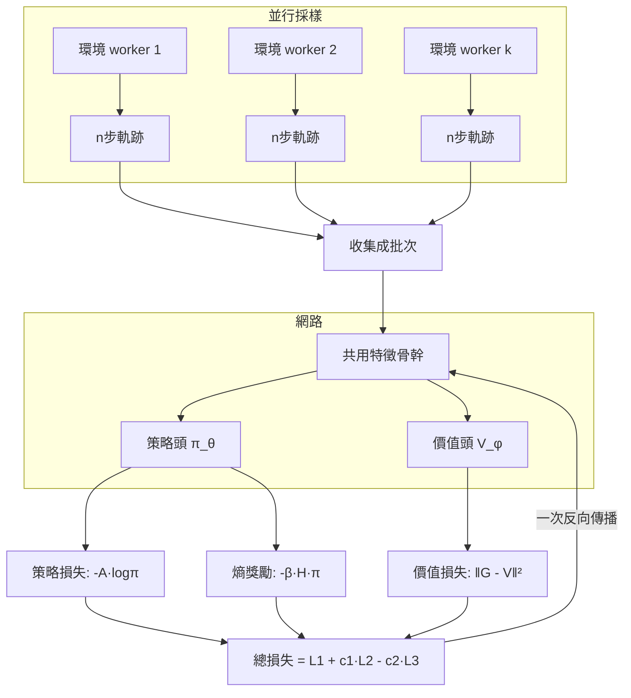

# 5.2 A2C 與 PPO：穩定訓練的工程學（2017）

## 前言：策略梯度會「走太遠摔死」，PPO 是安全帶

第 5.1 節的 actor-critic 雖然降了方差，還有一個致命傾向：**單次更新可能把策略推離資料支援的區域**。策略梯度是一次梯度估計，只能保證「往好的方向挪一小步」；若學習率大了、或同一批資料被重用多次（off-policy 化），新策略可能從「還不錯」斷崖式跌到「胡亂行動」，而且**跌下去之後很難爬回來**（新策略採樣的資料已經變爛，梯度估計失效）。這是 RL 特有的「毀滅性更新」問題——監督學習中跌一步只是損失變大，RL 中跌一步連資料分布都毀了。2015 年 Schulman 等的 **TRPO**（Trust Region Policy Optimization）用二階約束（KL 距離限制）理論性地解決，但實作複雜（共軛梯度、Fisher 矩陣）。2017 年 **PPO**（Proximal Policy Optimization）用一個簡單到近乎暴力的一階裁剪達到同等穩定性，成為此後數年的事實標準——並在 2022 年成為 InstructGPT 對齊 LLM 的訓練引擎（第 8 章）。本節講清 A2C 的架構、PPO 的數學、以及為何「簡單、穩定、好調」在工程史上戰勝了「精確、優雅、難調」。

## 歷史背景：2016-2017 的「多環境並行」浪潮

2016 年前後兩件事同時發生：（1）**A3C**（Asynchronous Advantage Actor-Critic, Mnih et al. 2016）用多個平行環境的異步 worker 同時採樣與更新，一舉解決兩件事——資料相關性（不同 worker 的軌跡天然去相關，比經驗回放更輕量）與採樣吞吐（CPU 核心並行）。A3C 發表時在 Atari 上用 1/8 的訓練時間追平 DQN。（2）**TRPO**（Schulman et al. 2015）證明：若策略更新被 KL 信任域約束，可獲得單調改進保證——這是深度 RL 少見的理論加固。但 TRPO 一階近似成本高。於是 2017 年出現兩條收斂路線：DeepMind 的 **A2C**（同步版 A3C，實作更簡單、GPU 更友好）與 OpenAI 的 **PPO**（裁剪版信任域）。PPO 論文本身是「工程比較」的典範：多種裁剪/懲罰變體在多個任務上對比，選出最穩的。之後 RL 界的基本盤分裂為「value-based（Rainbow 系，離散遊戲）」與「PPO 系（連續控制 + 一切後續大模型工作）」，而大模型時代全面倒向 PPO 的原因很快揭曉：**它是 on-policy、可微、對超大隨機策略友好，且工程上極度皮實。**

## A2C：同步優勢 Actor-Critic 的架構



三個組件值得記住，因為它們會原封不動出現在第 8 章的 RLHF：

- **共用骨幹 + 雙頭**：一個網路同時輸出策略與價值，省算力且特徵共享。
- **優勢 $A = G - V_\phi(s)$**（或 GAE）：第 5.1 節藥方一、二的落地。
- **熵正則** $-\beta H(\pi)$：鼓勵策略保持隨機性，防止過早坍縮成確定策略（探索的深層保險）。

## PPO 的數學：一階近似 + 裁剪

### 重要性採樣：重用舊資料的橋

為了在一份批次上多更新幾個 epoch（樣本效率），需要修正「資料來自舊策略 $\pi_{\theta_{old}}$」的事實。對任意期望有恆等式：

$$
\mathbb{E}_{a\sim\pi_\theta}\left[ f(a) \right] = \mathbb{E}_{a\sim\pi_{old}}\left[ \frac{\pi_\theta(a)}{\pi_{old}(a)} f(a) \right]
$$

定義**機率比率** $r_t(\theta) = \dfrac{\pi_\theta(a_t|s_t)}{\pi_{\theta_{old}}(a_t|s_t)}$，則策略目標可寫成：

$$
L^{CPI}(\theta) = \mathbb{E}_t\left[ r_t(\theta)\, \hat{A}_t \right]
$$

$\theta = \theta_{old}$ 時 $r_t = 1$，梯度與普通策略梯度一致。問題：$\theta$ 離開 $\theta_{old}$ 稍遠，$r_t$ 大幅偏離 1，**重要性採樣的方差爆炸**且估計失效（第 5.1 節「毀滅性更新」換了個形式回來）。

### 裁剪目標：粗暴而有效的信任域

PPO 的解法不是懲罰 $r_t$ 偏離 1，而是**直接把它的貢獻裁掉**：

$$
L^{CLIP}(\theta) = \mathbb{E}_t\left[ \min\!\big( r_t(\theta)\hat{A}_t,\ \ \mathrm{clip}(r_t(\theta),\, 1-\epsilon,\, 1+\epsilon)\, \hat{A}_t \big) \right],\quad \epsilon \approx 0.2
$$

逐項拆解這個 min 的含義（這是全書最值得背下來的公式之一）：

- **$\hat{A}_t > 0$（好動作）**：$\min$ 在 $r_t > 1+\epsilon$ 時取裁剪項（固定在 $(1+\epsilon)\hat A_t$）→ **好動作的機率不能無限推高**；$r_t$ 在 $[1-\epsilon, 1+\epsilon]$ 內時取原項，梯度正常流動。
- **$\hat{A}_t < 0$（壞動作）**：$r_t < 1-\epsilon$ 時裁剪 → **壞動作的機率不能無限壓低**。
- 裁剪使目標函數在「策略已經偏離 $\theta_{old}$ 超過 $\epsilon$」的區域**梯度為零**——訓練自動停在信任域邊界附近，等收集新資料再走。這正是 TRPO「單調改進」直覺的一階模仿。

### 完整 PPO 損失與「為何它皮實」

$$
L^{PPO}(\theta) = \underbrace{L^{CLIP}}_{\text{策略}} - c_1\, \underbrace{\mathbb{E}\big[(V_\phi(s_t) - G_t)^2\big]}_{\text{價值}} + c_2\, \underbrace{H\big[\pi_\theta\big]}_{\text{熵}}
$$

許多實作再加一項 **KL 懲罰**（對 $\mathbb{E}[\pi_{\theta_{old}} \log \frac{\pi_\theta}{\pi_{\theta_{old}}}]$ 加懲罰係數）作為保險。PPO 的工程優勢：一階方法（沒有 Fisher 矩陣）、與 Adam 無縫相容、超參數（$\epsilon$、$c_1, c_2$）跨任務可通用、數值上「最壞情況也不會把策略推得太遠」。這解釋了後續歷史：**OpenAI 在 GPT 路線上統一使用 PPO**（遊戲五人足球、機器手解魔方、InstructGPT、ChatGPT 的訓練引擎全是它）——不是因為理論最優，而是因為**大模型訓練中「不可複現的崩壞」代價太高，穩定壓倒一切**。這個「工程穩定學」的價值觀是本章真正的標題含義。

## 程式碼：裁剪效果的直接驗證

先做一個純數值實驗看 clip 曲線，再給精簡 PPO 主迴圈：

```python
import numpy as np
import matplotlib.pyplot as plt

eps, A = 0.2, 1.0
r = np.linspace(0.5, 1.5, 200)
unclipped = r * A
clipped = np.clip(r, 1-eps, 1+eps) * A
ppo_obj = np.minimum(unclipped, clipped)

plt.plot(r, unclipped, "--", label="r·A (未裁剪)")
plt.plot(r, ppo_obj, lw=2, label="min(r·A, clip(r)·A)  (PPO)")
plt.axvspan(1-eps, 1+eps, alpha=0.15, color="gray", label="信任域")
plt.xlabel("r = π_new/π_old"); plt.ylabel("目標")
plt.title("A>0 時: 超過 1+ε 目標變平 → 梯度=0"); plt.legend(); plt.show()
```

可以看到：$r > 1+\epsilon$ 之後曲線完全水平——**梯度消失，策略不會被推得更遠**。下面是精簡版 PPO（CartPole）：

```python
# pip install gymnasium torch
import gymnasium as gym
import numpy as np, torch, torch.nn as nn

env = gym.make("CartPole-v1")
GAMMA, LAM, EPS_CLIP, EPOCHS, BATCH = 0.99, 0.95, 0.2, 4, 64
torch.manual_seed(0)

class ActorCritic(nn.Module):
    def __init__(self):
        super().__init__()
        self.body = nn.Sequential(nn.Linear(4,64), nn.Tanh())
        self.pi   = nn.Linear(64,2)
        self.v    = nn.Linear(64,1)
    def forward(self, x):
        h = self.body(x); return self.pi(h), self.v(h).squeeze(-1)

net = ActorCritic()
opt = torch.optim.Adam(net.parameters(), lr=3e-4)

def rollout(n_steps=2048):
    s, _ = env.reset(seed=0)
    buf = []
    for _ in range(n_steps):
        with torch.no_grad():
            logits, v = net(torch.tensor(s, dtype=torch.float32))
            dist = torch.distributions.Categorical(logits=logits)
            a = dist.sample()
        ns, r, term, trunc, _ = env.step(a.item())
        buf.append((s, a.item(), r, ns, term, v.item()))
        s = ns
        if term or trunc: s, _ = env.reset(seed=0)
    # GAE 優勢 (第5.1節 藥方二+λ光譜)
    adv = np.zeros(len(buf)); gae = 0.0; next_v = 0.0
    for t in reversed(range(len(buf))):
        _, _, r, _, term, v = buf[t]
        nonterm = 0.0 if term else 1.0
        delta = r + GAMMA * next_v * nonterm - v
        gae = delta + GAMMA * LAM * nonterm * gae
        adv[t] = gae; next_v = v
    ret = adv + np.array([b[5] for b in buf])
    return buf, adv, ret

for it in range(60):
    buf, adv, ret = rollout()
    S = torch.tensor([b[0] for b in buf], dtype=torch.float32)
    A_ = torch.tensor([b[1] for b in buf], dtype=torch.int64)
    O_ = torch.tensor((adv - adv.mean())/(adv.std()+1e-8), dtype=torch.float32)
    R_ = torch.tensor(ret, dtype=torch.float32)
    with torch.no_grad():
        old_logits, _ = net(S)
        old_logp = torch.distributions.Categorical(logits=old_logits).log_prob(A_)

    idx = np.arange(len(buf))
    for ep_ in range(EPOCHS):                 # 同一批資料多 epoch —— off-policy 化!
        np.random.shuffle(idx)
        for i0 in range(0, len(idx), BATCH):
            b = idx[i0:i0+BATCH]
            logits, v = net(S[b])
            dist = torch.distributions.Categorical(logits=logits)
            logp = dist.log_prob(A_[b])
            ratio = torch.exp(logp - old_logp[b])          # 機率比率 r_t
            s1 = ratio * O_[b]
            s2 = torch.clamp(ratio, 1-EPS_CLIP, 1+EPS_CLIP) * O_[b]
            l_pi  = -torch.min(s1, s2).mean()              # 裁剪策略損失
            l_val = nn.functional.mse_loss(v, R_[b])
            l_ent = -dist.entropy().mean()
            loss = l_pi + 0.5*l_val + 0.01*l_ent
            opt.zero_grad(); loss.backward(); opt.step()

    # 評估
    sc = []
    for ev in range(10):
        s, _ = env.reset(seed=9000+ev); dn, tot = False, 0
        while not dn:
            with torch.no_grad():
                logits, _ = net(torch.tensor(s, dtype=torch.float32))
            s, r, t, tr, _ = env.step(int(logits.argmax())); dn = t or tr; tot += r
        sc.append(tot)
    print(f"iter {it+1:3d}  平均步數={np.mean(sc):.0f}")
```

對照實驗：（1）把 `torch.min(s1, s2)` 換成 `s1`（無裁剪的 vanilla 策略梯度 + 多 epoch）——常見結果是前期上升後突然崩壞到接近隨機（毀滅性更新的直接展示）；（2）`EPOCHS=1` 時 PPO 退化為 on-policy AC，樣本效率明顯下降但仍穩——說明裁剪主要保護的是「重用資料」這件事。

## 本節重點

1. **毀滅性更新**是策略路線的特有風險：一次過大的更新會把策略推離資料支援區，且崩壞後難以恢復（資料分布跟著壞掉）。TRPO 用 KL 信任域理論性解決；**PPO 用 clip 一階近似**達成同等穩定。
2. **裁剪目標** $\min(r\hat A, \mathrm{clip}(r,1\pm\epsilon)\hat A)$：好動作不能無限推高、壞動作不能無限壓低；超界區域梯度為零，訓練自動停在信任域邊界。
3. **A2C/PPO 標準配方**：共用骨幹雙頭 + GAE 優勢 + 價值損失 + 熵正則 + 多 epoch 小批次更新——這套配方將原封不動出現在第 8 章 RLHF。
4. PPO 戰勝 TRPO 的原因不是理論而是**工程**：一階、皮實、超參數通用、崩壞風險低——大模型時代「穩定壓倒一切」的價值觀由此確立。
5. 重要性採樣比率 $r_t = \pi_\theta/\pi_{old}$ 是「重用舊資料」的數學橋樑；裁剪是對其方差爆炸的結構性防護。

## 思考問題

1. 裁剪對「好動作」限制了 $r \le 1+\epsilon$，卻對「壞動作」在 $r < 1-\epsilon$ 時也停止懲罰。請推理：這會不會導致壞動作「永久保留低機率」而無法被徹底刪除？這與第 8.2 節 LLM 訓練中「毒性內容難以壓到零」的現象有何關聯？
2. 證明：$r_t(\theta) \in [1-\epsilon, 1+\epsilon]$ 時 $L^{CLIP}$ 與 $L^{CPI}$ 完全相同。這說明裁剪「只在越界時生效」。
3. PPO 每批資料跑 4 個 epoch，理論上每次重用都讓估計更 off-policy。請解釋為何裁剪使這種違反「可以接受」，以及 $\epsilon$ 越小允許的重用越少。
4. 熵正則項 $c_2 H(\pi)$ 太大會怎樣（策略永不收斂）？太小會怎樣（過早坍縮）？在 RLHF 中，這個旋鈕對應什麼樣的 LLM 行為（提示：多樣性 vs. 模式坍縮）？
5. 為何 LLM 的動作空間（詞表 3-10 萬）讓第 4 章 Rainbow 路線（argmax over Q）幾乎不可用，而 PPO 的「每詞一個 softmax 機率」天然可行？請從計算複雜度角度分析。
