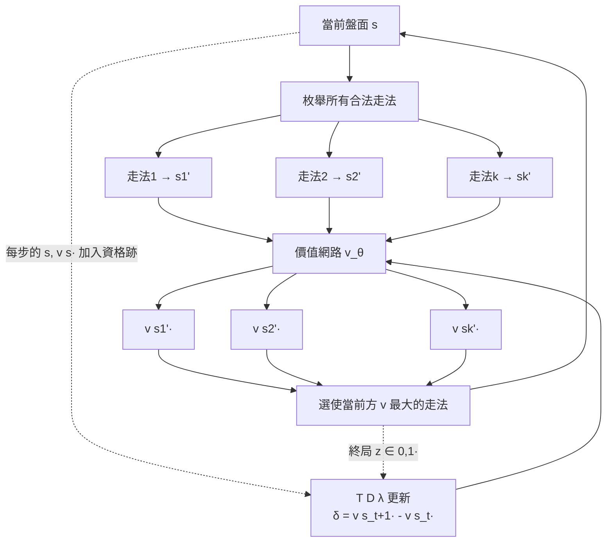

# 6.1 TD-Gammon（1992）與電腦下棋的漫長歷史

## 前言：神經網路 + TD，第一次打敗世界級人類

1992 年，IBM 的 Gerald Tesauro 發表的 **TD-Gammon** 讓整個領域震驚：一個只用 TD 學習與自我對弈訓練的神經網路（無任何人類棋譜、無任何手工特徵），在西洋雙陸棋（backgammon）上達到接近世界冠軍的水平。這是「深度學習 + 強化學習」的第一次重大勝利——比 DQN 早了二十一年。TD-Gammon 的核心配方（**自我對弈生成資料 + TD(λ) 訓練價值網路 + 貪婪選步**）幾乎原封不動地出現在 2016 年 AlphaGo 的自訓練版（AlphaGo Zero）中。要理解這條線為何一斷就是二十多年、又為何能在 2016 年復活，必須先看完整段「電腦下棋」的漫長歷史：從 1950 年 Shannon 的構想、1997 年 Deep Blue 的暴力搜尋、到圍棋為何成為最後的堡壘。這一段歷史的反覆教訓是：**「人工知識 + 搜尋」能走多遠，「學習」在什麼條件下才會勝出。**

## 歷史背景一：下棋作為 AI 的果蠅（1950-1997）

**Shannon（1950）** 在〈Programming a Computer for Playing Chess〉中論證了下棋是理想的 AI 試驗場：規則完全明確、勝負客觀、搜尋空間大到暴力不可行（西洋棋博弈樹約 $10^{47}$）、卻需要人類認為是「智能」的判斷。他提出了兩條至今仍對立的路線：**Type A**（暴力搜尋 + 簡單評估）與 **Type B**（選擇性搜尋 + 人類式局面理解）。此後四十年的實質進展幾乎全在 Type A 方向。

**Samuel（1959）**：跳棋（第 1 章已述），學習路線的先聲但之後三十年未獲追隨。

**Deep Blue（1997）**：IBM 專用硬體 + 每秒 2 億局面搜尋 + 大量人類特化的評估函數知識（數千個由大師參與調校的評估值），以 3.5:2.5 擊敗世界冠軍 Kasparov。這是 **Type A 的勝利**：工程暴力 + 人類知識注入。它的意義與局限同樣深刻：西洋棋「被解決」了，但（1）方法不可泛化——每一種棋都要重新注入知識；（2）**圍棋成為新的堡壘**：博弈樹約 $10^{170}$、分支因子約 250（西洋棋約 35）、且局面優劣極難用線性特徵評估（「勢」與「形」），暴力搜尋 + 手工評估在此徹底失效。1997-2015 年間，最強圍棋程式（如 Zen、CrazyStone）也只能達到業餘高段水平，與職業頂尖差距明顯。

**為何西洋雙陸棋恰好是學習路線的完美試驗場？** 這是理解 TD-Gammon 選題的關鍵，原因是三個結構性特徵：

1. **隨機性**（擲骰子）使搜尋樹呈扇形爆炸，純搜尋路線效率低——學習評估的相對優勢大。
2. **每步都有密集的狀態資訊**且棋盤狀態天然可用數字編碼（每點上的棋子數），適合神經網路輸入。
3. **單局數萬局面可採樣**，且自我對弈零成本——學習資料無限。

Tesauro 的選擇展示了研究策略的智慧：**在學習方法尚未成熟前，先找一個「學習有結構性優勢」的問題證明自己。**

## 歷史背景二：TD-Gammon 的技術細節

### 架構與訓練迴路

TD-Gammon(0.0) 的架構極簡：

- **輸入**：198 個單元編碼盤面（每個點位用 4 個單元表示己方 1-4 顆以上棋子，對稱地編碼對方）。
- **網路**：一層隱藏層（最初 40 個單元，後加到 80/120），**單一輸出**：白方（當前行動方）的預期勝率 $\hat{v}(s) \in [0,1]$。
- **訓練**：**自我對弈**。每一步，網路枚舉所有合法走法，對每個走法後的結果局面 $s'$ 前向傳播得 $\hat{v}(s')$，選 $\hat{v}$ 最高（對當前行動方調整符號）的走法——**用價值網路自己當策略**（greedy on value）。
- **學習**：TD(λ)（第 3.1 節的資格跡），目標是下一時刻自己的估計，終局用真實勝負（$z = 1/0$）修正：

$$
\hat{v}(s_t) \leftarrow \hat{v}(s_t) + \alpha\, \delta_t\, e_t, \qquad \delta_t = \hat{v}(s_{t+1}) - \hat{v}(s_t) \ \ (\text{局中}), \quad \delta_T = z - \hat{v}(s_T) \ \ (\text{局終})
$$



### 驚人的發現一：沒有雙倍賭注（doubling cube）知識卻學會了

TD-Gammon 完全沒被告知雙陸棋的「雙倍賭注」規則（人類高手最重要的判斷之一），但它學出的位置評估被雙陸棋世界冠軍 Kit Woolsey 稱讚為「在某些局面下的雙倍判斷比人類更好」。**原因**：自我對弈中，網路的「期望勝率」估計天然就是雙倍決策所需的信息——它不是被教會的，而是**目標函數（勝率）的正確性自動包含了這個能力**。這是「學習勝於知識注入」最乾淨的早期證據：人類專家自己都說不清的直覺，只要你能正確定義學習目標，網路能自己長出來。

### 驚人的發現二： TD-Gammon 1.0+ 的「輔助知識」反而可能有害

Tesauro 後續版本（1.0-3.0）在輸入中加入了人類特徵（pip count 等），性能略有提升，但 0.0（純原始盤面）與 1.0（加特徵）的差距極小。更微妙的是，加入人類特徵可能讓網路**模仿人類的偏見**而放棄自己發現的更好策略——TD-Gammon 0.0 的某些開局走法（如早期「bearding」的奇招）起初被專家嘲笑，後來被分析證明可取並改變了人類雙陸棋的開局理論。**AI 反哺人類知識**——這是 RL 歷史上第一次。

### 為何 TD-Gammon 未能推廣到西洋棋與圍棋？

這是理解「為何斷了二十年」的關鍵問題，答案揭示了學習路線當時的兩個硬傷：

1. **西洋雙陸棋是「一步評估型」遊戲**：擲骰子的隨機性使得「深搜幾步」的增益有限，單步貪婪 + 好的價值評估已接近最優。西洋棋與圍棋則是**深搜必要型**——人類高手也要往後看十幾步。TD-Gammon 的「無搜尋、純評估」配方在此不足。
2. **當時沒有好的「搜尋 + 學習」整合框架**：評估函數和搜尋如何結合？若用搜尋樹的結果訓練價值，樹本身又依賴價值——這個自我引用的穩定性問題直到 MCTS 與 2015-2017 年 AlphaGo 才解決。

Tesauro 本人在 1995 年後嘗試把 TD-Gammon 方法用於其他遊戲，效果平平。這個「配方鎖死在特定遊戲結構」的教訓，正是第 6.2 節 AlphaGo 必須發明「價值網路 + 策略網路 + MCTS」三位一體的原因。

## 數學側記：自我對弈的價值為什麼「自動正確」

TD-Gammon 的一個理論疑點：自我對弈的 TD 目標是「自己的估計」，按第 3.1 節的說法這是自舉的偏見源。為何它收斂到的是「**對真實對手也有效**」的價值？直覺性的答案（嚴格理論遲至自我博弈收斂性的後續研究才部分給出）：

1. **零和對稱性**：雙陸棋是零和的，「我覺得此局面我有 70% 勝率」與「對手覺得他有 30%」是同一件事——自我對弈的兩方互相校準對方的高估。**這是自我對弈在零和博弈中自我校正的根源**，也是它無法直接用於非零和問題的原因（後者的策略會互相配合出「共謀」的次優解，第 8 章的 RLHF 恰好是非零和情境，無法靠自我對弈校準）。
2. **資格跡的多步傳播**：局終的真實勝負 $z$ 會沿著跡傳回所有關鍵局面，長期校準自舉的即期偏見（λ 越接近 1 校正越強）。
3. **貪婪行動製造對抗性資料**：每方都選對自己最好的走法，這使得雙方各自的價值估計必須在「對手最努力」的壓力下成立——比被動隨機走法提供的校準強得多。

## 程式碼：一個迷你版 TD-Gammon 玩 Connect Four 簡化版

用一個小棋盤遊戲展示「價值網路 + 自我對弈 + TD」的最小可運作核心：

```python
# pip install torch numpy
import numpy as np, torch, torch.nn as nn

# --- 極簡 3x3 井字棋 (結構與 TD-Gammon 同: 自我對弈 + TD) ---
WIN = [(0,1,2),(3,4,5),(6,7,8),(0,3,6),(1,4,7),(2,5,8),(0,4,8),(2,4,6)]

def winner(board):                     # 1/-1 勝, 0 繼續, None 平
    for i,j,k in WIN:
        if board[i] != 0 and board[i]==board[j]==board[k]: return board[i]
    return 0 if (board!=0).all() else None

net = nn.Sequential(nn.Linear(9,64), nn.ReLU(), nn.Linear(64,1), nn.Sigmoid())
opt = torch.optim.Adam(net.parameters(), lr=1e-3)
GAMMA, LAM, ALPHA = 0.9, 0.7, 0.05    # γ, λ, α 直接對應第3.1節

def greedy_action(board, player):
    """枚舉走法, 選對 player 最優(價值最高)的 — 同 TD-Gammon 的行動策略"""
    best, best_v = None, -2
    for a in np.where(board==0)[0]:
        b = board.copy(); b[a] = player
        v = float(net(torch.tensor(b.astype(np.float32))))
        if player*v > best_v: best_v, best = player*v, (a, b)
    return best

elig = {}                              # 資格跡: 盤面bytes -> 跡
for game in range(30_000):
    board = np.zeros(9); player = 1; done = False
    while not done:
        a, nb = greedy_action(board, player)
        elig[board.tobytes()] = elig.get(board.tobytes(), 0.0) + 1.0
        board = nb; player = -player
        w = winner(board)
        if w is not None:
            done = True
            target = 1.0 if w == 1 else 0.0    # 局終真值 (從「白方」視角)
    # TD(λ) 更新: 這裡簡化為局終對整條跡的修正 (在線版需逐步)
    for state, e in list(elig.items()):
        s = torch.tensor(np.frombuffer(state, dtype=np.float32))
        v = net(s)
        # δ = z - v(s) 對所有有跡的狀態, 按跡強度分配功勞 (信用分配!)
        loss = (ALPHA * (target - v)**2 * min(e, 1.0)).sum() / max(e.sum(), 1e-9)
        opt.zero_grad(); loss.backward(); opt.step()
    elig.clear()
    if (game+1) % 10_000 == 0:
        # 對戰「隨機策略」勝率檢驗
        wins = 0
        for ep in range(500):
            b = np.zeros(9); p = 1
            while True:
                if p == 1: a, b = greedy_action(b, p)
                else: a = np.random.choice(np.where(b==0)[0]); b[a] = p
                w = winner(b)
                if w is not None:
                    wins += (w == 1); break
                p = -p
        print(f"game {game+1}: 對隨機策略勝率 {wins/500:.1%}")
```

注意這個迷你版與真 TD-Gammon 的簡化之處（也是你思考的素材）：真版是**每步線上更新**（δ 取自下一步的估計），這裡為程式簡潔在局終一次更新整條跡；真版網路單一輸出「當前行動方勝率」（靠對稱性自動處理先後手），這裡固定了白方視角。

## 本節重點

1. 下棋史的主線鬥爭是 **Shannon 的 Type A（搜尋+知識注入）vs. Type B（學習）**；Deep Blue 1997 證明 Type A 在西洋棋的極限，圍棋暴露其完全失效——「每換一個遊戲要重新注入知識」是不可泛化的死穴。
2. **TD-Gammon（Tesauro 1992）**用「自我對弈 + TD(λ) + 價值貪婪行動」在雙陸棋達到世界級，是深度學習×RL 的首次重大勝利（早 DQN 21 年）。
3. 它的兩個教訓：（a）**正確的學習目標（勝率）會自動長出人類說不清的能力**（雙倍判斷），且能反哺人類理論；（b）**配方鎖死於「一步評估型」遊戲**——深搜必要型遊戲需要價值與搜尋的新整合（→ 第 6.2 節）。
4. 自我對弈在**零和博弈**中的自我校正性（雙方互相暴露對方的高估）是它有效的理論根源；非零和問題（如 RLHF）不能直接照搬。
5. TD-Gammon 的配方（自我對弈、價值網路當策略、TD 更新）在 24 年後以 AlphaGo Zero 的形式復活，成為本書第 6.2 節的主題。

## 思考問題

1. 為什麼雙陸棋的骰子隨機性反而**有利於**學習路線？請用「搜尋樹扇形展開」與「評估函數相對優勢」兩個角度分析。
2. TD-Gammon 0.0 沒有 pip count 特徵仍達世界級。請推測：網路從 198 個盤面編碼中，需要學出哪些等價於 pip count 的功能？這對第 4 章「CNN 從像素學特徵」有何預示？
3. 雙陸棋的雙倍判斷「沒人教卻會了」。請提出一個 RLHF 情境的類比：LLM 的什麼能力可能「沒被直接標註、卻因優化了對的目標而湧現」？以及什麼目標看似對、實則會長出錯的能力（→ 第 8.2 節 reward hacking）？
4. 自我對弈的兩方互相校準高估。請構造一個**非零和**情境，說明自我對弈會怎麼「共謀」出對外部世界無意義的策略。
5. 迷你程式中把 λ 從 0.7 改成 0（只學最後一步）與 1.0（只信局終真值），比較收斂速度。這與第 3.1 節 MC vs. TD(0) 的取捨有何對應？
