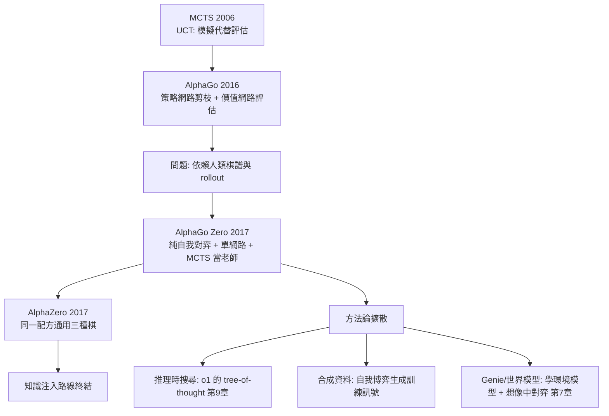

# 6.2 AlphaGo（2016）、MCTS 與 AlphaZero（2017）：自我對弈的勝利

## 前言：圍棋堡壘的攻陷與「知識注入時代」的終結

2016 年 3 月 15 日，AlphaGo 以 4:1 擊敗李世乭（Lee Sedol）——圍棋堡壘陷落，比多數專家預測的時間早了十年。2017 年 10 月，**AlphaGo Zero** 更進一步：**完全不用任何人類棋譜**，純自我對弈，3 天訓練後超越所有舊版（包括擊敗李世乭的版本），40 天後超越所有人類與所有舊 AI。同年 12 月的 **AlphaZero** 把方法泛化到西洋棋與將棋，8 小時訓練擊敗世界最強西洋棋引擎 Stockfish。這一節要拆解這場勝利的三個技術支柱——**MCTS（蒙地卡羅樹搜尋）、雙網路（策略+價值）、自我對弈訓練迴路**——並且看到一個更深的歷史訊號：AlphaZero 的西洋棋棋風讓頂尖棋手評價為「美麗的、陌生的人類未曾下出的棋」，而這套「自我對弈 + 搜尋 + 神經網路」的配方，將在 2017-2024 年間被證明不僅屬於棋類：它的精神直接進入了 LLM 時代（推理時的樹搜尋、第 9 章 o1 的 RL 思維鏈、以及「自我博弈式生成數據」的合成資料方法論）。

## 歷史背景：MCTS 的誕生與 AlphaGo 的集成

### MCTS：用隨機模擬代替精確評估

傳統博弈搜尋（minimax + alpha-beta）需要評估函數在葉節點打分——第 6.1 節說過，圍棋的葉節點評估極難。2006 年 Coulom 的 **CrazyStone** 與 Kocsis & Szepesvári 的 **UCT** 引入蒙地卡羅樹搜尋：**不評估葉節點，而是從葉節點開始隨機走完一整局，用成千上萬次隨機模擬的勝率當評估**。MCTS 的四步迴圈：

1. **選擇（Selection）**：從根沿樹下降，用 UCT 公式選節點：
$$
\arg\max_{a} \left[ \frac{w(s,a)}{n(s,a)} + c \sqrt{\frac{\ln N(s)}{n(s,a)}} \right]
$$
（ $w$ 為累積勝率、 $n$ 為該邊拜訪數、 $N$ 為父節點拜訪數——正是第 3.2 節 UCB 在樹上的推廣：**利用項 + 探索項**。）
2. **擴展（Expansion）**：到達葉節點，加一個未展開的子節點。
3. **模擬（Simulation/rollout）**：從新節點隨機（或用輕量策略）走到局終。
4. **回傳（Backpropagation）**：把結果沿路徑回傳更新所有 $w, n$ 。

MCTS 讓電腦圍棋從業餘低段跳到業餘高段（2006-2012），但 rollout 的隨機性粗糙——**隨機走法與高手走法差距太大，模擬結果的偏差限制了上限**。

### AlphaGo（2016）：三件套的集成

DeepMind（Silver et al., Nature 2016）的解法是**用深度網路取代 rollout 的粗糙性**：

- **策略網路 $p_\sigma$ **（監督學習自 KGS 業務高段棋譜 3000 萬局面，預測人類高手走法；再用策略梯度自我對弈強化成 $p_\rho$ ）——把搜尋的**分支因子從 250 砍到 ~10**（只展開 $p_\sigma$ 認為有戲的走法），rollout 也用更聰明的 fast rollout policy。
- **價值網路 $v_\theta$ **：預測「從此局面出發（自我對弈）的最終勝率」，**取代/補充 rollout**——直接回答「這局面值多少」，不再依賴隨機走到底。
- **MCTS（PUCT 變體）**：整合三者。選擇公式為：
$$
\arg\max_a \left[ Q(s,a) + u(s,a) \right],\quad u(s,a) = c_{puct}\, p_\sigma(a|s)\, \frac{\sqrt{\sum_b n(s,b)}}{1 + n(s,a)}
$$
其中 $Q(s,a)$ 由 **價值網路評估與 rollout 評估的混合** $\lambda v_\theta + (1-\lambda) z_{rollout}$ 回傳而來（ $\lambda = 0.5$ ）。**PUCT 就是 UCT 加上先驗 $p_\sigma$ **——策略網路告訴樹「哪裡值得先看」，價值網路告訴樹「看到這裡大概值多少」。

訓練流程：監督學習初始化 → 自我對弈（用當前網路走 MCTS 對弈）→ 用對弈結果訓練價值網路（局面 → 勝負）→ 迭代。**這個迴圈就是第 2.2 節 GPI 的自我對弈版**：MCTS（改進）產生資料，網路（評估）消化資料，兩者互相拉扯上升。

### AlphaGo Zero（2017）：去掉人類知識的極簡與更強

Zero 版的三個刪減與一個統一：

1. **刪掉人類棋譜**：純自我對弈從隨機策略起步。
2. **刪掉 rollout policy**：不再模擬走到底，只信價值網路（消除了 rollout 偏差）。
3. **統一雙網路為一個**：單一網路同時輸出 $p_\theta(a|s)$ （所有 362 個位置的機率）與 $v_\theta(s) \in [-1,1]$ 。
4. **訓練訊號全部來自自我對弈的結果 $z \in \{-1,1\}$ **：
$$
L = (z - v_\theta)^2 - \pi^{MCTS} \cdot \log p_\theta + c\|\theta\|^2
$$
其中 $\pi^{MCTS}$ 是搜尋產生的**改進後策略**（訪問次數分布）——網路被訓練去模仿「自己搜尋後的更好判斷」。**這是極深刻的 GPI 閉環：MCTS 是老師，網路是學生；學生學會後又成為更強老師的引擎。** 數學上這就是「策略迭代」：MCTS=策略改進，網路訓練=策略評估/擬合。

結果的歷史意義：Zero 在西洋棋、將棋、圍棋上用**同一套超參數**、無任何人類知識，全面超越人類與傳統引擎（Stockfish 被擊敗時用的是 8 小時訓練 vs. Stockfish 的數十年工程）。**「知識注入」路線正式終結**——至少在完美資訊零和遊戲中，學習完全取代了人工特徵。



## 為何自我對弈在此成立：零和完美資訊的特殊結構

把第 6.1 節的理論直覺在此補全，因為它劃定了 AlphaZero 方法的**適用邊界**（這個邊界解釋了為何第 7、8 章的方法長得完全不同）：

1. **完美資訊 + 確定性 + 零和**：博弈結果只由雙方行動決定，沒有隱藏資訊與運氣，策略優劣可被無限精確地驗證（對弈即驗證）。**自我對弈 = 無限量的、無偏的、可驗證的訓練資料**。資料瓶頸被轉化為算力瓶頸——這是整個 AlphaZero 最核心的洞察。
2. **單調改進性**：新策略與舊策略對弈，勝率高才入選——策略改進有直接的「考試」，避免了第 5 章策略梯度的高方差更新。Zero 用了簡單的挑選機制（新網路需以 >55% 勝率勝過現網路才替換）。
3. **邊界**：不完美資訊遊戲（撲克）需要 belief 狀態建模；非零和/多主體（談判、多智能體）無法靠對抗校準；**現實世界沒有「重開一局」**——這三個缺口分別指向第 7 章（學世界模型來「想像」對弈）與第 8 章（用人類偏好替代可驗證的勝負）。棋類是 RL 的「實驗室純水」，現實是混著雜質的原液。

## 程式碼：Mini-AlphaZero——井字棋上的完整自我對弈迴路

以下實作 AlphaZero 的**完整方法論**（PUCT MCTS + 單網路雙頭 + 自我對弈 + 模仿搜尋策略）於井字棋，數行可跑：

```python
# pip install torch numpy
import numpy as np, torch, torch.nn as nn, math

WIN = [(0,1,2),(3,4,5),(6,7,8),(0,3,6),(1,4,7),(2,5,8),(0,4,8),(2,4,6)]
def winner(b):
    for i,j,k in WIN:
        if b[i]!=0 and b[i]==b[j]==b[k]: return b[i]
    return 0 if (b!=0).all() else None

net = Net = type("Net", (nn.Module,), {})()          # 佔位避免重定義
class DualNet(nn.Module):
    def __init__(self):
        super().__init__()
        self.body = nn.Sequential(nn.Linear(9,64), nn.ReLU())
        self.p = nn.Linear(64,9)     # 策略頭: 每格一個機率
        self.v = nn.Linear(64,1)     # 價值頭: tanh ∈ (-1,1)
    def forward(self, x):
        h = self.body(x)
        return self.p(h), torch.tanh(self.v(h)).squeeze(-1)

net = DualNet()
opt = torch.optim.Adam(net.parameters(), lr=2e-3, weight_decay=1e-4)
CPUCT = 1.5

def legal_mask(b):  return torch.tensor((b==0).astype(np.float32))

def mcts(b, player, n_sim=60):
    """簡化 MCTS: 根節點即樹, 每次模擬做一次 PUCT 選步 + 價值網路回傳"""
    root_a = np.where(b==0)[0]
    N = {a:0 for a in root_a}; W = {a:0.0 for a in root_a}
    with torch.no_grad():
        logits, _ = net(torch.tensor(b.astype(np.float32)))
        logits = logits + (legal_mask(b)-1)*1e9           # 非法動作屏蔽
        prior = torch.softmax(logits, -1).numpy()
    for _ in range(n_sim):
        # PUCT 選擇 (第3.2節 UCB + 先驗)
        u = {a: W[a]/(N[a]+1) + CPUCT*prior[a]*math.sqrt(sum(N.values())+1)/(1+N[a])
             for a in root_a}
        a = max(root_a, key=lambda x: u[x])
        nb = b.copy(); nb[a] = player
        w0 = winner(nb)
        if w0 is not None:
            z = float(w0*player)                          # 從行動方視角
        else:
            with torch.no_grad():
                _, v = net(torch.tensor(nb.astype(np.float32)))
            z = float(-v)                                 # 對手視角取負
        N[a] += 1; W[a] += z
    visits = np.zeros(9)
    for a in root_a: visits[a] = N[a]
    return visits / visits.sum()                          # 改進後策略 π^MCTS

def selfplay(n_games=400):
    data = []
    for g in range(n_games):
        b = np.zeros(9); player = 1; traj = []
        while True:
            pi = mcts(b, player)
            a = np.random.choice(9, p=pi)
            traj.append((b.copy(), pi))
            b[a] = player; player = -player
            w = winner(b)
            if w is not None: break
        for s, pi in traj:
            data.append((s, pi, float(w)))                # z 從白方(先手)視角
    return data

for it in range(8):
    data = selfplay()
    S = torch.tensor([d[0].astype(np.float32) for d in data])
    P = torch.tensor([d[1] for d in data], dtype=torch.float32)
    Z = torch.tensor([d[2] for d in data])
    for ep in range(60):
        logits, v = net(S)
        logp = torch.log_softmax(logits + (legal_mask(data[0][0])-1)*0, -1)
        # 非法格的先驗不懲罰: 用 mask
        mask = (S != 0).float()
        lp = torch.log_softmax(logits.masked_fill(mask.bool(), -1e9), -1)
        l_p = -(P * lp).sum(1).mean()          # 策略損失: 模仿 MCTS
        l_v = ((Z - v)**2).mean()              # 價值損失: 預測勝負
        loss = l_p + l_v
        opt.zero_grad(); loss.backward(); opt.step()
    # 對戰「純網路貪婪(不搜尋)」驗證 MCTS 的增益
    wins = 0
    for ep in range(100):
        b = np.zeros(9); p = 1
        while True:
            if p == 1:
                pi = mcts(b, p, 40); a = np.random.choice(9, p=pi)
            else:
                with torch.no_grad():
                    lg, _ = net(torch.tensor(b.astype(np.float32)))
                a = int(lg.argmax())
            b[a] = p; p = -p
            w = winner(b)
            if w is not None:
                wins += (w == 1); break
    print(f"iter {it+1}: MCTS(先手) vs 純網路勝率 {wins}%  (越高代表搜尋越有用)")
```

觀察要點：（1）`mcts` 的選擇式就是 PUCT——先驗 `prior` 來自策略網路，隨訓練越來越準，樹越來越集中在關鍵分支；（2）策略損失 `-(P*logp)` 讓網路**模仿自己的搜尋結果**——GPI 迴圈的學生-老師閉環；（3）價值損失 `(Z-v)²` 學的是自我對弈的真實勝負；（4）隨迭代進行，「搜尋 vs. 純網路」的勝率差可能縮小——**網路逐漸內化搜尋能力**（這正是第 9 章 LLM「把搜尋內化成直覺」的棋類原型）。

## 本節重點

1. **MCTS（2006）**用隨機模擬代替葉節點評估攻下電腦圍棋第一座山；UCT = UCB 的樹版本（利用 + 探索）。
2. **AlphaGo（2016）**集成三件套：策略網路（剪枝 + 先驗）、價值網路（勝率評估）、PUCT 搜尋；策略網路把分支因子 250→10，價值網路消除 rollout 偏差。
3. **AlphaGo Zero / AlphaZero（2017）**刪掉全部人類知識：單一雙頭網路 + 純自我對弈 + MCTS 當老師（策略損失模仿搜尋分布、價值損失學真實勝負）——**GPI 的自我對弈閉環**，三天超越李世乭版。
4. 自我對弈成立的邊界：**完美資訊、確定性、零和**——驗證無限、免費、無偏；不完美資訊、非零和、現實世界三個缺口分別通向第 7 章世界模型與第 8 章人類偏好。
5. AlphaZero 的最深遠遺產是**方法論**：「用可驗證的遊戲結果無限生成訓練訊號 + 搜尋內化為直覺」——第 9 章 o1/R1 的 RLVR 推理訓練是同一方法論在語言空間的重演。

## 思考問題

1. AlphaGo Zero 不用棋譜反而更強。請分析監督棋譜的兩重壞處（限制探索空間、目標是「像人」而非「贏」），並推測哪一類問題中「人類示範」仍然不可替代。
2. PUCT 公式中先驗 $p_\sigma$ 與探索項同時出現。若 $p_\sigma$ 早期是接近均匀的隨機分布，PUCT 會退化成什麼？這說明 Zero 為何能「從零開始」仍有效。
3. 「網路逐漸內化搜尋能力」——請類比人類棋手：大師的「第一感」常就是正確手順。這與第 9 章 LLM 推理（直接生成 vs. 先搜尋再生成）的取捨有何關聯？
4. 自我對弈需要雙方都努力贏。請設計一個「意外共謀」：兩個自我對弈的 agent 在什麼條件下會發展出對第三方（人類）有害但對彼此「平衡」的行為？（連結第 8.2 節與多智能體對齊。）
5. Mini 程式中 `z = -v`（對手視角取負）實現了極小化對手價值。請證明：在零和完美資訊博弈中，「最大化自己的 $v$ 」與「最小化對手的 $v$ 」是同一件事，因此單一價值頭即可；在非零和博弈中此式何處破裂？
