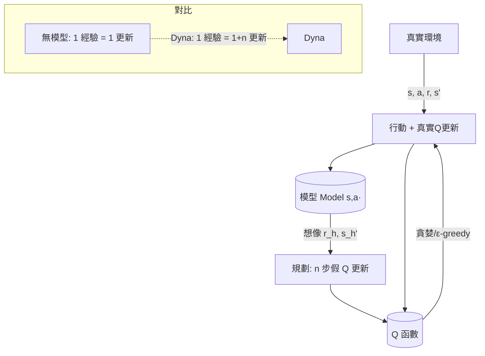

# 7.1 為何需要環境模型：Dyna（1991）與 MPC

## 前言：無模型方法的痛——樣本太貴

第 3-5 章的無模型方法有一個共同的隱性成本：**每一份經驗都來自真實環境的一次採樣**。在 Gym 裡這很便宜，但在真實世界——機器人摔一次就真摔、自動駕駛試錯就是事故、醫療決策不能重來——樣本按條命算。更根本地：人類嬰兒不用摔一百萬次才學會走路，因為人腦裡有**世界如何運轉的預測模型**，可以在腦內「試跑」各種未來。這一節講 **model-based RL** 的開端：學習環境模型 $P, R$ 之後能做什麼。兩大用途構成全節骨架：**Dyna（Sutton 1991）**——用模型「憑空生成」額外訓練樣本加速價值學習；**MPC（模型預測控制）**——用模型直接規劃未來軌跡。而 model-based 的核心矛盾也在此節登場：**模型學錯了，規劃就會自信地規劃向錯誤**（model bias）——這條張力線直通第 7.2 節 World Models 與 Dreamer 的解法。

## 歷史背景：從最優控制的兩個世界說起

回想第 2 章：動態規劃是最優控制的正統，但它需要**已知**的 $P, R$。控制理論界 1960-1980 年代走了一條 AI 界後來才回頭看的路：**先辨識（system identification）再控制**——用觀測數據擬合系統的動力學方程（線性系統有完備的最小平方法；非線性用神經網路），然後對擬合出的模型做規劃。**模型預測控制（Model Predictive Control, MPC）**在 1970-80 年代的化工與煉油業落地（Richalet 1978、Cutler & Ramaker 1980 的 DMC）：每個控制週期用模型在線規劃未來 $H$ 步的最優控制序列，只執行第一步，下個週期用新觀測重新規劃——**滾動時域（receding horizon）**讓規劃錯誤不會累積太遠。MPC 至今是工業界的標配，也是第 7.2 節 Dreamer「想像中規劃」的直接祖先。

AI/RL 界這邊，Watkins 的 Q-Learning（1989）讓「無模型」路線大放異彩，但 Sutton 清醒地指出：**「模型 vs. 無模型」不是二選一，而是取捨**——模型提供了額外的經驗來源（模擬）與泛化能力（一條經驗教給所有相鄰狀態），無模型則保證不被模型的錯誤誤導。1991 年 Sutton 的《Dyna, an integrated architecture for learning, planning, and reacting》提出把兩者焊在一個架構裡。Dyna 之後，1990 年代的 model-based RL（如 Prioritized Sweeping、Moore & Atkeson；Kearns & Singh 的 R-max 2002）逐漸成熟；2010 年代，深度網路讓「學複雜環境的模型」變得可行（PILCO 2011 用高斯過程模型做到極高樣本效率的機器人控制）；2018 年 Ha & Schmidhuber 的 World Models 與 2019 年起的 Dreamer 系列把它推向高維視覺環境（第 7.2 節）。歷史的因果：**控制理論的「辨識+規劃」傳統 → Sutton 的 Dyna 統一框架 → 深度學習讓模型可學 → 世界模型讓想像可訓練。**

## 為何需要模型：三個結構性理由

1. **樣本效率**：模型是**資料的壓縮器**。一次真實經驗 $(s,a,r,s')$ 若被模型吸收，就能在規劃/想像中被「重放」於任意相鄰情境——等於一條經驗教育了整個鄰域。無模型方法（DQN 用回放池勉強重用）遠遠達不到這種傳染性泛化。
2. **規劃能力**：人類下棋靠的不只是直覺，還有「推演幾步」。有模型才能推演——這是 AlphaZero 的 MCTS 也在做的事（只是它的「模型」是遊戲規則本身，天然的完美模型！）。**AlphaZero 是 model-based 的極端特例：模型免費且精確。** 現實世界的挑戰是模型不免費、不精確。
3. **可解釋與可控**：模型說「如果我做 X，系統會走到 Y」——這對安全關鍵系統（機器人靠近人）至關重要：規劃時就能排除危險軌跡，而不必真去試。

## Dyna：學習、規劃、反應的統一架構

### 核心思想：模型當「假環境」供電給 Q-Learning

Dyna-Q 的迴圈（記住這個偽碼，它是全章的地基）：

```
重複:
    (1) 真實互動一步: s, a, r, s' ← 環境.step(a)
        用真實經驗做 Q-Learning 更新
        用真實經驗更新模型 Model(s,a) ← (r, s')
    (2) 規劃 n 次(腦內):
        隨機抽一個見過的 (s_h, a_h), 用模型模擬 r_h, s_h' ← Model(s_h, a_h)
        用「模擬經驗」再做一次 Q-Learning 更新
```

數學上，規劃步做的是「**來自模型的想像 Q-Learning**」：更新式與真實學習完全相同，只是 $(r, s')$ 的來源換成了模型。效果：每一步真實經驗的資訊被**放大 n 倍**地傳播到價值函數中——尤其當 Q 表用 $\max$ 更新時，規劃步讓「新知識」（例如發現捷徑）沿著價值網路**向後傳播**（backpropagation of value）遠快於純真實採樣。



### 模型錯誤的代價：Dyna 的阿基里斯腱

若模型在某處學錯（例如「走 A 門有獎勵」其實是過時資訊），規劃步會**反覆自信地強化錯誤價值**——因為想像經驗不受真實環境約束。Dyna 的緩解手段：規劃時優先抽「近期被真實經驗推翻」的狀態動作（**Prioritized Sweeping** 的思想：優先更新「會引起大 TD 誤差」的隊列）；以及模型的可信度加權。但根本矛盾無法在 Dyna 框架內消解——**想像的收益與想像的偏見同源**。這個矛盾直到第 7.2 節 Dreamer 的「不確定性感知 + 保守價值估計」才被工程化地馴服，並在第 8.2 節以 reward hacking 的形式再度回歸（RLHF 的獎勵模型正是「一個會錯的模型」）。

## MPC：滾動時域的直接規劃

MPC 不學價值函數，**每一步現場規劃**：

$$
a^* = \arg\max_{a_0, a_1, \ldots, a_{H-1}} \mathbb{E}\left[ \sum_{t=0}^{H-1} \gamma^t r(s_t, a_t) \right], \quad s_{t+1} = \hat{f}(s_t, a_t)
$$

執行 $a_0^*$，觀測新狀態，重解。三個關鍵設計：

- **時域 $H$**：有限視野是對「模型長程必錯」的承認——規劃近處（模型相對準）、捨棄遠處（模型不可信）。MPC 用「終端價值 $V(s_H)$」補償視野截斷（理論上 $V$ 越準，$H$ 可以越短）。
- **隨機性處理**：$\hat f$ 常是機率模型，規劃目標對未來的隨機性取期望；工程上用**取樣軌跡 + 交叉熵方法（CEM）**等隨機優化。
- **滾動重解**：每步重新規劃 = 不斷用最新觀測校正模型誤差——誤差不跨步累積。

MPC 與 Dyna 的分工：**MPC 適合「模型較準、只需規劃」的問題（化工、機器人軌跡跟蹤）；Dyna 適合「模型粗糙、需要長期價值學習」的問題（探索型任務）**。兩者在第 7.2 節 Dreamer 中合流：Dreamer 用學到的世界模型「想像中」跑 actor-critic——本質是「在 Dyna 式的想像經驗上做 MPC/AC 混合」。

## 數學側記：模型的學習與 model bias 的權衡

模型學習本身是監督學習問題：給定資料 $\{(s_t, a_t) \to (s_{t+1}, r_t)\}$，學 $\hat f_\phi(s,a) \approx \mathbb{E}[s' \mid s,a]$（迴歸）與 $\hat r_\phi$。深度模型常見陷阱：**自回歸誤差複合**——想像 $H$ 步時，每步的預測誤差會被下一步當成「真實狀態」再放大，$H$ 步後想像軌跡可能完全脫離真實流形。量化地說，若單步預測誤差為 $\epsilon$，$H$ 步累積誤差在最好情況 $O(\epsilon H)$、最壞情況指數級。這導出 model-based RL 的基本法則：**規劃視野 $H$ 必須與模型品質掛鉤**——第 7.2 節 Dreamer 的「latent想像 + 價值梯度傳播」與「終端價值學習」正是對這條法則的工程回應。

## 程式碼：Dyna-Q vs. Q-Learning 的樣本效率對比

用一個帶捷徑的迷宮展示 Dyna 的威力（與 Sutton 原書 Example 8.1 的精神一致）：

```python
# pip install numpy
import numpy as np

rng = np.random.default_rng(0)
# 8x8 網格迷宮, 狀態 = (row, col); 0=空 1=牆; 起點(7,0) 終點(0,7)
WALLS = {(3,1),(3,2),(3,3),(3,4),(3,5),(3,6)}
S_ROW, S_COL = 7, 0; E_ROW, E_COL = 0, 7
ACTIONS = [(-1,0),(1,0),(0,-1),(0,1)]        # 上下左右

def step(r, c, a):
    nr, nc = r + ACTIONS[a][0], c + ACTIONS[a][1]
    if (nr,nc) in WALLS or not (0<=nr<8 and 0<=nc<8):
        nr, nc = r, c                         # 撞牆不動
    reward = 1.0 if (nr,nc)==(E_ROW,E_COL) else 0.0
    return nr, nc, reward, (nr,nc)==(E_ROW,E_COL)

def qlearn_dyna(n_planning=0, episodes=60, gamma=0.95, alpha=0.1, eps=0.1):
    Q = {}; Model = {}
    def get(s, a): return Q.get((s,a), 0.0)
    steps_total = 0
    for ep in range(episodes):
        s = (S_ROW, S_COL); done = False
        while not done:
            steps_total += 1
            # ε-greedy
            if rng.random() < eps: a = rng.integers(4)
            else: a = int(np.argmax([get(s,i) for i in range(4)]))
            ns, r, _, done = step(*s, a)
            # 真實 Q 更新
            tgt = r + gamma * (max(get(ns,i) for i in range(4)) if not done else 0)
            Q[(s,a)] = get(s,a) + alpha * (tgt - get(s,a))
            Model[(s,a)] = (r, ns, done)      # 學模型
            # ---- Dyna 規劃: n_planning 步想像更新 ----
            for _ in range(n_planning):
                (sh, ah) = list(Model)[rng.integers(len(Model))]
                rh, nsh, dh = Model[(sh,ah)]
                tgth = rh + gamma * (max(get(nsh,i) for i in range(4)) if not dh else 0)
                Q[(sh,ah)] = get(sh,ah) + alpha * (tgth - get(sh,ah))
            s = ns
    return steps_total

for n_plan in [0, 5, 50]:
    st = qlearn_dyna(n_planning=n_plan)
    print(f"規劃步/次={n_plan:3d}: 學會走迷宮共需 {st:6d} 步真實互動")
```

典型輸出：`n_planning=0`（純 Q-Learning）需要數千步，`n_planning=50` 只需數百步——**每一步真實經驗被放大 50 倍的教育效率**。你可以再做第 7.2 節伏筆的實驗：在中途改變迷宮（把捷徑封死），觀察依賴想像的 Dyna 需要「真實經驗糾正想像」的次數——這就是 model bias 的實體化。

## 本節重點

1. 無模型方法的結構性痛點是**樣本昂貴**（真實世界不可重置）；模型是資料的壓縮器，讓一條經驗泛化到整個鄰域。
2. **Dyna（Sutton 1991）**統一「學習（真實經驗）+ 規劃（模型想像）+ 反應」：想像經驗供電給同一套 Q 更新，樣本效率可放大 $n$ 倍；但**模型錯誤會被想像反覆自強化**（model bias）。
3. **MPC** 用滾動時域直接規劃：有限視野是對「模型長程必錯」的承認，滾動重解用最新觀測校正誤差；至今是工業控制與 model-based RL 的主力。
4. **AlphaZero 是 model-based 的特例**（遊戲規則=免費完美模型）；現實世界的 model-based RL 要先解決「模型從經驗學出來且會錯」。
5. 模型學習的**誤差複合**限制規劃視野：$H$ 必須與模型品質掛鉤——第 7.2 節 World Models/Dreamer 的所有設計都圍繞這條法則。

## 思考問題

1. Dyna 的想像更新用的是「見過的 $(s,a)$」。請推理：這種「重放舊經驗」的規劃能發現「從未走過的路」嗎？（不能——這就是 exploration 與 planning 的鴻溝，思考如何補上。）
2. 在 Dyna 程式中途封死捷徑後，想像會繼續強化舊捷徑的價值多久？請設計一個「模型可信度隨時間衰減」的補丁。
3. MPC 的滾動重解「每步重新規劃」看似浪費（上次規劃的後半被丟棄）。請說明它換來的是什麼，以及何時可以省略（提示：開環 vs. 閉環）。
4. 論證：「RLHF 的獎勵模型本質上就是一個學出來的（會錯的）環境模型」，因此第 8 章的 reward hacking 是本節 model bias 的語言空間重演。這個觀點如何幫助你預防 hacking？
5. AlphaZero 不學模型（用遊戲規則）。若讓它學模型，想像中的規劃會帶來什麼新風險？這對第 9 章「LLM 用學到的世界知識做內部模擬」有何警示？
