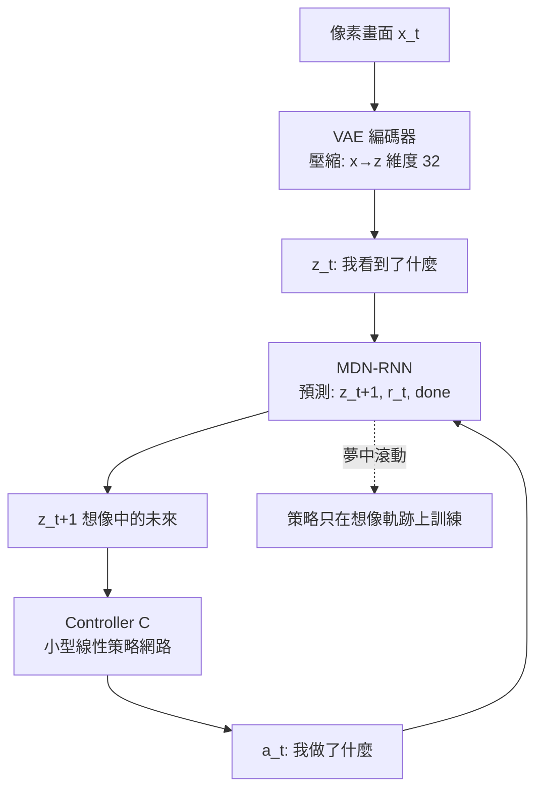

# 7.2 World Models（2018）與 Dreamer 系列（2019-2023）

## 前言：在夢裡訓練，在現實行動

第 7.1 節確立了方向：模型讓一條經驗泛化成一個鄰域的教育。但 Dyna 時代的模型是低維表格式的，MPC 時代的模型是工程給定的。2018 年，Ha & Schmidhuber 的《World Models》展示了震撼性的一幕：一個**從像素學出的生成式世界模型**（VAE 學「看什麼」、RNN 學「預測會發生什麼」），agent 在**純想像的潛在空間中訓練**策略，再拿到真實環境執行——「在夢裡學開車」。2019-2023 年，DeepMind 的 **Dreamer 系列**（v1/v2/v3）把這條路推到工程成熟：統一的架構在 Atari、連續控制、機器人操縱上用同一組超參數，樣本效率達到無模型方法的 10-50 倍。本節要講清三層技術：**怎麼學一個「用得起」的世界模型**（表示學習 + 潛在動力學）、**怎麼在想像中訓練**（latent imagination + actor-critic over imagination）、以及**怎麼對抗模型錯誤**（不確定性、保守價值、latent 截斷）——最後一層正是第 7.1 節 model bias 的正面回答，而「世界模型」這個概念本身，將在 2024-2026 年成為 LLM 巨頭的戰略名詞（Genie、Sora、「影片生成即世界模擬器」之爭，第 9.2 節）。

## 歷史背景：三條支流匯成 World Models

**支流一：變分自編碼器與表示學習（2013-2018）**。Kingma & Welling 的 VAE（2013）給出了從高維觀測（畫面）學**低維潛在表示** $z$ 的框架——這解決了 model-based RL 的第一個實際問題：別想在 $210 \times 160 \times 3$ 的像素空間學動力學，先壓縮到幾十維的「什麼重要」表示。**支流二：隨機潛在動力學**。如何預測「壓縮後的未來」？Westermann、Watter et al.（2015）的 embed-to-control、Finn & Levine 的視覺預測等工作證明：在潛在空間學 $z_{t+1} \sim p(z_{t+1}|z_t, a_t)$ 比在像素空間可行得多。**支流三：RL 的想像訓練**。Silver 2017 年的演講與 Sutton 長年的倡議（「predictions, planning, and the predictive state」）提供了理論敘事。2018 年 World Models 論文把三條支流接成一個**可運行的系統**，並用 CarRacing 與 VizDoom 展示：策略完全在想像中訓練，零真實環境梯度。2019 年 Hafner 等的 PlaNet 與 Dreamer v1 接力工程化；2020 Dreamer v2 用離散潛變數登頂 Atari；2023 Dreamer v3 用**一套超參數**橫跨 150+ 任務，並首次純 RL 在 Minecraft 收集鑽石——達成此前需要模仿學習或分層課程的里程碑。

## 世界模型的解剖：三個組件

### World Models（2018）的三件套



- **V（Vision, VAE）**：把畫面壓成潛向量 $z_t$ 。訓練目標是重構——**它學到的是「什麼資訊值得保留」**。
- **M（Memory, MDN-RNN）**：混合密度網路 RNN，預測下一潛狀態的**分布**（不是點估計——隨機環境需要分布預測，呼應第 4.2 節 C51 的「學分布」直覺）： $p(z_{t+1}, r_{t+1}, done_{t+1} \mid z_{t \le t}, a_{t \le t})$ 。
- **C（Controller）**：極小的線性策略（參數量 ~1000），**故意做小**——作者論證：把「智能」分層，複雜感知與預測由大網路（V+M）承擔，決策留給小網路，訓練才能穩定。

作者的演示精神大於數量：CarRacing 中策略純靠 M 想像的夢軌跡用進化策略訓練，真實環境幾乎零樣本。它也留下了關鍵缺口：**夢越滾越離譜**（誤差複合，第 7.1 節），只能短夢 + 進化策略湊合——Dreamer 接手補上。

### Dreamer：想像中的 Actor-Critic

Dreamer v1-v3 的統一框架（以 v2/v3 語言描述）：

**第一步：RSSM 世界模型**。表示學習與動力學學習在**一個循環狀態空間模型**中同時完成：

$$
h_t = f_\phi(h_{t-1}, z_{t-1}, a_{t-1}), \qquad z_t \sim q_\phi(z_t \mid h_t, x_t)
$$

$h_t$ 是確定性隱狀態（GRU）， $z_t$ 是隨機潛變數（後驗由觀測 $x_t$ 糾正）。訓練目標是變分下界（ELBO）：重構 $x_t$ + 預測獎勵 + 預測 done + KL( $q_\phi \| p_\phi$ )（先驗 $p_\phi(z|h)$ 是不依賴當前觀測的「夢」分布，用於想像）。**確定性 + 隨機的混合**是工程關鍵：純隨機模型難以捕捉長期依賴（資訊容易在採樣中丟失），純確定性模型無法表達環境隨機性（導致過度樂觀的想像）。

**第二步：Actor 想像訓練**。從真實經驗中的狀態 $(h_t, z_t)$ 出發，用**學到的策略**在模型中滾動 $H = 15$ 步想像軌跡，全部在 latent 空間（不需要解碼回像素！），用想像獎勵 $\hat r$ 的折扣和當 Actor 的目標：

$$
J_R(\theta) = \mathbb{E}_{p_\theta}\left[ \sum_{\tau=t}^{t+H} \gamma^{\tau-t} \hat r_\phi(h_\tau, z_\tau) \right]
$$

梯度**穿過模型**直接傳回策略（ $\nabla_\theta$ 對想像軌跡微分）——這是 model-based 的巨大優勢：**不需要環境可微，只需要模型可微**（第 5.1 節思考題的呼應）。

**第三步：Critic 想像學習**。價值網路 $V_\psi$ 學習想像回報 $\sum \gamma^k \hat r$ （用 λ-return，第 3.1/5.1 節光譜第三次登場），Actor 用 $V_\psi$ 當 baseline（REINFORCE 式）或直接用價值梯度（Dreamer v3 兩者混合）。

**第四步（v3 的穩定性全家桶）**：**平衡 KL**（KL 損失的 free bits 防止潛變數塌縮）、**two-hot 獎勵編碼**（把迴歸變分類，穩定訓練）、**symlog**（對大數值壓縮）、**規劃視野 H=15 + λ-return**（承認模型長程不可信，把遠處交給價值網路外推——第 7.1 節「終端價值補償視野」的直接應用）。

### 對抗 model bias 的三板斧

Dreamer 的每個設計都是對「夢會騙人」的防禦，值得逐一對應第 7.1 節的矛盾：

1. **短視野 + 價值外推**：想像只滾 15 步，之後的回報交給 Critic $V_\psi$ 估計——模型只負責它擅長的近程動力學，長程價值由「在想像資料上訓練的價值函數」承擔。**想象與學習的分工**，而非讓想像包辦。
2. **隨機潛變數**：模型輸出分布而非點估計，Actor 對想像的期望做優化——對「環境可能往壞的方向隨機」天然更保守。
3. **在 latent 空間想像**：不解碼像素，避免在「畫面像但物理錯」的區域被騙；且 KL 正則使潛空間平滑，抑制模型在訓練分布外的瘋狂外推。

儘管如此，Dreamer 的訓練仍是**on-policy 想象**（從真實訪問過的狀態開始做夢）——刻意不從任意虛構狀態做夢，因為那些區域的模型完全不可信。這是「想象自由度」與「模型可靠性」的折衷，也是目前 model-based RL 的共識邊界。

## 程式碼：一個迷你 Dreamer 的想像迴圈

完整 Dreamer 太龐大；以下實作其**核心機制**——在學到的 latent 模型中滾動想像、梯度穿過模型訓練策略——用 CartPole 的向量化版本：

```python
# pip install torch numpy gymnasium
import numpy as np, torch, torch.nn as nn, gymnasium as gym

# 環境: 連續 CartPole (動作離散化為 3 個推力)
env = gym.make("CartPole-v1")
DIMS = {"obs": 4, "act": 3, "lat": 16}

class WorldModel(nn.Module):
    """極簡 RSSM: 確定性 h + 隨機 z, 頭部預測 r 與 done"""
    def __init__(self):
        super().__init__()
        self.gru   = nn.GRUCell(DIMS["lat"] + DIMS["act"], 64)
        self.post  = nn.Sequential(nn.Linear(64 + DIMS["obs"], 64), nn.ReLU(),
                                   nn.Linear(64, DIMS["lat"]))       # 後驗 z|h,x
        self.prior = nn.Sequential(nn.Linear(64, 64), nn.ReLU(),
                                   nn.Linear(64, DIMS["lat"]))       # 先驗 z|h (夢用)
        self.rhead = nn.Linear(64, 1)
        self.dhead = nn.Linear(64, 1)
    def imagine(self, h, a):
        """夢中走一步: 只用先驗, 不看真實觀測"""
        h = self.gru(torch.cat([h, a], -1), h)
        z = torch.tanh(self.prior(h))
        r = self.rhead(h).squeeze(-1)
        d = torch.sigmoid(self.dhead(h)).squeeze(-1)
        return h, z, r, d

wm = WorldModel()
policy = nn.Sequential(nn.Linear(64 + DIMS["lat"], 64), nn.ReLU(),
                       nn.Linear(64, DIMS["act"]))
value  = nn.Sequential(nn.Linear(64 + DIMS["lat"], 64), nn.ReLU(),
                       nn.Linear(64, 1))
opt = torch.optim.Adam(list(wm.parameters()) + list(policy.parameters())
                       + list(value.parameters()), lr=3e-4)

def to_onehot(a): 
    v = torch.zeros(DIMS["act"]); v[a] = 1.0; return v

# --- 主迴圈: 交替 [真實收集→模型學習] 與 [想像滾動→策略學習] ---
h_buf = []
for it in range(300):
    # ===== 真實互動, 存 (h, z, a, r) 轉移 =====
    s, _ = env.reset(seed=it)
    h = torch.zeros(64); z = torch.zeros(DIMS["lat"]); total_r = 0.0
    transitions = []
    for t in range(200):
        inp = torch.cat([h, z])
        a = int(policy(inp).argmax())
        ns, r, term, trunc, _ = env.step(a)
        transitions.append((h.detach(), z.detach(), to_onehot(a),
                            torch.tensor(float(r)), s.astype(np.float32)))
        # 模型的單步預測學習(簡化: 逐步 on-line, 非批次)
        h_new, z_new, r_hat, d_hat = wm.imagine(h, to_onehot(a))
        z_true = torch.tanh(wm.post(torch.cat([h_new, torch.tensor(s.astype(np.float32))], -1)))
        loss_wm = ((z_true - z_new)**2).mean() + (r - r_hat)**2
        opt.zero_grad(); loss_wm.backward(); opt.step()
        h, z = h_new.detach(), z_true.detach()
        s, done = ns, term or trunc
        total_r += r
        if done: break

    # ===== 想像訓練: 從真實狀態出發滾 H 步夢, 梯度穿過模型 =====
    H, GAMMA = 15, 0.99
    for _ in range(20):
        h0, z0, a0, _, _ = transitions[np.random.randint(len(transitions))]
        h = h0.clone().requires_grad_(True)
        rets = []
        for t in range(H):
            a_logits = policy(torch.cat([h, z]))
            a_prob = torch.softmax(a_logits, -1)
            a = a_prob[np.random.randint(0,1) * 0 + torch.multinomial(a_prob,1).item()] if False else a_prob
            a = a_prob  # 用機率向量近似 one-hot, 使梯度可流通
            h, z, r_hat, d_hat = wm.imagine(h, a)
            rets.append(r_hat)
            if t == H-1: rets.append(value(torch.cat([h, z])).squeeze(-1) * 0)  # 短視野+價值外推(此處簡化為截斷)
        R = torch.stack(rets[:-1])
        G = sum(GAMMA**k * R[k] for k in range(len(R)))     # 想像中的折扣回報
        # Actor: 用想像價值當 baseline 的策略梯度 (REINFORCE over imagination)
        v_hat = value(torch.cat([h0, z0])).squeeze(-1)
        logp = torch.log_softmax(policy(torch.cat([h0, z0])), -1)
        a_taken = transitions[np.random.randint(len(transitions))][2].argmax()
        adv = (G - v_hat).detach()
        loss_pi = -(logp[int(a_taken)] * adv)
        loss_val = (G.detach() - v_hat)**2
        opt.zero_grad(); (loss_pi + loss_val).backward(); opt.step()

    if (it+1) % 50 == 0:
        print(f"iter {it+1}: 真實環境回合回報 = {total_r:.0f}")
```

這份程式刻意保留了 Dreamer 的三個靈魂特徵：（1）`wm.imagine` 只用**先驗**（不看觀測）——夢必須是自足的；（2）想像軌跡上計算 `G` 後 `backward()`——**梯度穿過世界模型**傳回策略；（3）`H=15` 短視野——承認夢滾長了會離譜。它也誠實地暴露了簡化（逐步而非批次的模型訓練、單樣本想像），完整實作請參考 DreamerV3 官方碼。

## 本節重點

1. **World Models（2018）**把 VAE（看）+ MDN-RNN（記憶/預測）+ 小 Controller（行動）接成「在夢中訓練」的系統；它證明了概念，但夢的長度受誤差複合限制。
2. **Dreamer（2019-2023）**工程化：RSSM（確定性 h + 隨機 z 的混合動力學）、latent 空間想像、**梯度穿過模型**訓練 Actor、Critic 在想像資料上學價值；v3 用一套超參數橫跨 150+ 任務並拿下 Minecraft 鑽石。
3. 對抗 model bias 的三板斧：**短視野 + 價值外推**（第 7.1 節法則的落地）、**分布預測**（保守對待隨機性）、**latent 想象**（避免「畫面像但物理錯」）。想象必須從真實訪問過的狀態出發——想象自由度的共識邊界。
4. Model-based 的本質優勢：**不需要環境可微，只需模型可微**——策略梯度可以直接穿過想像軌跡回傳，這是無模型方法做不到的。
5. 「世界模型」已從 RL 技術詞彙升格為 AI 戰略概念（Genie、影片生成即模擬器）：第 9.2 節將看到 LLM/Agent 路線與這條線的合流。

## 思考問題

1. Dreamer 的想象「只從真實訪問過的狀態出發」。請構思一個允許「更自由做夢」的機制，並指出它需要什麼新的安全設計（提示：模型不確定性估計 + 保守價值下界，類似 offline RL）。
2. VAE 的重構目標決定了 z 保留什麼。請舉出一個「重構損失丟掉關鍵決策資訊」的環境例子（提示：畫面角落的小型分數計數器），以及 Dreamer 用「獎勵預測作為輔助任務」如何緩解。
3. 「梯度穿過模型」把模型變成了策略的訓練訊號放大器。若模型有系統性偏差，這個放大器會放大什麼？與第 8.2 節「優化獎勵模型」的 hacking 有何同構？
4. 純隨機模型與純確定性模型各有什麼災難模式？RSSM 的混合設計為何是折衷而非疊加？
5. Dreamer v3 在 Minecraft 鑽石任務的成功被視為 milestone，因為它證明純 RL 可以解決「長時程、稀疏獎勵、開放世界」。請分析這個任務的獎勵結構（程式給定的中間獎勵）與第 9 章「RLVR 只給最終正確性」的差別——哪個更難？
