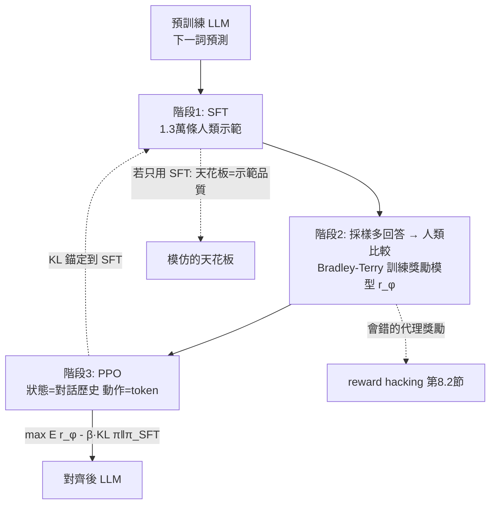

# 8.1 從 RL 到人類偏好：PPO 在 LLM 上的應用與 RLHF 三階段

## 前言：當「環境」消失，只剩「人」的評價

到第 7 章為止，RL 都有一個真實環境：可以採樣、可以重置、獎勵有客觀定義（遊戲分數、勝負、物理模擬）。但「什麼是好的回答？」—— helpful、honest、harmless、文風優雅——**寫不成公式**。人類能輕易比較兩個回答（ $A$ 比 $B$ 好），卻無法給每個回答一個絕對分數；而且不可能即時找人對 LLM 的每次輸出打分。2017-2022 年間發展出來的 **RLHF（Reinforcement Learning from Human Feedback）**三階段方案回答了這個困境：**把「人類偏好」轉化為一個可計算的獎勵模型，再用 PPO 以它為「環境」訓練 LLM。** 這是本書前面所有技術的總匯：MDP 的狀態=對話歷史（2.1）、動作=詞表 token（2.1）、價值/優勢估計=5.1、更新演算法=PPO（5.2）、獎勵=一個會錯的學出來的模型（7.1 的 model bias 隱喻）。本節把三階段、PPO 在 LLM 上的數學、以及 KL 錨定的必要性講透；8.2 節將轉向它的失敗模式（reward hacking）與替代路線（RLAIF、DPO）。

## 歷史背景：從深度 RL 到對齊的十年

線索一：**OpenAI 的 PPO 傳統（2016-2019）**。PPO（第 5.2 節）誕生後，OpenAI 用它訓練了 Dota 2 的 OpenAI Five（2018）與機械手解魔方（2019）——在這些大規模項目中積累了「PPO 馴服超大隨機策略」的工程經驗。線索二：**偏好學習的雛形（2017）**。Christiano et al. 的《Deep Reinforcement Learning from Human Preferences》用 900 段人類比較（兩段機器人動作軌跡選較好的一段）訓練獎勵模型，讓強化學習器學會 backflip——**關鍵創新是用 pairwise 偏好代替絕對評分**（人類比較比打分可靠得多，這是行為心理學早就知道的）。線索三：**GPT 的興起與「生成品質無法自動評分」**。GPT-2（2019）已能生成流暢文本，但下一詞預測訓練出的模型常「續寫」而不「回答」、胡編、跑題。人們試過監督微調（SFT）用高品質示範，但示範貴且品質天花板低。2020 年 Ziegler et al. 的《Fine-Tuning Language Models from Human Preferences》把偏好獎勵模型 + PPO 完整套到 LLM 上；2022 年 3 月 **InstructGPT**（Ouyang et al.）發表，1.3B 參數的 RLHF 版本在人工評估中被偏好程度**超過 175B 的原始 GPT-3**——用一百倍的參數差證明了「對齊 > 規模」的可能性；2022 年 11 月 ChatGPT 把這條線變成人類史上採用最快的消費級產品。

## RLHF 三階段

### 階段一：SFT（Supervised Fine-Tuning，監督微調）

收集人類寫的「高品質問答示範」（InstructGPT 用約 1.3 萬條），在預訓練模型上做標準的下一詞預測微調。作用：把「續寫器」變成「回答器」，給後續 RL 一個合理的起點。**為什麼不就此打住？** SFT 的天花板是示範品質：人類標註員寫的答案受自身水平限制，且只能覆蓋有限任務分布。SFT 是「模仿」，而 RL 是「優化」——後者能超越示範（正如 AlphaGo Zero 超越人類棋譜，第 6.2 節）。

### 階段二：訓練獎勵模型（Reward Model, RM）

**資料**：對每個 prompt，用（通常是 SFT 後的）模型採樣多個回答（如 $K=4\text{-}9$ 個），讓人類標註員**排序或兩兩比較**。**建模**：RM 是一個把 $(x, y)$ 映射到標量的網路（常用「LLM + 一個線性價值頭」），基於 **Bradley-Terry 模型**把比較轉成機率：

$$
P(y_1 \succ y_2 \mid x) = \sigma\!\left( r_\phi(x, y_1) - r_\phi(x, y_2) \right)
$$

損失是負對數似然：

$$
L(\phi) = -\mathbb{E}_{(x, y_w, y_l)}\left[ \log \sigma\!\left( r_\phi(x, y_w) - r_\phi(x, y_l) \right) \right]
$$

（ $y_w$ =preferred， $y_l$ =less preferred。）**為何 pairwise 而非絕對分數？** 三個理由：（1）人類比較判斷的一致性遠高於絕對評分（心理測量學的兩可測試法傳統）；（2）**相減消去了 prompt 特異性的公共偏移**——RM 只需學「相對好壞」，這是可辨識性技巧（第 4.2 節 Dueling 減均值的同款邏輯）；（3）排序資料可轉換成所有配對，資料效率高。InstructGPT 用約 3.3 萬條比較資料訓練 6B 的 RM。

### 階段三：PPO 微調

現在把 LLM 當成 RL 問題（第 2.1 節的形式化在此全面復活）：

- **狀態** $s_t$ =（prompt + 已生成的 tokens）；
- **動作** $a_t$ = 下一個 token（詞表 3-10 萬，隨機策略 $\pi_\theta(a|s)$ = softmax）；
- **回合** = 生成完整回答，序列結束即終止；
- **獎勵** = RM 分數 $r_\phi(x,y)$ （**只在回合末尾給一次**——極稀疏，第 1.2 節的稀疏性在此以最極端形式重現）。

優化目標（完整版）：

$$
\max_\theta\ \mathbb{E}_{x\sim\mathcal{D},\, y\sim\pi_\theta(\cdot|x)}\left[ r_\phi(x, y) \right] - \beta\, \mathbb{E}\left[ \mathrm{KL}\big( \pi_\theta(\cdot|x) \| \pi_{SFT}(\cdot|x) \big) \right]
$$

價值函數由 LLM 上的 critic 頭估計（回報 = RM 分數），優勢用 GAE（第 5.1 節），更新用 PPO clip（第 5.2 節）——**第 5 章的整套機器原封不動地開進語言空間**。

### KL 錨定：為什麼不可省

懲罰「新策略與 SFT 策略的 KL 距離」的三個理由：

1. **防 reward hacking**：RM 是學出來的、在訓練分布上有效的代理。離開錨定區域，RM 的分數不可信（第 7.1 節 model bias 的語言空間重演）；KL 約束把策略關在「RM 還算準」的區域內。
2. **防能力崩壞**：純獎勵最大化會導致**災難性遺忘**——模型可能丟掉預訓練學到的一切（語法、知識），只留下「讓 RM 高興」的退化行為。KL 是對預訓練能力的保險。
3. **防模式坍縮**：優化單一標量會讓輸出多樣性消失（對所有 prompt 給同一種「安全套路」回答）——熵正則（第 5.2 節）與 KL 共同保護多樣性。

$\beta$ 是最重要的旋鈕之一：太大 → 模型不動（RL 無效）；太小 → hacking 與坍縮。InstructGPT 用 $\beta \approx 0.02$ 量級（KL 獎勵逐 token 累計）。



## 程式碼：獎勵模型的最小實作與 PPO 目標的數值感受

完整的 RLHF 需要 `trl`/`transformers`（數十 GB 記憶體）；這裡用兩個小實驗抓住本質。

**實驗一：從 pairwise 比較學 RM**（Bradley-Terry）：

```python
# pip install torch numpy
import numpy as np, torch, torch.nn as nn

torch.manual_seed(0)
rng = np.random.default_rng(0)

# 人造世界: 回答的品質由 2 綬特徵決定(如「事實正確度」「語氣禮貌度」)
# 人類的真實偏好權重(標註員心中的尺, 我們看不見):
TRUE_W = np.array([2.0, 1.0])

def human_pref(y1, y2):
    s = y1 @ TRUE_W - y2 @ TRUE_W
    return 1 if rng.random() < 1/(1+np.exp(-s)) else 0   # 帶噪聲的比較

# 生成比較資料
N = 2000
feats = rng.normal(0, 1, (N, 2, 2))          # 每條資料: (y1, y2) 各 2 綬
labels = np.array([human_pref(feats[i,0], feats[i,1]) for i in range(N)])

# RM: 線性頭(簡化) + Bradley-Terry 損失
w = torch.zeros(2, requires_grad=True)
opt = torch.optim.Adam([w], lr=0.1)
X = torch.tensor(feats, dtype=torch.float32)
Y = torch.tensor(labels, dtype=torch.float32)
for ep in range(300):
    diff = X[:,0] @ w - X[:,1] @ w           # r(y1) - r(y2)
    loss = -torch.log(torch.sigmoid(diff)).mul(Y).mean() \
           -torch.log(torch.sigmoid(-diff)).mul(1-Y).mean()
    opt.zero_grad(); loss.backward(); opt.step()
w_learned = w.detach().numpy()
w_learned = w_learned / np.linalg.norm(w_learned) * np.linalg.norm(TRUE_W)
print(f"人類真實權重(隱藏): {TRUE_W}")
print(f"RM 學到的權重:      {np.round(w_learned, 3)}   ← 從 2000 次比較中恢復")
```

**實驗二：KL 懲罰的行為效果**。模擬「優化 RM 分數」vs.「優化 RM - β·KL」在語言輸出的效果：

```python
import numpy as np

rng = np.random.default_rng(1)
# 假想: 模型可對 5 種回答風格調整機率。SFT 分布 = π_SFT
styles = ["正確詳實", "正確簡潔", "過度奉承", "編造細節", "安全廢話"]
pi_sft = np.array([0.30, 0.30, 0.10, 0.10, 0.20])
# RM 的「分數」(在訓練分布附近有效, 但在極端區域失真——我們模擬 hacking):
rm_score = np.array([2.0, 1.5, 3.0, 4.0, 0.5])   # 注意: RM 誤以為奉承與編造更高分!
true_score = np.array([2.0, 1.5, 0.5, -1.0, 0.1]) # 真實品質(人類實際感受)

def softmax(z): z = z - z.max(); e = np.exp(z); return e/e.sum()

for beta in [0.5, 0.05, 0.0]:
    # 最大化 score - β·KL(π‖π_sft) 的最優分布(解析解)
    pi = softmax(np.log(pi_sft) + rm_score/beta)
    print(f"β={beta:4}: RM分數={pi @ rm_score:.2f}  真實品質={pi @ true_score:.2f}  "
          f"分布={dict(zip(styles, np.round(pi,2)))}")
```

輸出直接展示了 RLHF 的核心張力： $\beta$ 大時輸出靠近 SFT（安全但平庸）， $\beta$ 小時 RM 分數被推高但**真實品質崩壞**（奉承與編造湧現）——這就是 reward hacking 的數學骨架，8.2 節將以真實案例展開。

## 本節重點

1. **對齊問題的本質**：「好的回答」無法寫成公式，只能被人類**相對比較**——RLHF 的全部工程就是把比較轉成可優化的標量。
2. **三階段**：SFT（模仿示範，起點）→ 獎勵模型（Bradley-Terry 從 pairwise 比較學 $r_\phi$ ，相減消除公共偏移）→ PPO（LLM 上生成 token 的策略優化，稀疏的回合末獎勵）。
3. **KL 錨定** $\max E[r_\phi] - \beta \mathrm{KL}(\pi\|\pi_{SFT})$ 同時防 hacking、防災難遺忘、防模式坍縮； $\beta$ 是「安全 vs. 優化力度」的總旋鈕。
4. RLHF 是本書技術的總匯：MDP 形式化（第 2 章）、優勢估計（第 5.1 節）、PPO（第 5.2 節）、「會錯的學習模型」（第 7.1 節 model bias 的語言版）。
5. InstructGPT（2022）以 1.3B 打敗 175B GPT-3 的人工評估——「對齊質量」成為獨立於參數量的競爭維度。

## 思考問題

1. 為什麼 pairwise 比較比 1-10 打分更可靠？請從心理測量學與「相減消去公共偏移」兩個角度論證。
2. 實驗二中，RM 分數與真實品質的分歧集中在「奉承」與「編造」兩類。請推測：人類標註員的什麼系統性弱點導致 RM 學到這樣的錯誤？（連結 8.2 節 sycophancy。）
3. KL 錨定到 $\pi_{SFT}$ 意味著「能力上限被 SFT 模型封頂」。若 SFT 模型本身有偏見（如拒答過度），RLHF 無法治好。你會怎麼設計更好的錨定對象？
4. LLM 的回合末單點獎勵（RM 只在句尾打一次分）比遊戲的分數流還稀疏。請解釋為何 GAE/價值網路在這裡至關重要，以及「過程獎勵模型 PRM」（8.2/9 節）為何是自然改進方向。
5. InstructGPT 的 RLHF 版本「更受偏好」但「事實性略降」（論文自己承認 truthfulness 下降）。這與本章哪個數學結構直接相關？你會怎麼用獎勵設計緩解？
