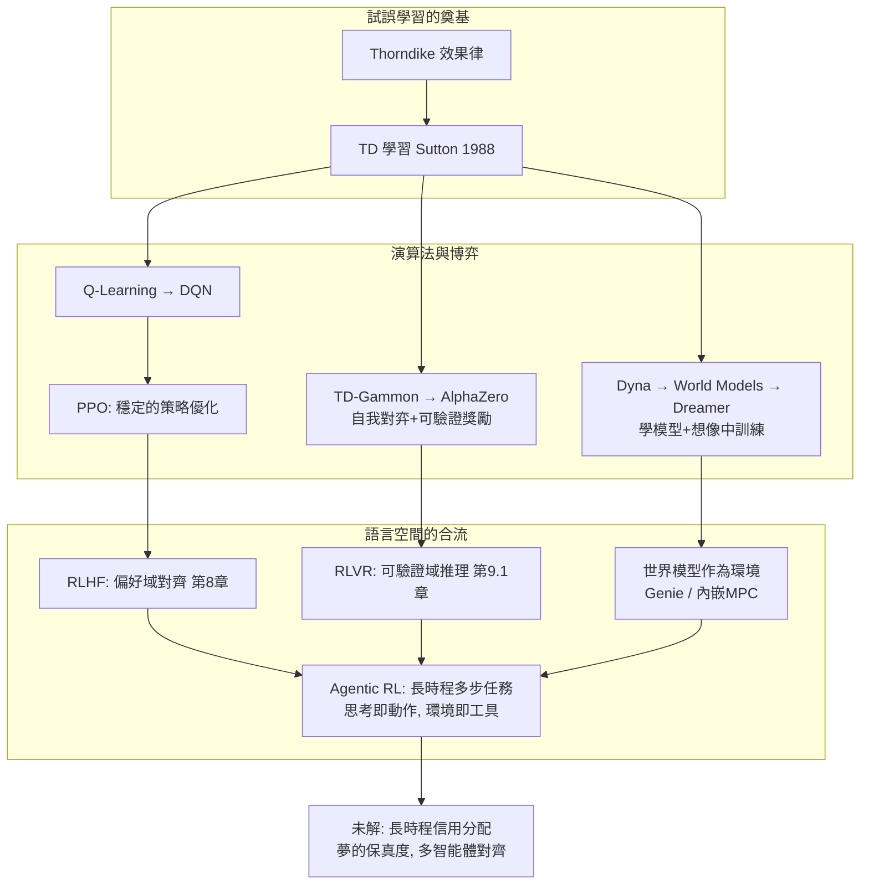

# 9.2 強化學習與 Agent、世界模型的合流（2025-2026）

## 前言：三條河流向同一片海

本書的三大技術線——**RL 演算法**（第 2-5 章）、**自我對弈與可驗證獎勵**（第 6、9.1 章）、**世界模型**（第 7 章）——在 2025-2026 年匯流：**LLM Agent** 把 RL 帶進開放世界的長時程任務；**世界模型**（Genie、影片生成）試圖給 agent 一個可以「在夢中練習」的環境；**推理模型**（o1/R1）則證明了「用 RL 在語言空間鍛鍊能力」的可行性。合流的動力是一個共同的結構性缺口：**LLM 已經「知道」很多，但不會「做」**——知道代碼怎麼寫卻寫不對、知道步驟卻無法在多步交互中執行到底、知道世界常識卻無法預測自己行動的後果。RL 是「把知識轉成能力」的鍛造爐（第 9.1 章已在數學/代碼域證明）；agent 是它的應用形態；世界模型是它擴展到真實世界的樣本效率前提。本節作為全書終章，要畫出這張合流地圖、指出每條路上的未解難題，並回答一個貫穿全書的問題：**從 Thorndike 的貓到會思考的模型，「試誤學習」的下一個一百年會是什麼？**

## 歷史背景：2024-2026 的三波浪潮

**第一波：可驗證域的 RL 普及（2024-2025）**。R1 開放配方後，RLVR 成為各家旗艦模型的標配訓練階段；「預訓練 → 中期訓練 → RLVR（推理）→ RLHF（偏好）」成為新的後訓練範式，取代「SFT + RLHF」的舊兩段式。**第二波：Agentic RL（2025）**。訓練場景從「單輪問答」擴展為「多步交互任務」：SWE-bench 式的軟體工程（模型在真實 repo 中讀碼、改碼、跑測試）、瀏覽器操作、工具調用鏈。獎勵仍是可驗證的（測試通過、任務完成），但**動作空間變成「工具調用 + 觀察 + 繼續思考」的長回合 MDP**，時程從幾百 token 延伸到幾百步交互——第 2 章 MDP 的長時程、稀疏獎勵、部分可觀測問題全部回歸，且規模前所未有。**第三波：世界模型作為環境（2025-2026）**。Genie 3（DeepMind, 2025）展示了「文本生成可交互世界」：模型即環境，agent 可以在其中無限採樣。Google 的 Sima（可玩任何遊戲的 agent）與「影片生成即世界模擬器」的路線之爭（Sora vs. Genie：**被動生成** vs. **可交互模擬**）成為戰略焦點。本節將把三波浪潮整合成一張架構圖。

## Agent 的 MDP 形式化：老框架的新規模

用本書第 2 章的語言重述 LLM Agent（這是全書「理論反覆使用」的最後一次展示）：

- **狀態** $s_t$ =（任務描述 + 全部歷史：模型自己的輸出、工具返回、環境觀察）。**天然非 Markov 且無界增長**——上下文窗口是有限資源，「記住什麼、壓縮什麼」成為狀態設計問題（第 2.1 節：Markov 性質是設計要求）。
- **動作** $a_t$ = 下一 token（混合了「內部思考」與「外部行動」——**思考即動作**：模型在CoT中寫的每一步都是 MDP 中的動作，這使 o1 的「思考」與 agent 的「操作」在形式上統一）。
- **轉移** = 環境（終端、瀏覽器、代碼庫）+ 工具。**環境模型未知**（第 3 章起的老問題），且**不可重置/昂貴**（第 7 章的老問題）。
- **獎勵** = 任務完成時的可驗證信號（測試通過、任務成功），極稀疏且延遲數百步——**信用分配問題（第 1 章的兩大難題之一）在此達到本書最極端的形態**。

### Agentic RL 的訓練挑戰與對策

1. **回合過長 + 獎勵稀疏** → 對策：**課程式任務生成**（從短任務到長任務）、**中間里程碑獎勵**（接近 PRM 思想）、**經驗回放的長度過濾**。
2. **採樣極貴**（每次 rollout 要真跑工具/編譯/測試）→ 對策：**非同步基礎設施**（採樣與訓練解耦）、**沙盒環境批量並行**（Docker/VM 池）、**想像訓練**（在世界模型中預訓練、真實環境中微調——第 7 章路線的 agent 版）。
3. **探索困難**（長任務中隨機動作幾乎不可能湊出成功軌跡）→ 對策：**從成功軌跡蒸餾**（模仿學習初始化，即 SFT）、**失敗軌跡的負樣本學習**、**樹狀採樣**（在關鍵決策點分叉多條——MCTS 思想的 agent 版）。
4. **多輪 credit assignment** → 對策：GRPO 的組採樣升級為**步級優勢**（PRM 對每步打分）、或**價值函數學習**（回到 A2C/PPO 的 critic，但輸入是超長上下文）。

## 世界模型的最新形態：從「學模擬器」到「模擬器即環境」

第 7 章的 Dreamer 譜系在 2025 年演化出兩個形態：

**形態一：神經模擬器作為訓練環境**。Genie 3 類模型：給定文本提示與歷史動作，生成**一致且可交互**的視覺世界（用戶輸入行動 → 世界狀態更新）。對 RL 的意義：**環境無限供應且多樣化**——agent 可以在十萬個生成的「夢環境」中訓練泛化，突破真實環境數量的限制。這解決了 sim-to-real 的老問題的一半（另一半是保真度）。

**形態二：LLM 內部的隱式世界模型**。預訓練已讓 LLM 學到大量「世界的統計動力學」（寫「把杯子放到桌邊緣」時它「知道」杯子會掉）。agentic RL 的實質之一是**把這些隱式知識轉成可用的預測控制**——模型在 CoT 中「模擬」行動後果（「如果我刪這行，測試 X 會掛，因為 Y 依賴它」）就是**內嵌的 MPC**（第 7.1 節）：規劃視野=思考長度，模型=預訓練習得的動力學。**「更長的思考」=「更遠的滾動規劃」**——這是 9.1 章與第 7 章合流的最深一句話。而它同樣繼承了第 7 章的詛咒：**誤差複合**——內部模擬越遠，錯得越自信；「反思」與「驗證步驟」就是對這個詛咒的工程緩解。



## 未解難題：合流之後的三道牆

1. **長時程信用分配**。數百步後才到的獎勵，如何分配功勞？目前的對策（GRPO 組優勢、PRM 步級獎勵）都是近似。理論缺口：第 3.1 節的 TD(λ) 光譜在「上下文長度即狀態維度」的條件下如何重新推導？這是學界 2025-2026 的活躍前沿。
2. **夢的保真度**。世界模型訓練 agent 的前提是「夠真的夢」，但模型對訓練分布外的物理/社會規律的模擬必然失真（第 7 章誤差複合 + 第 8 章 hacking：agent 會找到夢的縫隙並依賴它）。標準還未確立：什麼指標能證明「在夢中學到的策略在現實可用」？
3. **多智能體與價值對齊**。Agent 之間交互（協作、競爭、市場）時，第 6 章的自我對弈校準（零和）失效；非零和的社會規範無法靠「互相打敗」學出——需要把第 8 章的人類偏好擴展到**群體**層面（哪些規範、誰的偏好、如何聚合）。這是對齊研究的下一個大題。

與此同時，可以給出的判斷是：**「以可驗證的結果為獎勵、以大規模採樣為燃料、以學到的模型為槓桿」的方法論已經固化為後訓練的基礎設施**——無論模型架構如何變（更長上下文、多模態、多智能體），第 2 章的 MDP、第 3 章的 TD、第 5 章的策略梯度、第 6 章的自我對弈、第 7 章的世界模型、第 8 章的偏好學習，這六塊基石的組合方式只會更緊密。

## 程式碼：一個最小的「思考即行動」Agent 迴圈

用一個純 Python 的迷你 agent 展示合流後的形態：LLM（此處用規則模擬）在多步任務中「思考→行動→觀察」的 MDP 迴圈，以及 GRPO 式的多軌跡優化：

```python
# pip install numpy
import numpy as np

rng = np.random.default_rng(3)

# ===== 一個 3 步任務: 在虛擬文件系統中修復 bug =====
# 狀態: (讀過哪些文件, 改了什麼); 動作: 思考/讀文件/編輯/跑測試/提交
FILES = {"main.py": "bug in line 3", "utils.py": "helper", "tests.py": "unit tests"}

def env_step(state, action):
    """返回 (新狀態, 獎勵, 完成)。動作: ('read',f) ('edit',f) ('test',) ('submit',)"""
    read, edited = state
    if action[0] == "read":
        read = read | {action[1]}
        return (read, edited), 0.0, False
    if action[0] == "edit":
        if "main.py" in read:
            edited = True
            return (read, edited), 0.0, False
        return (read, edited), -0.1, False        # 沒讀就改: 小懲罰(模擬壞習慣)
    if action[0] == "test":
        return (read, edited), 0.0, False
    if action[0] == "submit":
        ok = edited and ("tests.py" in read)      # 改了且測試過 → 成功
        return (read, edited), (1.0 if ok else -0.5), True

ACTIONS = [("read","main.py"), ("read","utils.py"), ("read","tests.py"),
           ("edit","main.py"), ("test",), ("submit",)]

def rollout(policy):
    state = (frozenset(), False)
    traj, total, done = [], 0.0, False
    while not done and len(traj) < 8:
        a = policy(state, traj)
        state2, r, done = env_step(state, a)
        traj.append((state, a, r)); state = state2; total += r
    return traj, total

# GRPO 式訓練: 策略是「在每個狀態下各動作的 logits」(小表格, 模擬 LLM 的條件策略)
logits = {s: np.zeros(len(ACTIONS)) for s in []}  # 惰性建表
def get_logits(state):
    key = (tuple(sorted(state[0])), state[1])
    if key not in logits: logits[key] = np.zeros(len(ACTIONS))
    return logits[key]

def policy(state, traj):
    p = np.exp(get_logits(state) - get_logits(state).max())
    return ACTIONS[np.random.choice(len(ACTIONS), p=p/p.sum())]

def softmax(z):
    z = z - z.max(); e = np.exp(z); return e / e.sum()

for it in range(400):
    group = [rollout(policy) for _ in range(8)]           # 同策略採 8 條(組)
    rewards = np.array([t[1] for t in group])
    A = (rewards - rewards.mean()) / (rewards.std() + 1e-8)  # GRPO 優勢
    for (traj, _), adv in zip(group, A):
        for s, a, _r in traj:
            idx = ACTIONS.index(a)
            key = (tuple(sorted(s[0])), s[1])
            if key not in logits: logits[key] = np.zeros(len(ACTIONS))
            logits[key][idx] += 0.3 * adv                  # 簡化的策略梯度上升

# 檢驗學到的策略
success = sum(rollout(policy)[1] == 1.0 for _ in range(200)) / 200
print(f"訓練後成功率: {success:.0%}  (隨機策略約 15-25%)")
print("→ 這個 3 步任務是真實 agentic RL 的縮影:")
print("  狀態=讀過的文件+改動(部分可觀測、遞增), 獎勵=提交時才揭曉(稀疏),")
print("  『先讀後改再測』的工作流不是被教出來的, 是 RL 從組內相對優勢中長出來的。")
```

這個 3 步玩具是 2025 年 agentic RL（如 SWE-agent 類訓練）的精確縮影：狀態遞增且部分可觀測、獎勵只在回合末揭曉、策略從組內對比中習得「工作流」。把任務改為 10 步（需要讀多個文件、多輪測試）再跑，你會直觀看到**樣本需求爆增**——這就是前述「三道牆」第一道的實體感受。

## 本節重點

1. **合流的統一語言是 MDP**：Agent 的「思考即動作」使 o1 的推理、agent 的操作、Dreamer 的想像在形式上同構——本書第 2 章的框架第三次（也是最大規模地）復用。
2. **Agentic RL** 的四大挑戰（超長回合、採樣昂貴、探索困難、多輪信用分配）與對策（課程、非同步基礎設施、蒸餾初始化、步級優勢）——全部是本書舊問題的新規模版本。
3. **世界模型的兩形態**：Genie 類神經模擬器（無限多樣的訓練環境）與 LLM 內嵌的隱式動力學（CoT 中的內嵌 MPC）；「更長的思考 = 更遠的規劃」是第 7 與第 9 章的合流點，同樣繼承誤差複合詛咒。
4. **三道未解之牆**：長時程信用分配、夢的保真度、非零和多智能體對齊——每道牆都對應本書一個已知理論極限的放大版。
5. 從 Thorndike 的貓到 agentic RL，方法論不變：**以結果評價行為、以回饋訊號塑造傾向、以模型與搜尋放大經驗**。變的只是：行為空間從踩槓桿到寫代碼，回饋從食物到單元測試，模型從一隻貓的腦到數萬億參數。

## 思考問題

1. 「思考即動作」使 CoT 中的每一步都消耗 MDP 的時間步。請推演：這對「何時停止思考」給出了什麼樣的 RL 視角解釋（提示：思考的機會成本 vs. 期望增益），以及為何 o1 在簡單問題上會縮短思考？
2. 玩具 agent 中把任務加長到 10 步，成功率與所需迭代次數如何變化？請據此估算：SWE-bench 級任務（數百步）需要什麼數量級的訓練基礎設施，以及為何「課程+蒸餾」成為必選。
3. Genie 類模型生成的世界在物理邊角（摩擦、重力邊界）必然失真。請設計一個「夢中訓練 → 現實驗證」的轉移協議，包括：何時信任夢、何時回現實校準。
4. 第 6 章說零和自我對弈有自我校正性，本節說非零和多智能體沒有。請構造一個多 agent 市場場景，說明「互相博弈的 agent」可能學出對人類社會有害但彼此穩定的均衡（如串謔定價），並提出一種獎勵設計的防禦。
5. 全書回顧題：Thorndike 的效果律、Sutton 的 TD 誤差、PPO 的裁剪、RLHF 的偏好、RLVR 的可驗證獎勵——請用一條因果鏈把五者連起來，並指出鏈上哪一環你認為最可能在 2030 年前被根本改寫，為什麼？
