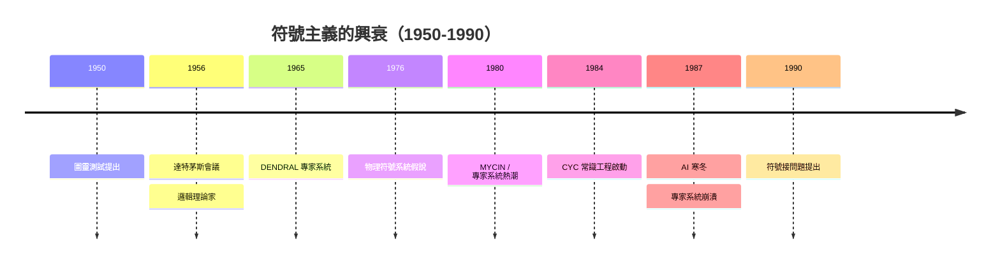
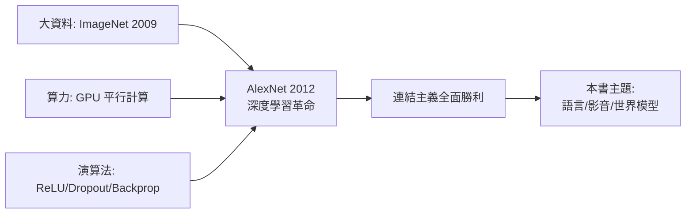

# 1.1 從符號主義到連結主義：智慧表示之爭（1950-2010）

## 一、歷史背景：一個問題，兩種答案

「智慧是什麼？如何在機器中實現智慧？」——這個問題自 1950 年圖靈（Alan Turing）發表《計算機器與智慧》（Computing Machinery and Intelligence）以來，就分裂成兩條截然不同的路線。這場「智慧表示之爭」貫穿了人工智慧近七十年的歷史，而本書要介紹的語言模型、影音生成模型與世界模型，最終都是「連結主義」路線在 2010 年代大獲全勝後的產物。要理解今天的智慧模型，必須先理解這場路線之爭的前因後果。

兩條路線的核心分歧在於一個根本問題：**智慧應該如何被「表示」？**

- **符號主義（Symbolicism）**：智慧是對符號的邏輯操作。知識應該被人類用明確的符號（如「所有的鳥都會飛」、「小鳥是鳥」）寫下來，機器透過邏輯推論規則（如三段論）對符號進行操作，從而表現出智慧。
- **連結主義（Connectionism）**：智慧是大量簡單單元（神經元）的統計性集體行為。知識不應被人類手工寫下，而應該分散地編碼在神經網路的連結強度（權重）之中，透過資料自動學習。

這不是單純的技術分歧，而是哲學分歧：**智慧究竟是人類可理解的邏輯，還是難以解釋的統計模式？**

## 二、符號主義的黃金時代（1956-1987）

### 2.1 達特茅斯會議與符號 AI 的誕生

1956 年的達特茅斯會議（Dartmouth Conference）上，John McCarthy、Marvin Minsky、Claude Shannon 等人正式提出了「Artificial Intelligence」這個詞。與會者的共識傾向符號主義：他們相信智慧本質上是**符號操作**，而紐厄爾（Allen Newell）與西蒙（Herbert Simon）的「物理符號系統假說」（Physical Symbol System Hypothesis, 1976）將這一信念表述為：「物理符號系統具有產生智慧行動的必要且充分手段。」

這個假說的數學基礎來自邱奇—圖靈論題與數理邏輯：如果思考可以被形式化為對命題的推論，那麼通用圖靈機就能執行這些推論。

### 2.2 符號主義的輝煌成就

符號主義在早期取得了令人矚目的成功：

- **邏輯理論家（Logic Theorist, 1956）**：Newell 與 Simon 寫出能證明數學定理的程式，甚至發現了《數學原理》中原證明的更優雅版本。
- **專家系統（Expert Systems, 1970s-1980s）**：MYCIN（1970s，血液感染診斷）、DENDRAL（化學結構分析）等系統，將領域專家的知識寫成數百到數千條「IF-THEN 規則」，在狹窄領域達到甚至超過人類專家的水準。1980 年代專家系統市場一度達到數十億美元規模。
- **知識圖譜的雛形**：CYC 計畫（1984 年啟動）試圖人工輸入所有人類常識知識，是史上最大規模的知識工程。

### 2.3 符號主義為何失敗：三大困境

然而，符號主義遇到了無法克服的結構性問題，這些問題正是後來連結主義崛起的「因」：

**（1）知識獲取瓶頸（Knowledge Acquisition Bottleneck）**

所有知識都必須由人類手工編寫。Feigenbaum 在 1970 年代就指出：專家系統的瓶頸不在推理，而在取得知識。一個醫療診斷系統需要數萬條規則，而每條規則的編寫都需要專家數月的時間。知識增長的速度遠遠跟不上應用的需求。

**（2）常識問題（Common Sense Problem）**

人類視為理所當然的常識，幾乎不可能被窮舉。Minsky 的例子：「貓放在墊子上」與「墊子放在貓上」——符號系統無法理解為什麼前者合理而後者荒謬，除非把「貓的重力、柔軟度、體積關係」全部寫成規則。常識知識是無限的、隱性的（tacit）、難以形式化的。CYC 計畫投入四十年仍未能完成，就是明證。

**（3）脆性與符號接問題（Symbol Grounding Problem）**

符號系統中的「貓」只是一個字串，它與真實世界的貓沒有任何內在連結。Harnad 在 1990 年提出「符號接問題」：符號的意義從何而來？如果符號只能由其他符號定義，意義就永遠懸在空中。這說明：**沒有感知與行動的純符號系統，無法真正理解世界**——這個問題至今仍縈繞在大語言模型與世界模型的辯論中（見第 8 章）。

### 2.4 第一次 AI 寒冬（1974-1980）與第二次（1987-1993）

1973 年英國的 Lighthill 報告嚴厲批評 AI 未兌現承諾，導致經費大砍。1987 年，LISP 機器市場崩潰、專家系統維護成本失控，第二次寒冬到來。每次寒冬的直接原因都是**承諾與能力的落差**：符號方法在玩具問題上成功，在真實世界的規模、雜訊與模糊面前潰敗。

## 三、連結主義的三次浪潮

### 3.1 第一次浪潮：感知機（1957-1969）

1957 年，Frank Rosenblatt 在康乃爾提出**感知機（Perceptron）**，這是第一個可以「學習」的模型。其數學形式極為簡潔：

$$
\hat{y} = \mathrm{sign}\left(\sum_{i=1}^{n} w_i x_i + b\right)
$$

學習規則（Perceptron Learning Rule）：

$$
w_i \leftarrow w_i + \eta \,(y - \hat{y})\, x_i
$$

Rosenblatt 證明了**感知機收斂定理**：若資料線性可分，此演算法必在有限步內收斂。這是「從資料中自動學習權重」的開端——連結主義的核心主張第一次有了數學證明。

然而 1969 年，Minsky 與 Papert 出版《Perceptrons》，指出單層感知機連 **XOR（互斥或）** 這種簡單函數都無法表示（因為 XOR 不是線性可分的）。這本書精準而致命，加上 Rosenblatt 1971 年去世，連結主義研究陷入十餘年的低潮。這是連結主義的第一次挫敗。

### 3.2 第二次浪潮：反向傳播（1986）

轉機出現在 1986 年。Rumelhart、Hinton 與 Williams 在《Nature》發表**反向傳播（Backpropagation）**演算法（此前 Werbos 1974 年已在博士論文中提出）。其關鍵洞察是：對於多層網路，可以用**鏈鎖法則**將損失函數對每個權重的梯度高效算出：

$$
\frac{\partial L}{\partial w^{(l)}} = \frac{\partial L}{\partial a^{(L)}} \cdot \prod_{k=L}^{l+1} \frac{\partial a^{(k)}}{\partial a^{(k-1)}} \cdot \frac{\partial a^{(l)}}{\partial w^{(l)}}
$$

有了多層網路（MLP）與反向傳播，XOR 問題迎刃而解：隱藏層可以學出非線性特徵。**萬用逼近定理**（Universal Approximation Theorem, Cybenko 1989, Hornik 1991）更證明：單隱藏層網路只要神經元夠多，就能逼近任意連續函數。

這一時期的重要成果：

- **Hopfield 網路（1982）**：將統計物理（自旋玻璃）引入神經網路，是後來 Energy-Based Models 與現代 Hopfield Networks（2020，被證明等價於 Transformer 注意力）的思想源頭。
- **CNN 的雛形**：Fukushima 的 Neocognitron（1980）啟發了 LeCun 的**卷積神經網路（CNN, 1989-1998）**。LeNet-5 在 1998 年成功用於支票手寫數字辨識，是深度學習第一個大規模商業應用。
- **RNN 與 LSTM（1997）**：Hochreiter 與 Schmidhuber 提出長短期記憶網路（LSTM），以閘門機制解決序列資料中的梯度消失問題，為後來的語言模型鋪路（詳見第 2 章）。

但第二次浪潮仍受限於兩個硬約束：**資料太少、算力太弱**。1990 年代 SVM（Support Vector Machine）等「淺層」統計方法在小型資料集上理論優雅、效果更好，連結主義再度退居邊緣。

### 3.3 第三次浪潮：深度學習革命（2006-2012）

2006 年 Hinton 提出**深度信念網路（Deep Belief Network）**與逐層預訓練（layer-wise pretraining），「深度學習」一詞開始流行——「深度」只是多層的時髦說法，但標誌著社群重新相信**深層表示的價值**。

真正的引爆點是 **2012 年的 AlexNet**。Krizehvsky、Sutskever 與 Hinton 在 ImageNet 競賽上以 CNN 將 Top-5 錯誤率從 26% 一舉壓到 15.3%（第二名是 26.2%），震驚整個領域。AlexNet 的成功不是因為新演算法，而是三個舊要素終於湊齊：

1. **大資料**：ImageNet（2009，Fei-Fei Li 等人建立，1400 萬張標註圖像）；
2. **算力**：GPU（原本為電玩設計）的平行矩陣運算恰好匹配神經網路；
3. **演算法改良**：ReLU 活化函數、Dropout、資料擴增。

## 四、兩條路線的深層對比

| 面向 | 符號主義 | 連結主義 |
|---|---|---|
| 知識表示 | 離散符號、邏輯規則 | 連續向量、權重矩陣 |
| 知識來源 | 人類手工編寫 | 從資料自動學習 |
| 推理方式 | 演繹（邏輯推論） | 統計歸納（模式匹配） |
| 可解釋性 | 高（規則可讀） | 低（黑箱） |
| 需要的資料量 | 少（但需人腦投入） | 極多（但可自動擴充） |
| 對雜訊/模糊 | 脆弱 | 魯棒 |
| 常識 | 無法窮舉 | 可從語料中「統計吸收」 |

關鍵洞察在於：**符號主義輸在「知識的成本」**。人類專家的知識是稀缺資源，而連結主義用「資料 + 算力」替代了「人腦」。當網際網路帶來近乎無限的文字、圖像、影片資料，且摩爾定律與 GPU 讓算力指數成長時，勝負早已注定。

## 五、神經符號系統與未竟之爭

路線之爭並未完全結束。2010 年代後，「神經符號（Neuro-Symbolic）」方法試圖兩全：用神經網路做感知，用符號系統做推理。GPT-4 等大模型的「思維鏈（Chain-of-Thought）」其實也是一種妥協——在神經網路內部模擬符號推理的逐步過程（詳見 9.2 節）。

事實上，大語言模型本身就是一場微妙的融合：它們用連結主義的方式學習，卻學會了輸出符號（文字），並能在一定程度上操作符號邏輯。這提醒我們：**連結主義的勝利不是符號的死亡，而是符號被「內化」為向量的統計性質**。

## 六、本節重點

1. 智慧表示之爭的核心問題是：知識應由人類編寫（符號）還是機器自學（連結）。
2. 符號主義的三大困境——知識獲取瓶頸、常識問題、符號接問題——是結構性的，無法靠投入更多人力解決。
3. 連結主義經歷三次浪潮：感知機（1957）、反向傳播（1986）、深度學習（2012），每次都因「資料×算力×演算法」三者之一缺席而受挫。
4. AlexNet（2012）的成功是三要素同時到位的結果，標誌著連結主義路線的全面勝利。
5. 本書之後的所有模型——GPT、BERT、Stable Diffusion、Sora——都是這條連結主義路線的延伸。

## 七、思考問題

1. 「物理符號系統假說」在今天看來錯了嗎？還是大語言模型某種意義上恰恰驗證了它（用統計方法實現了符號操作）？
2. 符號接問題在大語言模型上是否依然存在？GPT 能說出「貓」的一切，但它「理解」貓嗎？你會如何設計實驗檢驗？
3. 如果 1980 年代就有今天的 GPU 與網路資料，AI 歷史會如何改寫？這說明技術突破依賴的是理念還是條件？
4. 神經網路的黑箱性是否會成為新的「符號接問題」——即「接地面問題」：統計模式如何接到真實意義？
