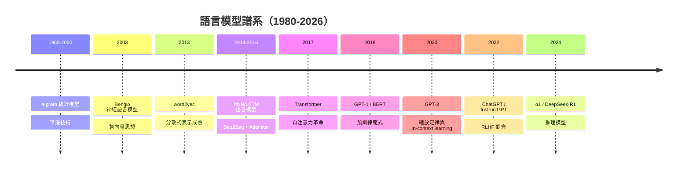
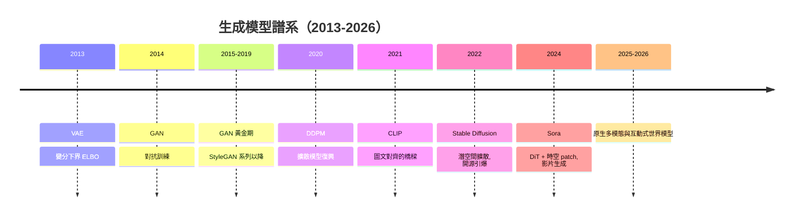
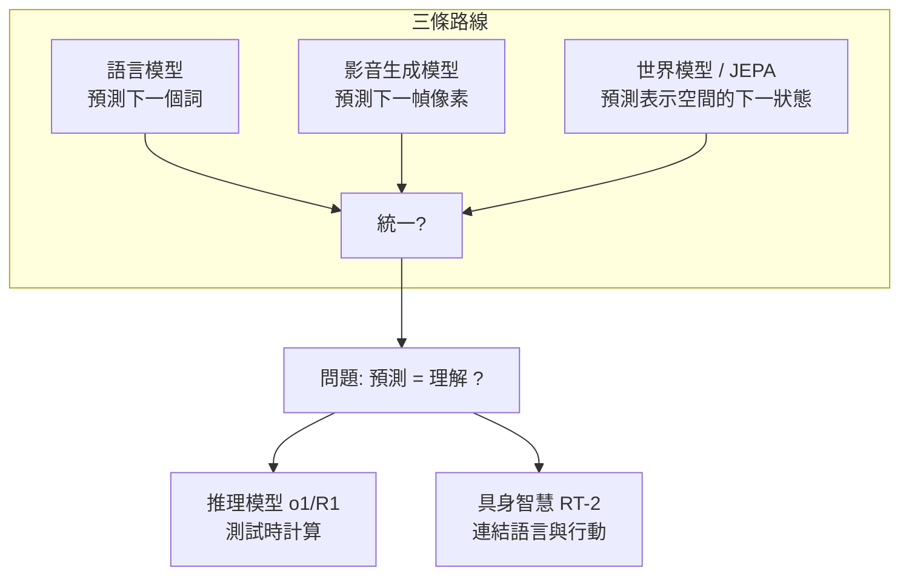
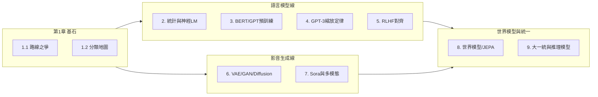

# 1.2 智慧模型的分類地圖：語言、影音、世界模型

## 一、從一條主線到三大領域

2012 年之後，深度學習迅速分裂成幾個應用領域：影像辨識（CNN）、語音（RNN/CTC）、自然語言（RNN→Transformer）、生成模型（GAN/VAE/Diffusion）、強化學習（RL）。這些領域各自發展，但在 2020 年代開始匯流——GPT-4V 能看圖、Sora 能生成影片、RT-2 能控制機器人。本節要建立一張「分類地圖」，讓讀者在進入各章之前，先看清整個疆域：**語言模型、影音生成模型、世界模型**三者各自的問題定義、技術譜系，以及它們彼此驅動的關係。

一個有用的框架是從「智慧模型要處理什麼、做什麼」來分類。任何智慧模型都可以放在兩個軸上：

- **輸入模態**：文字、圖像、影片、聲音、感測器狀態（物理世界）；
- **任務方向**：理解（分析、分類、預測）vs. 生成（產生新樣本）vs. 互動（在環境中行動）。

## 二、語言模型：從 $P(\text{下一個詞})$ 到通用智慧

### 2.1 問題定義

語言模型的目標是對文字序列的機率分佈建模。給定詞序列 $w_1, w_2, \dots, w_t$，模型學習：

$$
P(w_1, w_2, \dots, w_T) = \prod_{t=1}^{T} P(w_t \mid w_1, \dots, w_{t-1})
$$

這個「預測下一個詞」的目標看似簡單，卻蘊含驚人的深度：要預測「今天的天氣真___」，你需要語法；要預測「水的化學式是___」，你需要事實；要預測一段推理文字的下一步，你需要**推理能力**。語言模型的歷史，就是這個簡單目標逐步釋放出深層能力的歷史。

### 2.2 技術譜系

每一代的更替都由前一代的「痛點」驅動（各章詳述）：

- n-gram 的**稀疏性**問題 → 神經詞向量；
- RNN 的**長距離依賴與無法平行**問題 → Transformer；
- 標註資料不足 → **自監督預訓練**範式；
- 小模型能力有限 → **縮放定律**（scale is all you need）；
- 預訓練模型「不聽話」→ **RLHF 後訓練**；
- 快思考不夠深 → **測試時推理**（o1/R1）。

### 2.3 語言模型的地位

語言模型在智慧模型版圖中佔有特殊地位：**文字是人類知識最密集的載體**。網路上絕大多數知識以文字形式存在，因此語言模型成為第一個達到「通用」能力的模型——它能寫程式、翻譯、答題、推理，靠的只是「預測下一個詞」。這引出本書反覆出現的問題：預測文字是否等於理解世界？

## 三、影音生成模型：讓機器畫出世界

### 3.1 問題定義

生成模型的目標是學習資料分佈 $p_{\text{data}}(x)$，並從中採樣出新樣本。數學上，生成模型可以走兩條路：

- **顯式建模**：直接估計 $p_\theta(x)$（VAE、Diffusion）或 $p_\theta(x\mid z)$；
- **隱式建模**：學一個生成器 $G(z)$ 直接把雜訊映到樣本（GAN），不顯式給機率。

圖像生成的挑戰在於：資料分佈處於極高維空間（一張 512×512 圖像有約 78 萬維），且「像不像、好不好」極難用單一數值衡量。影片生成更是雪上加霜：增加了時間維度（資料量乘上百倍）與**時間一致性**要求（物體不能一閃一滅、動作必須連貫、必須遵守物理規律）。

### 3.2 技術譜系

驅動關係同樣清晰：

- VAE 提供了「**潛變數**」思想，但生成模糊 → GAN 用對抗訓練換取清晰度，但訓練不穩、模式崩潰；
- 擴散模型以穩定的訓練目標取代對抗訓練，但計算昂貴 → **潛空間（latent space）**壓縮解決（Stable Diffusion）；
- 文字如何控制圖像？→ **CLIP** 提供了圖文對齊的語義空間，成為文字到影像的橋樑；
- 圖像的成功架構（U-Net/擴散）如何擴展到影片？→ **DiT（Diffusion Transformer）+ 時空 patch**（Sora），而影片資料的規模化又直接依賴語言模型時代累積的基礎設施。

### 3.3 影音生成的深層難題

影片生成不只是「多幀圖像」。一個能生成連貫影片的模型，必須隱式學到：物體恆存性（object permanence）、剛體運動、光影一致性、因果關係。這正是第 8 章「世界模型」辯論的焦點：**能畫出物理世界的影片，是否代表理解了物理世界？**

## 四、世界模型：在「腦內」模擬世界

### 4.1 問題定義

世界模型（World Model）源自認知科學的「心智模型」概念，在 AI 中的技術定義是：學習環境的**動力學模型**，即預測「在狀態 $s_t$ 採取動作 $a_t$ 後，世界會變成什麼樣」：

$$
p(s_{t+1} \mid s_t, a_t), \qquad r = R(s_t, a_t)
$$

有了這樣的模型，智慧體可以在「腦內」進行模擬與規劃，而不必在真實環境中反覆試錯。這與強化學習中的 **model-based RL** 直接相關：model-free 方法（如 DQN）直接學策略，樣本效率低；model-based 方法先學環境模型，再用模型規劃或生成想像資料，樣本效率高得多。

### 4.2 與語言、影音模型的深刻關聯

世界模型與另外兩條路線的關係是本書後半部的主軸：

1. **語言模型是一種「文字世界模型」**：預測下一個詞，本質上是預測世界（透過文字中介）的下一個狀態。人類寫下的敘事本身就是對世界的壓縮描述。
2. **影片生成模型是一種「視覺世界模型」**：Sora 能生成物體遮擋後再出現、水面倒影正確的影片，暗示它學到了某種物理規律——但這是否等於「理解」？LeCun 對此強烈質疑。
3. **JEPA（Joint-Embedding Predictive Architecture）**是 LeCun 提出的第三條路：不預測像素（生成），而是在**抽象表示空間**中預測，跳過不可預測的細節，直取語義——他主張這才是通往真正世界模型的正道。

### 4.3 核心辯論：預測是否等於理解

本書將反覆回到這個問題。支持方（如 Sora 團隊、部分scaling派）認為：足夠好的預測必然要求內部具備世界的模擬器。反對方（LeCun、Marcus 等）指出：生成影片可以只靠「紋理與風格的統計」而違反物理（Sora 影片中杯子碎裂的方式錯誤、物體憑空出現），說明它學到的是「看起來像」而非「是」。

## 五、三大模型的匯流：2024-2026 的統一趨勢

2024 年之後，三條路線明顯匯流：

- **架構統一**：Transformer 成為所有模態的骨幹。ViT 把圖像切成 patch 當詞元；Sora 把影片切成時空 patch；語音、蛋白質、機器人動作同理。**「一切皆詞元（tokens）」**。
- **訓練範式統一**：自監督預測 + 大規模資料 + 縮放，成為通用配方。
- **任務統一**：Gato（2022）一個模型做六百種任務；GPT-4V 原生看圖；RT-2 把機器人控制變成「輸出動作詞元」的 VQA 任務。
- **推理統一**：o1/R1 證明「測試時計算（test-time compute）」是繼預訓練縮放之後的新縮放軸——用更多推理時間換取更深的思考。

這個「大一統」進程也帶來新問題：資料枯竭（高品質文字即將用盡）、算力成本、幻覺、對齊、以及最根本的——**縮放定律是否有終點**。這些將在第 9 章總結。

## 六、閱讀地圖

## 七、本節重點

1. 智慧模型可沿「模態 × 任務」兩軸分類；語言（文字）、影音（視覺）、世界模型（動力學）是三大主線。
2. 語言模型的統一目標是 $P(w_t \mid \text{前文})$，其演進由稀疏性、長依賴、資料不足、對齊等連環問題驅動。
3. 生成模型分顯式（VAE/Diffusion）與隱式（GAN）兩路；擴散模型勝在訓練穩定，潛空間技術解決了算力瓶頸，CLIP 連結了文字與影像。
4. 世界模型的核心是學環境動力學 $p(s_{t+1}\mid s_t,a_t)$，與 model-based RL 同源；「預測是否等於理解」是貫穿全書的核心辯論。
5. 2024-2026 年的統一趨勢：架構（Transformer）、範式（自監督+縮放）、任務（詞元化一切）、推理（測試時計算）全面匯流。

## 八、思考問題

1. 「預測下一個詞」與「預測下一幀像素」在資訊含量上有何本質不同？為什麼語言模型先展現出推理能力？
2. 如果把世界模型定義為「能回答反事實問題（如果……會怎樣）」的模型，Sora 算嗎？GPT 算嗎？
3. 你認為三大模型最終會合而為一，還是保持分工？各自的瓶頸是什麼？
4. 「一切皆詞元」的策略有什麼代價？哪些模態特別難以詞元化？
