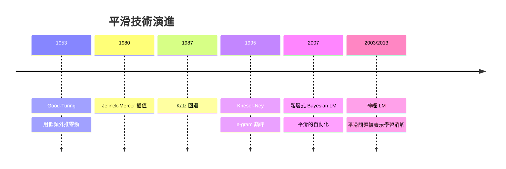

# 2.1 n-gram 語言模型與平滑技術（1980-2000）

## 一、歷史背景：統計方法進入語言

在 1980 年代之前，自然語言處理（NLP）由喬姆斯基（Noam Chomsky）的**生成語法**主宰：語言能力是人類天賦的符號規則系統，機器要處理語言，就應該解析出句子的語法樹。喬姆斯基在 1957 年《句法結構》中甚至宣稱「機率模型無法解釋語言」——這句話影響了語言學界數十年。

然而，語音辨識與機器翻譯的工程實踐者發現了殘酷的現實：**規則方法在真實語料面前不堪一擊**。口語有口音、語法錯誤、歧義，句法解析器在雜訊前脆弱無比。以賈里尼克（Frederick Jelinek）為首的 IBM 華生研究中心在 1970-80 年代掀起「統計革命」：既然不知道語言的確切規則，就用**機率**來建模語言。賈里尼克的名言——「每次我解僱一個語言學家，語音辨識器的性能就會上升」——道盡了兩大陣營的衝突。

統計語言模型的核心思想：**語言是機率過程，一個句子的好壞取決於它的機率**。這一思想是本書所有後續模型的共同起點——從某個意義上說，GPT 就是把 n-gram 的 $P(w_t \mid \text{前文})$ 按到底的產物。

## 二、語言模型的數學定義

### 2.1 鏈鎖法則與資料稀疏

語言模型的目標：估計句子 $w_1 w_2 \dots w_T$ 的機率。根據機率的鏈鎖法則，它總是可以分解為條件機率的連乘：

$$
P(w_1, \dots, w_T) = P(w_1)\,P(w_2 \mid w_1)\,P(w_3 \mid w_1, w_2) \cdots P(w_T \mid w_1, \dots, w_{T-1})
$$

理論上完美，實踐中致命：若詞彙表有 $V = 10^5$ 個詞，則長度為 $T$ 的句子的「前文歷史」組合數是 $V^{T-1}$ ——天文數字。任何有限語料都只會覆蓋其中極小的比例，**絕大多數條件機率 $P(w_t \mid w_1,\dots,w_{t-1})$ 根本沒有資料可估計**。這就是**資料稀疏問題（data sparsity）**，它是 n-gram 時代一切技術創新的驅動力。

### 2.2 馬爾可夫假設：n-gram 模型

解法是退而求其次：**假設下一個詞只依賴前 $n-1$ 個詞**（馬爾可夫假設）：

$$
P(w_t \mid w_1, \dots, w_{t-1}) \approx P(w_t \mid w_{t-n+1}, \dots, w_{t-1})
$$

- $n=1$ ：unigram，只看詞頻；
- $n=2$ ：bigram， $P(w_t \mid w_{t-1})$ ；
- $n=3$ ：trigram， $P(w_t \mid w_{t-2}, w_{t-1})$ ，工業標準。

估計方法就是**最大概似估計（MLE）——即統計計數**：

$$
P_{\text{ML}}(w_t \mid w_{t-2}, w_{t-1}) = \frac{C(w_{t-2}, w_{t-1}, w_t)}{C(w_{t-2}, w_{t-1})}
$$

其中 $C(\cdot)$ 是語料中的出現次數。語言模型的評分則用**困惑度（Perplexity）**：

$$
\mathrm{PPL} = \exp\left(-\frac{1}{T}\sum_{t=1}^{T} \log P(w_t \mid \text{context})\right)
$$

直觀地說，困惑度是「模型平均在多少個詞之間猶豫」。PPL 越低越好，至今仍是大語言模型評估的核心指標之一。

## 三、零機率危機與平滑技術

### 3.1 為什麼零機率是災難

MLE 有個致命缺陷：若某個 trigram 在訓練語料中從未出現，MLE 給它機率 0。而連乘中任何一項為 0，整句機率為 0——模型會武斷地宣稱一個完全合理的句子「不可能存在」。更糟的是，測試句中幾乎必然包含未見過的 n-gram（Zipf 定律：詞頻分佈極度長尾，大量詞只出現一兩次）。因此，**平滑（Smoothing）**技術——把機率質量從高頻事件分一些給未見事件——成為 n-gram 時代的研究主戰場。

### 3.2 平滑技術的演進

**（1）加法平滑（Add-one / Laplace Smoothing）**

$$
P_{\text{add}}(w_i \mid w_{i-1}) = \frac{C(w_{i-1}, w_i) + 1}{C(w_{i-1}) + V}
$$

最簡單，但過於粗暴：把大量機率分給從未見過的事件，對高頻事件的懲罰過重，實務效果差。改良版加 $\delta < 1$ （add-delta）稍好，但仍是粗糙的啟發式。

**（2）Good-Turing 估計（1953）**

用「見過一次的事件的數量」來估計「未見事件」的總機率質量。設 $N_c$ 為出現 $c$ 次的事件種類數，則出現 $c$ 次的事件改用調整計數：

$$
c^* = (c+1)\,\frac{N_{c+1}}{N_c}
$$

這是第一次有原則的方法：用觀察到的頻率分佈**外推**未見事件。Good-Turing 的「用低頻估計零頻」思想深遠，影響了後續所有平滑方法。

**（3）回退（Backoff, Katz 1987）與插值（Interpolation, Jelinek-Mercer）**

核心洞察：**高階模型資料不夠時，就向低階模型求助**。

- Katz 回退：若 trigram 有可靠計數就用 trigram；否則「回退」到 bigram，再不行退到 unigram，並按折扣係數保留機率歸一。
- Jelinek-Mercer 插值：將各階模型線性混合：

$$
P(w_t \mid \text{ctx}_2) = \lambda_3 P_3(w_t) + \lambda_2 P_2(w_t) + \lambda_1 P_1(w_t)
$$

插值比回退更平滑（永遠混合所有階層），回退更簡潔（只在必要時退）。

**（4）Kneser-Ney 平滑（1995）：實用之王者**

Kneser-Ney 是 n-gram 時代的巔峰，至今仍是許多任務上的最強 n-gram 平滑方法。兩個關鍵創新：

- **絕對折扣（absolute discounting）**：從每個計數中扣掉固定量 $D$ （而非按比例），因為高階計數的「不可靠性」近似常數；
- **連續詞（continuation）機率**：回退到低階時，不用詞的總頻率，而用「**這個詞前面出現過多少種不同的詞**」：

$$
P_{\text{cont}}(w) = \frac{\left|\{v : C(v, w) > 0\}\right|}{\sum_{w'}\left|\{v : C(v, w') > 0\}\right|}
$$

直觀理由：像 "Francisco" 這種詞，只會跟在 "San" 後面。若回退到 unigram，用總頻率會高估 $P(\text{Francisco} \mid \text{new})$ ；用連續詞機率則正確反映「它只在一種上下文出現」——即**多樣性比頻率更能預測回退行為**。這個洞察在神經時代仍有迴響（詞的「分佈特性」比原始頻率更有資訊量）。

## 四、n-gram 時代的成就與極限

### 4.1 成就

n-gram 語言模型是史上第一個大規模成功的統計 NLP 系統：

- **語音辨識**：n-gram LM 與聲學模型結合，是 1990 年代商業語音辨識的標準架構；
- **機器翻譯**：IBM 模型 1-5（1988-1993）加上 n-gram 語言模型，奠定統計機器翻譯（SMT）基礎；
- **輸入法與拼寫校正**：智慧輸入法的候選詞排序本質上就是一個 n-gram LM；
- Google 在 2006 年發布的萬億詞級 n-gram 語料，展示了「資料勝過技巧」的早期證據。

### 4.2 結構性極限

無論平滑多麼精巧，n-gram 有三個**無法在自身框架內解決**的問題：

**（1）上下文截斷**：馬爾可夫假設強行丟棄 $n$ 詞以外的所有歷史。「三年前我去過京都，那裡的___」——trigram 無法利用「京都」這個 15 詞之前的關鍵資訊。語言的長距離依賴（主謂一致、指代、篇章結構）被硬生生切斷。

**（2）離散性導致的泛化無能**：n-gram 中每個詞是獨立符號，模型只知道「"貓"和"狗"共同出現在某計數中」，卻不知道兩者語義相近。若語料有大量 "the cat sat" 而 "the dog sat" 只出現過一次，n-gram 無法將前者的統計遷移給後者。**相似詞之間的知識無法共享**——這是離散計數的本質缺陷。

**（3）指數膨脹**： $n$ 每加 1，參數量乘上 $V$ 。trigram 已達 $10^{15}$ 種組合，再往上毫無希望。

這三個極限精準地指向解藥：把詞從離散符號變成**連續向量**，把上下文從固定視窗變成**可學習的任意長度編碼**。這正是神經語言模型（2.2 節）的兩大使命。值得注意的是：神經模型並沒有「取代」平滑，而是用內插於連續空間的方式**消解**了平滑問題——相近的詞自動共享統計。

## 五、過渡：階層式與主題模型的啟示

在神經 LM 興起前，貝葉斯方法做了重要嘗試：pLSA（1999）與 LDA（2003）把文件建模為「主題的混合」，詞由主題生成，用狄利克雷先驗自動「平滑」。這些模型帶來的啟示——**詞的意義可以用低維潛在結構表示**——與詞向量思想一脈相承。同一時期，Hinton 的「分佈式表示」（distributed representation）哲學逐漸成熟：一個概念由多個維度共同編碼，概念之間的相似度體現為向量的距離。舊表示之爭（符號 vs 連結）在語言領域以「離散計數 vs 分佈式表示」的形式重演，而後者即將贏得這一局。

## 六、本節重點

1. 統計語言模型的革命在於：把「語言」建模為機率過程，用 $P(\text{句子})$ 取代語法規則。
2. 鏈鎖法則 + 馬爾可夫假設 = n-gram 模型；評估指標是困惑度 PPL。
3. 資料稀疏是 n-gram 的核心危機；平滑技術（Good-Turing → 插值/回退 → Kneser-Ney）是不斷精進的解藥，Kneser-Ney 的「連續詞機率」體現了多樣性勝過頻率的深刻洞察。
4. n-gram 的三大結構性極限——上下文截斷、離散性無泛化、指數膨脹——無法在計數框架內解決，直接催生了神經語言模型。
5. 「平滑」在神經時代沒有消失，而是被連續向量空間的內插性質自動實現。

## 七、思考問題

1. Kneser-Ney 用「前驅詞多樣性」取代頻率，這個思想能否類比到神經語言模型？例如詞向量的學習是否也隱式地利用了「上下文多樣性」？
2. 馬爾可夫假設錯在哪裡？Transformer 的自注意力是「有界的馬爾可夫」還是真正突破了它？
3. 困惑度低是否必然代表模型更好？一個 PPL 很低但生成文本空洞的模型可能存在嗎？
4. 若給你 10 億詞語料與無限算力，你會把 n-gram 做到 $n=6$ 還是訓練一個神經 LM？依據是什麼？
