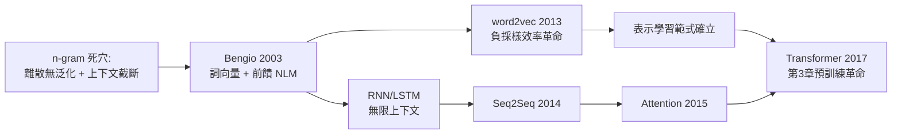

# 2.2 神經語言模型：詞向量 word2vec 與 RNN-LM（2003-2016）

## 一、歷史背景：用向量取代計數

2.1 節指出 n-gram 的兩大死穴：離散符號之間無法泛化、上下文被硬性截斷。神經語言模型（Neural Language Model, NLM）正是針對這兩點的精準反擊，其歷史有三個里程碑：

1. **2003 年**，Bengio 等人發表《A Neural Probabilistic Language Model》，首次系統性地提出「學習詞的分散式表示 + 神經網路預測下一詞」的完整架構；
2. **2013 年**，Mikolov 等人的 **word2vec** 把詞向量訓練簡化到可以在普通機器上跑大語料，引爆「詞嵌入」全民應用；
3. **2014-2016 年**，RNN/LSTM 語言模型在多項任務上超越 n-gram，Seq2Seq + Attention 為 Transformer 鋪路。

這一時期建立了現代語言模型的全部基本概念——embedding、softmax 下一詞預測、困惑度評估、序列建模——只是還缺「大規模預訓練+縮放」這最後一塊拼圖。

## 二、Bengio 2003：神經概率語言模型

### 2.1 架構

Bengio 2003 模型的核心想法：**詞向量查表 + 前饋網路**。給定前 $n-1$ 個詞，模型為：

$$
\begin{aligned}
x &= [E(w_{t-n+1}), \dots, E(w_{t-1})] \quad &\text{(詞向量串接)}\\
h &= \tanh(W x + b) \quad &\text{(隱藏層)}\\
P(w_t = i \mid \text{ctx}) &= \mathrm{softmax}(U h + d)_i \quad &\text{(輸出分佈)}
\end{aligned}
$$

其中 $E \in \mathbb{R}^{V \times d}$ 是**詞嵌入矩陣（embedding matrix）**：每一行是一個詞的向量表示， $d$ 通常為 50-300 維。 $E$ 不是人工特徵，而是隨模型一起用梯度下降端到端學出來的。

### 2.2 為什麼這一招同時解決了兩大死穴

**（1）泛化機制：連續空間中的自動平滑**

在離散 n-gram 中，"cat" 與 "dog" 是兩個毫無關係的符號。但在嵌入空間中，語義相近的詞的向量彼此接近。若訓練語料中 "the cat sat" 常見而 "the dog sat" 罕見，由於 $E(\text{cat}) \approx E(\text{dog})$ ，兩者的網路輸入幾乎相同，網路輸出自然相近——**統計知識自動在相近詞之間共享**。形式上，神經 LM 對條件機率做的是連續函數近似：

$$
P(w_t \mid \text{ctx}) \approx f_\theta(E(\text{ctx}))
$$

$f_\theta$ 若是平滑函數，相近輸入必得相近輸出——這正是「平滑」二字在向量空間中的新生。n-gram 時代的平滑技術不再是手工補丁，而是表示學習的副產品。

**（2）表示的結構性**

詞向量不是一個熱（one-hot）編碼（ $V$ 維、彼此正交、無相似度可言），而是 $d$ 維密集向量。 $d \approx 100$ 的向量可以表達遠多於 $V \approx 10^5$ 個正交符號所能表達的結構——每個維度承擔一部分語義（性別、單複數、領域……），概念被**分解**到連續維度上。這就是「分佈式表示」的具體化。

### 2.3 計算瓶頸

Bengio 2003 的最大障礙是 softmax：對每個訓練樣本，都要對整個詞彙表 $V$ 計算正規化項，成本 $O(Vd)$ 。當 $V = 10^5$ 時，這佔了絕大部分計算。當時的解法（短列表、階層式 softmax 的前身）都不夠徹底，導致模型只能在小語料上訓練，效果不足以全面超越調校極致的 Kneser-Ney n-gram。**表示學習的概念已經證明，但規模化的工程還未到位**——這個瓶頸等了十年才被 word2vec 打破。

## 三、word2vec（2013）：效率革命與類比奇蹟

### 3.1 跳出語言模型框架：預測即學習

Mikolov 等人的關鍵一步：**如果目標只是學好詞向量，就不需要複雜的深度網路**。word2vec 提出兩種極簡架構：

- **CBOW**：用上下文詞向量的平均預測中心詞；
- **Skip-gram**：用中心詞預測每個上下文詞。

訓練目標（Skip-gram，以 softmax 形式）：

$$
\max_\theta \sum_{t} \sum_{-c \le j \le c, j \ne 0} \log \frac{\exp(v_{w_t}^{\top} u_{w_{t+j}})}{\sum_{w' \in V} \exp(v_{w_t}^{\top} u_{w'})}
$$

配合兩大工程絕技把 $O(V)$ 的 softmax 打下來：

- **負採樣（Negative Sampling）**：不做完整 softmax，只對目標詞與 $k$ 個隨機抽的「負例」做二分類。目標退化为「區分真實搭配與隨機搭配」，計算量從 $O(V)$ 降到 $O(k)$ 。數學上可證明它近似優化 NCE（Noise Contrastive Estimation）目標；
- **層次 softmax**：用 Huffman 樹把 $O(V)$ 分解為 $O(\log V)$ 。

### 3.2 國王 − 男人 + 女人 ≒ 女王：線性結構的發現

word2vec 訓練出的向量展現了震驚學界的性質：**語義關係在向量空間中近似線性**：

$$
v_{\text{king}} - v_{\text{man}} + v_{\text{woman}} \approx v_{\text{queen}}
$$

以餘弦相似度做向量運算，可以回答「男人之於國王，如同女人之於___」這類類比題。這說明模型從「哪些詞常一起出現」這一純粹的統計中，無監督地學出了性別、時態、國家—首都等抽象關係。

理論解釋由 Levy 與 Goldberg（2014）給出：**Skip-gram with Negative Sampling 隱式地分解了「逐點互資訊（PMI）」矩陣**：

$$
v_w^{\top} v_c \approx \log \frac{P(c \mid w)}{P(c)} - \log k = \mathrm{PMI}(w, c) - \log k
$$

這個「word2vec = 分解共現統計矩陣」的定理極其重要：它把神經詞向量與 1950 年代 Harris 的分佈假說（distributional hypothesis，「詞義由其上下文定義」）與潛在語義分析（LSA, 1990）直接連起——**神經方法並未發明新資訊源，只是用更好的幾何結構重組了同樣的統計**。GloVe（2014）則直接以「重構 $\log$ 共現矩陣」為目標，從另一頭殊途同歸。

### 3.3 影響與後果

word2vec 的影響遠超 NLP：詞向量成為 2013-2017 年所有 NLP 系統的標配第一層；推薦系統的 item embedding、圖像的 patch embedding、圖網路的 node embedding 全部仿效「自監督預測學表示」的範式。更重要的是它確立了一條信念：**好的表示可以完全由自監督目標學出，無需標註**——這是 2018 年預訓練革命的直接思想前驅。

但詞向量也有明顯極限：**每個詞只有一個向量**。"bank" 在河岸與銀行語境中應有不同表示，靜態向量無能為力（一詞多義問題）；且詞向量只是特徵，還需搭配序列模型才能做真正的語言建模——這就輪到 RNN 登場。

## 四、RNN 語言模型：無限上下文的第一步

### 4.1 循環結構與截斷 BPTT

前饋 NLM 仍受固定視窗 $n$ 限制。**循環神經網路（RNN）**用隱狀態把任意長的歷史壓縮進一個固定向量：

$$
h_t = \tanh(W_x x_t + W_h h_{t-1} + b), \qquad P(w_{t+1} \mid w_{\le t}) = \mathrm{softmax}(W_o h_t)
$$

訓練用「隨時間反向傳播（BPTT）」，實務上做截斷（truncated BPTT，視窗 20-200 步）。RNN 從理論上可表達任意長的依賴（圖靈完備），首次突破了馬爾可夫截斷。

### 4.2 梯度消失與 LSTM/GRU

然而樸素 RNN 在長序列上訓練失敗：BPTT 中梯度要連乘 $\prod_t \frac{\partial h_t}{\partial h_{t-1}}$ ，若 $\|W_h\| < 1$ 則梯度指數衰減（梯度消失），遠處的資訊學不到；若 $>1$ 則爆炸。Hochreiter 與 Schmidhuber 的 **LSTM（1997）**用「閘門 + 細胞狀態」解決：

$$
\begin{aligned}
f_t &= \sigma(W_f [h_{t-1}, x_t] + b_f) &\text{(遺忘閘)}\\
i_t &= \sigma(W_i [h_{t-1}, x_t] + b_i) &\text{(輸入閘)}\\
c_t &= f_t \odot c_{t-1} + i_t \odot \tanh(W_c [h_{t-1}, x_t]) &\text{(細胞狀態)}\\
o_t &= \sigma(W_o [h_{t-1}, x_t] + b_o) &\text{(輸出閘)}\\
h_t &= o_t \odot \tanh(c_t)
\end{aligned}
$$

關鍵在 $c_t$ 的更新是**加法**（ $f_t \odot c_{t-1} + \dots$ ）而非矩陣乘法：梯度可以沿「細胞狀態高速公路」近乎無衰減地流動（遺忘閘接近 1 時）。2014 年的 GRU 是其簡化版。2014-2016 年，LSTM 語言模型在 Penn Treebank、WikiText 等基準上全面超越 Kneser-Ney n-gram，Google 翻譯 2016 年也切換到 LSTM Seq2Seq。

### 4.3 Seq2Seq 與 Attention：通往 Transformer 的最後一階

2014 年 Sutskever 等人的 **Seq2Seq** 用兩個 LSTM（編碼器—解碼器）做機器翻譯，但發現把整句壓縮成一個固定向量是瓶頸——正如把整本書塞進一句摘要。2015 年 Bahdanau 等人提出**注意力機制**：解碼器每一步不再只看一個摘要向量，而是對編碼器所有隱狀態做加權組合：

$$
e_{t,s} = v^{\top}\tanh(W_q h_t^{\text{dec}} + W_k h_s^{\text{enc}}), \quad \alpha_{t,s} = \mathrm{softmax}_s(e_{t,s}), \quad c_t = \sum_s \alpha_{t,s} h_s^{\text{enc}}
$$

「注意力讓模型直接存取任意位置的資訊，權重可學習」——這個機制在 2017 年被 Karpathy 等人驚人地發現：**在圖像字幕任務中，注意力權重自動對齊到圖像中的對應物體**，模型無監督地學出了視覺定位。注意力如此強大，以至於 2017 年《Attention Is All You Need》乾脆把 RNN 整個丟掉，只留注意力——那是第 3 章之前的故事，但思想根源已經完備。

## 五、本節重點

1. Bengio 2003 用「詞嵌入 + 神經網路」同時解決 n-gram 兩大死穴：連續空間使相近詞共享統計（自動平滑），分佈式表示提供結構化語義。
2. word2vec 以負採樣把訓練成本從 $O(V)$ 降到 $O(k)$ ，是表示學習規模化的關鍵；King−Man+Woman≈Queen 的線性結構證明統計共現中蘊含抽象語義。
3. Levy-Goldberg 定理揭示 word2vec 本質是 PMI 矩陣分解，把神經詞向量接到 70 年的分佈假說傳統。
4. RNN 用隱狀態突破馬爾可夫截斷，LSTM 用加法式的細胞狀態解決梯度消失；Seq2Seq+Attention 補上「直接存取任意位置」的能力，直通 Transformer。
5. 這一時期確立了現代 LM 的所有基本要素：embedding、下一詞預測、自監督、困惑度——只差「縮放」。

## 六、思考問題

1. 一詞多義是靜態詞向量的死穴。Transformer 的「上下文相關表示」如何解決它？這個解決方案的計算代價是什麼？
2. 負採樣把「完整分佈估計」簡化為「真假判別」，這種簡化損失了什麼資訊？在哪些任務上會出問題？
3. LSTM 的閘門機制與 Transformer 的注意力，哪個更接近人類記憶的運作？各有哪些動物大腦證據支持？
4. 若 word2vec 的線性結構來自共現統計的矩陣分解，那麼 GPT 的「線性語義結構」來自哪裡？兩者有何質的差別？
