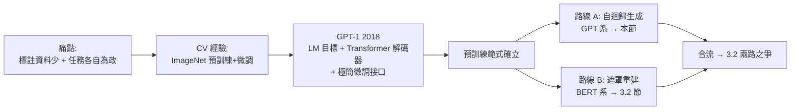

# 3.1 GPT-1 與自迴歸預訓練：生成路線（2018）

## 一、歷史背景：差異微調的痛點

2017 年之前的深度學習 NLP 有一個尷尬的現狀：詞向量（word2vec/GloVe）雖然解決了「表示」問題，但它只是**靜態特徵**。要做好情感分析、問答、命名實體識別，每個任務仍需：設計任務專屬架構（BiLSTM+CRF、attention 結構各異）、從零訓練（或只初始化 embedding 層）、準備大量**標註資料**。

這帶來兩個結構性問題：

1. **標註資料瓶頸**：網路語料近乎無限，但標註資料昂貴稀缺。模型只能「用一碗水的標註資料，學一個需要一池水的任務」。
2. **知識不共享**：每個任務各自從零學習，模型 A 在翻譯中學到的語法知識，模型 B 做分類時一無所用。

電腦視覺早已示範了答案：**ImageNet 預訓練 + 下游微調**。CV 圈在 2014 年之後的標準流程是「在 ImageNet 上預訓練 CNN，再在目標任務上微調最後幾層」。這個範式在 NLP 遲遲無法複製，原因在於語言是離散的、序列的、雙向的，ImageNet 式的「分類預訓練」無法直接照搬。

2018 年，兩篇論文分別給出兩種解法，開啟了「預訓練革命」：**GPT-1**（2018.6，OpenAI）選擇**自迴歸生成**路線，**BERT**（2018.10，Google）選擇**遮罩重建**路線。本節講 GPT-1，3.2 節講 BERT 與路線之爭。

## 二、GPT-1：生成式預訓練（GPT = Generative Pre-Training）

### 2.1 核心配方：三個舊要素的新組合

GPT-1 的論文題目《Improving Language Understanding by Generative Pre-Training》精確概括了其貢獻——不是發明新架構，而是**把現有要素組合成新範式**：

1. **架構**：只用 Transformer **解碼器**（12 層、768 維、12 頭、約 1.17 億參數），採用**遮罩自注意力**確保每個位置只能看左邊——因為生成任務不能偷看未來；
2. **預訓練目標**：語言模型目標，即最大化對數概似：

$$
\mathcal{L}_{\text{LM}} = \sum_t \log P(w_t \mid w_1, \dots, w_{t-1}; \Theta)
$$

3. **資料**：BooksCorpus（約 7000 本未出版書籍，約 800M 詞元）——選擇長篇連貫文本是刻意為之，短文檔（如網頁片段）缺乏長距離依賴，學不出篇章推理。

### 2.2 兩階段範式：預訓練 + 微調

**第一階段（預訓練）**：在上面目標上訓練很久，學到一個「通用的語言理解器」。這一階段**完全無標註**——任何文字都是訓練資料，這就是「自監督」。

**第二階段（微調）**：把預訓練模型接到任務上。GPT-1 的巧思是**極簡任務接口**：所有任務都轉成「一段文字序列進、一個（或幾個）輸出出」，在句首加特殊 token `<start>`，句尾加 `<extract>`，用 `<extract>` 位置的向量接線性層做分類：

$$
P(y \mid \text{seq}) = \mathrm{softmax}(W_y \, h_{\text{last}})
$$

微調時優化組合目標：

$$
\mathcal{L} = \mathcal{L}_{\text{task}} + \lambda \, \mathcal{L}_{\text{LM}}
$$

保留 LM 損失作為輔助項，可改善泛化並加速收斂。

### 2.3 成果：12 項任務、9 項 SOTA

GPT-1 在自然語言推論、問答、語義相似度、文本分類等 12 個資料集上，有 9 個取得當時最佳成績（例如 SNLI 提升 5.8%）。關鍵結論：**zero-shot 的預訓練模型就已經超過許多專門設計的架構**（如 relation extraction 任務上，不做微調直接用，也勝過一堆手工設計的系統）。這證明：預訓練學到的是**通用語言知識**，而非任務特異技巧。

### 2.4 特徵探測：預訓練學到了什麼

論文中一個精妙的分析：在下游任務中固定預訓練層、只用線性探測器（linear probe）讀出特徵，效果同樣很好。且不同層的探測表現顯示出**層級分工**：低層偏詞法與局部語法，高層偏語義與長距離依賴。這是「深度表示 = 逐層抽象特徵階梯」在 NLP 上的首度直接驗證，也預示了後來 probing 研究的繁榮。

## 三、範式意義：兩個基本假說的確立

GPT-1（連同同期 ELMo、下一節的 BERT）確立了後來被 ACL 2019 主題演講總結為「ImageNet 時刻」的範式，其背後是兩個假說：

**（1）知識假說**：語言的深層結構與世界知識，可以從大規模未標註文本中自監督地學出。標註資料只負責「告訴模型任務格式」，知識本身來自預訓練。

**（2）遷移假說**：預訓練學到的表示是通用的，微調只是在其上做小幅調整。因此 NLP 的研究重心從「設計任務架構」轉向「設計預訓練目標與擴大規模」。

### 3.1 GPT-1 的自我限制

GPT-1 選擇「從左到右」的自迴歸架構，有其內在張力：**理解任務需要看全文，但生成式架構每個位置只能看左邊**。GPT-1 的微調接口是繞過問題（只在最後位置讀出），但根本矛盾還在。這個張力正是 BERT 登場的伏筆——BERT 直接放棄生成目標，換取雙向理解。而另一方面，自迴歸路線保留了「生成」能力，這在當時看似只是附帶技能，卻在兩年後（GPT-3）反轉為決定性優勢：**能生成，才能做 in-context learning；能續寫，才能不微調地完成任務**。路線之爭的種子在這裡就已埋下。

## 四、技術細節補充

### 4.1 為什麼用 Transformer 解碼器而非 RNN

- **平行性**：RNN 必須逐步計算，GPU 利用率低；自注意力對全序列平行計算，訓練吞吐量大增，使「更多資料+更多層」可行；
- **長距離依賴**：任意兩位置直接相連（路徑長度 1），RNN 是 $O(n)$；
- 2017 年 Transformer 論文已證明其機器翻譯效果，GPT-1 直接繼承。

### 4.2 訓練配置（作為時代標本）

- Adam、batch 64、每輪最多 50000 步；學習率暖身 + 餘弦衰減；
- BPE（byte-pair encoding）子詞分詞，緩解詞彙表爆炸與未登錄詞；
- GELU 活化、Dropout 0.1、LayerNorm 前置（GPT-2 起改 pre-LN，訓練更穩）。

這些細節的價值在於看清：**GPT-1 的每個組件都是已知的，革命在於「組合+目標選擇+資料選擇」**。這是深度學習史上反覆出現的模式：範式轉移往往不靠單一新發明，而靠既有積木的正確拼裝。

## 五、與 ELMo 的對照

同期（2018.2）的 ELMo 用雙向 LSTM 分別從左右掃描、把兩個方向的隱狀態拼接作為上下文詞向量。ELMo 是「特徵式」（下游需自訂架構），GPT 是「微調式」（同一模型、同一接口處理一切任務）。微調式最終勝出，因為它把「用模型」的成本降到最低，且所有任務參數共享。但 ELMo 的「雙向」思想被 BERT 繼承併發揚——兩條亡靈在 2018 年合體成兩大陣營。

## 六、本節重點

1. 2018 年前的 NLP 痛點是標註資料瓶頸與任務孤島；CV 的「預訓練+微調」範式是現成答案，GPT-1 將其成功移植到 NLP。
2. GPT-1 配方：Transformer 解碼器 + 純 LM 自監督目標 + 長篇連貫語料 + 極簡微調接口；12 項任務 9 項 SOTA。
3. 「零標註的預訓練模型已勝過專門架構」證明了通用語言知識可自監督習得，確立知識假說與遷移假說。
4. 自迴歸（只看左邊）與理解任務（需看全文）存在張力——這是 BERT 的出發點，也是未來 in-context learning 的伏筆。
5. GPT-1 無新發明，革命在組合：範式轉移靠積木的正確拼裝。

## 七、思考問題

1. 如果 2018 年你在 OpenAI，你會把賭注壓在自迴歸（GPT）還是遮罩重建（BERT）？當時的證據分別支持哪一邊？
2. GPT-1 保留 $\lambda\mathcal{L}_{\text{LM}}$ 輔助損失有什麼好處？到了 GPT-3 之後為什麼乾脆不再需要微調？
3. 「用 BooksCorpus（書）而非網頁」這個資料選擇說明了什麼？資料的「連貫性」與「數量」該如何取捨？
4. 特徵探測顯示層級分工，那麼「模型第幾層承擔推理」對後來的思維鏈研究有何啟示？
