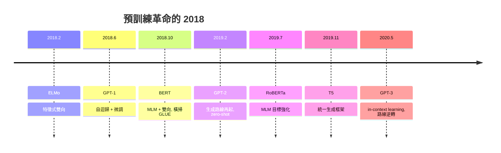

# 3.2 BERT 與遮罩語言模型：理解路線（2018）與兩條路線之爭

## 一、歷史背景：GPT 的「單向枷鎖」

3.1 節末尾指出 GPT-1 的內在張力：自迴歸模型每個位置只能看左邊，但「理解」任務（分類、問答、指代消解）需要整合**全文**資訊。一個明顯的思想實驗：人類理解「他去了銀行，因為要存款」中的「銀行」，需要右邊的「存款」來消歧——單向語言模型在預測「銀行」一詞時只能靠左文。

2018 年 10 月，Google 的 Devlin 等人發表 **BERT（Bidirectional Encoder Representations from Transformers）**，正面攻擊這個痛點：乾脆不做生成，用**雙向**的 Transformer 編碼器 + **遮罩語言模型（Masked Language Model, MLM）**目標，換取最強的雙向理解表示。結果是橫掃：GLUE 基準提升 7.7 個點、SQuAD v1.1 超越人類、11 項任務 SOTA。2019 年，BERT 部署進 Google 搜尋，是 Transformer 第一次觸及十億級用戶。

BERT 的成功在當時是壓倒性的——以至於 2018-2019 年，學界普遍認為「遮罩重建」路線打敗了「自迴歸」路線。這個判斷在兩年後被 GPT-3 完全逆轉，而這次逆轉的原因與教訓，是本節的重點之一。

## 二、BERT 的技術核心

### 2.1 遮罩語言模型（MLM）

BERT 的預訓練目標靈感來自「完形填空（Cloze）」：隨機遮住輸入中 15% 的詞元，讓模型用**上下文（左右都看）**預測被遮的詞：

$$
\mathcal{L}_{\text{MLM}} = \sum_{i \in M} -\log P(w_i \mid \tilde{w}_{[1..n]}; \Theta)
$$

其中 $M$ 是被遮位置的集合，$\tilde{w}$ 是遮罩後的序列。與 GPT 的 $P(w_t \mid w_{<t})$ 相比，MLM 的條件包含雙向資訊，因此學到的表示是「深度雙向」的。

**15% 遮罩的細節**（重要工程智慧）：若全部換成 `[MASK]` token，會造成預訓練與微調的分佈不匹配（微調時輸入裡沒有 `[MASK]`）。BERT 的做法是對選中的 15%：80% 換成 `[MASK]`、10% 換成隨機詞、10% 保持原詞。這強迫模型不能只記住「有 `[MASK]` 的位置要猜」，而要對每個位置都保持懷疑。

### 2.2 下一句預測（NSP）與輸入表示

許多任務（問答、自然語言推論）需要理解**句子對**的關係。BERT 加入第二個目標：給句子對 $(A, B)$，判斷 $B$ 是否真的是 $A$ 的下一句（50% 真、50% 隨機）：

$$
\mathcal{L}_{\text{NSP}} = -\log P(\text{IsNext} \mid A, B)
$$

輸入表示的設計（後來成為所有後續模型的模板）：

```
[CLS] 句A的詞元... [SEP] 句B的詞元... [SEP]
```

- `[CLS]` 位置的最終隱狀態作為「整句/句子對」的彙總表示，用於分類；
- 詞元嵌入 + 段落嵌入（segment embedding，標記屬於 A 還是 B）+ 位置嵌入，三者相加。

### 2.3 模型規格與微調

- BERT-Base：12 層、768 維、12 頭、110M 參數（刻意與 GPT-1 同級，便於公平對比）；
- BERT-Large：24 層、1024 維、16 頭、340M 參數；
- 資料：BooksCorpus + 英文維基百科（約 3.3B 詞元，比 GPT-1 大近 4 倍）。

微調只需在 `[CLS]`（分類）或 start/end span（抽取式問答）上加一個輸出層，端到端訓練 2-4 個 epoch 即可——**同一個預訓練模型、極小的任務專屬參數、極少的微調成本**，這個「即插即用」體驗引爆了全行業採用。2019 年的變體（RoBERTa、ALBERT、ELECTRA、中文版）不斷刷新紀錄，BERT 一度成為 NLP 的代名詞。



## 三、兩條路線之爭：MLM vs 自迴歸

### 3.1 理論對比

| 面向 | BERT（MLM） | GPT（自迴歸） |
|---|---|---|
| 條件方向 | 雙向（上下文） | 單向（左看） |
| 每詞元訓練信號 | 只在 15% 被遮位置 | 每個位置都有 |
| 生成能力 | 無（需要外加解碼器） | 原生 |
| 期望損失訓練效率 | 高（猜中的難度集中在難詞） | 低（常見詞貢獻低資訊量） |
| 統計依賴 | 遮罩位置**條件獨立**（近似） | 嚴格聯合分佈分解 |
| 下游接口 | 微調為主 | 微調 or 零樣本續寫 |

關鍵的理論分歧在最後一點：**BERT 的 MLM 目標不是一個真正的機率模型**。因為各遮罩位置在給定上下文時被視為條件獨立，BERT 無法給出一個序列的聯合機率 $P(w_1,\dots,w_n)$，也就無法直接計算困惑度、無法生成、無法做「以文字為接口」的任何任務。GPT 則嚴格建模聯合分佈：

$$
P(w_1,\dots,w_n) = \prod_t P(w_t \mid w_{<t})
$$

在 2018 年，這個缺陷看起來無關緊要——大家要的是「理解」。但 2020 年 GPT-3 證明：**只要模型夠大，把聯合分佈學好，理解可以從生成中湧現**；而反過來，BERT 的雙向優勢卻無法轉化為生成能力。不對稱的交換性決定了勝負：生成可以攜帶理解，理解不能憑空變出生成。

### 3.2 GPT-2（2019）：生成路線的中場哨聲

在 BERT 橫掃與 GPT-3 稱霸之間，GPT-2（2019.2）是關鍵的「信念之躍」：參數 1.5B（GPT-1 的 13 倍）、資料 WebText（40GB 高品質網頁，以出站連結品質過濾 Reddit karma），並提出大膽主張：**LM 目標理論上可以學會任何任務**，因為任務（及其解答）本身就出現在訓練文字之中（論文標題：Language Models are Unsupervised Multitask Learners）。GPT-2 開始展示零樣本能力（問答、翻譯、摘要的雛形），其「聯合分佈涵蓋一切任務條件分佈」的論證——

$$
\text{若 } (x, y) \text{ 作為文字出現於語料，則 } P(y \mid x) \text{ 必然是 } P(\text{text}) \text{ 的一部分}
$$

——成為縮放路線的理論基石。GPT-2 因「假新聞風險」採取分階段釋出模型，也開啟了 AI 安全與開源政策的長期爭議。

### 3.3 逆轉的教訓

2019-2020 年的路線逆轉給出三條元教訓：

1. **基準誤導**：GLUE/SQuAD 這類「理解基準」獎勵的是微調表現，遮罩路線天然占優；但真正的戰場是「通用能力與資料效率」，這是生成路線的主場。**評估指標決定了你看到的真相**。
2. **能力可組合，缺陷不可逆**：MLM 的條件獨立近似在模型小時影響不大，但隨規模放大，其「無法生成、無法建模完整分佈」的缺陷是指數級的機會成本。
3. **目標函數決定上限**：LM 目標涵蓋所有「文字可表達的任務」，MLM 只涵蓋「填空」。縮放放大目標的覆蓋面差異。

## 四、BERT 路線的遺產

BERT 並未消失，而是轉入適合的生態位：**表示與檢索**。 Sentence-BERT、雙塔檢索、後來的 embedding 模型（OpenAI text-embedding 系列）幾乎都基於編碼器架構；中文 NLP 工業界長期以 BERT 系為主力；2020 年 DeBERTa 在 SuperGLUE 上超越人類，證明 MLM 路線在「純理解」上仍是強者。此外，2021 年 Google 的 T5 把「一切任務皆文字到文字」統一起來（span corruption 作為統一遮罩目標），試圖兼併兩路，但也從側面證明：**最終統一語言的是「文字進、文字出」，而不是「特徵進、標籤出」**——這仍是生成範式的勝利。

## 五、本節重點

1. BERT 用 MLM（完形填空）+ NSP + 雙向編碼器換取最強理解表示；15% 遮罩中 80/10/10 的混合是避免訓練—微調分佈失配的關鍵工程。
2. `[CLS]` + 極簡微調接口讓 BERT 即插即用，2018-2019 年稱霸 NLP，並第一次把 Transformer 推向億級用戶產品。
3. 兩條路線的本質分歧：MLM 學「條件獨立的填空」，不是機率模型；自迴歸嚴格分解聯合分佈，能生成、能 zero-shot。
4. GPT-2 提出並驗證「LM 目標涵蓋一切任務」的論證；GPT-3 以規模證明生成路線可以吸收理解能力，路線逆轉。
5. 元教訓：評估基準決定你看到的真相；目標函數的覆蓋面在縮放下被指數級放大；BERT 轉入檢索/嵌入生態位繼續存活。

## 六、思考問題

1. MLM 的「遮罩位置條件獨立」假設，在哪些現象上會系統性地出錯？請設計一個被 BERT 學不好的語言現象。
2. 若 2018 年你只能押一條路線，用「目標覆蓋面」論證你的選擇；再反過來論證另一條路線在 2018 年的合理性。
3. 「任務與解答都出現在訓練文字中」——這個論證對「模型學到的是知識還是模式」的辯論有何含義？
4. BERT 式雙向表示對「檢索增強生成（RAG）」時代有何新價值？編碼器路線會在 LLM 時代迎來第二春嗎？
