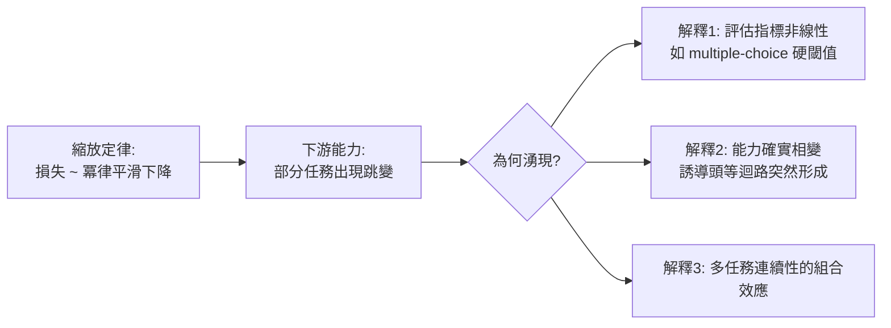

# 4.1 GPT-3 與 In-context Learning、湧現能力（2020）

## 一、歷史背景：賭注加大，賽道翻轉

到 2019 年底，NLP 的兩條路線已見分曉：BERT 稱霸理解基準，GPT-2 展示了生成路線的潛力但尚未證明其通用性。OpenAI 在 2020 年 5 月端出 **GPT-3**：1750 億參數——GPT-2 的 116 倍、BERT-Large 的 500 餘倍——訓練資料約 3000 億詞元（經過濾的網頁、書籍、維基、程式碼）。這是當時人類訓練過最大的神經網路，也是一次豪賭：**如果縮放不能帶來質變，數千萬美元的訓練成本將證明這條路是死路**。

結果是徹底的勝利，且帶來兩個超出所有人預期的發現：

1. **In-context Learning（ICL，情境中學習）**：不需要任何梯度更新，模型僅憑提示中的幾個範例就能執行新任務；
2. **湧現能力（Emergent Abilities）**：許多能力（如多位數算術）在小模型上幾乎為零，在某個規模之後突然出現。

GPT-3 論文《Language Models are Few-Shot Learners》的標題直接回應了 GPT-2 的《Language Models are Unsupervised Multitask Learners》：從「無監督多工」升級為「少樣本學習者」——**模型本身變成了一個學習器，提示詞就是它的教材**。

## 二、GPT-3 的技術配置

### 2.1 規模與資料

| 模型 | 參數 | 層數 | 維度 | 頭數 |
|---|---|---|---|---|
| GPT-1 | 117M | 12 | 768 | 12 |
| GPT-2 | 1.5B | 48 | 1600 | 25 |
| GPT-3 | 175B | 96 | 12288 | 96 |

訓練資料混合（Weighted mix）：Common Crawl（過濾後佔大宗，60%）、WebText2（22%）、Books1/2（16%）、Wikipedia（3%）。重要細節：**CC 是低品質但海量，被下採樣權重**；高品質資料重複多次。「資料品質加權混合」從此成為大模型預訓練的標準操作。

### 2.2 架構微調

架構上 GPT-3 與 GPT-2 幾乎相同（Transformer 解碼器、pre-LN），只有小改動（交錯 dense/sparse attention 中的局部帶狀稀疏注意力，後來的版本其實多數也放棄了稀疏）。這再次印證：**架構不是瓶頸，規模才是**。

## 三、In-context Learning：範式級發現

### 3.1 三種模式

GPT-3 定義了三種使用模式，以翻譯任務為例：

- **Zero-shot**：`請把英文翻成法文: "cheese" =>` —— 無範例；
- **One-shot**：給一組範例 `"sea otter" => "loutre de mer", "cheese" =>`；
- **Few-shot**：給多組範例（論文實驗最多 64 個）再提問。

震驚之處在於：**few-shot 效果隨範例數穩定提升**，很多任務上逼近甚至超越當時經過完整微調的 SOTA。梯度一個都沒更新——「學習」完全發生在前向傳播的注意力之中。

### 3.2 ICL 的機制解釋

ICL 的原理至今仍是活躍研究，主流解釋有幾層：

**（1）隱式貝葉斯 / 任務推斷**：提示中的範例幫助模型推斷「這次談話處於哪個任務的分佈中」。形式上，模型學到的是任務上的後驗：

$$
P(y \mid \text{提示}) \approx \sum_{\text{任務 } \tau} P(y \mid x, \tau)\, P(\tau \mid \text{範例})
$$

注意力機制充當了「任務檢索器」。

**（2）隱式梯度下降**：ICL 的前向計算在數學上近似於對某個隱式參數做梯度更新——「Transformer 作為優化器」。提示 = 訓練集，前向傳播 = 幾步隱式學習。

**（3）誘導頭（Induction Heads）**：Anthropic 的機制可解釋性研究在兩層注意力網路中發現「誘導頭」迴路（模式 `[A][B] ... [A] → 預測 [B]`），並證明其形成與 ICL 能力的出現直接相關。這是 ICL 從「現象」走向「機制」的關鍵一步。

無論哪種解釋，ICL 的範式意義是劃時代的：**NLP 的接口從「微調」變成「提示」**。用戶不再需要訓練模型，只要寫幾行文字。這是 ChatGPT 產品化的直接前提——沒有 ICL，就沒有「對話即使用」。

### 3.3 與預訓練範式的連續性

值得強調：GPT-3 的訓練目標與 GPT-1 完全相同（純 LM 損失）。ICL 不是新目標的產物，而是**舊目標在大規模下的副產品**。這是「湧現」的最佳註腳：沒有人把 ICL 寫進目標函數，它是模型為了更好地預測文字而必然演化出的能力——因為人類文字中充滿了「範例→新例」的模式，預測得好的最省力方式就是學會這種模式。

## 四、湧現能力與縮放定律的初次亮相

### 4.1 能力曲線的形狀

GPT-3 論文的關鍵發現：多數任務上，損失隨參數量**平滑冪律**下降（log-log 直線），但下游任務準確率呈現**非平滑跳變**。2022 年 Wei 等人正式總結為「湧現能力」：在小模型上隨機水準（如加法正確率 0%），跨過某個規模後急速上升。典型例子：3 位數加法、詞義消歧、多步推理。

### 4.2 縮放定律（Kaplan 2020）

GPT-3 的規模選擇並非拍腦袋。同期 OpenAI 的 Kaplan 等人發表《Scaling Laws for Neural Language Models》：在七個數量級上系統實驗，發現**測試損失是參數量 $N$、資料量 $D$、算力 $C$ 的冪律函數**：

$$
L(N) \approx L_\infty + a\,N^{-\alpha}, \quad L(D) \approx L_\infty + b\,D^{-\beta}
$$

且各量之間有明確的最優配比（在固定算力下，Kaplan 的結論傾向「參數優先於資料」）。縮放定律第一次讓「買多少算力→得到多少能力」變成可計算的工程問題，直接指揮了 GPT-3 的資源配置與整個行業的軍備競賽。（Kaplan 配比的偏差將在 4.2 節由 Chinchilla 修正。）

### 4.3 湧現的爭議

湧現是否「真實」存在爭議：Schaeffer 等人（2023）指出，許多湧現是**評估指標的人造物**——若改用連續指標（log-likelihood），曲線其實平滑。但誘導頭等機制證據表明某些內部結構確實「突然」形成。折衷觀點：底層能力平滑增長，**當底層能力跨過任務所需的閾值，離散的下游表現就跳變**——就像水位連續上升，堤壩潰決卻是突變。

## 五、GPT-3 的影響與新問題

GPT-3 的衝擊波：

1. **接口革命**：提示工程（prompt engineering）成為新職業；OpenAI 2020 年開放 API，開啟「模型即服務」商業模式；
2. **軍備競賽**：縮放定律的可計算性讓各大廠敢於投入數億美元訓練（GPT-4、PaLM、中文的 GLM 系列、文心一言等）；
3. **學界重定位**：訓練 175B 需要數千 V100-GPU 月，大學無力競爭，「預訓練被壟斷、下游研究內卷」的格局形成（這也催生了後來的開源運動，見 4.2 節）。

同時，GPT-3 暴露的問題同樣深刻：

- **不可靠**：同一提示兩次提問答案可能不同；會一本正經地胡說八道（幻覺）；
- **不聽話**：用戶想要「助手」，GPT-3 卻是「補全機」——問「我頭疼怎麼辦」，它可能接著寫一篇頭疼論文摘要；
- **偏見與毒性**：從網路語料照單全收的偏見被放大。

這些問題指向同一個診斷：**預訓練讓模型「懂人話」，但沒教它「像助手一樣回話」**。模型需要第二階段的教育——這就是第 5 章 RLHF 與對齊的出發點。GPT-3 與 ChatGPT 之間，隔著的正是「後訓練」這一躍。

## 六、本節重點

1. GPT-3（175B）以純 LM 目標在超大規模上訓練，架構不變，證明「規模」本身是能力的引擎。
2. In-context Learning 是範式級發現：不更新梯度，憑提示範例完成新任務；主流解釋包括隱式貝葉斯任務推斷、隱式梯度下降、誘導頭機制。
3. ICL 是 LM 目標在大規模下的湧現副產品，無人將其寫入目標函數。
4. Kaplan 縮放定律把能力變成可計算的工程問題，指揮了整個行業的資源配置；湧現現象有指標人造物與真實相變兩種解釋。
5. GPT-3 的三宗罪——不可靠、不聽話、有偏見——直接定義了下一步議程：後訓練與對齊（第 5 章）。

## 七、思考問題

1. ICL 若等價於「隱式梯度下降」，那麼「模型規模越大，ICL 越好」的機制原因是什麼？提示的長度上限又意味著什麼？
2. 「湧現是指標人造物」與「湧現是真實相變」兩種觀點，你認為哪些證據最能區分它們？
3. Kaplan 定律的「參數優先」配比後來被證明次優（見 4.2 節）。為什麼在 2020 年會得出系統性偏差的結論？實驗設計的哪些盲點？
4. GPT-3 之「不聽話」說明預訓練分佈與用戶需求分佈存在落差。這個落差能否僅靠提示工程解決？為什麼？
