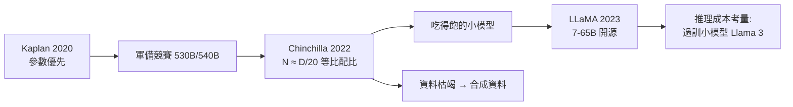

# 4.2 Chinchilla 縮放定律與開源模型 LLaMA（2022-2023）

## 一、歷史背景：軍備競賽與兩個待解問題

GPT-3 之後，行業陷入瘋狂的軍備競賽：Gopher（280B）、MT-NLG（530B）、PaLM（540B）……模型參數一路狂飆。但到了 2022 年，兩個問題浮上水面：

1. **配比問題**：Kaplan 縮放定律（2020）的「參數優先」配比是對的嗎？各家旗艦模型動輒數百 B 參數，卻只餵了 3000 億詞元——**模型是否嚴重「吃不飽」？**
2. **壟斷問題**：175B 級模型的訓練成本（數百萬至數千萬美元）讓大學與中小企業完全出局。封閉 API 之外，研究界需要的**可自由取得的強模型**並不存在。

2022 年 3 月與 2023 年 2 月，兩篇工作分別回答了這兩個問題：DeepMind 的 **Chinchilla** 論文修正了縮放定律，Meta 的 **LLaMA** 證明「更小但吃得飽」的模型可以又強又開源。兩者合力把行業從「軍備競賽」轉向「效率競賽與開源生態」，間接催生了 Mistral、Qwen（通義千問）、DeepSeek 等開源系，徹底改變了智慧模型的地緣格局。

## 二、Chinchilla：縮放定律的修正

### 2.1 Kaplan 配比的盲點

Kaplan 實驗的一個關鍵設計選擇：**固定學習率策略、不隨模型大小調整**，且實驗中資料與模型同時受限。這導致系統性偏差——大模型的學習率未調優、訓練不充分，損失被高估，於是結論偏向「把算力投給更大的模型」。

### 2.2 Chinchilla 的實驗設計

Hoffmann 等人（DeepMind, 2022）用三種互證的方法重新估計最優配比：

1. **固定模型、變資料**：對每個模型規模，訓練多個不同資料量的版本，找每個 $N$ 的損失最低點；
2. **計算最優前沿（IsoFLOP）**：固定總算力 $C \approx 6ND$ ，掃描不同的 $(N, D)$ 組合，找損失最低的組合；
3. **參數化損失函數**：直接擬合 $L(N, D) = E + A N^{-\alpha} + B D^{-\beta}$ 。

三種方法一致給出結論，修正了 Kaplan：

> **最優配比下，參數量 $N$ 與資料量 $D$ 應等比例增長： $D \approx 20\,N$ **（每個參數約配 20 個詞元）。

具體含義：在固定算力 $C$ 下，最優模型應**更小、吃更多資料**。按此定律，GPT-3（175B、300B 詞元）嚴重「欠訓練」——同樣算力若訓一個 70B 模型、餵 1.4T 詞元，損失更低。

### 2.3 Chinchilla 本體的驗證

DeepMind 以 70B 參數、1.4T 詞元訓練了 **Chinchilla**，與 280B 參數、300B 詞元的 Gopher 對比：**模型小 4 倍、資料多 4.6 倍，幾乎所有任務全面勝出**（MMLU 67.6% vs 60.0%）。這是縮放定律修正最直接、最昂貴的實證。

### 2.4 影響：從「大就是強」到「吃得飽的小模型」

Chinchilla 之後的行業轉向：

- **資料優先**：訓練詞元量從 300B 級跳到 1-2T 級（LLaMA 2 到 2T，小型模型甚至更多）；
- **過訓練（over-training）小型模型**：Chinchilla 最優是針對「給定算力」的；但如果在乎**推理成本**（部署後每天億次調用），就值得用更多訓練算力把小模型「過訓」到遠超 Chinchilla 最優——因為推理成本省的是一輩子，訓練成本只花一次。這是 Llama 3（8B、15T 詞元）的理論依據，也修正了 Chinchilla 對「推理成本」這個現實約束的忽視；
- **資料枯竭警報**： $D \approx 20N$ 意味著想要更大的模型就需要更多高品質資料，而網路高品質文字是有限的——合成資料（第 9 章）因此被提上日程。

## 三、LLaMA：開源之路

### 3.1 設計理念

Meta AI 於 2023 年 2 月發布 LLaMA（7B/13B/33B/65B），其配置是 Chinchilla 理念的教科書式應用：

- **資料**：1.4T 詞元的精選混合（Common Crawl 過濾佔 67%、C4、GitHub、維基、書籍、ArXiv、StackExchange）——強調「重清洗勝過大雜燴」；
- **架構改良**（吸收前一年社群結晶）：
  - Pre-RMSNorm（訓練更穩）；
  - SwiGLU 活化函數（FFN 效率更高）；
  - **RoPE 旋轉位置編碼**（外插性更好、相對位置建模）；
  - 分組查詢注意力 GQA 與 FlashAttention 等效率技術在其後續版本引入；
- **僅公開權重（研究許可）**，訓練細節論文全公開。

### 3.2 為什麼 LLaMA 改變了遊戲規則

在 LLaMA 之前，開源界只有 GPT-J、BLOOM 等「比 GPT-3 弱」的模型；LLaMA 的 13B 在多數基準上接近 GPT-3（175B），65B 全面超越。由於權重可下載，整個生態在數週內爆發：

- **量化（quantization）**：llama.cpp 將模型壓到 4-bit，MacBook 即可本地運行 7B 模型——「平民化 LLM」的里程碑；
- **微調民主化**：Stanford 的 Alpaca 用 52K 條 Self-Instruct 資料 + LoRA（低秩適配微調，只訓 <1% 參數），以 600 美元復現了「指令跟隨」能力——證明 RLHF 的效果可以被低成本蒸餾；
- **中文生態**：LLaMA 衍生出的中文擴充詞表、續訓模型（如 Chinese-LLaMA），以及各大廠的自主開源模型（Qwen、DeepSeek、Yi）。

開源模型的存在產生了系統性後果：**封閉模型被迫持續升級**（否則開源會追平）；研究界獲得可復現的載體；安全研究脫離「只能問 API」的困境。反方觀點（濫用、深度偽造、生物安全）也由此真實化——開源治理成為 AI 政策核心議題。

### 3.3 Llama 2 與生態制度化

2023 年 7 月的 Llama 2（7B/13B/70B）做了三件事：資料加碼到 2T 詞元；加上 RLHF 後訓練成為 **Llama 2-Chat**；採用更寬鬆的商用許可。這標誌「開源權重 + 商用許可 + 對齊版本」成為業界標準模板，也宣告 Meta 以「開源換生態」對抗封閉巨頭的戰略成型。

## 四、縮放定律的再修正：法則之外

Chinchilla 也不是終點，後續的再修正揭示了「定律」背後的假設：

1. **推理最優（inference-optimal）**：如上述，部署成本反轉 Chinchilla 配比，小模型過訓成為主流；
2. **資料受限（data-constrained）**：當資料用盡，重複資料的邊際收益遞減（Muennighoff 等人 2023：重複最多約 4 個 epoch 仍有益），此時最好「資料再分配給更多 epoch 而非更大模型」；
3. **架構效率**：MoE（混合專家）讓「總參數大、激活參數小」，在 Chinchilla 框架下等於把有效算力再放大——Mixtral、DeepSeek-V2/V3 皆循此路；
4. **新縮放軸**：o1/R1 證明「測試時計算」是繼 $N$ 、 $D$ 之後的第三條冪律軸（詳見 9.2 節）——縮放的故事從訓練延伸到推理。

## 五、本節重點

1. Chinchilla 修正 Kaplan：「等比縮放 $D \approx 20N$ 」，模型應更小、資料更多；70B/1.4T 擊敗 280B/300B 是其鐵證。
2. Kaplan 的偏差源於實驗設計（學習率未調優、訓練不充分）——**縮放定律的「定律」也受實驗方法論制約**。
3. 推理成本反轉 Chinchilla：實務上用過訓的小模型（Llama 3：8B、15T）換取部署效率。
4. LLaMA 以 Chinchilla 配比 + 社群架構結晶（RoPE/SwiGLU/RMSNorm）+ 開源權重引爆生態：量化、LoRA 微調、Alpaca、中文系全面開花。
5. 開源權重改變行業格局：倒逼封閉模型升級、民主化研究、開啟治理爭議；MoE 與測試時計算是縮放定律的後續修正。

## 六、思考問題

1. Chinchilla 最優是「訓練算力最優」。請寫出考慮推理成本的總成本函數，並說明什麼情況下應過訓小模型。
2. Kaplan 與 Hoffmann 對同一問題得出不同結論，但都自稱「縮放定律」。這對「AI 的可預測性」宣稱意味著什麼？
3. 開源權重模型導致能力擴散，若你負責政策，會設置什麼樣的許可或審查機制？權衡是什麼？
4. 高品質資料枯竭後，合成資料、多模態資料、測試時計算，哪一個最可能是下一條縮放主軸？論證你的排序。
