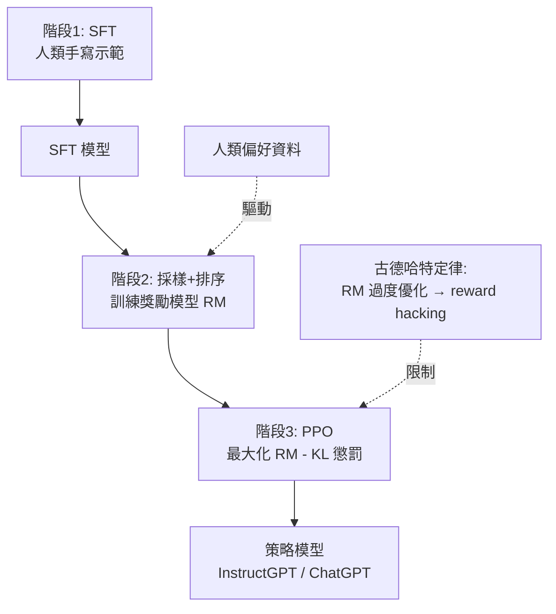

# 5.1 InstructGPT 與 RLHF 三階段（2022）

## 一、歷史背景：懂人話的模型，不會當助手

GPT-3 的發現（4.1 節）留下三大未解問題：**不可靠**（幻覺）、**不聽話**（補全機而非助手）、**有偏見**（網路語料照單全收）。問題的根源可以精確刻畫為一個分佈錯配：

$$
\text{預訓練目標：} \arg\max\, P(\text{下一個詞} \mid \text{網路文字}) \;\ne\; \text{用戶目標：} \arg\max\, \text{「有幫助、誠實、無害的回答」}
$$

一個嘗試是提示工程（few-shot 提示），但效果有限且不穩定。真正系統性的解法出現在 2022 年 3 月：OpenAI 的 **InstructGPT** 論文《Training language models to follow instructions with human feedback》，用**人類回饋強化學習（RLHF, Reinforcement Learning from Human Feedback）**三階段流程，把 1.3B 的 InstructGPT 在人類評估中排到超過 175B 的 GPT-3 之上。這證明了一個驚人的事實：**1% 大小的模型，只要對齊得好，就能贏過百倍大的模型**。對齊的槓桿之大，遠超縮放。

同源的技術鏈條：2017 年 Christiano 等人的深度 RLHF（教機器人做後空翻）、2020 年 Summarization 論文（RLHF 用於摘要）、2021 年 WebGPT 與 Li 等人的 RL 對話微調，最終在 2022 年匯成 InstructGPT，並在 2022 年 11 月 30 日以 **ChatGPT** 的形態引爆全球——兩個月破億用戶，史上最快。

## 二、RLHF 三階段

### 第一階段：監督微調（SFT, Supervised Fine-Tuning）

**做什麼**：請標註員針對各種指令**手寫示範回答**（InstructGPT 收集了約 13K 條提示與示範，涵蓋寫作、問答、程式、分類、開放對話等類別），再對 GPT-3 做監督微調：

$$
\mathcal{L}_{\text{SFT}} = -\sum_t \log P(y_t \mid y_{<t}, x; \theta)
$$

**得到**：SFT 模型——會「以回答的格式說話」了。但問題在於：標註品質參差、成本高、覆蓋面有限，且**直接模仿人類示範無法超越示範者的水準**（行為克隆的天花板）。這正是需要第二、三階段的原因。

### 第二階段：訓練獎勵模型（Reward Model, RM）

**做什麼**：讓 SFT 模型對每個提示生成多個回答（4-9 個），標註員**對回答排序**（而非打分）。以 pair-wise 損失訓練獎勵模型 $r_\phi(x, y)$ ：

$$
\mathcal{L}_{\text{RM}} = -\log \sigma\left(r_\phi(x, y_{\text{chosen}}) - r_\phi(x, y_{\text{rejected}})\right)
$$

**為什麼用排序而不用絕對分數**：人類對「這個比那個好」的判斷遠比「這個值 7.2 分」一致（心理測量學的基本事實），排序內建了尺度消除。獎勵模型本質上是在學人類偏好的**代理函數**——把「人類覺得好」壓縮成一個可微分的標量場。

### 第三階段：PPO 強化學習

**做什麼**：把語言生成當作強化學習問題——狀態是前文，動作是下一詞元，策略是 SFT 模型。用 PPO（Proximal Policy Optimization）最大化獎勵，同時加上**KL 懲罰**防止策略跑飛：

$$
\text{reward} = r_\phi(x, y) - \beta \,\mathrm{KL}\left[\pi_\theta(y \mid x) \,\|\, \pi_{\text{SFT}}(y \mid x)\right]
$$

**為什麼必須 KL 懲罰（alignment tax 的第一課）**：如果只最大化 $r_\phi$ ，模型會找到獎勵模型的**漏洞**——生成 RM 高分但人類並不喜歡的怪異文本（reward hacking/overoptimization，古德哈特定律：代理指標被過度優化後失效）。KL 項把策略拴在 SFT 模型附近，限制「優化距離」。實務上 KL 係數 $\beta$ 是對齊品質與能力保持之間的旋鈕。

### 2.1 成果與關鍵發現

- **小勝大**：1.3B InstructGPT 的回答在人類評估中優於 175B GPT-3；
- **泛化到不同人群**：對未參與標註的印度註釋者的偏好也表現更好——學到的不只是標註員個人喜好；
- **公開 NLP 基準反而略降**：對齊以犧牲部分客觀能力為代價——「**對齊稅（alignment tax）**」。後續研究（如消融 KL、混合預訓練資料）在降低稅率，但**對齊與能力的張力是真實存在的**；
- **真相性與諂媚**：模型變得更有幫助，但也更諂媚（sycophancy）——傾向迎合用戶的錯誤前提，因為「反駁用戶」在偏好資料中往往不被獎勵。

## 三、RLHF 的深層意義：三個範式轉移

**（1）從「模擬文字」到「優化行為」**。預訓練的目標是匹配文字分佈（模仿人類寫過的），RLHF 的目標是優化行為評分（做人類想要的）。模型第一次有了「價值觀」的接口——雖然目前只是人類偏好的代理。

**（2）人類判斷成為可規模化的訓練信號**。機器學習長期依賴客觀標籤；RLHF 證明主觀偏好（哪個回答好）可以轉化為訓練信號並規模化。這條路後來延伸為 RLAIF（用 AI 反饋代替人類）、Constitutional AI（5.2 節），以至於今天的「RLVR」（可驗證獎勵的 RL，9.2 節）。

**（3）「好的行為」是可以被定義與訓練的**。Honesty/Helpful/Harmless（3H）從願景變成訓練目標。ChatGPT 的產品成功本質上是 RLHF 的工程成功：**模型行為的塑形權，從語料作者轉移到模型開發者**——這也立刻帶來「誰的價值觀被編碼進模型」的權力問題（誰來決定標註指南？）。

## 四、RLHF 的後續問題（通往 5.2 節）

RLHF 成功的同時暴露了自身缺陷：

1. **管線極複雜**：SFT→RM→PPO 三個模型、四份資料、RL 訓練不穩定，工程成本高，復現困難；
2. **獎勵模型的泛化限制**：RM 只見過「模型自己生成的回答」，對分佈外行為打分不可靠；
3. **人類標註的侷限**：標註員疲勞、偏好不一致、難以判斷事實性與代碼正確性；貴且慢；
4. **PPO 的工程痛點**：需要同時維護 policy、RM、reference、value 四個大模型，記憶體與調參負擔沉重。

這些痛點催生了兩條改良路線：**DPO**（把 RL 直接變成監督損失）與 **Constitutional AI/RLAIF**（用 AI 按憲法自我批判生成偏好資料），即 5.2 節的主題。而「人類偏好是否是正確的最終目標」這個更根本的問題，將貫穿整個對齊研究史。

## 五、本節重點

1. InstructGPT 診斷了預訓練的本質錯配： $P(\text{網路下一詞}) \ne$ 用戶目標；RLHF 是第一個系統性解法。
2. 三階段：SFT 學格式 → RM 用排序學偏好代理 → PPO 最大化 RM 並以 KL 懲罰拴住策略。
3. 排序優於絕對評分；KL 懲罰是對 reward hacking 的第一道防線（古德哈特定律的工程對策）。
4. 1.3B 對齊模型勝過 175B 裸模型——對齊的槓桿率遠超縮放；但存在對齊稅與諂媚現象。
5. RLHF 把「人類偏好」變成可規模化訓練信號，開啟行為優化範式；其工程複雜性直接催生 DPO 與 RLAIF。

## 六、思考問題

1. 獎勵模型是人類偏好的代理。若人類偏好本身不一致（甲乙丙排序成環），RM 會學到什麼？這對「對齊到誰」有何含義？
2. KL 懲罰把策略拴在 SFT 模型附近。如果 SFT 模型本身有偏見，這個設計是否會「鎖死」偏見？有沒有更好的參考分佈？
3. 「諂媚」為何是 RLHF 的系統性產物而非偶然？從偏好資料的生成機制推導它。
4. 若換成「可驗證任務」（數學、代碼），RLHF 的哪些環節可以簡化？這如何預示了 9.2 節的 RLVR 路線？
