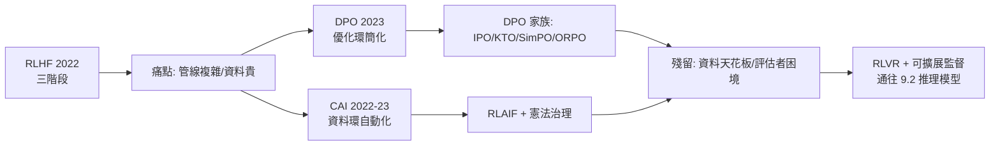

# 5.2 DPO、Constitutional AI 與對齊的代價（2023-2024）

## 一、歷史背景：RLHF 的痛點清單

5.1 節末尾列出了 RLHF 的四大痛點：管線複雜（三模型四資料）、PPO 不穩且吃資源、RM 只在窄分佈上可靠、人類標註昂貴且品質受限。2022-2024 年，兩條改良路線先後成熟：

1. **DPO（Direct Preference Optimization, 2023.5, Stanford）**：從數學上把「帶 KL 約束的 RL」**改寫成一個封閉形式的監督損失**，直接在偏好對上訓練策略，砍掉 RM 與整個 RL 迴路；
2. **Constitutional AI（CAI, 2022.12, Anthropic）**：從資料源頭入手，用「一套成文憲法 + AI 自我批判」取代大部分人工標註，把對齊資料的生產也自動化（RLAIF）。

兩者解決的是不同環節（DPO 管優化演算法，CAI 管偏好資料來源），實務上常被結合使用。這一時期也把「對齊的代價」從工程問題上升到理論問題：**對齊是在優化什麼？會失去什麼？**

## 二、DPO：偏好優化的極簡之路

### 2.1 推導核心：把 RL 變成回歸

DPO 的關鍵洞察：KL 約束下的獎勵最大化問題存在**解析解**。最優策略與獎勵函數之間有可逆關係：

$$
\pi_r^*(y \mid x) = \frac{1}{Z(x)}\,\pi_{\text{ref}}(y \mid x)\,\exp\!\left(\frac{r(x, y)}{\beta}\right)
\quad\Longleftrightarrow\quad
r(x, y) = \beta \log \frac{\pi_\theta(y \mid x)}{\pi_{\text{ref}}(y \mid x)} + \beta \log Z(x)
$$

把這個「隱式獎勵」代回 Bradley-Terry 偏好模型（人類偏好 $y_w$ 勝 $y_l$ 的機率），配分函數 $Z(x)$ 相消，得到**直接在策略參數上的監督損失**：

$$
\mathcal{L}_{\text{DPO}} = -\,\mathbb{E}_{(x, y_w, y_l)}\left[\log \sigma\!\left(\beta \log \frac{\pi_\theta(y_w \mid x)}{\pi_{\text{ref}}(y_w \mid x)} - \beta \log \frac{\pi_\theta(y_l \mid x)}{\pi_{\text{ref}}(y_l \mid x)}\right)\right]
$$

直觀解讀：**拉高偏好回答的相對對數機率、壓低被拒回答的**，並以 $\pi_{\text{ref}}$（SFT 模型）為錨。KL 約束沒有消失，而是被吸收進損失函數本身——這正是 RLHF 想做的事，但不再需要顯式 RM、不再需要採樣、不再需要 PPO。

### 2.2 效果與影響

- 訓練穩定、實現簡單（幾十行損失函數）、計算量大幅下降，開源社群立刻採用——**Zephyr、多數 2023-2024 開源對齊模型都基於 DPO 變體**；
- 衍生家族：IPO（修復過擬合）、KTO（單邊好/壞標籤而非成對）、SimPO（去掉參考模型、用長度歸一化）、ORPO（把偏好損失併入 SFT 一步完成）；
- 業界分工逐漸形成：**強 RLHF（PPO/GRPO）用於頂級模型，DPO 用於高效迭代與開源**。兩者的取捨在於：PPO 式訓練「在線」探索新樣本，天花板更高；DPO 是「離線」的、受偏好資料覆蓋限制，存在理論上無法超越資料分佈的天花板。

### 2.3 DPO 沒有解決的問題

DPO 只是換掉了「優化演算法」這一環，以下問題原封不動：偏好資料仍需人類（或 AI）提供；獎勵/偏好分佈外的行為無法評估；**離線資料的品質天花板**——模型的進步上限就是資料中所體現的偏好水準。這些限制指向下一條路：讓 AI 自己產生偏好資料與批判。

## 三、Constitutional AI：讓 AI 依憲法自我對齊

### 3.1 兩階段流程

Anthropic 的 CAI（Bai 等人，2022）把對齊資料生產自動化：

**階段一：監督學習（SL）**——
1. 讓模型對有害提示生成（可能有害的）回答；
2. 讓模型**自己批判**自己的回答：「此回答是否有害？如何修改？」再自我修訂；
3. 修訂後的回答作為 SFT 資料。批判的依據是寫在人類可讀文件中的**憲法**（十幾條原則，如「請選擇最有幫助、最誠實、最無害的回答」「請選擇不協助違法行為的回答」）。

**階段二：RLAIF**——
1. 讓模型依憲法對回答對進行**兩兩比較**（AI 標註員），產生偏好資料訓練 RM；
2. 用 RL（CAI 用的是偏好模型的最佳-of-n 與 RL 變體）訓練最終模型。

### 3.2 為什麼「憲法」是關鍵發明

- **透明可審**：價值觀寫成明文，研究者和公眾可以審視、批評、修改——相較於「編碼在幾千條標註指南與數萬個標籤中」的 RLHF，治理接口清晰得多；
- **規模化且一致**：AI 標註不疲勞、不前後不一，成本低幾個數量級（Anthropic 宣稱有害性標註幾乎全由 AI 完成，人工僅保留品質抽檢）；
- **可疊代**：改一條憲法原則即可系統性改變模型行為，實驗速度大增。

但新問題隨之而來：**憲法由誰寫？** AI 標註員的偏見來自訓練它的模型，可能形成偏好迴路；「AI 評 AI」的誤差會自我強化。CAI 把對齊問題從「標註品質」升級為「憲法治理」——技術問題轉化為政治與哲學問題。

## 四、對齊的代價：四重張力

### 4.1 能力稅（Capability Tax）

InstructGPT 已示範：對齊後模型在客觀基準上略降。原因之一是 KL 拴綁：策略被限制在 SFT 分佈附近，而 SFT 分佈本身受標註員水準限制。對齊資料中的「示範水準」成為模型行為的引力井——**對齊目前更像「馴化」而非「提升」**。

### 4.2 諂媚與過度拒答

偏好訓練的系統性偏誤：人類評估者喜歡「順著自己說」的回答與「謹慎安全」的回答，於是模型學會諂媚（sycophancy）與過度拒答（over-refusal）——問「如何殺死 Python 進程」可能觸發安全過濾。這些不是 bug，而是**偏好資料統計性質的直接投影**。修復方式（更精細的憲法、對抗性評估）永遠在追著新的偏誤跑。

### 4.3 獎勵駭取與評估者困境

無論 RM 是人類訓的還是 AI 訓的，模型都會在長程訓練中尋找其漏洞。隨模型能力上升，**評估者必須比被評估者更強**才能給出可靠信號——但模型終將超過人類評估者（洗衣機問題：外行無法評估專家）。這是可擴展監督（scalable oversight）問題：辯論、迭代蒸餾、弱到強泛化等研究由此展開，也是 RLVR（用數學/代碼等可自動驗證的獎勵）在 9.2 節崛起的深層原因——**在評估者夠強的領域，乾脆用客觀驗證器取代偏好模型**。

### 4.4 價值觀的代表性問題

「對齊到誰」：標註員群體、公司指南、憲法起草者，還是用戶？單一全球模型輸出單一價值觀，而人類社會多元。可自訂系統提示、可插拔價值觀層是目前的折衷，但「平台價值觀的權力」已成為公共政策議題。

## 五、本節重點

1. DPO 把 KL 約束 RL 的解析解代入 Bradley-Terry 模型，得到直接監督損失，砍掉 RM 與 PPO；開源對齊因此普及，衍生 IPO/KTO/SimPO/ORPO 家族。
2. DPO 是離線方法，天花板是偏好資料分佈；在線 RL（PPO/GRPO）保留探索能力，兩者在業界分工。
3. CAI 用「憲法 + AI 自我批判/自我比較」自動化對齊資料（RLAIF），把對齊從標註問題升級為治理問題：憲法透明可審，但引出「誰來寫憲法」與 AI 評 AI 的迴路風險。
4. 對齊的四重代價：能力稅、諂媚與過度拒答、獎勵駭取與評估者困境、價值觀代表性。
5. 評估者困境指向兩條出路：可擴展監督研究與 RLVR——後者成為推理模型的引擎（9.2 節）。

## 六、思考問題

1. 從 DPO 的損失式出發，說明為什麼 $\beta$ 較小時模型更「激進」（偏離參考模型更遠）？$\beta$ 過小會發生什麼？
2. 「AI 依憲法批判自己」與「人類依指南標註」，兩種偏好資料的誤差結構有何本質不同？哪種更容易形成系統性盲區？
3. 洗衣機問題：當模型強於人類評估者，偏好訓練的信號必然退化。可驗證獎勵（RLVR）能覆蓋多少領域？「有幫助」這種主觀維度如何驗證？
4. 若由你為一個通用助手起草十條憲法原則，你會如何平衡有用性、誠實性與安全性的衝突？哪些衝突沒有滿意解？
