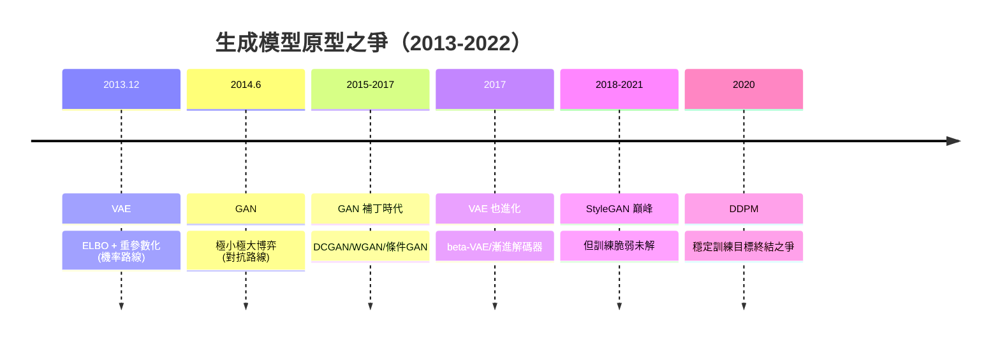

# 6.1 VAE 與 GAN：生成模型的兩大原型（2013-2014）

## 一、歷史背景：從判別到生成的鴻溝

2012 年 AlexNet 之後，深度學習在**判別任務**（分類：$p(y \mid x)$）上勢如破竹。但「智慧」的另一面是**生成**：學習資料本身的分佈 $p(x)$，並從中創造新樣本。生成模型在數學上難得多——判別任務只需在資料流形上畫邊界，生成任務要刻畫整個流形及其密度。

2013-2014 年，兩篇論文幾乎同時提出兩條截然不同的路：

- **VAE（Variational Autoencoder, Kingma & Welling, 2013.12）**：機率圖模型路線——用變分推斷把難以計算的似然變成可優化的下界；
- **GAN（Generative Adversarial Network, Goodfellow et al., 2014.6）**：博弈論路線——乾脆不算似然，讓兩個網路對抗，生成器直接學會「騙過判別器」。

此後近八年，生成模型的歷史就是這兩大原型互相競爭、互相啟發的歷史，最終在 2020 年被第三者——擴散模型——先繼承 VAE 的潛空間思想、再以穩定訓練取代 GAN 的對抗博弈（6.2 節）。理解 VAE 與 GAN，是理解所有現代生成模型的前提。

## 二、生成模型的根本困難

對連續高維資料（圖像），要最大化似然 $\prod_i p_\theta(x_i)$，就必須能計算 $p_\theta(x)$。許多自然模型（如含隱變數 $z$ 的模型）只能給出邊緣化的形式：

$$
p_\theta(x) = \int p_\theta(x \mid z)\, p(z)\, dz
$$

這個積分在高維空間**不可解**（$z$ 的空間是指數級的，大多數 $z$ 對應的 $p(x\mid z)$ 幾乎為零，蒙特卡洛估計方差極大）。這是統計機器學習幾十年的老難題；2013 年之前，深度生成模型（如 DBN）只能對二值資料做受限玻爾茲曼機式的近似。VAE 與 GAN 是兩種針對此難題的正面突圍。

## 三、VAE：變分下界與潛空間

### 3.1 ELBO 的推導

VAE 的思路：引入**推斷網路**（編碼器）$q_\phi(z \mid x)$ 近似真實後驗 $p_\theta(z \mid x)$，將對數似然改寫為：

$$
\log p_\theta(x) = \underbrace{\mathbb{E}_{q_\phi(z\mid x)}\left[\log p_\theta(x \mid z)\right]}_{\text{重構項}} \;-\; \underbrace{\mathrm{KL}\left[q_\phi(z \mid x)\,\|\,p(z)\right]}_{\text{正則項}} \;+\; \mathrm{KL}\left[q_\phi(z \mid x)\,\|\,p_\theta(z \mid x)\right]
$$

最後一項非負，因此左邊兩項構成**變分下界（ELBO, Evidence Lower Bound）**：

$$
\log p_\theta(x) \ge \mathcal{L}_{\text{ELBO}}(\theta, \phi; x) = \mathbb{E}_{q_\phi}\left[\log p_\theta(x \mid z)\right] - \mathrm{KL}\left[q_\phi(z \mid x) \,\|\, p(z)\right]
$$

最大化 ELBO 就是在最大化似然的下界——訓練目標從不可解變成可微分的。當編碼器足夠好（後驗被精確近似），下界貼合真實似然。

### 3.2 重參數化技巧：讓隨機性可反向傳播

ELBO 中有期望 $\mathbb{E}_{q_\phi}$，而「從 $q_\phi$ 採樣」這一步不可微，梯度無法穿過。Kingma 的**重參數化技巧**把隨機性移出計算圖：

$$
z = \mu_\phi(x) + \sigma_\phi(x) \odot \epsilon, \qquad \epsilon \sim \mathcal{N}(0, I)
$$

隨機性只出現在外部常數 $\epsilon$ 上，$z$ 成為 $\phi$ 的確定函數，梯度可以順利流回編碼器。這一技巧是現代隨機深度學習的基石之一（擴散模型同樣依賴它）。

### 3.3 VAE 的產出與局限

VAE 給出：可微分的**潛空間**（$z$ 是連續向量，插值、算術操作有意義）、一個真正的機率模型（可算下界、可控生成），以及「重構 vs KL」的權衡結構。但它的致命弱點是**生成圖像模糊**：以逐像素 MSE 類損失為重構項，模型對「多種合理答案」會取平均——把可能的貓的鬍鬚位置平均成一團糊。GAN 正是針對這一點的猛攻。

## 四、GAN：對抗博弈

### 4.1 博弈結構

Goodfellow 的洞見：與其算似然，不如設一個**博弈**。生成器 $G(z)$ 把雜訊映成樣本；判別器 $D(x)$ 判斷樣本真假。兩者玩極小極大博弈：

$$
\min_G \max_D \; V(D, G) = \mathbb{E}_{x \sim p_{\text{data}}}[\log D(x)] + \mathbb{E}_{z \sim p_z}[\log(1 - D(G(z)))]
$$

理論結果優美：固定 $G$ 時最優判別器為 $D^*(x) = \frac{p_{\text{data}}(x)}{p_{\text{data}}(x) + p_g(x)}$，此時優化 $G$ 等價於最小化 JS 散度（Jensen-Shannon divergence），且**全域最優時 $p_g = p_{\text{data}}$、$D = 1/2$**——生成器完美騙過判別器，生成樣本與真實樣本不可區分。

### 4.2 為什麼 GAN 生成銳利

GAN 的訓練信號不是逐像素距離，而是判別器的**決策邊界**：「這張臉哪里不像真臉」。模型只需生成「足以騙過判別器的樣本」，沒有動機對多種可能性取平均——因此輸出銳利、真實感強。這正是 VAE 的痛點的反面。

### 4.3 訓練之痛：不穩定與模式崩潰

GAN 的代價是**訓練動力學的深淵**：

1. **不收斂**：兩個網路互相追逐，損失振盪；博弈的納許均衡在非凸參數空間中極難到達；
2. **模式崩潰（mode collapse）**：生成器發現「某幾種樣本足以騙過判別器」，就放棄多樣性——MNIST 上只生成 1 和 7。因為 JS 散度在分佈不重疊時**飽和**（梯度為零），一旦判別器太強，生成器學不到東西；
3. **評估困難**：沒有似然，只能用 Inception Score、FID 等間接指標。

後續五年的 GAN 工程史就是不斷補丁的歷史：DCGAN（卷積架構與訓練準則）、WGAN（用 Wasserstein 距離取代 JS，Kantoro vich-Rubinstein 對偶使梯度在不重疊區域也有效）、WGAN-GP（梯度懲罰）、譜歸一化、條件 GAN（cGAN）、pix2pix、CycleGAN（無配對風格轉換）……直到 **StyleGAN 系列**（2018-2021）在**人臉生成**上達到以假亂真的巔峰（StyleGAN 的人臉曾是「AI 生成」的代名詞），但模式崩潰與訓練脆弱性始終未被根治——這個未解的根本缺陷，就是擴散模型的機會。

## 五、兩大原型的思想遺產

VAE 與 GAN 雖然都被擴散模型超越，但它們的思想基因無處不在：

- **VAE 的潛空間** → Stable Diffusion 的潛在擴散（在 VAE 的潛空間中做擴散，6.2 節）；ELBO 的變分思想滲透到表徵學習（β-VAE disentanglement）、世界模型（VAE 編碼觀測，8.1 節）；
- **GAN 的對抗思想** → 對抗性評估、幻覺檢測、以及 RLHF 中的「判別式偏好訓練」（RM 本質上是個判別器）；生成對抗微調（diffusion-GAN）仍被用於提升銳度；
- **共同的教訓**：訓練目標的**幾何性質**（JS 散度的飽和、MSE 的平均化）直接決定生成品質——這一課被擴散模型學走：它選了一個「處處有梯度、逐步小步走」的目標。

## 六、本節重點

1. 生成模型的根本困難：含隱變數的似然需要高維積分，不可解——VAE 與 GAN 是兩條突圍路。
2. VAE：編碼器近似後驗 + ELBO 下界 + 重參數化使隨機性可微；產出連續潛空間，但逐像素重構導致生成模糊。
3. GAN：極小極大博弈，理論上最優點是 $p_g=p_{\text{data}}$；生成銳利，但 JS 散度飽和導致不穩定與模式崩潰。
4. 2015-2021 的 GAN 補丁史（WGAN、StyleGAN 等）沒能根治訓練脆弱性，這正是擴散模型的突破口。
5. 遺產：潛空間成為 Stable Diffusion 骨架；對抗思想進入偏好訓練與評估；「目標函數幾何決定生成品質」的教訓由擴散模型繼承。

## 七、思考問題

1. VAE 模糊、GAN 銳利的根源可否統一解釋為「訓練信號對『多模態後驗』的處理方式不同」？請具體論證。
2. WGAN 用 Wasserstein 距離替代 JS 散度解決梯度消失。這對「選擇散度 = 選擇訓練動力學」有何一般性啟示？
3. 模式崩潰是否是「最優生成器在對抗下必然退化的均衡」？若是，任何對抗式生成都有此宿命嗎？
4. Stable Diffusion 在 VAE 潛空間做擴散。VAE 的重構模糊會如何限制最終生成品質？如何緩解？
