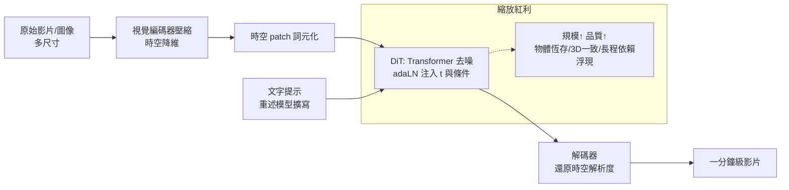

# 7.1 影音生成的難點與 Sora 的 DiT 架構（2024）

## 一、歷史背景：從「畫一張」到「畫一段」

2022 年 Stable Diffuction 之後，文生圖已趨成熟，行業焦點自然轉向影片生成。但影片不是「多幀圖像」這麼簡單——它是在三個維度上同時加壓：

1. **資料維度**：一分鐘 24 幀的 1080p 影片是 $1920 \times 1080 \times 3 \times 1440$ 的張量，比單張圖大兩個數量級以上；
2. **時間一致性**：物體必須恆存（不能一幀有四指、下一幀五指）、動作連貫、光影與材質隨視角變化保持一致；
3. **物理規律**：球要按拋物線落、水要流動並反射、布料要垂墜——影片觀眾對物理違和的敏感度遠高於靜態圖。

早期影片模型（2022-2023）多為「圖像模型 + 時間層」的補丁：Make-A-Video、Imagen Video、Runway Gen-1/2 用 3D 卷積或幀間注意力在擴散 U-Net 上縫時間維度，輸出多是數秒、低解析度、明顯閃爍的片段。**補丁式架構無法享受視覺 Transformer 的縮放紅利**——瓶頸明顯，缺的是一次範式級跳躍。

2024 年 2 月，OpenAI 發布 **Sora**（技術報告《Video generation models as world simulators》），以 **DiT（Diffusion Transformer）+ 時空 patch（spacetime patches）**的統一架构，生成最長一分鐘、構圖與物理表現遠超前代的影片。Sora 的意義不在單一效果，而在於它證明：**影片生成可以被納入語言模型的縮放軌道**。

## 二、Sora 的技術核心

### 2.1 時空 patch：影片的「詞元化」

語言模型的成功公式是：把文字切成 token，用 Transformer 統一處理。Sora 的第一步是把影片「詞元化」：先壓縮（一個視覺編碼器把原始影片在時空上同時降維），再切成 patch——**時間上相鄰、空間上相鄰的 patch 組成時空 patch 序列**，如同 ViT 把圖像切 patch、LLM 把文字切 token。

$$
\text{影片} \rightarrow \text{壓縮潛表示} \rightarrow \text{時空 patch 序列} \rightarrow \text{Transformer 處理}
$$

這一步的威力是**統一性**：不同時長、不同解析度、不同長寬比的影片/圖像，都可以表示成不同長度的 patch 序列（類似 LLM 處理不同長度的文字）。訓練資料不必裁切到固定尺寸——原生多樣性被保留，這對構圖自然度影響巨大（固定 256×256 訓練的模型生成的構圖有「正方形偏見」）。

### 2.2 DiT：把 U-Net 換成 Transformer

DiT（Diffusion Transformer, Peebles & Xie, 2022/ICCV 2023）的提案：在潛在擴散框架中，把去噪骨幹從 U-Net 換成**純 Transformer**，patch 作為 token，時間步與條件以 adaLN（adaptive layer norm）注入。

為什麼換骨幹是關鍵：U-Net 的歸納偏置（局部卷積、金字塔）適合小規模，但**Transformer 是唯一被反覆證明「隨規模單調變強」的架構**（Kaplan 縮放定律在 Transformer 上測得）。DiT 論文展示了擴散模型版本的縮放曲線：GFLOPs 越大，FID 越低。Sora 把這條曲線推到影片上——技術報告明言其核心發現：**「影片生成模型在計算量增大時，品質顯著提升，是構建世界模擬器的有前途方向」**。

### 2.3 完整管線

值得注意的細節：OpenAI 沿用 DALL·E 3 的**重述（recaptioning）**策略——用視覺語言模型為訓練影片寫詳細描述，解決「網路影片字幕品質極差」的問題。**語言監督的品質再次決定視覺生成的品質**，這是 6.2 節結論的再驗證。

### 2.4 湧現的視覺能力

Sora 展示了隨規模出現的行為：3D 一致性（鏡頭旋轉時物體與人物保持三維合理）、物體恆存與遮擋處理（人繞過柱子後仍存在）、長程依賴（人物保持同一形象數十秒）、以及初步的數位世界模擬（Minecraft 風格畫面同時控制角色）。這些能力**無人顯式編程**，是 patch 預測目標在大規模下的湧現——與 GPT-3 的 ICL（4.1 節）結構完全同型：簡單預測目標 + 大規模 = 湧現能力。

## 三、影片生成仍待解的難點

Sora 之後，影片生成的物理短板同樣清晰（OpenAI 自己列舉）：玻璃杯碎裂方式錯誤、物體憑空出現/消失、左右腳互換的步態、複雜交互（咬一口餅乾後餅乾上沒有咬痕）。這些失敗模式有共同結構：

1. **像素級預測的資訊浪費**：影片中大量像素（紋理、雜訊）高度不可預測，模型被迫花容量在「無關物理的細節」上；物理規律反而是少量低頻結構。這正是 LeCun 攻擊的靶心（8.2 節 JEPA）；
2. **資料瓶頸**：高品質、長、有配对描述的影片遠比文字稀缺；版權與肖像權問題更尖銳；
3. **一致性與可控性**：跨鏡頭角色一致性（分鏡敘事）需要新的條件機制（參考圖、角色庫）；
4. **算力成本**：一分鐘影片的採樣成本是圖像的百倍以上，推理優化（蒸餾、cache、非自回歸跳步）是工程主戰場。

2024-2026 年的後續（可靈、Veo、Gen-3、以及互動式系統如 Genie 系）沿兩條路推進：**更大的 DiT**（沿縮放曲線推）與**互動式世界模型**（邊生成邊響應動作，接第 8 章）。

## 四、Sora 的範式意義：三個「統一」

1. **架構統一**：語言（LLM）、圖像（ViT）、影片（DiT）全部收斂到 Transformer + 詞元化；生成模型的縮放曲線與理解模型的縮放曲線接軌。
2. **目標統一**：影片生成與世界模擬在形式上合流——「預測下一幀 patch」就是「在視覺上預測世界的下一狀態」。技術報告的標題把這個主張寫得很明白：影片模型是世界模擬器的有前途基礎。
3. **路線統一**：OpenAI 用同一套「資料+縮放+簡單目標」的方法論同時推進語言與視覺，證明該方法論的模態無關性。

但「形式上合流」不等於「能力上達標」——Sora 違反物理的失敗案例使「Sora 是世界模型嗎」成為 2024 年最大的辯論題（8.2 節正面交鋒）。

## 五、本節重點

1. 影片生成在資料量、時間一致性、物理規律三維加壓；早期「圖像模型+時間層」補丁無法接入縮放紅利。
2. Sora 的兩步關鍵：時空 patch 詞元化（統一多尺寸/多時長）+ DiT（把去噪骨幹換成可縮放的 Transformer，adaLN 注入條件）。
3. 擴散版縮放定律成立：計算量增大→品質提升→物體恆存、3D 一致性、長程依賴湧現；重述（recaptioning）使語言監督品質再次成為關鍵。
4. 物理違和的失敗模式共同指向像素級預測的結構性弱點——大量容量浪費在不可預測的紋理上，這是 JEPA 攻擊的靶心。
5. Sora 實現架構、目標、路線三重統一，把影片生成接入語言模型式縮放軌道；「是不是世界模型」留給第 8 章正面辯論。

## 六、思考問題

1. U-Net 的局部歸納偏置在小資料上更有利，Transformer 在大資料上更有利。這對「歸納偏置與資料規模的取捨」有何一般性法則？
2. 時空 patch 的大小（時間×空間）如何影響模型？太細（算力爆炸）與太粗（丟失動態細節）之間，你會如何選？
3. 若「物理違和」源自容量分配（紋理吃掉了物理），有哪些架構或訓練目標的修改能把容量導向物理規律？
4. Sora 與電玩引擎（如 Unreal）都能「生成符合物理的畫面」。兩者的知識來源與可泛化性有何本質差別？
