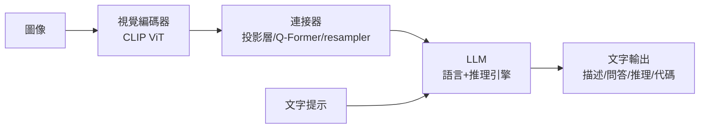

# 7.2 多模態大模型：CLIP、GPT-4V 與原生多模態（2021-2026）

## 一、歷史背景：模態之牆的倒塌

到 2020 年，AI 世界是割裂的：語言模型只讀文字，視覺模型只看圖像，語音模型只聽聲音。各模態有自己的架構、資料與社群。但人類的智慧顯然是多模態的：嬰兒靠視覺、聽覺、觸覺的聯合統計學會世界；「紅色」的意義一半來自語言、一半來自視網膜。

打通模態的嘗試很多（圖像字幕、VQA），但都是「單向膠水」：視覺編碼器抽出特徵、塞進語言模型當條件。真正的分水嶺是 2021 年的 **CLIP**——用大規模**自然圖文對**做對比學習，把視覺與語言嵌入**同一語義空間**。此後五年，多模態經歷三個階段：

1. **對齊階段（2021-2022）**：CLIP 式雙塔，模態各自編碼、空間對齊；
2. **拼接階段（2023-2024）**：視覺編碼器 + 連接器 + 凍結 LLM（LLaVA、GPT-4V、Gemini 1.0）；
3. **原生多模態階段（2024-2026）**：預訓練起點就混合多模態詞元，單一 Transformer 統一處理（GPT-4o、Gemini 2.0、原生多模態輸出）。

這條演進線的驅動邏輯一以貫之：**語言模型是現成的「知識與推理引擎」，多模態的歷史就是不斷把感知接上這台引擎的歷史**。

## 二、CLIP：對比學習對齊兩個模態

### 2.1 方法

CLIP（Radford et al., 2021）訓練於 4 億（400M）網路圖文對（WIT 資料集）。雙塔架構：圖像編碼器（ResNet 或 ViT）與文字編碼器（Transformer）各自輸出向量，對 batch 內所有組合算餘弦相似度矩陣，用對稱的 InfoNCE 損失：

$$
\mathcal{L} = -\frac{1}{N}\sum_{i=1}^{N}\left[\log \frac{\exp(s(v_i, t_i)/\tau)}{\sum_j \exp(s(v_i, t_j)/\tau)} + \log \frac{\exp(s(v_i, t_i)/\tau)}{\sum_j \exp(s(v_j, t_i)/\tau)}\right]
$$

其中 $s$ 為餘弦相似度、 $\tau$ 為溫度。即：**在 batch 內做檢索——正確的圖文配對要互相靠攏，錯配的互相推開**。

### 2.2 零樣本分類的奇蹟

CLIP 的殺手級應用：**零樣本分類**。把類別寫成提示模板（"a photo of a {label}"），編碼成文字向量，圖像向量與哪個類別文字最近就判為哪類。在 ImageNet 上不做任何訓練達到 76.2%（與完整訓練的 ResNet-50 持平），在細分類與 OOD 資料上遠超傳統模型。

這在範式上意味著：**任務被「提示」而非「訓練」定義**。與 GPT-3 的 in-context learning（4.1 節）同構——語言側用範例定義任務，視覺側用類別文字定義任務。2021 年因此被稱為視覺的「GPT-3 時刻」。

### 2.3 局限

CLIP 是對齊而非理解：雙塔各自編碼、無深層跨模態融合；對計數、空間關係、否定（「沒有貓的圖片」）表現差；偏好「圖像的標題風格」而非完整句子。這些侷限正是第二階段（深度融合）要解決的。

## 三、拼接式多模態：LLaVA 與 GPT-4V

### 3.1 通用配方：編碼器 + 連接器 + LLM

2023 年起，「視覺接語言」有了教科書式配方（LLaVA 將其開源普及）：

- **視覺編碼器**：CLIP ViT 抽取 patch 特徵（幾乎無人另起爐灶——CLIP 的表示太好用）；
- **連接器**：線性投影（LLaVA 1.0）、Q-Former/resampler（BLIP-2 用可學習 query 壓縮視覺 token）、或交叉注意力（Flamingo 的 gated xattn）；
- **LLM**：凍結或 LoRA 微調的語言模型，承擔推理與生成。

訓練分兩步：先用「圖像-描述」對訓練連接器（對齊），再用視覺指令資料微調（GPT-4 生成的指令資料即可，成本極低）。LLaVA 用 158K 條 GPT-4 合成指令資料，在一張 A100 上數小時訓出可用模型——多模態能力被「平民化」。

### 3.2 GPT-4V 與 Gemini：閉源旗艦

2023 年 9 月 OpenAI 上線 GPT-4V(ision)，2023 年 12 月 Google 發布 Gemini 1.0（原生多模態訓練，見下）。GPT-4V 的能力跨越：複雜圖表推理、手寫數學題、 meme 理解、UI 操作指導（後來的 Computer Use 伏筆）。它證明視覺不是「附加技能」而是推理的新入口：**語言模型的多數推理框架可以直接作用在視覺內容上**。

## 四、原生多模態（2024-2026）：預訓練即多模態

### 4.1 為什麼拼接式有天花板

拼接式的問題：視覺 token 與文字 token 來自不同訓練歷史，LLM 只是在推理期「事後」融合。跨模態的統計結構（同一事件在語言與視覺中的冗餘）在預訓練期就被浪費了；且輸出端仍只有文字——看得到說不出、聽得到畫不出。

### 4.2 原生多模態的形態

2024-2026 的旗艦（GPT-4o、Gemini 2.x、以及開源側的 Qwen2.5-Omni 等）把「原生」做到三個層面：

1. **預訓練混合**：文字、圖像、音頻、影片 token 從頭混訓，模型在表示層就統一（「interleaved」資料：圖文交錯的網頁正是天然教材）；
2. **統一詞元化**：語音不再經 ASR 轉文字，而是直接用音頻詞元（保留語調、情緒、停頓等副語言資訊）；
3. **多模態輸出**：不僅理解音頻，還直接生成音頻（即時語音對話延遲降至數百毫秒，情緒語調可控制）；圖像輸出則由擴散解碼器承接。

### 4.3 Any-to-Any 與統一前景

「任何模態進、任何模態出」（any-to-any）成為架構目標：NExT-GPT、Chameleon（早期 token 級統一）、以及「自回歸骨幹 + 擴散頭」的混合設計（理解用自回歸、高保真生成用擴散解碼器）。這與第 9 章的「大一統」匯合：**當輸入輸出都是詞元序列，語言、視覺、語音、動作（RT-2 的機器人詞元）在數學上已無區別**。

## 五、多模態的未解難題

1. **幻覺跨模態化**：VLM 會描述圖中不存在的物體，且比純文字幻覺更難驗證；
2. **視覺 token 的效率**：一張圖動輒數百 token，長影片的 token 預算爆炸——壓縮（池化、動態解析度、token 合併）是活躍戰場；
3. **空間與計數**：數量、左右、深度等精確空間推理仍是弱項（CLIP 時代的遺產性缺陷）；
4. **評估**：多模態基準易被捷徑學習污染（文字先驗即可答對）；「真的在用視覺嗎」需要盲測對照；
5. **具身落地**：理解影片到操作機器人之間還隔著動作空間——這正是 RT-2（9.1 節）與世界模型（第 8 章）要填的鴻溝。

## 六、本節重點

1. CLIP 用 4 億圖文對的 InfoNCE 對比學習把視覺與語言嵌入同一空間，零樣本分類證明「任務可被提示定義」，是視覺的 GPT-3 時刻。
2. 拼接式配方（CLIP ViT + 連接器 + LLM）以極低成本打通視覺-語言；LLaVA 開源普及、GPT-4V 展示旗艦上限。
3. 拼接式天花板在於融合只發生在推理期；原生多模態（GPT-4o/Gemini 2.x）把多模態詞元放進預訓練、統一詞元化、並實現多模態輸出。
4. 多模態演進的主軸邏輯：LLM 是現成的推理引擎，感知是待接入的外設；接入方式從膠水到融合到共生。
5. 未解難題（跨模態幻覺、token 效率、空間推理、具身落地）構成通往世界模型與具身智慧的路標。

## 七、思考問題

1. CLIP 的對比學習與 word2vec 的負採樣在數學上高度相似（都是「正例靠近、負例推開」）。為什麼對比學習在圖文對齊上特別有效？
2. 「原生多模態」是否必然優於「拼接式」？在什麼資料與算力條件下，拼接式反而更划算？
3. 語音直接用音頻詞元（而非 ASR 轉文字）會保留哪些資訊、增加哪些難度？這對「語言是否是思考的必要介質」有何啟示？
4. VLM 的「看圖說話」幻覺，如何用「盲測對照」（拿掉圖像後模型是否仍給同樣答案）來檢測與緩解？
