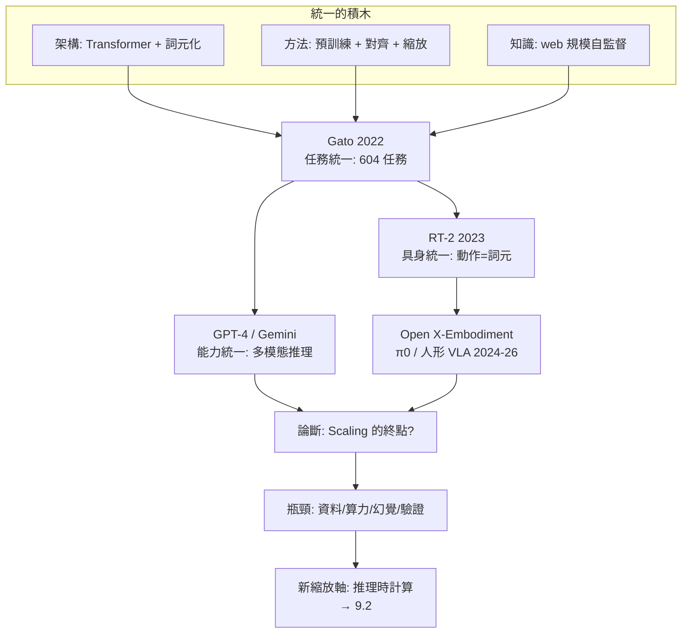

# 9.1 Gato、RT-2 與基礎模型大一統：Scaling 的終點？

## 一、歷史背景：從「一模型一任務」到「一模型一切」

回顧本書：語言模型（第 2-5 章）、生成模型（第 6-7 章）、世界模型（第 8 章）各自演化，但它們在 2022 年之後開始合流。合流的第一個明確信號來自 DeepMind 的 **Gato**（2022.5）：一個 1.2B 參數的 Transformer，同一組權重執行 **604 種任務**——打 Atari、給圖像寫字幕、對話、疊積木、控制真實機械臂。

Gato 的技術其實平平（多數任務只是「專家水準的 50%」），但它的主張是範式級的：**只要把一切輸入輸出都變成詞元序列，一個通用 Transformer 就能「同時」做所有事**。DeepMind 的標語——「與其造越來越大的專用模型，不如造一個可完成一切任務的通用智慧體（generalist agent）」——宣告了「基礎模型大一統（generalist / foundation model unification）」路線的正式成立。

本節沿大一統的三個層次展開：**任務統一（Gato）→ 具身統一（RT-2）→ 範式之問（Scaling 有終點嗎）**。

## 二、Gato：任務統一的宣言

### 2.1 詞元化一切

Gato 的方法論極簡：把 604 個任務的資料全部序列化成同一種格式：

$$
\text{文字} \to \text{BPE 詞元}；\quad \text{圖像} \to \text{patch 詞元}；\quad \text{離散動作} \to \text{整數詞元}；\quad \text{連續動作/力矩} \to \text{離散化詞元}
$$

模型就是標準 Transformer（編碼器-解碼器），訓練目標就是序列預測。沒有任務頭、沒有模態專屬架構。這與 7.1 節 Sora 的時空 patch、7.2 節的 any-to-any 完全同構——**「一切皆詞元」在 2022 年已經完成理論閉環，之後的歷史只是把它推到更大規模**。

### 2.2 規模悖論與批評

Gato 也暴露了當時的誠實結論：其 1.2B 模型在多數任務上遠弱於專用模型（論文自己寫道：加大規模應可縮小差距，但「在所有任務上同時超越專用模型」是開放問題）。批評者（如 Marcus）指出這是「雜燴式通用」：一個模型做很多事 ≠ 通用智慧，缺的是跨任務的**組合與遷移**。但大一統路線的回應很簡單：**差距是規模與資料問題，不是架構問題**——這正是 OpenAI 的立場，而 GPT-4 的多模態能力在一年後部分兌現了它。

## 三、RT-2：把機器人控制變成 VQA

### 3.1 動作即詞元

機器人是「大一統」最硬的試金石：語言與像素是離散符號，機器人動作是連續的力矩序列，且真實世界不可重置（沒法像模擬器那樣試錯百萬次）。Robotics Transformer 2（RT-2, 2023.7, DeepMind）給出教科書式的解法：

1. **基座**：從 web 規模視覺-語言模型（PaLI-X 55B、PaLM-E 12B）出發——繼承網路級的語言與視覺知識；
2. **動作詞元化**：把機器人動作（7 維連續量：位置、姿態、夾爪）離散化成 256 桶，表示成文字詞元。訓練資料是機器人示範（RT-1 資料集，13 萬次嘗試）轉成的「圖像 + 指令 + 動作詞元序列」；
3. **訓練**：共訓練（co-training）網路資料與機器人資料，輸出端動作就是「文字」。

$$
P(\text{動作} \mid \text{圖像}, \text{指令}) \equiv P(\text{下一組動作詞元} \mid \text{上下文詞元})
$$

### 3.2 為什麼這是範式跳躍

RT-2 的關鍵發現是**語義知識免費湧入機器人**：僅用機器人資料訓練時，模型無法執行「把恐龍玩具拿給泰迪熊」這種需要世界知識的指令；共訓練後，網路學到的物體、顏色、常識直接轉化為操作能力（「把要拿去垃圾桶的東西移到桌上」→ 模型自己推理出垃圾 = 揉皺的紙團）。**語言模型的推理能力成為機器人的規劃先驗**——具身智慧的瓶頸從「控制」轉移到「理解」，而理解恰好是 LLM 的強項。

### 3.3 具身路線的後續與瓶頸

RT-2 之後的路線圖：RT-X 與 Open X-Embodiment（2023-2024，跨 22 種機器人本體的資料聯盟——「機器人界的 ImageNet 時刻」）、π0（2024，流匹配輸出連續動作，處理高頻靈巧控制）、Helix/GR00T（2025，人形機器人 VLA）。瓶頸清晰可見：**資料**。文字有整個網際網路，機器人示範只有實驗室裡的小時級採集。於是三條補給線成形：模擬器（Isaac/Genesis）、遙操作眾包（影像示範）、以及——回到第 8 章——**用世界模型合成想象資料**。大一統的最後一塊拼圖（具身）與世界模型在此合流。

## 四、Scaling 的終點？——五道牆

大一統的信心來自縮放定律（4.1、4.2 節），但 2024-2026 年，「scaling 會不會到頭」成為核心爭論。牆有五道，高矮不一：

**（1）資料牆**：高品質文字語料即將耗盡（估計可用量 10-30T 詞元量級）；$D \approx 20N$ 的 Chinchilla 配比使資料先於算力枯竭。對策：合成資料（SFT 蒸餾、模型自造數學題）、多模態資料（影片遠未用盡）、資料重複的邊際收益管理（4.2 節）。

**（2）算力牆**：訓練前沿模型成本從 GPT-3 的千萬美元漲到數億乃至十億美元級；摩爾定律放緩，算力成為地緣政治資源（晶片管制）。對策：MoE 稀疏化、低精度（FP8/FP4）、推理優化。

**（3）預訓練收益牆**：2024-2025 年多方報告稱同量級投入下 GPT 級模型間的預訓練品質增益縮小（「預訓練 scaling 撞牆」之說）——但很快被「推理時縮放」（9.2 節）接棒：**收益沒有消失，而是遷移到新的縮放軸**。這一幕與 GAN 被擴散接棒（6.2 節）同構：**舊軸飽和 → 找到新軸 → 縮放故事續寫**。

**（4）能力牆**：幻覺（生成式建模的結構性副產品）、長程一致性、新知識更新（權重凍結的世界）、組合泛化的脆弱性。這些不是規模可簡單沖掉的——需要結構性方案（檢索、工具、驗證器、世界模型）。

**（5）驗證牆**：模型超過人類評估者後，訓練信號從哪來（5.2 節洗衣機問題）？可驗證領域（數學/代碼）先行突破（9.2 節），開放領域仍懸置。

## 五、本節重點

1. Gato 用「一切皆詞元」把 604 種任務（含機器人控制）塞進一個 Transformer，宣告 generalist 路線；其規模悖論（通用但不出色）被「規模能解決」的立場回應。
2. RT-2 把機器人動作離散化為詞元，接上 web 級 VLM 基座：語義知識免費湧入具身控制，具身瓶頸從控制轉移到理解；後續瓶頸是示範資料稀缺，補給線為模擬器、眾包示範與世界模型合成。
3. 大一統的三層積木：架構（Transformer+詞元）、方法（預訓練+對齊+縮放）、知識（web 自監督）——三者在 Gato/GPT-4/RT-2 分別完成任務、能力、具身的統一。
4. Scaling 的五道牆：資料、算力、預訓練收益、能力（幻覺等結構性缺陷）、驗證；歷史模式是「舊軸飽和→新軸接棒」，推理時計算是正在接棒的軸。
5. 「終點」的誠實回答：預訓練縮放這**特定軸**收益遞減；縮放作為**方法論**（找新軸並推到底）仍是 2026 年的主流信仰。

## 六、思考問題

1. 「一個模型做很多任務」與「通用智慧」之間還缺什麼？請用具體行為（跨任務遷移、組合新穎任務）刻畫差距。
2. RT-2 的動作離散化（256 桶）對高頻靈巧操作（穿針引線）夠用嗎？π0 的流匹配輸出解決了什麼、又引入了什麼？
3. 若五道牆按「最先到達」排序，你的排序是什麼？哪道牆最可能被純工程（而非新科學）解決？
4. 「舊軸飽和→新軸接棒」的模式若繼續成立，推理時縮放飽和後的下一軸會是什麼？給出你的候選與論證。
