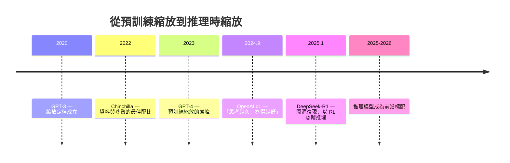
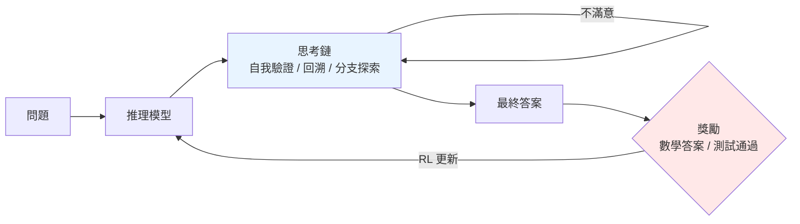

# 9.2 推理模型 o1/R1 與智慧模型的下一章（2024-2026）

## 一、歷史背景：預訓練 Scaling 撞牆之後

回顧 4.2 節的 Chinchilla 縮放定律：模型品質隨「參數 × 資料 × 算力」的冪律提升。但到 2024 年，這條路線遇到三重牆：

1. **資料牆**：高品質網路文字即將用盡——網路上可用的文字總量約為數十兆詞元，而訓練前沿模型已需要 10-15 兆詞元；
2. **算力牆**：單次前沿訓練成本逼近數億美元，摩爾定律放緩使成本曲線更陡；
3. **能力牆**：加大預訓練對「推理」類任務（數學、程式、規劃）的邊際增益遞減——模型「知道答案」卻「不會一步步想」。

$$
\text{預訓練 Scaling（2020-2024）} \Rightarrow \text{知識豐富但思考膚淺}
$$

Ilya Sutskever 在 2024 年 NeurIPS 的演講標題總結了這個轉折：**「預訓練時代將結束（Pre-training as we know it will end）」**。下一章的主角，是把算力從「訓練時」轉移到「推理時」——**測試時計算（test-time compute）**。

## 二、關鍵洞察：Chain-of-Thought 是可被強化的行為

### 2.1 從 CoT 提示到 CoT 強化

第 4 章已提過 2022 年的 Chain-of-Thought（CoT）提示：在 prompt 裡加一句「讓我們一步步思考」，推理正確率顯著上升。這揭露了一個關鍵事實——**模型內部已經「知道」如何推理，只是預訓練目標（預測下一詞元）沒有激勵它展開來想**。

2023-2024 年的推理模型把 CoT 從「提示技巧」升級為「訓練目標」：

$$
\text{舊範式：} \quad P(\text{答案} \mid \text{問題}) \quad\Rightarrow\quad \text{新範式：} \quad P(\text{答案} \mid \text{問題}, \underbrace{\text{思考過程}}_{\text{長度由模型自決}})
$$

模型先輸出一段長長的思考（thinking tokens），再給出答案。訓練時，**只有最終答案被評分，思考過程本身不被監督**——這正是強化學習（本系列《強化學習》第 8-9 章）登場之處：以可驗證獎勵（verifiable reward，如數學答案對錯、程式是否通過測試）訓練模型自己探索出有效的思考策略。

### 2.2 o1：推理時縮放定律的宣言

OpenAI 於 2024 年 9 月發布 o1，其論文展示了兩條新的縮放曲線：

1. **訓練時 RL 縮放**：RL 訓練算力 ↑ → 推理正確率 ↑（冪律）；
2. **測試時計算縮放**：讓模型思考更久（生成更長的思考鏈、或多路取樣後擇優）→ 正確率持續上升。

第二條曲線意義重大：它宣告「推理表現」不再被參數量鎖死，**推理時願意花多少算力，成為新的品質旋鈕**。在 AIME 數學競賽上，o1 從 GPT-4o 的約 13% 提升到 74%（搭配測試時取樣可達 83%+）；Codeforces 程式競賽達到 89 百分位——這是預訓練範式多年未曾出現的跳躍式進步。

## 三、DeepSeek-R1：開源的「啊哈時刻」（2025）

### 3.1 純 RL 路線與湧現的反思行為

2025 年 1 月，DeepSeek 發布 R1 系列，用相對輕量的純強化學習（GRPO，省去價值網路的群組相對優勢估計）直接在基座模型上訓練，獎勵只有兩項：**答案正確性**與**格式遵循**（把思考放進 `<think>` 標籤）。沒有過程監督、沒有人類示範。

結果震驚業界：模型**自發湧現**出反思（「等等，我剛才算錯了，重新來」）、回溯、自我驗證、在多種解法間切換等行為——論文稱之為「啊哈時刻（aha moment）」。這回答了一個深刻的理論問題：**推理行為不需要被教，只需要被獎勵**。這與本系列《強化學習》第 6 章 AlphaGo Zero 的教訓完全同構：去掉人類示範，讓獎勵信號自己塑造行為，反而得到更純粹、更強的能力。

### 3.2 蒸餾與推理模型民主化

R1 團隊同時展示：把 R1 生成的 80 萬條推理軌跡拿去微調小模型（1.5B-70B），小模型推理能力大幅躍升——**推理能力可以蒸餾**。這使推理模型在數月內成為全行業標配（Claude 的 extended thinking、Gemini 的 thinking mode 等），並直接推動了《Agent 技術》一書將討論的「Agentic RL」：把推理模型放進 Agent 迴圈，以任務成敗為獎勵繼續訓練。

## 四、對智慧模型版圖的衝擊

| 面向 | 預訓練時代（GPT-3 → GPT-4） | 推理模型時代（o1/R1 →） |
|---|---|---|
| 算力投向 | 訓練：一次巨型預訓練 | 訓練 + 推理：每個問題都可加算力 |
| 品質旋鈕 | 參數、資料量 | 思考長度、取樣數、RL 訓練量 |
| 能力成長方式 | 餵更多網路文字 | 練更多可驗證題目（數學、程式、科學） |
| 軟肋 | 幻覺、淺層推理 | 思考成本、無可驗證獎勵的領域（寫作、閒聊） |
| 與本書各章的關聯 | 第 3-4 章 | 串起第 5 章（對齊）+ 第 8 章（世界模型）+ 《強化學習》第 9 章 |

值得注意的張力：推理縮放對「**有標準答案**」的領域（數學、程式、邏輯）威力最強；對開放性、無客觀對錯的領域（創意寫作、價值判斷），獎勵從何而來仍是未解難題——這又把問題繞回第 5 章的對齊，以及第 8 章的世界模型（若模型內部有足夠好的世界模型，「思考」就可以在想象中驗證，而不需要外部答案鍵）。

## 五、本節重點

1. 預訓練縮放在 2024 年遭遇資料、算力、能力三重牆，範式重心轉向**測試時計算**；
2. o1 證明推理品質可隨「思考算力」冪律提升——推理時長成為新的品質旋鈕；
3. DeepSeek-R1 以純 RL + 可驗證獎勵湧現出反思與自我驗證，重演了 AlphaGo Zero 的「去人類示範」教訓；
4. 推理能力可蒸餾，使推理模型迅速普及並成為 Agent 與科學研究的基座；
5. 無客觀獎勵的領域是推理縮放的邊界，答案指向世界模型與對齊的下一步。

## 六、思考問題

1. 「測試時計算縮放」與「預訓練縮放」在經濟上有何不同？為何前者更適合「按需付費」的 API 商業模式？
2. 可驗證獎勵在數學與程式上容易取得，請舉兩個「難以構造可驗證獎勵」的重要領域，並討論可能的替代獎勵來源及其風險。
3. R1 的「啊哈時刻」是真正的湧現，還是基座模型既有行為被獎勵選擇放大？如何設計實驗區分兩者？
4. 若把第 8 章的世界模型當作推理模型的「內部模擬器」，思考過程可以在想象中展開——這與人類的「心理模擬」有何異同？
5. 推理模型在長思考中可能「想歪但答對」或「想對但答錯」。過程監督（PRM）與結果監督（ORM）該如何取捨？
