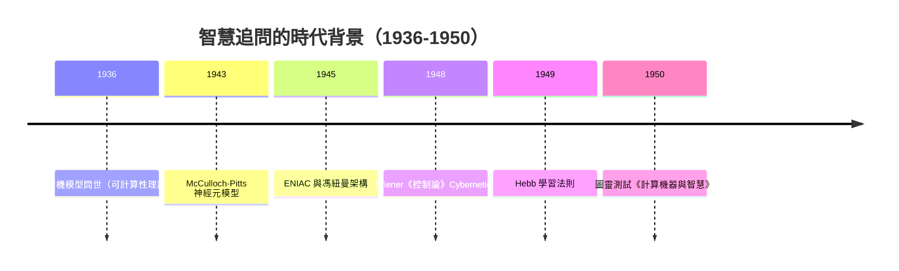
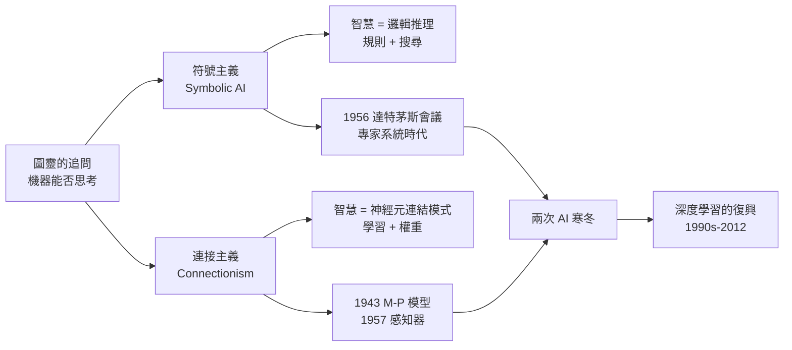
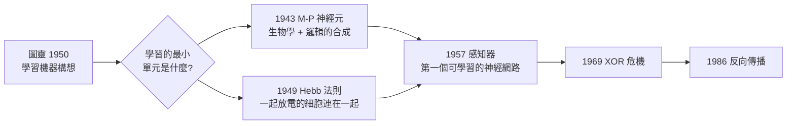

# 1.1 智慧、學習與圖靈的追問（1943-1950）

## 一、歷史背景：一個時代的提問

在人類歷史的大部分時間裡，「智慧」只屬於哲學與神學的範疇。古希臘人問「靈魂是什麼」，笛卡爾問「心靈與身體如何互動」，但沒有人真正把智慧當作一個可以被工程化的對象。直到二十世紀中葉，三股力量同時匯聚，才讓「機器能否思考」從哲學命題變成技術議題：

1. **數理邏輯的成熟**：Frege、Russell、Gödel 建立了形式化推理系統，證明「思考」的某些面向可以被符號規則刻畫。圖靈 1936 年的論文《論可計算數》提出圖靈機模型，定義了「什麼是可計算的」。
2. **電子計算機的誕生**：1945 年 ENIAC 啟動，1945 年馮紐曼提出儲存程式架構（von Neumann architecture）。人類第一次擁有了可以高速執行符號操作的通用機器。
3. **神經科學的量化突破**：電生理學的發展讓科學家得以測量神經元的電信號，神經系統開始被視為一個「可以研究的機器」。

這三股力量的交會點，正是本書的主題：**神經網路與深度學習**。



## 二、圖靈 1950：模仿遊戲與機器智慧的操作性定義

1950 年，Alan Turing 在哲學期刊 *Mind* 上發表《Computing Machinery and Intelligence》。這篇論文的偉大之處不在於給出答案，而在於**把一個無法回答的問題替換成一個可以操作的實驗**。

### 2.1 從「機器能思考嗎」到模仿遊戲

圖靈認為「機器能思考嗎」這個問題的詞語定義（thinking、machine）過於模糊，於是他提出**模仿遊戲（Imitation Game）**，後世稱為**圖靈測試（Turing Test）**：

- 一位人類詢問者透過文字終端與兩個看不見的對話者交流：一個是人類，一個是機器。
- 若詢問者無法可靠地分辨誰是機器，則該機器在行為意義上具備智慧。

這是一個徹底的**行為主義（behaviorist）定義**：不問機器「內部」有沒有心智，只問它的外在行為是否與人類不可區分。這種「用可測量的操作取代形上學爭論」的方法論，深深影響了後來整個 AI 領域——包括 2022 年以後關於大型語言模型「是否真的理解」的爭論，本質上仍是圖靈問題的現代版本。

### 2.2 圖靈對九大反駁的回應

圖靈在論文中預先列舉並回應了九種反對意見，其中與本書最相關的有：

| 反駁 | 內容 | 圖靈的回應與現代啟示 |
|------|------|---------------------|
| 神學反駁 | 思維是上帝賦予人類靈魂的 | 機器製造智慧不違背全能神的可能 |
| 「意識」反駁（Jefferson） | 機器不會「感受」，除非它真的思考 | 行為等價即可；主觀感受不可觀測 |
| 來自連續性的反駁 | 神經系統是類比的、連續的，數位機器無法模擬 | 離散機器可以在容許誤差下模擬連續系統——這正是後來**類神經網路用數位電腦模擬連續神經動力學**的理論許可 |
| 來自創造性的反駁 | 機器不可能有新想法 | 透過隨機性與學習，機器的行為不必完全由設計者預見 |

特別值得注意「連續性反駁」：當年批評者認為神經元的模擬與放電是連續過程，數位圖靈機無法忠實重現。圖靈指出，在允許一定誤差的前提下，數位機器足以模擬任何連續系統。這個論證在理論上為「用數位計算機實作神經網路」鋪路——**沒有這一步，本書之後的一切演算法都失去了實作的載體**。

### 2.3 圖靈對「學習機器」的遠見

圖靈測試只是論文的一半。論文結尾提出了更影響深遠的構想——**Child Machine（孩童機器）**：

> 「與其嘗試製造一個模擬成人心智的程式，不如製造一個模擬孩童心智的程式，然後讓它接受教育。」

圖靈明確提出：與其手工編寫全部規則，不如設計一個具有初始結構、能透過**教育（獎懲訊號）**改變自身的機器。他把可能的教育機制分成三類：

1. **每次執行隨機變異 + 選擇**（演化式方法，預示了演化計算）；
2. **組織性的變異**（透過學習規則改變連結，預示了 Hebbian 學習與權重更新）；
3. **獎懲系統**（預示了強化學習）。

用現代語言來說，圖靈在 1950 年就已經畫出了「**架構（初始結構）+ 學習演算法（更新規則）+ 資料/獎勵（教育訊號）**」這個深度學習三位一體的草圖。今日的深度學習，可以看作是這個構想在七十年間被逐步工程化的過程。

## 三、智慧的定義之爭：為何「學習」成為核心

### 3.1 符號主義與連接主義的分歧

圖靈的追問開啟了兩條不同的技術路線，這條分歧貫穿本書前六章：



- **符號主義**認為智慧的核心是符號運算與邏輯推理，學習只是次要的表現；代表是 Newell 與 Simon 的邏輯理論家、後來的專家系統。
- **連接主義（Connectionism）**認為智慧源自大量簡單單元的相互連結，智慧是「湧現」而非「編寫」的；代表是 McCulloch-Pitts 模型、感知器與後來的深度神經網路。

兩條路線的根本分歧在於**表示（representation）**：知識應該被明確寫成符號規則，還是隱含地分散儲存在連結強度中？深度學習的最終勝出，說明了「分散式表示 + 從資料中學習」在感知類任務上的壓倒性優勢。

### 3.2 為什麼「學習」比「規則」更接近智慧

從工程角度看，符號系統在 1950-1980 年代取得了早期成功（定理證明、專家系統），卻遭遇了無法逾越的天花板，這個天花板正是深度學習的機會：

1. **知識獲取瓶頸（Knowledge Acquisition Bottleneck）**：把人類常識一條條寫成規則，成本無窮大。費根鮑姆的 CYC 專案花費數百人年仍遠未完成。
2. **常識的不可枚舉性**：「水是濕的」「走路會踩到影子之外的地面」——這類知識沒有明確邊界，難以規則化。
3. **感知任務的不可規則化**：讓人寫出「從一百萬個像素判斷這是一隻貓」的規則，幾乎不可能。視覺、語音這類「對人類容易、對機器困難」的任務（Moravec 悖論），恰恰是統計學習的舞台。

結論：**當任務無法被顯式規則化時，唯一的出路是讓機器從資料中自己學出規則**——這就是機器學習，而神經網路是其中最通用的一種函數表示。

## 四、學習的數學雛形：從圖靈到學習系統

### 4.1 把學習形式化的困難

圖靈提出了「孩童機器」，但沒有給出可計算的學習規則。要讓學習可行，需要回答三個問題：

1. **表示問題**：機器的知識狀態用什麼數學結構表示？（符號邏輯式？參數向量？）
2. **更新問題**：根據經驗，表示該如何改變？（學習規則是什麼？）
3. **收斂問題**：更新過程會不會收斂到「正確」的狀態？（有沒有理論保證？）

神經網路路線的答案分別是：**參數化的加權和結構、基於誤差的權重更新、以及後來的感知器收斂定理與梯度下降理論**。本書第 2、3、4 章將依序解決這三個問題。

### 4.2 一個最小的「學習系統」形式化

考慮最簡單的設定：給定資料 $\{(x_i, y_i)\}_{i=1}^{N}$，機器的假設是一族參數化函數 $f(x; \theta)$，其中 $\theta$ 是可學習參數。學習的目標是找到 $\theta$ 使經驗風險最小：

$$
\theta^* = \arg\min_{\theta} \; \frac{1}{N}\sum_{i=1}^{N} \ell\big(f(x_i;\theta),\, y_i\big)
$$

其中 $\ell(\cdot,\cdot)$ 是損失函數。這個框架的深意在於：

- **智慧被還原為最佳化**：「變聰明」等價於「在損失曲面上找到低點」。
- **知識被還原為參數**：機器「知道」的一切，就是 $\theta$ 中的數值。
- **經驗被還原為梯度**：資料對機器的影響，最終濃縮為損失對參數的偏導數 $\nabla_\theta \ell$。

1950 年代沒有人能預見這個框架會統治整個領域，但它的一切要素——參數化模型、損失函數、迭代更新——都在圖靈的「學習機器」構想中有其哲學原型。

### 4.3 用現代程式碼模擬「圖靈的追問」

下面用 PyTorch 寫一個 30 行的「孩童機器」：一個具有隨機初始結構的線性學習器，透過監督訊號（教育）學會一個簡單映射。這個例子刻意簡單，目的是讓讀者看到**「架構 + 損失 + 更新」三要素如何對應圖靈的構想**。

```python
import torch
import torch.nn as nn

# 1. 初始結構（孩童機器的「天賦」）：一個可學習的線性映射
torch.manual_seed(0)
model = nn.Linear(in_features=2, out_features=1)

# 2. 教育素材：老師提供的少數樣本（模擬有限的監督）
X = torch.tensor([[0.0, 0.0],
                  [0.0, 1.0],
                  [1.0, 0.0],
                  [1.0, 1.0]])
y = torch.tensor([[0.0], [1.0], [1.0], [1.0]])  # 目標: 邏輯 OR

# 3. 學習規則：最小化誤差（梯度下降）
loss_fn = nn.MSELoss()
optimizer = torch.optim.SGD(model.parameters(), lr=0.1)

for epoch in range(200):
    pred = model(X)
    loss = loss_fn(pred, y)
    optimizer.zero_grad()
    loss.backward()      # 經驗化為梯度
    optimizer.step()     # 梯度化為成長
    if epoch % 50 == 0:
        print(f"epoch {epoch:3d}  loss = {loss.item():.4f}")

# 4. 檢驗學習成果：機器是否「懂」了 OR 的概念？
with torch.no_grad():
    print(model(X).round().flatten().tolist())  # 預期 [0, 1, 1, 1]
    print("學到的權重:", model.weight.data.tolist())
```

輸出顯示 loss 逐步下降、預測逐步正確。這個微小的例子濃縮了整個領域的範式：**我們不寫「OR 的定義」，我們讓機器從例子中調整參數直到行為符合期望**。把這個範式從 2 維推廣到 1750 億參數、從 OR 推廣到人類語言，就是現代深度學習。

## 五、圖靈之後：定下問題、留下伏筆

圖靈 1950 年的論文沒有給出任何可執行的演算法，但它完成了三件關鍵的事：

1. **問題的操作化**：把「機器能否思考」轉化為可檢驗的行為標準，使 AI 成為科學而非玄學。
2. **理論許可**：回應連續性反駁，為「用數位機器模擬神經系統」開綠燈。
3. **路線指引**：孩童機器與獎懲學習，明確指向「學習」而非「編程」作為達成智慧的手段。

然而圖靈沒有回答：**學習的最小單元是什麼？** 要把「學習機器」落到實作，必須先有一個可以被數學化、被模擬的「神經元」。這正是下一節的主題——1943 年 McCulloch 與 Pitts 的 M-P 神經元模型：它比圖靈測試早了七年，卻是整個神經網路譜系真正的起點。



## 六、本節重點

- 1936-1950 年間，數理邏輯、電子計算機、神經科學三股力量匯聚，使「機器智慧」從哲學問題變成工程問題。
- 圖靈 1950 年以**模仿遊戲（圖靈測試）**將智慧操作化為可檢驗的行為標準，並以連續性論證為數位機器模擬神經系統提供理論許可。
- 圖靈的**孩童機器**構想預示了「架構 + 學習規則 + 教育訊號」的深度學習範式，以及演化、Hebbian、獎懲三種學習路線。
- 符號主義與連接主義的根本分歧在於知識的表示方式：顯式規則 vs. 分散式權重；知識獲取瓶頸與感知任務的不可規則化，最終使「從資料學習」成為主流。
- 學習可形式化為經驗風險最小化：智慧被還原為最佳化，知識被還原為參數，經驗被還原為梯度。
- 圖靈留下了未解的問題：學習的最小單元是什麼？——由 M-P 神經元模型接棒。

## 七、思考問題

1. 圖靈測試是行為主義的定義。你認為一個通過圖靈測試的現代大型語言模型「理解」它說的話嗎？行為等價與內在理解之間有什麼區別？
2. 圖靈提出的「孩童機器」三種教育方式（隨機變異+選擇、組織性變異、獎懲），分別對應現代哪些機器學習分支？請各舉一例。
3. 若符號規則方法可以解決所有任務，學習還有必要嗎？請說明「知識獲取瓶頸」為何在本質上難以用人力克服。
4. 經驗風險最小化公式中，若訓練資料 $N$ 很小，直接最小化經驗風險會發生什麼？這如何引出第 4 章的正則化議題？
5. 圖靈回應「連續性反駁」的論證，對今天的類比計算硬體（如神經形態晶片）研究有什麼啟示？
