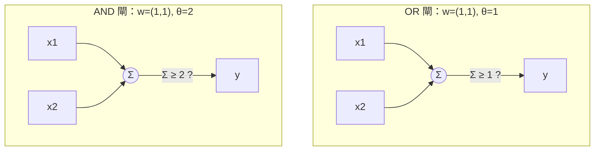
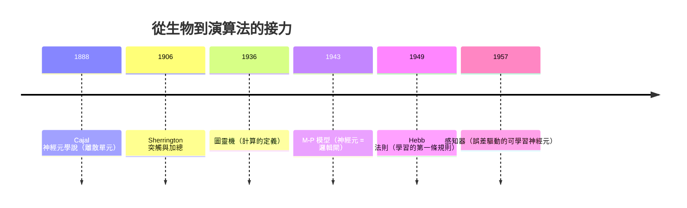

# 1.2 人工神經元的生物學原型與 M-P 模型（1943）

## 一、歷史背景：當神經外科醫生遇上邏輯學家

1943 年，神經生理學家 Warren McCulloch 與年僅 18 歲的邏輯學天才 Walter Pitts 在《Bulletin of Mathematical Biophysics》發表《A Logical Calculus of the Ideas Immanent in Nervous Activity》。這篇論文完成了一件石破天驚的事：**用命題邏輯描述神經網路的計算**，證明由神經元組成的網路原則上可以計算任何圖靈機可計算的函數。

這篇論文誕生的背景是：

- **Cajal 的神經元學說（1888-1906）**：Santiago Ramón y Cajal 用染色法確立了神經系統由離散的神經元構成，神經元之間在突觸處以特定方向傳遞訊號——這是「神經元可以作為獨立計算單元」的解剖學基礎。
- **Sherrington 的突觸理論（1906）**：Charles Sherrington 提出突觸有興奮性與抑制性之分，且存在「加總」現象——多個微弱輸入可以累積觸發動作電位。
- **圖靈機（1936）**：提供了「計算」的嚴格定義，使人們能問「神經系統能計算什麼」。
- **二戰期間的計算需求**：控制論（Cybernetics，Wiener 1948）運動正把生物體與機器視為同構的訊息處理系統。

McCulloch 的目標是回答一個哲學-科學混合的問題：**大腦這團「濕軟的物質」，憑什麼能進行邏輯思考？** 他的答案是：只要神經元的行為可以被簡化為二值的「全有全無」事件，神經網路就是一台邏輯機器。

## 二、生物學原型：神經元到底在做什麼

在建立數學模型之前，必須理解被建模的對象。生物神經元的結構與功能如下：


關鍵的生理事實，每一条都對應了 M-P 模型的一個數學假設：

| 生物事實 | M-P 模型的數學對應 |
|----------|-------------------|
| 動作電位是「全有全無」（all-or-none）的二值事件 | 神經元輸出 $y \in \{0, 1\}$ |
| 突觸有興奮性（促進放電）與抑制性（阻止放電） | 輸入有正權重與負權重（甚至硬抑制） |
| 細胞體對大量突觸輸入做**空間加總** | 對輸入求加權和 |
| 存在放電**閾值**（threshold，約 -55 mV） | 閾值函數 $\theta$，超過才輸出 1 |
| 軸突有傳導延遲、不應期 | 離散時間步的同步更新 |

值得注意的是模型的**極簡主義**：McCulloch 與 Pitts 刻意拋棄了學習、連續動力學、時間整合等所有複雜性，只保留「加權求和 + 閾值 + 二值輸出」這個骨架。這種抽象正是它成功的關鍵——**捨棄生物寫實性，換取可計算性**。這一取捨的原則（在生物合理性和數學可解性之間取捨）貫穿了之後八十年的神經網路史。

## 三、M-P 神經元的數學模型

### 3.1 單一神經元的數學定義

M-P 神經元接收 $n$ 個二值輸入 $x_1, \dots, x_n \in \{0, 1\}$，其計算規則為：

$$
y = \begin{cases} 1, & \displaystyle\sum_{i=1}^{n} w_i x_i \geq \theta \\[2mm] 0, & \displaystyle\sum_{i=1}^{n} w_i x_i < \theta \end{cases}
$$

其中：

- $w_i$ 是突觸權重：$w_i > 0$ 表興奮性突觸，$w_i < 0$ 表抑制性突觸；
- $\theta$ 是放電閾值；
- 輸出 $y \in \{0,1\}$ 代表「是否放電」。

用更現代的寫法，可以把 $-\theta$ 視為偏置 $b = -\theta$，把階躍函數記為 $H(\cdot)$：

$$
y = H\Big(\sum_{i=1}^{n} w_i x_i + b\Big), \qquad H(z) = \mathbb{1}[z \geq 0]
$$

這個形式讀者會在感知器（第 2 章）、多層感知器（第 3 章）中反覆看到——**M-P 模型就是一切人工神經元的直系祖先**，後來的所有改進（Sigmoid、ReLU、可學習權重、反向傳播）都是在此骨架上逐步放寬限制。

### 3.2 M-P 神經元可以計算基本邏輯閘

McCulloch 與 Pitts 的核心洞見：適當選擇權重與閾值，單一 M-P 神經元可實作任意布爾函數（以兩輸入為例）：

| 邏輯閘 | 權重 $(w_1, w_2)$ | 閾值 $\theta$ | 驗證 |
|--------|------------------|--------------|------|
| AND | $(1, 1)$ | $2$ | 僅 $(1,1)$ 時和為 $2 \geq 2$ |
| OR | $(1, 1)$ | $1$ | 任一輸入為 1 即放電 |
| NOT | $(-1)$ | $0$ | 輸入 0 時和為 $0 \geq 0$，輸入 1 時和為 $-1 < 0$ |
| NAND | $(-1, -1)$ | $-1$ | 和 $\geq -1$ 僅當非兩者皆 1 |

由於 {NAND} 是邏輯完備的（任何布爾函數都可由 NAND 組合而成），**多層 M-P 神經元網路可以計算任意有限布爾函數**。這就是 McCulloch-Pitts 的「邏輯演算」：大腦若由這樣的單元構成，它就是一台邏輯機器。



### 3.3 網路層次：可以表達任意布爾電路

將 M-P 神經元逐層連接（前一層的輸出作為後一層的輸入），可以合成更複雜的函數。例如 XOR 需要**兩層**：

$$
\text{XOR}(x_1, x_2) = \text{AND}\big(\text{OR}(x_1, x_2),\; \text{NAND}(x_1, x_2)\big)
$$

第一層兩個神經元分別計算 OR 與 NAND，第二層對它們做 AND。這個例子埋下了整個領域最重要的伏筆：**XOR 不是線性可分的，單層做不到，多層才行**——十七年後（1969）正是這個事實引發了第一次 AI 寒冬（見 2.2 節）。M-P 論文其實已給出多層解法，但「如何**自動學出**這些權重」的問題，要到 1986 年反向傳播才真正解決。

## 四、程式碼實作：從閘電路到極簡網路

### 4.1 純 Python 實作 M-P 神經元與邏輯閘

```python
import numpy as np

class MPNeuron:
    """McCulloch-Pitts 神經元：加權和 + 閾值，權重為人工設定（不可學習）"""
    def __init__(self, weights, threshold):
        self.w = np.array(weights, dtype=float)
        self.theta = threshold

    def __call__(self, x):
        return 1 if np.dot(self.w, x) >= self.theta else 0

# 以權重與閾值「手工設計」四種邏輯閘
AND  = MPNeuron([ 1,  1], 2)
OR   = MPNeuron([ 1,  1], 1)
NAND = MPNeuron([-1, -1], -1)
NOT  = MPNeuron([-1],     0)

inputs = [(0,0), (0,1), (1,0), (1,1)]
for gate, name in [(AND, "AND"), (OR, "OR"), (NAND, "NAND")]:
    print(name, [gate(x) for x in inputs])
# AND  [0, 0, 0, 1]
# OR   [0, 1, 1, 1]
# NAND [1, 1, 1, 0]

# XOR：單一 M-P 神經元無法實作（請讀者嘗試所有 w, θ 組合驗證）
# 但兩層網路可以：
XOR = lambda x1, x2: AND((OR((x1, x2)), NAND((x1, x2))))
print("XOR", [XOR(a, b) for a, b in inputs])   # [0, 1, 1, 0]
```

### 4.2 指出模型的致命限制：權重不能學習

M-P 模型的權重與閾值是**人工設計**的。上面的程式碼裡，是我們「告訴」機器 AND 的定義，而不是它自己學的。要成為真正的學習系統，必須回答：**給定樣本，權重能否自動調整？** 這個問題的第一個回答，就是 1949 年的 Hebb 法則與 1957 年的感知器。

### 4.3 用 PyTorch 重新檢視：可學習版本的前夜

```python
import torch
import torch.nn as nn

# 同一個數學結構，但權重改為可學習參數（先預告第 3 章的形式）
inputs  = torch.tensor([[0.,0.],[0.,1.],[1.,0.],[1.,1.]])
targets = torch.tensor([[0.],[1.],[1.],[1.]])     # OR

neuron = nn.Linear(2, 1)                          # y = w·x + b
loss_fn = nn.MSELoss()
opt = torch.optim.SGD(neuron.parameters(), lr=0.1)

for epoch in range(100):
    loss = loss_fn(neuron(inputs), targets)
    opt.zero_grad(); loss.backward(); opt.step()

print("學到的 w, b =", neuron.weight.data, neuron.bias.data)
print("預測 =", neuron(inputs).round().flatten().tolist())
# 同樣的 M-P 數學，只是把「人設權重」換成「誤差驅動的權重更新」
```

## 五、M-P 模型的歷史地位與局限

### 5.1 它證明了什麼

1. **神經活動可以被形式邏輯刻畫**：全有全無的放電行為足以支撐命題邏輯運算。
2. **神經網路具備圖靈完備的潛力**：結合圖靈機的無限帶模型，M-P 網路（加記憶）可計算任何可計算函數——大腦沒有原理上的計算障礙。
3. **開創了「以簡御繁」的建模傳統**：抽象掉生物細節、保留計算本質。今天的深度網路（ReLU 單元就是廣義 M-P 神經元）仍遵循這一傳統。

### 5.2 它沒有解決什麼（引出後續歷史）

| 未解問題 | 後續發展 |
|----------|----------|
| 權重如何**自動設定**（學習） | Hebb 法則（1949）→ 感知器（1957） |
| 抑制的處理過於簡化（硬抑制不可微） | 可微激活函數（Sigmoid，1960s-1986） |
| 二值輸出無法表達「程度」與機率 | 連續輸出與機率詮釋 |
| XOR 需要多層，但多層網路無訓練演算法 | 反向傳播（1986） |

### 5.3 Hebb 法則：學習的第一次定義（1949）

Donald Hebb 在《The Organization of Behavior》提出著名的學習假說：

> 「當細胞 A 的軸突足夠接近並反覆參與激發細胞 B，某種成長代謝會發生，使 A 激發 B 的效率提高。」

通俗版即「一起放電的細胞連在一起（cells that fire together, wire together）」。其數學雛形為：

$$
\Delta w_{ij} = \eta \, x_i \, y_j
$$

即權重增量正比於前後神經元的**共同活動**。Hebb 法則第一次把「學習」從哲學概念變成**可寫進程式碼的局部更新規則**，是無監督學習與自組織網路（如 Hopfield 網路、自組織映射）的理論源頭。但它沒有「誤差」的概念——只能增強關聯，不能糾正錯誤。**誤差驅動的學習**要等感知器登場（第 2 章）。



## 六、本節重點

- M-P 模型（1943）基於三個生物學簡化：二值全有全無輸出、突觸的正負加權、閾值觸發，將神經元抽象為「加權和 + 階躍函數」。
- 適當設定權重與閾值，單一 M-P 神經元可實作 AND、OR、NOT、NAND 等邏輯閘；多層組合可表達任意布爾函數（XOR 需兩層）。
- M-P 模型在理論上證明了神經網路的**計算通用性**，為「大腦即計算機」的現代神經科學與 AI 觀點奠基。
- 模型的核心局限：權重**不可學習**、階躍函數**不可微**、二值輸出**無程度概念**——這些限制決定了之後三十年的技術演進方向。
- Hebb 法則（1949）首次將學習形式化為局部權重更新規則，但缺乏誤差信號，無法做監督式糾錯。
- 「表示（M-P 結構）已備、學習未至」——感知器將接下這一棒。

## 七、思考問題

1. M-P 模型捨棄了神經元的連續動力學、時間整合與適應性。請說明哪些真實神經行為無法用它表達？這種簡化是缺陷還是特徵？
2. 請證明：不存在單一 M-P 神經元（即單一超平面）可以實作 XOR。提示：列出四個點在平面上的幾何分布。
3. Hebb 法則 $\Delta w_{ij} = \eta x_i y_j$ 只會使權重增強，長期運行會發生什麼？現代哪些機制（如 Oja 規則、突觸穩態）解決了這個不穩定問題？
4. M-P 論文已用兩層網路實作 XOR，為何 1969 年 Minsky-Papert 的批評仍具殺傷力？（提示：問題不在「能不能表示」，而在「能不能學到」。）
5. 現代深度學習的 ReLU 單元與 M-P 神經元有何異同？請比較兩者的輸出空間與可微性。
